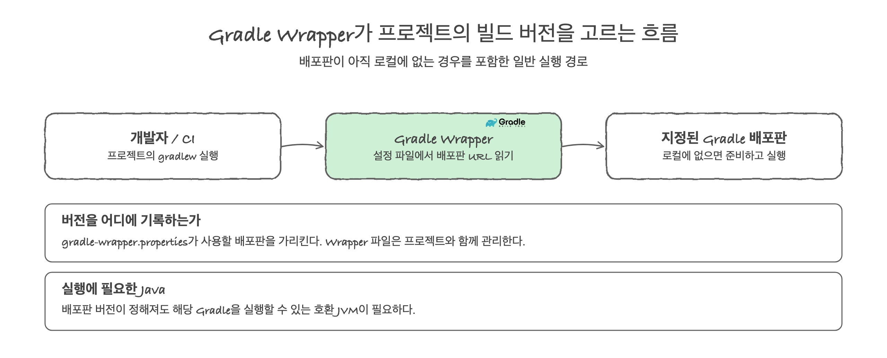

# Gradle과 Wrapper의 역할

## 1. 프로젝트에 반복 가능한 빌드 절차를 만들기

Gradle은 소스 컴파일, 테스트, 패키징, 산출물 게시 같은 일을 자동화하는 빌드 도구다. 빌드 스크립트에서 플러그인과 설정을 선언하면 플러그인이 언어나 배포 방식에 맞는 Task를 추가한다. 예를 들어 Java 플러그인은 컴파일·테스트·JAR 생성 작업을 제공하고, 소스와 의존성, 빌드 옵션에 맞춰 실행한다. [Gradle · Gradle Core Concepts](https://docs.gradle.org/current/userguide/gradle_basics.html) · [Gradle · Java Plugin](https://docs.gradle.org/current/userguide/java_plugin.html)

Groovy DSL의 `build.gradle`과 Kotlin DSL의 `build.gradle.kts`는 같은 Gradle 빌드 모델을 설정한다. 이 문서의 예시는 Groovy DSL과 Gradle 9.9.2를 기준으로 한다. 설정 파일의 이름과 내용, 사용하는 플러그인과 Java 호환성은 프로젝트의 Wrapper 버전에 맞춰 확인한다. [Gradle · Writing Build Scripts](https://docs.gradle.org/current/userguide/writing_build_scripts.html) · [Gradle 9.9.2 Release Notes](https://docs.gradle.org/9.9.2/release-notes.html) · [Gradle · Compatibility Matrix](https://docs.gradle.org/current/userguide/compatibility.html)

## 2. 같은 Gradle 버전으로 실행하기

Wrapper의 `gradlew`, `gradlew.bat`, `gradle/wrapper/gradle-wrapper.jar`, `gradle/wrapper/gradle-wrapper.properties`는 프로젝트에 함께 저장한다. Wrapper가 지정된 배포판을 준비해 실행하므로 기존 프로젝트에서는 시스템의 `gradle` 대신 프로젝트의 `./gradlew` 또는 Windows의 `gradlew.bat`를 사용한다. 배포판 다운로드가 필요한 환경에서는 저장소 접근이 가능해야 하며, 무결성 확인이 필요하면 `distributionSha256Sum`을 설정한다. [Gradle · Gradle Wrapper](https://docs.gradle.org/current/userguide/gradle_wrapper.html)

```sh
./gradlew --version
./gradlew tasks
```



개발 환경과 CI가 빌드에 사용할 Gradle 버전을 같은 설정에서 선택한다. [Gradle · Gradle Wrapper](https://docs.gradle.org/current/userguide/gradle_wrapper.html) · [Gradle · Compatibility Matrix](https://docs.gradle.org/current/userguide/compatibility.html)

## 3. Gradle 실행 JDK와 프로젝트 Java 버전 구분하기

Gradle을 실행하는 JVM은 Wrapper 버전의 호환 범위를 충족해야 한다. Java toolchain은 컴파일이나 테스트처럼 JVM 도구를 사용하는 Task의 Java 버전을 프로젝트에서 정하는 데 쓴다. 예를 들어 Gradle은 Java 17에서 실행하면서 프로젝트의 컴파일러와 테스트 런타임은 다른 호환 JDK를 쓰도록 설정할 수 있다. `./gradlew --version`의 JVM 정보와 빌드 스크립트의 toolchain 선언을 각각 확인한다. [Gradle · Compatibility Matrix](https://docs.gradle.org/current/userguide/compatibility.html) · [Gradle · Toolchains for JVM Projects](https://docs.gradle.org/current/userguide/toolchains.html)
