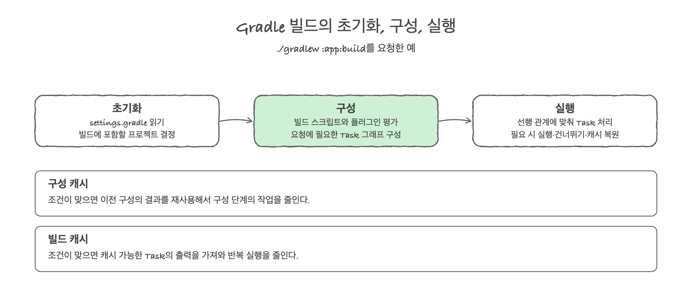

# 첫 Gradle 프로젝트, 의존성, 빌드 단계와 Daemon

## 1. 빈 디렉터리에서 Java 프로젝트 만들기

처음 만드는 프로젝트에서는 설치된 Gradle로 `gradle init`을 실행해 시작 구조와 Wrapper를 생성한다. 대화형으로 만들면 프로젝트 유형, DSL, Java 버전, 테스트 프레임워크를 선택할 수 있다. 다음 명령은 Gradle 9.9.2에서 Java 17과 Groovy DSL을 사용하는 애플리케이션 한 개를 만드는 예다. [Gradle · Build Init Plugin](https://docs.gradle.org/current/userguide/build_init_plugin.html) · [Gradle · Gradle Wrapper](https://docs.gradle.org/current/userguide/gradle_wrapper.html) · [Gradle · Toolchains for JVM Projects](https://docs.gradle.org/current/userguide/toolchains.html)

```sh
gradle init --type java-application --dsl groovy --test-framework junit-jupiter \
  --java-version 17 --project-name hello-gradle --package example.app \
  --no-split-project --use-defaults

./gradlew projects
./gradlew :app:run
./gradlew :app:build
```

이 구성은 루트의 `settings.gradle`에서 `app` 프로젝트를 포함하고, `app/build.gradle`에 플러그인과 의존성을 둔다. 앱 소스는 `app/src/main/java`, 테스트는 `app/src/test/java`에 둔다. `:app:run`은 엔트리포인트를 실행하고, `:app:build`는 검증과 산출물 작업을 묶는다. 애플리케이션의 JAR은 `app/build/libs/`에서 확인할 수 있다. [Gradle · Build Init Plugin](https://docs.gradle.org/current/userguide/build_init_plugin.html) · [Gradle · Java Plugin](https://docs.gradle.org/current/userguide/java_plugin.html) · [Gradle · Application Plugin](https://docs.gradle.org/current/userguide/application_plugin.html)

## 2. 외부 라이브러리를 추가하고 실제 버전 확인하기

의존성 저장소와 라이브러리는 빌드 모델에 선언한다. 아래는 저장소를 프로젝트 단위로 선언하는 빌드의 예다. 기존 프로젝트가 `settings.gradle`의 `dependencyResolutionManagement`에서 저장소를 관리하면 그 설정을 사용한다. `implementation`에 추가한 라이브러리는 해당 프로젝트의 컴파일과 실행에 쓰이며, 라이브러리의 메타데이터에 따라 필요한 전이 의존성도 함께 해석될 수 있다. [Gradle · Declaring Dependencies](https://docs.gradle.org/current/userguide/declaring_dependencies.html) · [Gradle · Declaring Repositories Basics](https://docs.gradle.org/current/userguide/declaring_repositories_basics.html) · [Gradle · Java Plugin](https://docs.gradle.org/current/userguide/java_plugin.html)

```groovy
repositories {
    mavenCentral()
}

dependencies {
    implementation 'org.apache.commons:commons-lang3:3.20.0'
}
```

요청한 버전과 실제 선택 버전이 궁금하면 `dependencies`로 해당 구성의 그래프를 보고, `dependencyInsight`로 특정 모듈의 선택 이유를 확인한다. 컴파일 실패와 런타임 로딩 실패는 각각 `compileClasspath`와 `runtimeClasspath`를 살펴볼 수 있다. [Gradle · Viewing Dependencies](https://docs.gradle.org/current/userguide/viewing_debugging_dependencies.html) · [Gradle · Java Plugin](https://docs.gradle.org/current/userguide/java_plugin.html)

```sh
./gradlew :app:dependencies --configuration runtimeClasspath
./gradlew :app:dependencyInsight --dependency commons-lang3 --configuration runtimeClasspath
```

## 3. 초기화, 구성, 실행에서 일어나는 일

1. 초기화(Initialization)에서는 설정을 읽어 빌드에 어떤 프로젝트가 포함되는지 판단한다. [Gradle · Build Lifecycle](https://docs.gradle.org/current/userguide/build_lifecycle.html) · [Gradle · Multi-Project Builds](https://docs.gradle.org/current/userguide/multi_project_builds.html)
2. 구성(Configuration)에서는 빌드 스크립트와 플러그인이 프로젝트 모델을 구성하고 요청에 필요한 Task 그래프를 만든다. 지연 등록한 Task는 필요할 때 구성할 수 있다. [Gradle · Build Lifecycle](https://docs.gradle.org/current/userguide/build_lifecycle.html) · [Gradle · Avoiding Unnecessary Task Configuration](https://docs.gradle.org/current/userguide/task_configuration_avoidance.html)
3. 실행(Execution)에서는 그래프가 정한 의존 순서에 맞춰 필요한 Task를 처리한다. 입력과 출력이 바뀌지 않아 `UP-TO-DATE`가 되거나 빌드 캐시에서 출력을 복원할 수도 있다. [Gradle · Build Lifecycle](https://docs.gradle.org/current/userguide/build_lifecycle.html) · [Gradle · Incremental Build](https://docs.gradle.org/current/userguide/incremental_build.html) · [Gradle · Build Cache](https://docs.gradle.org/current/userguide/build_cache.html)



빌드 단계별로 읽는 입력과 재사용할 수 있는 결과를 표시했다. [Gradle · Build Lifecycle](https://docs.gradle.org/current/userguide/build_lifecycle.html) · [Gradle · Avoiding Unnecessary Task Configuration](https://docs.gradle.org/current/userguide/task_configuration_avoidance.html) · [Gradle · Build Cache](https://docs.gradle.org/current/userguide/build_cache.html) · [Gradle · Configuration Cache](https://docs.gradle.org/current/userguide/configuration_cache.html)

## 4. Daemon, 구성 캐시, 빌드 캐시의 역할

Daemon은 빌드를 실행하는 장기 실행 JVM이다. Gradle 클라이언트는 조건이 맞는 Daemon을 재사용한다. Gradle 버전, Java 홈과 JVM 인자가 달라지면 기존 Daemon과 호환되지 않을 수 있다. `--status`로 상태를 확인하고, 프로세스를 정리하려면 해당 Wrapper 버전으로 `--stop`을 실행한다. [Gradle · Gradle Daemon](https://docs.gradle.org/current/userguide/gradle_daemon.html)

Daemon 재사용은 JVM과 실행 환경의 기동 비용을 줄인다. 구성 캐시는 다음 실행에 필요한 구성 결과를, 빌드 캐시는 캐시 가능한 Task의 출력을 재사용한다. 어느 비용이 큰지에 따라 구성 시간, Task 실행 시간, 캐시 적중 여부를 따로 관찰한다. [Gradle · Gradle Daemon](https://docs.gradle.org/current/userguide/gradle_daemon.html) · [Gradle · Configuration Cache](https://docs.gradle.org/current/userguide/configuration_cache.html) · [Gradle · Build Cache](https://docs.gradle.org/current/userguide/build_cache.html)
