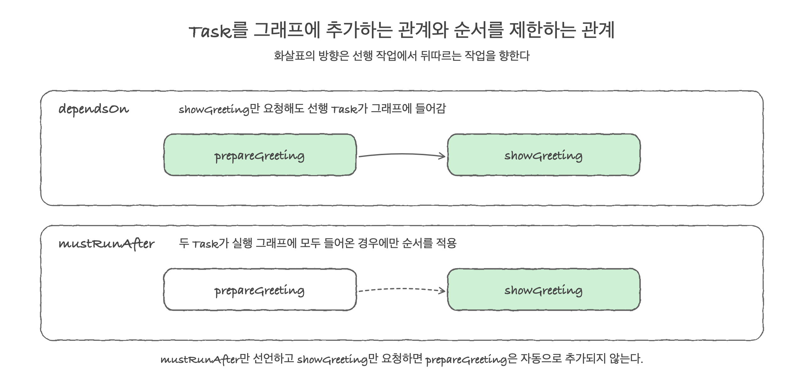

# Gradle의 Project와 Task 모델

## 1. Project는 빌드 설정의 단위다

Gradle은 각 프로젝트를 `Project` 객체로 표현한다. 루트 프로젝트와 서브프로젝트는 각자의 경로와 빌드 스크립트를 갖고 플러그인, 의존성, Task를 구성한다. `settings.gradle`은 프로젝트들을 포함하는 빌드 구조를 선언하며, 프로젝트 빌드 스크립트는 해당 `Project`의 모델을 설정한다. `:app:test`는 `:app` 프로젝트의 `test`를 가리키는 전체 경로다. [Gradle · Writing Build Scripts](https://docs.gradle.org/current/userguide/writing_build_scripts.html) · [Gradle · Multi-Project Builds](https://docs.gradle.org/current/userguide/multi_project_builds.html) · [Gradle DSL · Project](https://docs.gradle.org/current/dsl/org.gradle.api.Project.html)

## 2. Task는 실행할 작업과 선행 조건을 표현한다

Task는 컴파일이나 파일 복사처럼 실행할 작업 단위다. `dependsOn`은 선행 Task를 그래프에 포함한다. `mustRunAfter`는 두 Task가 모두 그래프에 들어왔을 때 순서를 정한다. 파일을 생성하는 Task의 출력을 다른 Task 입력에 연결할 때는 출력의 Provider를 연결해 Gradle이 선행 관계를 추론할 수 있게 한다. [Gradle · Writing Tasks](https://docs.gradle.org/current/userguide/writing_tasks.html) · [Gradle · Controlling Task Execution](https://docs.gradle.org/current/userguide/controlling_task_execution.html) · [Gradle · Incremental Build](https://docs.gradle.org/current/userguide/incremental_build.html)

아래 예에서 `showGreeting`을 요청하면 `prepareGreeting`이 먼저 실행된다. 두 `doLast`의 출력은 Task 실행 시점에 발생한다. [Gradle · Writing Tasks](https://docs.gradle.org/current/userguide/writing_tasks.html) · [Gradle · Controlling Task Execution](https://docs.gradle.org/current/userguide/controlling_task_execution.html) · [Gradle · Build Lifecycle](https://docs.gradle.org/current/userguide/build_lifecycle.html)

```groovy
def prepareGreeting = tasks.register('prepareGreeting') {
    doLast {
        println 'prepare'
    }
}

tasks.register('showGreeting') {
    dependsOn prepareGreeting
    doLast {
        println 'hello'
    }
}
```



같은 두 Task에 다른 관계를 선언했을 때 Gradle이 구성하는 실행 순서다. [Gradle · Controlling Task Execution](https://docs.gradle.org/current/userguide/controlling_task_execution.html) · [Gradle · Build Lifecycle](https://docs.gradle.org/current/userguide/build_lifecycle.html) · [Gradle · Avoiding Unnecessary Task Configuration](https://docs.gradle.org/current/userguide/task_configuration_avoidance.html)

## 3. Task를 지연 등록하고 입력과 출력을 선언하기

`tasks.register`는 `TaskProvider`를 반환하며 필요할 때 Task를 생성·구성한다. 기존 이름을 알고 있다면 `tasks.named`로 참조해 지연 구성을 유지한다. 구성 블록에는 속성 연결을 두고, 파일 변경처럼 실행이 필요한 작업은 Task 액션에 둔다. `--dry-run`은 Task 액션을 실행하지 않고 예정된 실행 순서를 살펴보는 데 사용할 수 있다. [Gradle · Avoiding Unnecessary Task Configuration](https://docs.gradle.org/current/userguide/task_configuration_avoidance.html) · [Gradle · Writing Tasks](https://docs.gradle.org/current/userguide/writing_tasks.html) · [Gradle · Command-Line Interface](https://docs.gradle.org/current/userguide/command_line_interface.html)

입출력을 Gradle에 선언하면 현재 입력과 이전 실행의 입력·출력을 비교할 수 있다. 입력과 산출물이 같으면 불필요한 실행을 건너뛸 수 있다. 테스트나 패키징이 예상과 다르게 실행된다면 전체 Task 경로, 그래프의 선행 관계, Task 결과 표시부터 확인한다. [Gradle · Incremental Build](https://docs.gradle.org/current/userguide/incremental_build.html) · [Gradle · Build Lifecycle](https://docs.gradle.org/current/userguide/build_lifecycle.html) · [Gradle · Command-Line Interface](https://docs.gradle.org/current/userguide/command_line_interface.html)
