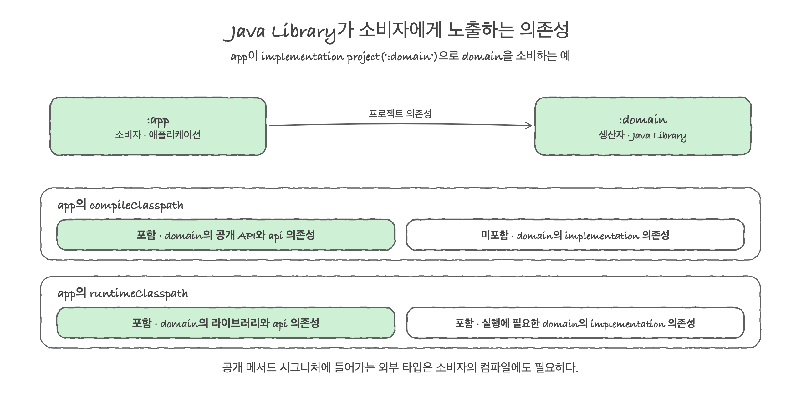
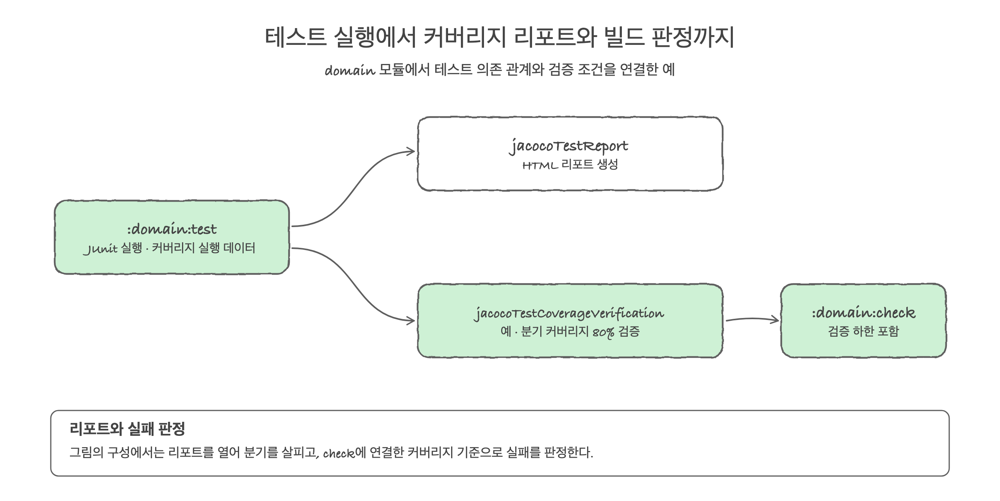

# Gradle 멀티 프로젝트, Convention Plugin과 테스트 커버리지

## 1. 프로젝트 경로와 공통 설정의 적용 범위

이 예에서는 실행 진입점이 있는 `:app`과 재사용할 로직을 담은 `:domain`을 하나의 빌드로 관리한다. Gradle에서 멀티 프로젝트 빌드의 포함 관계는 루트의 `settings.gradle`에 선언한다. 각 서브프로젝트가 자체 플러그인, 소스와 의존성을 관리하며, 프로젝트 경로는 파일 경로와 구분한다. [Gradle · Multi-Project Builds](https://docs.gradle.org/current/userguide/multi_project_builds.html) · [Gradle · Writing Build Scripts](https://docs.gradle.org/current/userguide/writing_build_scripts.html)

```groovy
rootProject.name = 'catalog'
include 'app', 'domain'
```

`allprojects { ... }`는 루트까지 포함한 프로젝트를, `subprojects { ... }`는 현재 프로젝트의 하위 프로젝트를 설정한다. 여러 모듈이 공유하는 컴파일·테스트 정책은 Convention Plugin으로 정의하고 필요한 모듈이 명시적으로 적용하면 공통 설정의 적용 범위를 해당 모듈에서 확인할 수 있다. 예시의 `buildSrc`는 빌드 로직을 담는 경로다. [Gradle DSL · Project](https://docs.gradle.org/current/dsl/org.gradle.api.Project.html) · [Gradle · Sharing Build Logic using buildSrc](https://docs.gradle.org/current/userguide/sharing_build_logic_between_subprojects.html) · [Gradle · Pre-compiled Script Plugins](https://docs.gradle.org/current/userguide/implementing_gradle_plugins_precompiled.html)

## 2. Application과 Library의 의존성 경계

`:app`은 Application 플러그인으로 진입점과 실행 Task를 정한다. `:domain`은 Java Library 플러그인으로 다른 프로젝트가 소비할 라이브러리를 구성한다. `app/build.gradle`에서 `implementation project(':domain')`를 선언하면 소비자인 app이 생산자인 domain의 결과를 사용하고, Gradle은 소비 구성에 맞는 variant와 산출물을 연결한다. [Gradle · Application Plugin](https://docs.gradle.org/current/userguide/application_plugin.html) · [Gradle · Java Library Plugin](https://docs.gradle.org/current/userguide/java_library_plugin.html) · [Gradle · Multi-Project Builds](https://docs.gradle.org/current/userguide/multi_project_builds.html) · [Gradle · Variant Selection and Attribute Matching](https://docs.gradle.org/current/userguide/variant_aware_resolution.html)

라이브러리의 공개 메서드 시그니처에 외부 타입이 있으면 소비자도 컴파일할 때 그 타입이 필요하므로 `api` 여부를 검토한다. 라이브러리 내부 구현에서만 쓰는 의존성은 `implementation`에 둔다. 소비자의 컴파일 클래스패스에는 라이브러리의 `api` 의존성이 노출되고, 런타임에는 실행에 필요한 `implementation` 의존성도 포함될 수 있다. [Gradle · Java Library Plugin](https://docs.gradle.org/current/userguide/java_library_plugin.html) · [Gradle · Variant Selection and Attribute Matching](https://docs.gradle.org/current/userguide/variant_aware_resolution.html)



두 클래스패스에서 생산자의 의존성이 어떻게 보이는지 비교했다. [Gradle · Multi-Project Builds](https://docs.gradle.org/current/userguide/multi_project_builds.html) · [Gradle · Java Library Plugin](https://docs.gradle.org/current/userguide/java_library_plugin.html) · [Gradle · Variant Selection and Attribute Matching](https://docs.gradle.org/current/userguide/variant_aware_resolution.html)

## 3. Groovy DSL Convention Plugin으로 Java 정책 공유하기

`buildSrc/build.gradle`에는 `groovy-gradle-plugin`을 적용하고, `buildSrc/src/main/groovy/catalog.java-conventions.gradle`에 다음 설정을 둔다. 파일 이름은 각 모듈에서 적용하는 플러그인 ID `catalog.java-conventions`가 된다. 이 설정은 필요한 프로젝트에서 Java 17 toolchain과 JUnit Platform 실행을 공통으로 설정한다. [Gradle · Sharing Build Logic using buildSrc](https://docs.gradle.org/current/userguide/sharing_build_logic_between_subprojects.html) · [Gradle · Pre-compiled Script Plugins](https://docs.gradle.org/current/userguide/implementing_gradle_plugins_precompiled.html) · [Gradle · Toolchains for JVM Projects](https://docs.gradle.org/current/userguide/toolchains.html) · [Gradle · Testing in Java and JVM Projects](https://docs.gradle.org/current/userguide/java_testing.html)

```groovy
plugins {
    id 'java'
}

repositories {
    mavenCentral()
}

java {
    toolchain {
        languageVersion = JavaLanguageVersion.of(17)
    }
}

dependencies {
    testImplementation platform('org.junit:junit-bom:5.12.2')
    testImplementation 'org.junit.jupiter:junit-jupiter'
    testRuntimeOnly 'org.junit.platform:junit-platform-launcher'
}

tasks.named('test') {
    useJUnitPlatform()
}
```

`app/build.gradle`에 애플리케이션 플러그인과 공통 정책을 적용하고, `domain/build.gradle`에는 `java-library`와 `catalog.java-conventions`를 적용한다. 앱의 소스와 라이브러리 소스는 각각의 `src/main/java`에, 테스트는 테스트 대상 모듈의 `src/test/java`에 둔다. [Gradle · Application Plugin](https://docs.gradle.org/current/userguide/application_plugin.html) · [Gradle · Java Library Plugin](https://docs.gradle.org/current/userguide/java_library_plugin.html) · [Gradle · Java Plugin](https://docs.gradle.org/current/userguide/java_plugin.html) · [Gradle · Pre-compiled Script Plugins](https://docs.gradle.org/current/userguide/implementing_gradle_plugins_precompiled.html)

```groovy
plugins {
    id 'application'
    id 'catalog.java-conventions'
}

dependencies {
    implementation project(':domain')
}

application {
    mainClass = 'example.catalog.Main'
}
```

최소 소스로 라이브러리의 공개 메서드를 앱에서 호출할 수 있다. 아래 두 코드는 각각 `domain/src/main/java/example/catalog/Stock.java`와 `app/src/main/java/example/catalog/Main.java`에 둔다. [Gradle · Java Plugin](https://docs.gradle.org/current/userguide/java_plugin.html) · [Gradle · Application Plugin](https://docs.gradle.org/current/userguide/application_plugin.html) · [Gradle · Java Library Plugin](https://docs.gradle.org/current/userguide/java_library_plugin.html)

```java
package example.catalog;

public final class Stock {
    public static boolean available(int quantity) {
        return quantity > 0;
    }
}
```

```java
package example.catalog;

public class Main {
    public static void main(String[] args) {
        System.out.println(Stock.available(1));
    }
}
```

## 4. 단위 테스트, 커버리지 리포트와 검증 기준

예를 들어 `:domain`의 분기 로직은 정상 입력과 경계 입력을 별도의 JUnit 테스트로 검증한다. JaCoCo는 실행된 코드의 범위를 측정한다. 라인 커버리지는 실행된 소스 줄을, 분기 커버리지는 조건 분기에서 어느 경로를 실행했는지 보여 준다. 테스트가 기대 동작을 검증하는지는 어설션과 입력을 함께 확인한다. [JUnit Jupiter 5.12.2 · Writing Tests](https://docs.junit.org/5.12.2/user-guide/#writing-tests) · [Gradle · Testing in Java and JVM Projects](https://docs.gradle.org/current/userguide/java_testing.html) · [JaCoCo · Coverage Counters](https://www.jacoco.org/jacoco/trunk/doc/counters.html)

`domain/src/test/java/example/catalog/StockTest.java`에서 재고가 1인 경우와 0인 경우를 검증한다. [JUnit Jupiter 5.12.2 · Writing Tests](https://docs.junit.org/5.12.2/user-guide/#writing-tests) · [Gradle · Java Plugin](https://docs.gradle.org/current/userguide/java_plugin.html)

```java
package example.catalog;

import org.junit.jupiter.api.Test;

import static org.junit.jupiter.api.Assertions.assertFalse;
import static org.junit.jupiter.api.Assertions.assertTrue;

class StockTest {
    @Test
    void availableWhenQuantityIsPositive() {
        assertTrue(Stock.available(1));
    }

    @Test
    void unavailableWhenQuantityIsZero() {
        assertFalse(Stock.available(0));
    }
}
```

다음은 `domain/build.gradle`의 예다. JaCoCo 리포트와 커버리지 검증을 각각 `test`에 연결하고, `check`가 분기 커버리지 하한을 검증하도록 한다. `0.80`은 예시 기준이다. HTML 리포트를 보려면 `./gradlew :domain:jacocoTestReport`를, 프로젝트 검증에 커버리지 하한을 포함하려면 `./gradlew :domain:check`를 실행한다. [Gradle · JaCoCo Plugin](https://docs.gradle.org/current/userguide/jacoco_plugin.html) · [Gradle · Testing in Java and JVM Projects](https://docs.gradle.org/current/userguide/java_testing.html)

```groovy
plugins {
    id 'java-library'
    id 'catalog.java-conventions'
    id 'jacoco'
}

jacoco {
    toolVersion = '0.8.13'
}

tasks.named('jacocoTestReport') {
    dependsOn tasks.named('test')
}

tasks.named('jacocoTestCoverageVerification') {
    dependsOn tasks.named('test')
    violationRules {
        rule {
            limit {
                counter = 'BRANCH'
                value = 'COVEREDRATIO'
                minimum = 0.80
            }
        }
    }
}

tasks.named('check') {
    dependsOn tasks.named('jacocoTestCoverageVerification')
}
```



테스트 실행 결과를 보는 리포트와 하한을 적용하는 검증을 각각 표시했다. [Gradle · JaCoCo Plugin](https://docs.gradle.org/current/userguide/jacoco_plugin.html) · [Gradle · Testing in Java and JVM Projects](https://docs.gradle.org/current/userguide/java_testing.html) · [JaCoCo · Coverage Counters](https://www.jacoco.org/jacoco/trunk/doc/counters.html)
