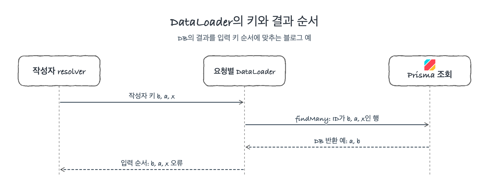

# Batching GraphQL Resolvers with DataLoader

DataLoader는 가까운 시점에 요청된 키를 한 배치로 모으고 해당 요청 안에서 동일 키의 조회 결과를 재사용한다. [GraphQL · DataLoader](https://github.com/graphql/dataloader/tree/v2.2.3) · [Prisma ORM 6 · Query Optimization](https://www.prisma.io/docs/orm/v6/prisma-client/queries/query-optimization-performance)

## 1. 결과를 입력 키의 순서로 다시 정렬한다

아래를 author-loader.mjs로 저장한다. findMany 결과 순서와 요청 키 순서가 같다고 가정하지 않는다. 사라진 키는 오류를 반환하고 해당 키만 실패할 수 있게 한다. [GraphQL · DataLoader](https://github.com/graphql/dataloader/tree/v2.2.3) · [Prisma ORM 6 · CRUD](https://www.prisma.io/docs/orm/v6/prisma-client/queries/crud) · [GraphQL · September 2025 Specification](https://spec.graphql.org/September2025/)



그림의 근거 · [GraphQL · DataLoader](https://github.com/graphql/dataloader/tree/v2.2.3) · [Prisma ORM 6 · CRUD](https://www.prisma.io/docs/orm/v6/prisma-client/queries/crud) · [GraphQL · September 2025 Specification](https://spec.graphql.org/September2025/)

```javascript
// author-loader.mjs
import DataLoader from "dataloader";

export function createAuthorLoader(prisma) {
  return new DataLoader(async ids => {
    const authors = await prisma.author.findMany({
      where: { id: { in: [...ids] } },
      select: { id: true, name: true },
    });
    const byId = new Map(authors.map(author => [author.id, author]));
    return ids.map(id => byId.get(id) ?? new Error("author not available"));
  }, { maxBatchSize: 100 });
}
```

## 2. 캐시의 수명과 일관성을 제어한다

로더를 요청마다 새로 만든다. 권한이 다른 사용자 사이에서 객체 결과를 공유하지 않는다. 같은 요청 중 조회 대상이 수정되면 해당 키를 clear하거나 새 값으로 prime하는 방식을 검토한다. 배치 크기와 실제 SQL 호출 수를 함께 확인한다. [GraphQL · DataLoader](https://github.com/graphql/dataloader/tree/v2.2.3) · [Apollo Server · Context](https://www.apollographql.com/docs/apollo-server/data/context) · [Prisma ORM 6 · Query Optimization](https://www.prisma.io/docs/orm/v6/prisma-client/queries/query-optimization-performance)
