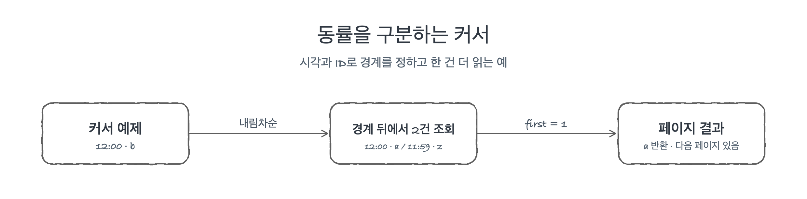

# Paginating GraphQL Connections with Cursors

Connection은 edge의 node·cursor와 pageInfo를 제공한다. 이 예는 createdAt과 id를 내림차순으로 정렬하는 전방 페이지를 제공한다. [Relay · GraphQL Cursor Connections](https://relay.dev/graphql/connections.htm) · [Prisma ORM 6 · CRUD](https://www.prisma.io/docs/orm/v6/prisma-client/queries/crud)

## 1. 동률을 처리하는 커서와 안정된 조건을 사용한다

아래를 post-page.mjs로 저장한다. first는 이 API에서 1~50으로 제한한다. after가 가리키는 값보다 뒤에 있는 튜플만 찾고, first보다 한 건 더 읽어 다음 페이지를 판단한다. 커서는 정렬 키를 전달하며 접근 범위는 별도로 검사한다. [Relay · GraphQL Cursor Connections](https://relay.dev/graphql/connections.htm) · [Prisma ORM 6 · CRUD](https://www.prisma.io/docs/orm/v6/prisma-client/queries/crud) · [GraphQL · Authorization](https://graphql.org/learn/authorization/)



그림의 근거 · [Relay · GraphQL Cursor Connections](https://relay.dev/graphql/connections.htm) · [Prisma ORM 6 · CRUD](https://www.prisma.io/docs/orm/v6/prisma-client/queries/crud) · [GraphQL · Authorization](https://graphql.org/learn/authorization/)

```javascript
// post-page.mjs
import { GraphQLError } from "graphql";

function badCursor() {
  return new GraphQLError("유효하지 않은 커서입니다.", {
    extensions: { code: "BAD_USER_INPUT" },
  });
}

function encode(post) {
  return Buffer.from(JSON.stringify([post.createdAt.toISOString(), post.id])).toString("base64url");
}

function decode(cursor) {
  try {
    if (!cursor || cursor.length > 512) throw badCursor();
    const bytes = Buffer.from(cursor, "base64url");
    if (bytes.toString("base64url") !== cursor) throw badCursor();
    const decoded = JSON.parse(bytes.toString("utf8"));
    if (!Array.isArray(decoded) || decoded.length !== 2) throw badCursor();
    const [time, id] = decoded;
    if (typeof time !== "string" || typeof id !== "string" || !id || id.length > 128) {
      throw badCursor();
    }
    const createdAt = new Date(time);
    if (createdAt.toISOString() !== time) throw badCursor();
    return { createdAt, id };
  } catch {
    throw badCursor();
  }
}

export async function readPostConnection(prisma, visible, { first = 10, after }) {
  if (!Number.isInteger(first) || first < 1 || first > 50) {
    throw new GraphQLError("first는 1에서 50 사이여야 합니다.", {
      extensions: { code: "BAD_USER_INPUT" },
    });
  }
  const bound = after == null ? null : decode(after);
  const where = bound ? {
    AND: [visible, { OR: [
      { createdAt: { lt: bound.createdAt } },
      { createdAt: bound.createdAt, id: { lt: bound.id } },
    ] }],
  } : visible;
  const rows = await prisma.post.findMany({
    where, orderBy: [{ createdAt: "desc" }, { id: "desc" }], take: first + 1,
  });
  const edges = rows.slice(0, first).map(node => ({ node, cursor: encode(node) }));
  return {
    edges,
    pageInfo: {
      hasNextPage: rows.length > first,
      hasPreviousPage: false,
      startCursor: edges[0]?.cursor ?? null,
      endCursor: edges.at(-1)?.cursor ?? null,
    },
  };
}
```

## 2. 정렬 경계와 읽기 일관성을 구분한다

Relay 규약은 전방 페이지에서 앞선 원소를 효율적으로 확인하기 어려우면 hasPreviousPage에 false를 허용한다. 이 실습은 앞 페이지를 별도로 조회하지 않는다. 정렬·필터가 바뀌면 커서를 다시 받고, 쓰기가 동시에 일어나면 전체 스냅샷을 읽는 계약과 구분한다. [Relay · GraphQL Cursor Connections](https://relay.dev/graphql/connections.htm) · [Prisma ORM 6 · CRUD](https://www.prisma.io/docs/orm/v6/prisma-client/queries/crud)
