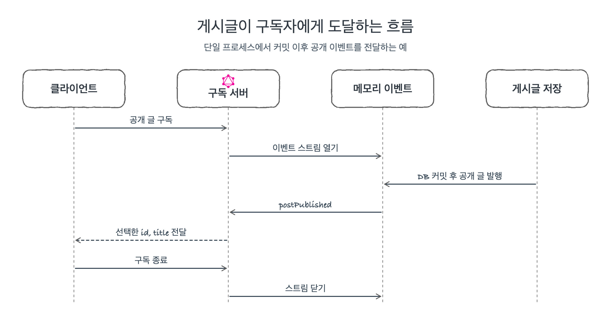

# Streaming GraphQL Subscriptions with Pub/Sub

Subscription은 초기 구독 연산을 하나의 이벤트 소스에 연결하고, 각 이벤트에서 선택 집합을 실행해 응답을 전달한다. 이 예는 graphql-transport-ws 프로토콜을 사용한다. [GraphQL · September 2025 Specification](https://spec.graphql.org/September2025/) · [Apollo Server · Subscriptions](https://www.apollographql.com/docs/apollo-server/data/subscriptions) · [graphql-ws · Protocol](https://github.com/enisdenjo/graphql-ws/blob/master/PROTOCOL.md)

## 1. 구독 스키마와 공개 이벤트를 WebSocket에 연결한다

graphql-ws 6.4.3과 ws 8.23.0을 설치하고 아래를 blog-events.mjs로 저장한다. 이 모듈은 ws WebSocketServer를 인자로 받는다. 구독 종료 시 AsyncIterator를 닫아 리스너를 해제한다. [Apollo Server · Subscriptions](https://www.apollographql.com/docs/apollo-server/data/subscriptions) · [GraphQL over WebSocket · useServer](https://the-guild.dev/graphql/ws/docs/use/ws/functions/useServer) · [GraphQL over WebSocket · ServerOptions](https://the-guild.dev/graphql/ws/docs/server/interfaces/ServerOptions) · [Node.js 24 · Events](https://nodejs.org/download/release/v24.5.0/docs/api/events.html)

```javascript
// blog-events.mjs
import { EventEmitter, on } from "node:events";
import { buildSchema } from "graphql";
import { useServer } from "graphql-ws/use/ws";

const topics = new EventEmitter();
const schema = buildSchema(`
  type PublicPost { id: ID!, title: String! }
  type Query { ready: Boolean! }
  type Subscription { postPublished: PublicPost! }
`);

export function publishPublicPost(post) {
  if (post.published) topics.emit("postPublished", { id: post.id, title: post.title });
}

function openPublicationStream() {
  const stream = on(topics, "postPublished");
  return {
    async next() {
      const step = await stream.next();
      return step.done ? step : { value: { postPublished: step.value[0] }, done: false };
    },
    return: () => stream.return(),
    [Symbol.asyncIterator]() { return this; },
  };
}

export function attachBlogSubscriptions(webSocketServer) {
  return useServer({
    schema,
    roots: {
      query: { ready: true },
      subscription: { postPublished: openPublicationStream },
    },
  }, webSocketServer);
}
```

호출부에서 WebSocketServer를 만든 뒤 attachBlogSubscriptions에 전달한다. DB 커밋 후 publishPublicPost를 호출하고 종료 시 반환 객체의 dispose를 실행한다. 일반 쿼리·뮤테이션을 같은 포트에서 제공할 때는 HTTP 서버에서 경로와 종료를 함께 관리한다. [Apollo Server · Subscriptions](https://www.apollographql.com/docs/apollo-server/data/subscriptions) · [GraphQL over WebSocket · useServer](https://the-guild.dev/graphql/ws/docs/use/ws/functions/useServer) · [Node.js 24 · Events](https://nodejs.org/download/release/v24.5.0/docs/api/events.html)



그림의 근거 · [Apollo Server · Subscriptions](https://www.apollographql.com/docs/apollo-server/data/subscriptions) · [GraphQL over WebSocket · useServer](https://the-guild.dev/graphql/ws/docs/use/ws/functions/useServer) · [Node.js 24 · Events](https://nodejs.org/download/release/v24.5.0/docs/api/events.html)

```graphql
subscription WatchPublicPosts {
  postPublished { id title }
}
```

## 2. 운영에서 전달·권한과 구독 수명을 관리한다

메모리 이벤트는 단일 프로세스에만 전달된다. 다중 인스턴스에서는 브로커와 발행 실패 복구를 설계한다. 연결 인증과 연산별 권한을 확인하고, 긴 구독 중 권한이 바뀌면 필요한 시점에 다시 검사한다. 재연결 후에는 최신 조회나 지정한 재개 정책으로 놓친 이벤트를 처리한다. [Apollo · graphql-subscriptions](https://github.com/apollographql/graphql-subscriptions) · [Apollo Server · Subscriptions](https://www.apollographql.com/docs/apollo-server/data/subscriptions) · [graphql-ws · Protocol](https://github.com/enisdenjo/graphql-ws/blob/master/PROTOCOL.md) · [GraphQL · Authorization](https://graphql.org/learn/authorization/)
