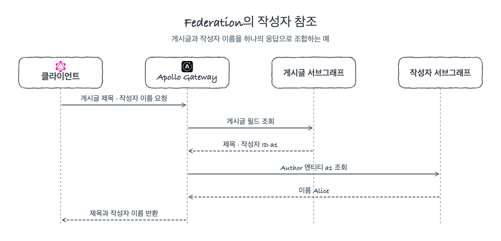

# Designing Federated GraphQL Subgraphs

Apollo Federation은 팀별 서브그래프 스키마를 조합해 하나의 API를 제공한다. 예제는 게시글 서비스가 작성자 ID를 참조하고, 작성자 서비스가 이름을 해결한다. [Apollo Federation · Entities](https://www.apollographql.com/docs/graphos/schema-design/federated-schemas/entities/intro) · [Apollo Federation · Directives](https://www.apollographql.com/docs/graphos/schema-design/federated-schemas/reference/directives) · [Apollo Federation · Composition](https://www.apollographql.com/docs/graphos/schema-design/federated-schemas/composition)

## 1. 게시글과 작성자의 엔티티 경계를 조합한다

토이 예제의 federation.mjs에는 두 개의 서브그래프가 있다. @apollo/subgraph 2.17.0과 @apollo/gateway 2.14.5을 추가로 설치한 뒤 실행한다. 로컬 조합을 사용해 네트워크 의존성 없이 엔티티 참조를 점검한다. [Apollo Server · Subgraph Setup](https://www.apollographql.com/docs/apollo-server/using-federation/apollo-subgraph-setup) · [Apollo Gateway · API](https://www.apollographql.com/docs/apollo-server/using-federation/api/apollo-gateway) · [Apollo Federation · Composition](https://www.apollographql.com/docs/graphos/schema-design/federated-schemas/composition)

```javascript
// federation.mjs
import assert from "node:assert/strict";
import { ApolloServer } from "@apollo/server";
import { ApolloGateway, LocalCompose, LocalGraphQLDataSource } from "@apollo/gateway";
import { buildSubgraphSchema } from "@apollo/subgraph";
import { parse } from "graphql";

const authorTypes = parse(`
  extend schema @link(url: "https://specs.apollo.dev/federation/v2.3", import: ["@key"])
  type Author @key(fields: "id") { id: ID!, name: String! }
  type Query { author(id: ID!): Author }
`);
const postTypes = parse(`
  extend schema @link(url: "https://specs.apollo.dev/federation/v2.3", import: ["@key"])
  type Author @key(fields: "id", resolvable: false) { id: ID! }
  type Post { id: ID!, title: String!, author: Author }
  type Query { post: Post! }
`);
const authorById = id => id === "a1" ? { id, name: "Alice" } : null;
const schemas = {
  authors: buildSubgraphSchema([{ typeDefs: authorTypes, resolvers: {
    Query: { author: (_root, { id }) => authorById(id) },
    Author: { __resolveReference: ({ id }) => authorById(id) },
  } }]),
  posts: buildSubgraphSchema([{ typeDefs: postTypes, resolvers: {
    Query: { post: () => ({
      id: "p1", title: "Federation", author: { __typename: "Author", id: "a1" },
    }) },
  } }]),
};
const gateway = new ApolloGateway({
  supergraphSdl: new LocalCompose({ localServiceList: [
    { name: "authors", url: "https://authors.example.invalid/graphql", typeDefs: authorTypes },
    { name: "posts", url: "https://posts.example.invalid/graphql", typeDefs: postTypes },
  ] }),
  buildService: ({ name }) => new LocalGraphQLDataSource(schemas[name]),
});
const server = new ApolloServer({ gateway });
try {
  const response = await server.executeOperation({ query: "{ post { title author { name } } }" });
  assert.equal(response.body.kind, "single");
  assert.equal(response.body.singleResult.errors, undefined);
  assert.equal(response.body.singleResult.data.post.author.name, "Alice");
} finally {
  await server.stop();
}
```

```bash
APOLLO_TELEMETRY_DISABLED=true node federation.mjs
```



그림의 근거 · [Apollo Federation · Entities](https://www.apollographql.com/docs/graphos/schema-design/federated-schemas/entities/intro) · [Apollo Federation · Directives](https://www.apollographql.com/docs/graphos/schema-design/federated-schemas/reference/directives) · [Apollo Federation · Composition](https://www.apollographql.com/docs/graphos/schema-design/federated-schemas/composition)

## 2. 조합 검증과 운영 권한을 함께 관리한다

CI에서 서브그래프의 조합과 이전 클라이언트 질의의 호환성을 확인한다. 라우터와 서브그래프 사이에서 검증한 신원을 안전하게 전달하고, 각 소유 서비스가 필드 권한을 강제한다. 분산 지연, 한 서브그래프의 실패, 엔티티 참조 성공률을 관측한다. [Apollo Federation · Composition](https://www.apollographql.com/docs/graphos/schema-design/federated-schemas/composition) · [GraphQL · Authorization](https://graphql.org/learn/authorization/) · [GraphQL · Security](https://graphql.org/learn/security/) · [Apollo Federation · Entities](https://www.apollographql.com/docs/graphos/schema-design/federated-schemas/entities/intro)
