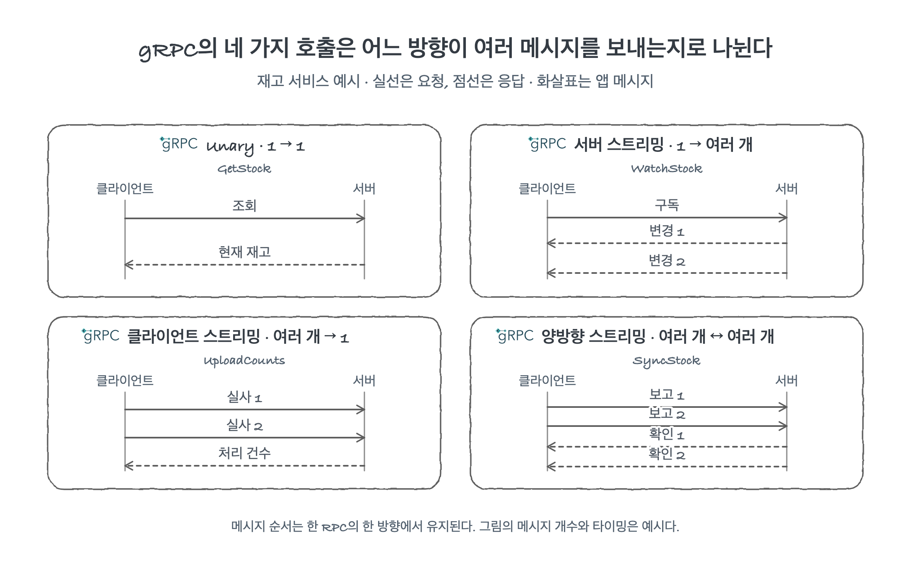
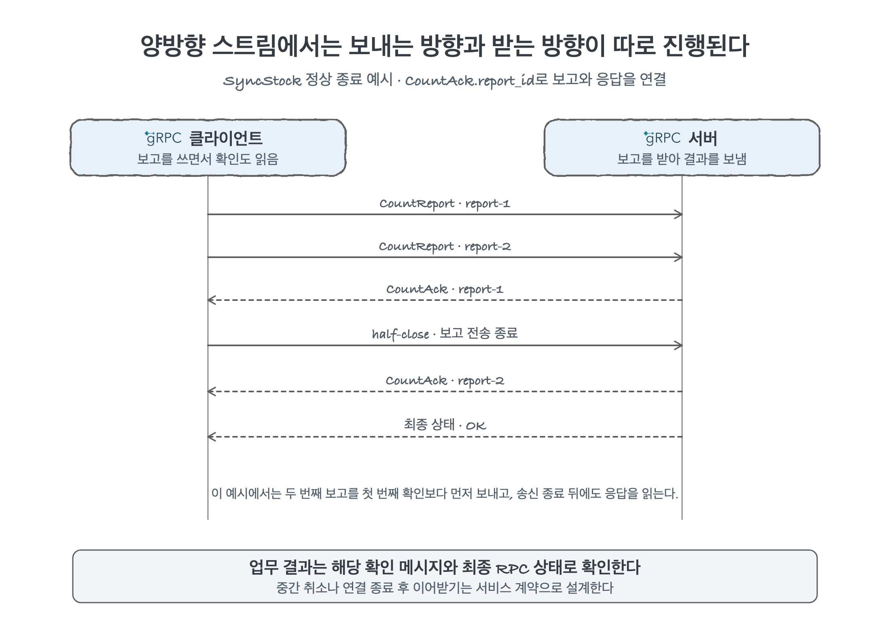

# gRPC Unary and Streaming RPC Patterns

gRPC 호출은 요청과 응답을 각각 한 번 보낼지, 여러 메시지를 스트림으로 보낼지에 따라 네 가지로 나뉜다. 재고 조회, 변경 알림, 실사 결과 업로드, 양방향 재고 동기화를 예로 비교한다.

## 1. Unary RPC와 최적화

Unary는 요청 메시지 하나에 응답 메시지 하나를 돌려주는 호출이다. 특정 SKU의 현재 재고를 조회하는 것처럼, 한 번의 입력과 한 번의 결과로 작업이 끝날 때 자연스럽다.

| 최적화 항목 | 적용 기준 |
| --- | --- |
| 채널과 스텁 재사용 | 같은 대상을 호출할 때 채널과 스텁을 재사용한다. 호출마다 새 채널을 만들면 연결 설정과 TLS 핸드셰이크 비용이 다시 발생할 수 있다. |
| Deadline 지정 | 응답이 여전히 유용한 시점까지 기다리도록 호출마다 예산을 설정한다. 하위 서비스에 연달아 호출할 때도 남은 시간을 고려한다. |
| 호출 횟수 줄이기 | 여러 SKU를 한꺼번에 조회한다면 작은 Unary 호출을 반복하는 경우와 제한된 크기의 배치 요청을 비교한다. |
| 재시도 범위 제한 | 재시도할 상태 코드, 최대 시도 횟수와 백오프를 정한다. 상태를 바꾸는 요청은 멱등성이나 중복 제거 여부를 확인한다. |

동시 요청이 많으면 HTTP/2 연결의 동시 스트림 한도에 도달해 새 RPC가 클라이언트에서 대기할 수 있다. 먼저 부하를 걸어 처리량, p95 지연, deadline 초과율을 비교하고 대기 원인을 확인한다. 여러 메시지를 지속적으로 주고받는 요구가 있을 때 스트리밍을 고려한다.

**공식 문서** [gRPC 성능 가이드](https://grpc.io/docs/guides/performance/) · [Deadline](https://grpc.io/docs/guides/deadlines/) · [Retry](https://grpc.io/docs/guides/retry/)

## 2. 스트리밍 RPC 세 가지

| 호출 유형 | 요청 | 응답 | 재고 서비스 예시 |
| --- | --- | --- | --- |
| Unary | 한 개 | 한 개 | `GetStock`으로 현재 재고를 조회한다. |
| Server Streaming | 한 개 | 여러 개 | `WatchStock`으로 특정 SKU를 구독하고 변경을 순차적으로 받는다. |
| Client Streaming | 여러 개 | 한 개 | `UploadCounts`로 실사 결과를 여러 건 보내고 마지막에 처리 건수를 받는다. |
| Bidirectional Streaming | 여러 개 | 여러 개 | `SyncStock`으로 실사 결과를 보내는 동안 서버가 각 보고의 확인 응답을 돌려준다. |

`.proto`에서 `stream`을 붙인 방향이 여러 메시지를 보낼 수 있다. 각 메시지는 타입이 정해진 독립적인 메시지다. 순서는 **같은 RPC의 같은 방향**에서 보장된다. 서로 다른 호출 사이의 순서나 양방향 요청과 응답 사이의 대응 관계는 서비스 계약에서 정한다.

```proto
syntax = "proto3";

package inventory.sync.v1;

service InventoryService {
  rpc GetStock(StockRequest) returns (StockSnapshot);
  rpc WatchStock(StockRequest) returns (stream StockSnapshot);
  rpc UploadCounts(stream CountReport) returns (UploadSummary);
  rpc SyncStock(stream CountReport) returns (stream CountAck);
}

message StockRequest {
  string sku = 1;
}

message StockSnapshot {
  string sku = 1;
  int32 available_quantity = 2;
}

message CountReport {
  string report_id = 1;
  string sku = 2;
  int32 counted_quantity = 3;
}

message UploadSummary {
  int32 accepted_count = 1;
}

message CountAck {
  string report_id = 1;
}
```

**공식 문서** [gRPC 서비스 정의와 호출 유형](https://grpc.io/docs/what-is-grpc/core-concepts/) · [Protocol Buffers 서비스 정의](https://protobuf.dev/programming-guides/proto3/#services)



그림의 근거 · [gRPC 호출 유형](https://grpc.io/docs/what-is-grpc/core-concepts/#service-definition) · [Proto3 서비스 선언](https://protobuf.dev/programming-guides/proto3/#services)

## 3. 양방향 스트리밍의 동시성과 종료

`SyncStock`에서 클라이언트는 `report-1`을 보낸 뒤 그 확인을 기다리는 동안에도 `report-2`를 보낼 수 있다. 수신 쪽은 `CountAck.report_id`로 어떤 보고가 확인됐는지 구분한다. 송신 메서드가 반환됐을 때는 gRPC 런타임에 메시지를 넘긴 상태일 수 있으므로, 업무 처리가 완료됐는지는 확인 응답과 최종 RPC 상태를 통해 판단한다.

| 상황 | 설계 기준 |
| --- | --- |
| 송신과 수신이 동시에 진행됨 | 한 RPC 안에서 송신 작업 하나와 수신 작업 하나를 독립적으로 진행한다. 송신자가 여럿이면 큐를 거쳐 한 곳에서 쓰고, 같은 방향에서의 동시 호출 허용 여부는 언어별 API를 확인한다. |
| 반대편이 읽는 속도가 느림 | 흐름 제어 때문에 쓰기가 대기할 수 있다. 양쪽이 읽기를 미룬 채 쓰기만 계속하면 서로 대기할 수 있다. 수신을 계속 처리하고, 응용프로그램의 송신 대기열에도 크기 한도를 둔다. |
| 더 보낼 메시지가 없음 | 송신 방향을 닫는 half-close를 사용한다. 송신을 마쳐도 서버가 보낸 남은 응답과 최종 상태를 수신할 수 있다. |
| 호출이 취소되거나 연결이 끊김 | 송신과 수신 작업을 종료하고 자원을 정리한다. 이어받기가 필요하면 마지막으로 확인한 식별자와 중복 처리 규칙을 응용프로그램 계약에 둔다. |

정상 종료 흐름에서는 클라이언트가 두 보고를 보낸 뒤 송신 방향을 닫고, 남은 확인 메시지와 최종 상태를 읽는다. 느린 수신자와 중간 취소도 테스트하면 큐가 한도를 지키고 송수신 작업이 종료되는지 확인할 수 있다.

**공식 문서** [gRPC 양방향 호출 수명](https://grpc.io/docs/what-is-grpc/core-concepts/#bidirectional-streaming-rpc) · [흐름 제어](https://grpc.io/docs/guides/flow-control/) · [취소](https://grpc.io/docs/guides/cancellation/) · [gRPC Go의 스트림 동시성 예시](https://grpc.io/docs/languages/go/generated-code/)



그림의 근거 · [gRPC 양방향 호출 수명](https://grpc.io/docs/what-is-grpc/core-concepts/#bidirectional-streaming-rpc) · [gRPC HTTP/2 스트림 종료](https://github.com/grpc/grpc/blob/master/doc/PROTOCOL-HTTP2.md) · [gRPC 취소](https://grpc.io/docs/guides/cancellation/)
