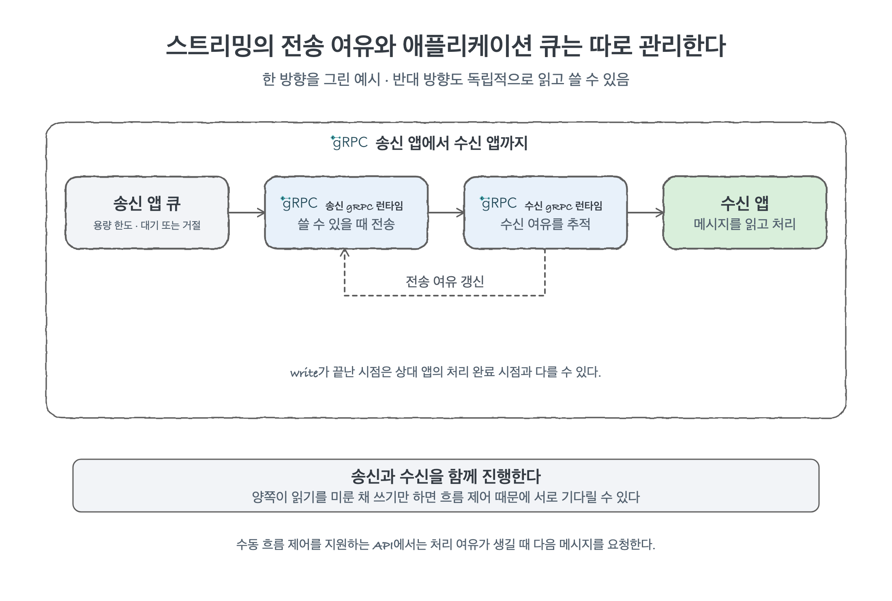
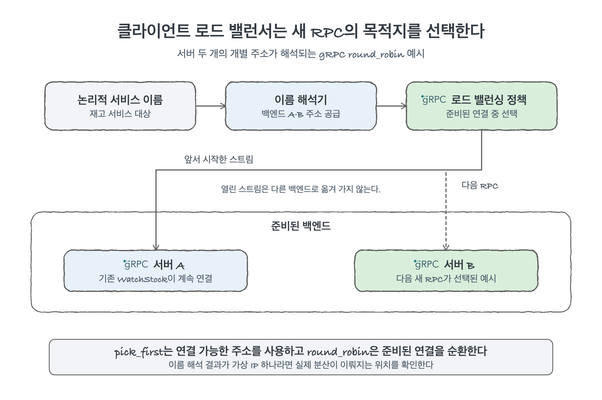
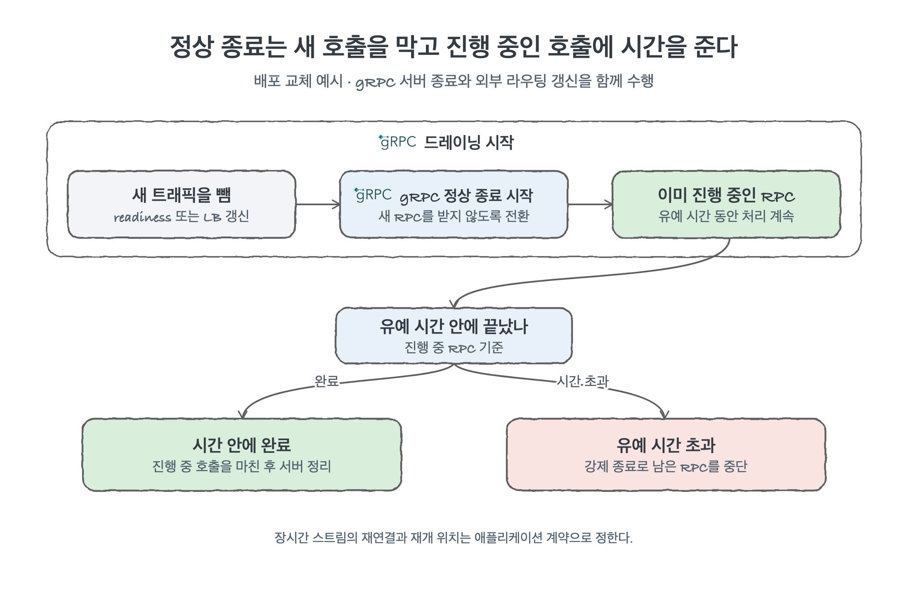
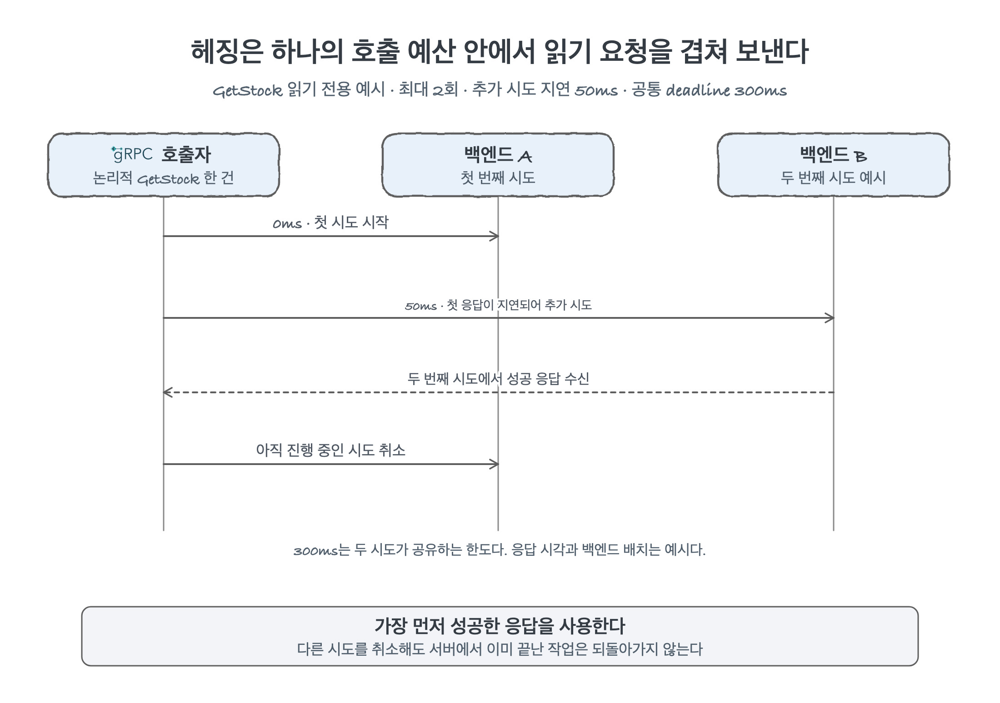

# gRPC Performance and Operational Best Practices

[gRPC 2번 문서의 재고 서비스](02_grpc_unary_and_streaming_rpc_patterns.md)를 기준으로, 호출 지연을 측정하고 스트리밍 부하를 제어하는 방법을 정리한다. 이어서 여러 서버에 호출을 분산하고, 배포 시 진행 중인 호출을 정리하는 방법을 다룬다.

## 1. 성능 측정과 최적화

| 관측한 현상 | 확인할 내용 |
| --- | --- |
| 첫 호출만 느리다 | 이름 해석, 연결 설정, TLS 핸드셰이크 시간을 구분한다. 같은 대상에 요청할 때는 채널과 스텁을 재사용한다. |
| 동시 호출이 많아질수록 클라이언트 대기 시간이 늘어난다 | HTTP/2 연결의 동시 스트림 한도와 활성 스트림을 확인한다. 같은 부하에서 채널이나 워크로드 분리가 대기를 줄이는지 비교한다. |
| 큰 메시지가 전송 시간이나 CPU 사용량을 늘린다 | 필요한 필드와 배치 크기를 확인한다. 압축은 전송량과 양쪽 CPU 사용량을 함께 비교한다. |
| 스트림이 오래 열려 일부 서버에 부하가 몰린다 | 서버별 활성 스트림 수와 처리량을 비교한다. 시작한 스트림은 도중에 다른 서버로 옮겨지지 않으므로, 분산 효과는 새 호출에서 나타난다. |

같은 동시성, 메시지 크기, 호출 구성을 유지한 채 처리량, p95·p99 지연, 오류율과 deadline 초과율을 비교한다. 스트리밍은 전체 호출 시간과 함께 첫 메시지까지 걸린 시간과 메시지당 지연도 본다.

**공식 문서** [gRPC 성능 가이드](https://grpc.io/docs/guides/performance/) · [압축](https://grpc.io/docs/guides/compression/) · [OpenTelemetry 지표](https://grpc.io/docs/guides/opentelemetry-metrics/)

## 2. 흐름 제어와 인터셉터

**흐름 제어**는 수신자가 감당할 수 있는 속도로 메시지를 전달하는 데 쓰인다. 스트리밍에서 상대가 읽는 속도가 느리면 런타임의 쓰기가 대기할 수 있다. 쓰기가 반환됐더라도 상대 서버의 업무 처리가 끝났는지는 애플리케이션 응답으로 판단한다.

- 양방향 스트림에서는 읽기와 쓰기를 독립적으로 진행한다. 양쪽이 읽기를 미뤄 두고 쓰기만 하면 서로 대기할 수 있다.
- gRPC 런타임의 흐름 제어와 애플리케이션의 대기열 크기는 별개의 설정이다. 대기열에는 한도를 두고, 가득 찼을 때 생산자가 대기하거나 새 작업을 거절하도록 정책을 정한다.
- 수동 흐름 제어를 사용하는 경우에는 처리할 여유가 생겼을 때 다음 메시지를 요청한다. 느린 수신자와 중간 취소에서 메모리와 대기 작업이 정리되는지 확인한다.

**인터셉터**는 여러 RPC가 공유하는 로깅, 호출 메타데이터, 추적, 접근 제어를 한 곳에서 처리한다. 서버 인터셉터는 핸들러 호출 전후를 감쌀 수 있다. 예를 들어 처리 시간 측정을 인증 인터셉터 바깥에 두면 인증에서 거절된 요청도 집계할 수 있다. 인터셉터가 실행되는 순서와 공유하는 가변 상태는 사용하는 언어의 API를 기준으로 확인한다.

**공식 문서** [흐름 제어](https://grpc.io/docs/guides/flow-control/) · [인터셉터와 실행 순서](https://grpc.io/docs/guides/interceptors/)



그림의 근거 · [gRPC 흐름 제어](https://grpc.io/docs/guides/flow-control/) · [HTTP/2 흐름 제어](https://www.rfc-editor.org/rfc/rfc9113.html#name-flow-control)

## 3. 로드 밸런싱과 서버 Reflection

클라이언트 측 로드 밸런싱에서 이름 해석기는 백엔드 주소를 찾고, 로드 밸런싱 정책은 각 RPC를 보낼 대상을 선택한다.

| 정책 | 동작 |
| --- | --- |
| `pick_first` | 연결할 수 있는 주소를 선택하고 해당 연결을 사용한다. 기본 정책이다. |
| `round_robin` | 준비된 백엔드 연결 사이에서 새 RPC를 순환 배정한다. |

클라이언트가 백엔드 주소를 각각 볼 수 있을 때 다음 Service Config를 적용해 `round_robin`을 사용할 수 있다. 단일 가상 IP만 해석되는 환경에서는 클라이언트가 개별 백엔드를 고를 수 없으므로, 프록시나 서비스에서 분산이 이루어지는 위치를 확인한다.

```json
{
  "loadBalancingConfig": [
    { "round_robin": {} }
  ]
}
```

**Reflection**은 서버에 등록된 서비스 이름과 Protobuf 타입 정의를 조회하는 RPC다. Reflection을 활성화한 로컬 서버가 `50051`에서 평문으로 실행 중이라면 `grpcurl`에서 다음처럼 서비스를 탐색할 수 있다.

```sh
grpcurl -plaintext 127.0.0.1:50051 list
grpcurl -plaintext 127.0.0.1:50051 describe inventory.sync.v1.InventoryService
```

프록시 뒤에서 Reflection을 사용할 때는 애플리케이션 메서드와 함께 Reflection RPC도 해당 서버로 전달한다. 운영 환경에서는 스키마 조회가 필요한 사용자와 네트워크 범위에 맞게 접근을 설정한다.

**공식 문서** [gRPC 로드 밸런싱 정책](https://grpc.io/docs/guides/custom-load-balancing/) · [Service Config](https://grpc.io/docs/guides/service-config/) · [Reflection](https://grpc.io/docs/guides/reflection/) · [grpcurl](https://github.com/fullstorydev/grpcurl)



그림의 근거 · [gRPC 로드 밸런싱 정책](https://grpc.io/docs/guides/custom-load-balancing/) · [gRPC Service Config](https://grpc.io/docs/guides/service-config/) · [gRPC 스트림 성능](https://grpc.io/docs/guides/performance/)

## 4. Graceful Shutdown과 Request Hedging

### 진행 중인 호출을 마치고 종료하기

1. 종료 대상에서 새 트래픽을 빼도록 로드 밸런서나 readiness를 갱신하고, gRPC 서버의 정상 종료를 시작한다.
2. 진행 중인 호출은 유예 시간 안에서 완료할 수 있게 둔다. 핸들러가 아직 쓰고 있는 DB 연결이나 작업 실행기는 이때 유지한다.
3. 유예 시간 안에 끝나지 않은 호출은 강제 종료한다. 이후 서버 작업과 외부 자원을 정리한다.

장시간 스트림은 배포 유예 시간보다 길게 이어질 수 있다. 재연결이 필요한 서비스는 클라이언트가 언제 다시 연결하고 어느 지점부터 이어받는지 계약에 포함한다.



그림의 근거 · [gRPC Graceful Shutdown](https://grpc.io/docs/guides/server-graceful-stop/) · [gRPC 취소와 서버 처리](https://grpc.io/docs/guides/cancellation/)

### 느린 응답에 한해 추가 시도를 보내기

Request Hedging은 첫 호출이 느릴 때 기존 호출이 끝나기 전에 같은 요청을 추가로 보낼 수 있게 하는 정책이다. 성공한 응답을 사용하면 아직 진행 중인 시도를 취소한다. 이 취소는 서버에서 이미 끝난 작업을 되돌리지 않으므로, 예제는 읽기 전용인 `GetStock`에만 적용한다.

```json
{
  "methodConfig": [
    {
      "name": [
        { "service": "inventory.sync.v1.InventoryService", "method": "GetStock" }
      ],
      "timeout": "0.300s",
      "hedgingPolicy": {
        "maxAttempts": 2,
        "hedgingDelay": "0.050s",
        "nonFatalStatusCodes": ["UNAVAILABLE"]
      }
    }
  ]
}
```

첫 시도를 즉시 보낸다. 헤징이 가능한 상태에서 50ms 동안 응답이 지연되면 두 번째 시도를 보낼 수 있다. `UNAVAILABLE`을 먼저 받으면 남은 시도를 지연 없이 보낼 수 있다. `maxAttempts`에는 최초 시도가 포함되고, 300ms 예산은 두 시도가 공유한다. 예제 값은 설정의 의미를 보여준다. 적용할 때는 p99 개선폭과 논리적 RPC당 백엔드 시도 횟수를 함께 측정하고, 클라이언트 런타임의 헤징 지원을 확인한다.

**공식 문서** [Graceful Shutdown](https://grpc.io/docs/guides/server-graceful-stop/) · [Request Hedging](https://grpc.io/docs/guides/request-hedging/) · [gRPC Retry 및 Hedging 설계](https://github.com/grpc/proposal/blob/master/A6-client-retries.md)



그림의 근거 · [gRPC Request Hedging](https://grpc.io/docs/guides/request-hedging/) · [gRPC 재시도·헤징 설계](https://github.com/grpc/proposal/blob/master/A6-client-retries.md)
