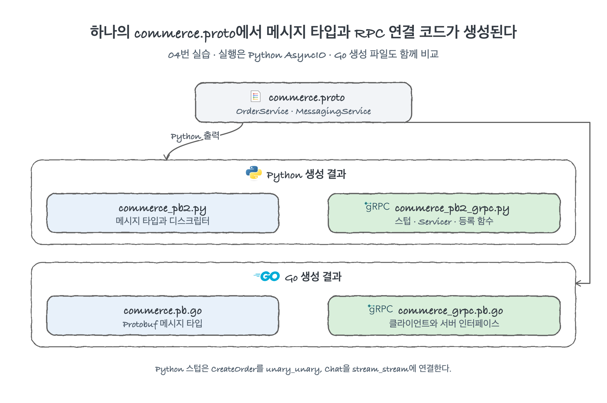
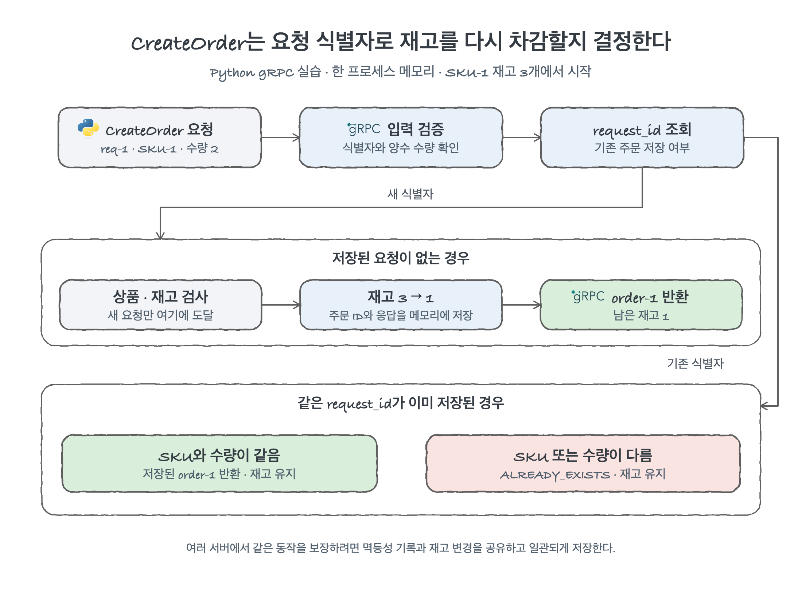
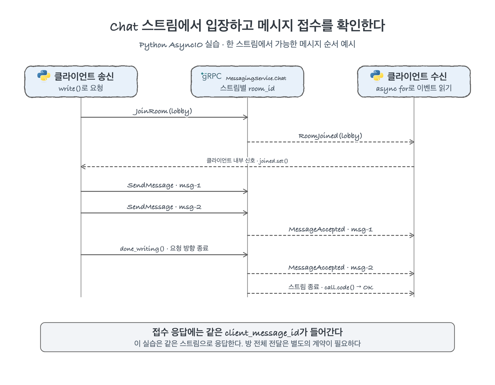

# gRPC Hands-On Lab for Orders and Bidirectional Messaging

주문을 생성하는 Unary RPC와 메시지를 주고받는 양방향 스트리밍 RPC를 같은 서버에서 실행한다. `.proto` 계약에서 코드를 생성한 뒤, 서버가 주문과 방 입장을 처리하는 방식과 클라이언트가 결과를 확인하는 흐름을 비교한다. 코드를 생성해 실행하는 예제는 Python을 사용하며, Go의 생성 파일도 함께 설명한다.

## 1. 서비스와 메시지 계약 설계

| 서비스 | 메서드 | 계약 |
| --- | --- | --- |
| `OrderService` | `CreateOrder` | 요청 식별자, 상품 코드, 수량을 받아 주문 식별자와 남은 재고를 반환한다. |
| `MessagingService` | `Chat` | 같은 스트림에서 방 입장과 메시지 전송을 받고, 입장과 메시지 접수 결과를 보낸다. |

주문을 재시도할 수 있도록 클라이언트가 `request_id`를 보낸다. 메시징에서는 요청의 `oneof`가 입장과 전송을 구분한다. 서버 이벤트의 `oneof`는 입장 확인과 메시지 접수 확인을 구분하며, `client_message_id`로 어느 메시지가 확인됐는지 연결한다.

다음 내용을 `commerce.proto`로 저장한다.

```proto
syntax = "proto3";

package commerce.v1;

service OrderService {
  rpc CreateOrder(CreateOrderRequest) returns (CreateOrderResponse);
}

message CreateOrderRequest {
  string request_id = 1;
  string sku = 2;
  int32 quantity = 3;
}

message CreateOrderResponse {
  string order_id = 1;
  int32 remaining_stock = 2;
}

service MessagingService {
  rpc Chat(stream ChatRequest) returns (stream ChatEvent);
}

message JoinRoom {
  string room_id = 1;
}

message SendMessage {
  string client_message_id = 1;
  string text = 2;
}

message ChatRequest {
  oneof command {
    JoinRoom join = 1;
    SendMessage send = 2;
  }
}

message RoomJoined {
  string room_id = 1;
}

message MessageAccepted {
  string client_message_id = 1;
}

message ChatEvent {
  oneof event {
    RoomJoined joined = 1;
    MessageAccepted accepted = 2;
  }
}
```

**공식 문서** [gRPC 서비스 정의](https://grpc.io/docs/what-is-grpc/core-concepts/#service-definition) · [Proto3 oneof](https://protobuf.dev/programming-guides/proto3/#oneof)

## 2. Protocol Buffers와 gRPC 코드 생성

Python 3.9 이상이 설치된 환경에서 `commerce.proto`가 있는 디렉터리에서 실행한다.

```sh
python3 -m venv .venv
.venv/bin/python -m pip install 'grpcio-tools==1.80.1'
.venv/bin/python -m grpc_tools.protoc -I . \
    --python_out=. --grpc_python_out=. commerce.proto
```

| 역할 | Python | Go |
| --- | --- | --- |
| 메시지 타입과 디스크립터 | `commerce_pb2.py` | `commerce.pb.go` |
| gRPC 스텁, 서버 인터페이스와 등록 함수 | `commerce_pb2_grpc.py` | `commerce_grpc.pb.go` |

Python에서는 `commerce_pb2.CreateOrderRequest`로 메시지를 만든다. `commerce_pb2_grpc.OrderServiceStub`은 호출을 직렬화해 보내는 클라이언트 인터페이스다. 서버는 생성된 `OrderServiceServicer`를 구현하고 등록 함수로 서버에 연결한다. 메시지 계약을 바꿀 때는 `.proto`를 수정한 뒤 다시 생성한다.

생성된 스텁에서 `CreateOrder`는 `channel.unary_unary`로 `/commerce.v1.OrderService/CreateOrder`에 연결되고, `Chat`은 `channel.stream_stream`으로 `/commerce.v1.MessagingService/Chat`에 연결된다. 각 연결에는 요청 직렬화와 응답 역직렬화 함수도 지정되어 있다.

**공식 문서** [Python 생성 코드](https://grpc.io/docs/languages/python/generated-code/) · [Go Protobuf 생성 코드](https://protobuf.dev/reference/go/go-generated/) · [Go gRPC 생성 코드](https://grpc.io/docs/languages/go/generated-code/)



그림의 근거 · [gRPC Python 생성 코드](https://grpc.io/docs/languages/python/generated-code/) · [Protobuf Go 메시지 파일](https://protobuf.dev/reference/go/go-generated/) · [gRPC Go 서비스 파일](https://grpc.io/docs/languages/go/generated-code/)

## 3. 서버 구현 · 주문 정책과 스트림 상태

| 상황 | 처리 결과 |
| --- | --- |
| 주문 요청 식별자가 비어 있거나 수량이 0 이하인 경우 | `INVALID_ARGUMENT` |
| 존재하지 않는 상품인 경우 | `NOT_FOUND` |
| 재고가 모자라는 경우 | `FAILED_PRECONDITION` |
| 같은 요청 식별자와 같은 주문 내용인 경우 | 이미 생성한 주문 응답을 그대로 돌려준다. |
| 같은 요청 식별자로 다른 내용을 요청한 경우 | `ALREADY_EXISTS` |
| 스트림의 첫 요청이 유효한 방 입장이 아닌 경우 | `INVALID_ARGUMENT` |

다음 내용을 `server.py`로 저장한다. 주문 상태는 한 프로세스의 메모리에 저장한다. 요청 식별자 확인과 재고 차감 사이에는 `await`가 없어 이 이벤트 루프에서 처리 순서가 섞이지 않는다. 서버 인스턴스를 늘리는 경우 멱등성 기록, 주문 생성, 재고 변경을 일관되게 저장할 공유 저장소와 트랜잭션이 필요하다.

```python
import asyncio

import grpc

import commerce_pb2 as pb
import commerce_pb2_grpc as rpc


class Orders(rpc.OrderServiceServicer):
    def __init__(self):
        self.stock = {"SKU-1": 3}
        self.orders = {}

    async def CreateOrder(self, request, context):
        if not request.request_id.strip() or request.quantity <= 0:
            await context.abort(grpc.StatusCode.INVALID_ARGUMENT, "request_id and positive quantity required")

        order = (request.sku, request.quantity)
        previous = self.orders.get(request.request_id)
        if previous is not None:
            original_order, response = previous
            if order != original_order:
                await context.abort(grpc.StatusCode.ALREADY_EXISTS, "request_id already used")
            return response

        available = self.stock.get(request.sku)
        if available is None:
            await context.abort(grpc.StatusCode.NOT_FOUND, "unknown SKU")
        if request.quantity > available:
            await context.abort(grpc.StatusCode.FAILED_PRECONDITION, "insufficient stock")

        remaining = available - request.quantity
        response = pb.CreateOrderResponse(
            order_id=f"order-{len(self.orders) + 1}",
            remaining_stock=remaining,
        )
        self.stock[request.sku] = remaining
        self.orders[request.request_id] = (order, response)
        return response


class Messaging(rpc.MessagingServiceServicer):
    async def Chat(self, requests, context):
        room_id = None
        async for request in requests:
            kind = request.WhichOneof("command")
            if room_id is None:
                if kind != "join" or not request.join.room_id.strip():
                    await context.abort(grpc.StatusCode.INVALID_ARGUMENT, "join a room first")
                room_id = request.join.room_id
                yield pb.ChatEvent(joined=pb.RoomJoined(room_id=room_id))
            else:
                message = request.send
                if kind != "send" or not message.client_message_id.strip() or not message.text.strip():
                    await context.abort(grpc.StatusCode.INVALID_ARGUMENT, "send a message with an ID and text")
                yield pb.ChatEvent(
                    accepted=pb.MessageAccepted(client_message_id=message.client_message_id)
                )
        if room_id is None:
            await context.abort(grpc.StatusCode.INVALID_ARGUMENT, "join a room first")


async def main():
    server = grpc.aio.server()
    rpc.add_OrderServiceServicer_to_server(Orders(), server)
    rpc.add_MessagingServiceServicer_to_server(Messaging(), server)
    server.add_insecure_port("127.0.0.1:50051")
    await server.start()
    print("gRPC server ready on 127.0.0.1:50051", flush=True)
    try:
        await server.wait_for_termination()
    finally:
        await server.stop(1)


if __name__ == "__main__":
    try:
        asyncio.run(main())
    except KeyboardInterrupt:
        pass
```

메시징 서버는 입장을 확인한 뒤 접수 이벤트를 같은 스트림에 보낸다. 방 참가자에게 메시지를 전달하는 계약이 필요하면 서버 이벤트에 메시지 전달 유형을 정의하고, 참가자의 수신 속도를 고려해 각 스트림에 송신 대기열과 한도를 둔다. [양방향 스트리밍의 흐름 제어](02_grpc_unary_and_streaming_rpc_patterns.md)

**공식 문서** [gRPC 상태 코드](https://grpc.io/docs/guides/status-codes/) · [gRPC Python AsyncIO 서버와 호출](https://grpc.github.io/grpc/python/grpc_asyncio.html)



그림의 근거 · [gRPC Python AsyncIO 서버](https://grpc.github.io/grpc/python/grpc_asyncio.html) · [gRPC 상태 매핑](https://grpc.io/docs/guides/status-codes/) · [gRPC 재시도](https://grpc.io/docs/guides/retry/)

## 4. 클라이언트 구성과 통신 테스트

다음 내용을 `client.py`로 저장한다. 주문은 같은 요청을 다시 보내 응답이 같은지 확인하고, 새 주문으로 남은 재고를 실제로 확인한다. 채팅은 입장 응답을 받으면서 송신과 수신을 함께 진행한다. 송신 태스크가 `done_writing()`을 호출하면 수신 태스크는 남은 이벤트와 최종 상태를 읽는다.

```python
import asyncio

import grpc

import commerce_pb2 as pb
import commerce_pb2_grpc as rpc


async def expect_status(call, expected):
    try:
        await call
    except grpc.aio.AioRpcError as error:
        assert error.code() == expected, error
    else:
        raise AssertionError(f"Expected {expected.name}")


async def check_orders(channel):
    stub = rpc.OrderServiceStub(channel)
    request = pb.CreateOrderRequest(request_id="req-1", sku="SKU-1", quantity=2)
    created = await stub.CreateOrder(request, timeout=3)
    assert created.order_id == "order-1" and created.remaining_stock == 1
    assert await stub.CreateOrder(request, timeout=3) == created

    conflicting = pb.CreateOrderRequest(request_id="req-1", sku="SKU-1", quantity=1)
    await expect_status(stub.CreateOrder(conflicting, timeout=3), grpc.StatusCode.ALREADY_EXISTS)
    too_many = pb.CreateOrderRequest(request_id="req-2", sku="SKU-1", quantity=2)
    await expect_status(stub.CreateOrder(too_many, timeout=3), grpc.StatusCode.FAILED_PRECONDITION)
    final = pb.CreateOrderRequest(request_id="req-3", sku="SKU-1", quantity=1)
    assert (await stub.CreateOrder(final, timeout=3)).remaining_stock == 0
    print("PASS order creation, idempotency, and stock checks")


async def check_chat(channel):
    stub = rpc.MessagingServiceStub(channel)
    call = stub.Chat(timeout=3)
    joined = asyncio.Event()
    accepted = []

    async def send():
        await call.write(pb.ChatRequest(join=pb.JoinRoom(room_id="lobby")))
        await joined.wait()
        for message_id in ("msg-1", "msg-2"):
            message = pb.SendMessage(client_message_id=message_id, text="hello")
            await call.write(pb.ChatRequest(send=message))
        await call.done_writing()

    async def receive():
        async for event in call:
            if event.WhichOneof("event") == "joined":
                assert event.joined.room_id == "lobby"
                joined.set()
            else:
                accepted.append(event.accepted.client_message_id)

    tasks = [asyncio.create_task(send()), asyncio.create_task(receive())]
    try:
        await asyncio.wait_for(asyncio.gather(*tasks), timeout=4)
        assert accepted == ["msg-1", "msg-2"]
        assert await call.code() == grpc.StatusCode.OK
    finally:
        if not call.done():
            call.cancel()
        for task in tasks:
            task.cancel()
        await asyncio.gather(*tasks, return_exceptions=True)
    print("PASS room join, ordered acknowledgements, and half-close")


async def main():
    async with grpc.aio.insecure_channel("127.0.0.1:50051") as channel:
        await check_orders(channel)
        await check_chat(channel)


if __name__ == "__main__":
    asyncio.run(main())
```

첫 터미널에서 서버를 실행한다. `50051`이 사용 중이면 서버와 클라이언트의 포트를 함께 바꾼다.

```sh
.venv/bin/python server.py
```

`gRPC server ready`가 출력되면 두 번째 터미널에서 같은 디렉터리로 이동해 클라이언트를 실행한다.

```sh
.venv/bin/python client.py
```

두 줄의 `PASS` 출력으로 주문과 채팅을 확인한다. 주문이 메모리 상태를 변경하므로 동일한 실습을 처음부터 실행하려면 서버를 다시 시작한다. 종료할 때는 서버 터미널에서 `Ctrl+C`를 누른다.

**공식 문서** [gRPC Python 기본 실습](https://grpc.io/docs/languages/python/basics/) · [gRPC Python AsyncIO 스트림 API](https://grpc.github.io/grpc/python/grpc_asyncio.html)



그림의 근거 · [gRPC Python AsyncIO 호출 API](https://grpc.github.io/grpc/python/grpc_asyncio.html) · [gRPC Python 1.80.1 구현](https://github.com/grpc/grpc/blob/v1.80.1/src/python/grpcio/grpc/aio/_call.py) · [Proto3 oneof](https://protobuf.dev/programming-guides/proto3/#oneof)
