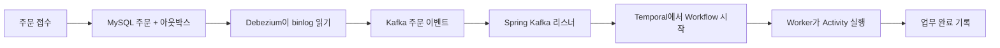

# Designing a Real-Time Event-Driven Architecture

주문 접수는 주문과 이벤트 발행 의도를 같은 MySQL 트랜잭션에 저장한다. Debezium이 커밋 이후 Kafka로 전달하고, Spring Boot 소비자가 Temporal에 후속 처리를 맡긴다. [AWS · Transactional Outbox](https://docs.aws.amazon.com/prescriptive-guidance/latest/cloud-design-patterns/transactional-outbox.html) · [Debezium 3.6 · MySQL Connector](https://debezium.io/documentation/reference/3.6/connectors/mysql.html) · [Temporal Java · Workflow Basics](https://docs.temporal.io/develop/java/workflows/basics)

## 1. 접수와 완료를 서로 다른 응답으로 다룬다

접수 경로는 주문을 저장하고 주문 ID를 반환한다. 처리 완료는 독립적인 상태 조회에서 확인한다. 이벤트 경로의 지연은 MySQL 커밋→Kafka 도착, Kafka→워크플로우 시작, 워크플로우 시작→완료로 나눠 관측한다. [AWS · Transactional Outbox](https://docs.aws.amazon.com/prescriptive-guidance/latest/cloud-design-patterns/transactional-outbox.html) · [Apache Kafka 4.3 · Design](https://kafka.apache.org/43/design/design/) · [Temporal · Workflows](https://docs.temporal.io/workflows) · [AWS · Avoiding Insurmountable Queue Backlogs](https://aws.amazon.com/builders-library/avoiding-insurmountable-queue-backlogs/)

## 2. 부하와 장애가 생기는 위치를 구별한다

큐는 피크에 생긴 작업을 대기시킨다. 지속 유입이 처리량을 넘으면 대기 시간은 계속 늘어난다. Kafka 적체, Temporal Task Queue 대기, DB 연결 한도를 각각 측정하고 처리 병목 쪽에서 동시성을 조정한다. [AWS · Avoiding Insurmountable Queue Backlogs](https://aws.amazon.com/builders-library/avoiding-insurmountable-queue-backlogs/) · [Apache Kafka 4.3 · Design](https://kafka.apache.org/43/design/design/) · [Temporal · Task Queues](https://docs.temporal.io/task-queue)

## 3. 주제별로 이어 읽기

[Docker 환경](04_building_a_lightweight_docker_environment.md), [Kafka 핵심](06_understanding_kafka_logs_and_partitions.md), [CDC](09_understanding_change_data_capture.md), [Temporal Workflow와 Activity](15_distinguishing_workflows_and_activities.md), [Spring Boot 구성](16_configuring_a_kotlin_spring_boot_build.md), [통합 실습](22_exercising_the_end_to_end_cdc_workflow.md) 순서로 경계를 확인한다. [Debezium 3.6 · MySQL Connector](https://debezium.io/documentation/reference/3.6/connectors/mysql.html) · [Temporal · Workflows](https://docs.temporal.io/workflows) · [Apache Kafka 4.3 · Introduction](https://kafka.apache.org/43/getting-started/introduction/)
