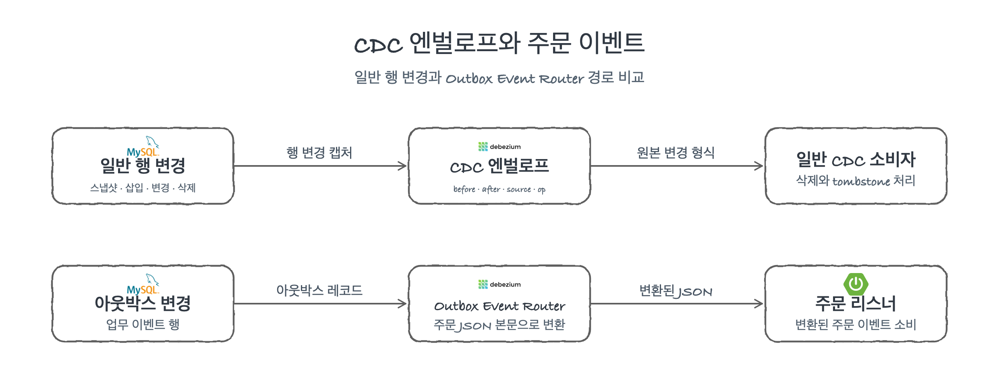

# Understanding Debezium Events and Snapshots

Debezium은 초기 스냅샷과 로그의 연속 변경을 Kafka 레코드로 전달한다. 일반 행 변경 이벤트와 아웃박스 변환 이후의 메시지 모양은 다르다. [Debezium 3.6 · MySQL Connector](https://debezium.io/documentation/reference/3.6/connectors/mysql.html) · [Debezium 3.6 · Outbox Event Router](https://raw.githubusercontent.com/debezium/debezium/v3.6.0.Final/documentation/modules/ROOT/pages/transformations/outbox-event-router.adoc)

## 1. 일반 CDC 레코드의 의미를 읽는다

기본 엔벌로프는 before, after, source, op를 포함한다. 스냅샷 읽기는 r, 삽입은 c, 변경은 u, 삭제는 d다. 삭제 레코드 뒤 값이 null인 tombstone이 추가될 수 있으며, 이는 로그 압축과 관련된 별도 레코드다. [Debezium 3.6 · MySQL Connector](https://debezium.io/documentation/reference/3.6/connectors/mysql.html) · [Apache Kafka 4.3 · Design](https://kafka.apache.org/43/design/design/)

## 2. 업무 리스너의 입력 계약을 결정한다

이 실습은 Debezium Outbox Event Router가 변환한 JSON 본문만 주문 리스너에 보낸다. 일반 CDC 엔벌로프나 tombstone을 받는 별도 소비자는 그 레코드 형식과 삭제 의미를 따로 다룬다. [Debezium 3.6 · MySQL Connector](https://debezium.io/documentation/reference/3.6/connectors/mysql.html) · [Debezium 3.6 · Outbox Event Router](https://raw.githubusercontent.com/debezium/debezium/v3.6.0.Final/documentation/modules/ROOT/pages/transformations/outbox-event-router.adoc) · [Spring Kafka 3.3 · KafkaListener](https://docs.spring.io/spring-kafka/reference/3.3/kafka/receiving-messages/listener-annotation.html)

그림의 근거 · [Debezium 3.6 · MySQL Connector](https://debezium.io/documentation/reference/3.6/connectors/mysql.html) · [Debezium 3.6 · Outbox Event Router](https://raw.githubusercontent.com/debezium/debezium/v3.6.0.Final/documentation/modules/ROOT/pages/transformations/outbox-event-router.adoc) · [Spring Kafka 3.3 · KafkaListener](https://docs.spring.io/spring-kafka/reference/3.3/kafka/receiving-messages/listener-annotation.html)
