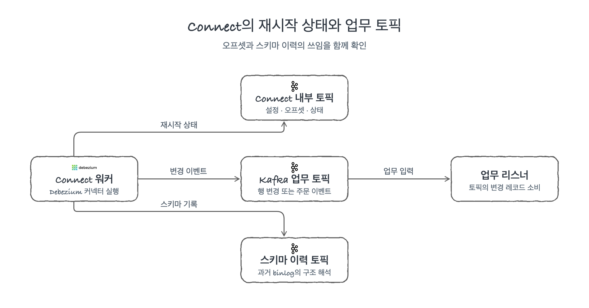

# Explaining the Debezium Connect Architecture

Kafka Connect 워커가 플러그인인 MySQL 소스 커넥터를 실행한다. 데이터 토픽 외에 재시작을 위한 내부 상태를 Kafka에 기록한다. [Apache Kafka 4.3 · Connect User Guide](https://kafka.apache.org/43/kafka-connect/user-guide/) · [Debezium 3.6 · MySQL Connector](https://debezium.io/documentation/reference/3.6/connectors/mysql.html)

## 1. 네 종류의 내부 상태를 나눠 본다

| 저장 위치 | 쓰임 | 근거 |
| --- | --- | --- |
| Connect config / offset / status 토픽 | 분산 실행 설정, 커넥터의 진행 위치와 작업 상태를 관리한다. | [Apache Kafka 4.3 · Connect User Guide](https://kafka.apache.org/43/kafka-connect/user-guide/) |
| Debezium 내부 schema history 토픽 | 과거 binlog 위치의 테이블 구조를 해석하는 이력을 담는다. 파티션 하나와 충분한 보존이 필요하다. | [Debezium 3.6 · MySQL Connector](https://debezium.io/documentation/reference/3.6/connectors/mysql.html) |
| Kafka 업무 토픽 | 리스너가 소비하는 테이블 변경 또는 변환된 주문 이벤트를 담는다. | [Debezium 3.6 · MySQL Connector](https://debezium.io/documentation/reference/3.6/connectors/mysql.html) · [Debezium 3.6 · Outbox Event Router](https://raw.githubusercontent.com/debezium/debezium/v3.6.0.Final/documentation/modules/ROOT/pages/transformations/outbox-event-router.adoc) |

그림의 근거 · [Apache Kafka 4.3 · Connect User Guide](https://kafka.apache.org/43/kafka-connect/user-guide/) · [Debezium 3.6 · MySQL Connector](https://debezium.io/documentation/reference/3.6/connectors/mysql.html)

## 2. 재시작 순서와 병목을 확인한다

MySQL 커넥터는 변경 스트림을 하나의 태스크로 읽는다. Connect 워커 추가가 이 소스 태스크 자체를 여러 개로 분할하지 않는다. 병목을 소스 읽기, 저장된 오프셋, Kafka 쓰기, 소비자 처리로 나누어 확인한다. [Debezium 3.6 · MySQL Connector](https://debezium.io/documentation/reference/3.6/connectors/mysql.html) · [Apache Kafka 4.3 · Connect User Guide](https://kafka.apache.org/43/kafka-connect/user-guide/) · [Apache Kafka 4.3 · Design](https://kafka.apache.org/43/design/design/)
