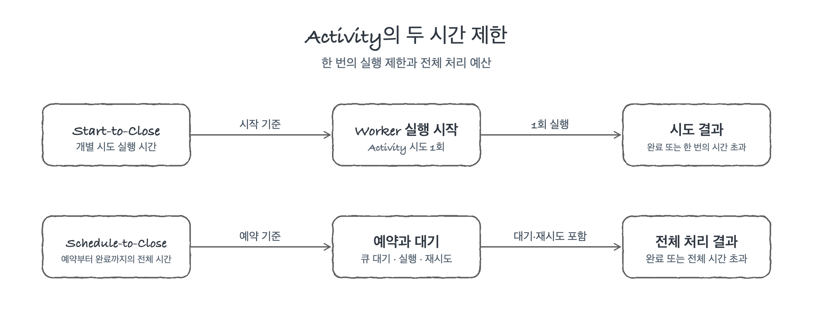

# Distinguishing Workflows and Activities

Workflow는 진행 순서와 상태를 표현한다. Activity는 DB 변경이나 외부 호출처럼 실행할 때마다 결과가 달라질 수 있는 부수 효과를 수행한다. [Temporal · Workflows](https://docs.temporal.io/workflows) · [Temporal · Activities](https://docs.temporal.io/activities) · [Temporal Java · Workflow Basics](https://docs.temporal.io/develop/java/workflows/basics)

## 1. 재생이 가능한 코드로 흐름을 작성한다

Worker는 이력으로 Workflow를 재생할 수 있으므로 일반 시스템 시각이나 직접 DB·네트워크 호출에 따라 명령이 달라지는 코드를 넣지 않는다. 시간과 타이머는 Workflow API를 사용하고 외부 작업의 결과는 Activity로 받는다. [Temporal · Workflows](https://docs.temporal.io/workflows) · [Temporal Java · Workflow Basics](https://docs.temporal.io/develop/java/workflows/basics) · [Temporal Java · Activity Basics](https://docs.temporal.io/develop/java/activities/basics)

## 2. Activity 시도와 전체 시간 예산을 정한다

Start-to-Close는 한 번의 Activity 실행을 제한하며, Schedule-to-Close는 대기와 재시도를 포함한 전체 시간을 제한한다. 긴 작업은 Heartbeat Timeout과 체크포인트가 필요한지 검토하고, 이미 성공한 부수 효과가 반복돼도 결과가 유지되게 만든다. [Temporal · Activities](https://docs.temporal.io/activities) · [Temporal Java · Activity Timeouts](https://docs.temporal.io/develop/java/activities/timeouts)

그림의 근거 · [Temporal · Activities](https://docs.temporal.io/activities) · [Temporal Java · Activity Timeouts](https://docs.temporal.io/develop/java/activities/timeouts)
