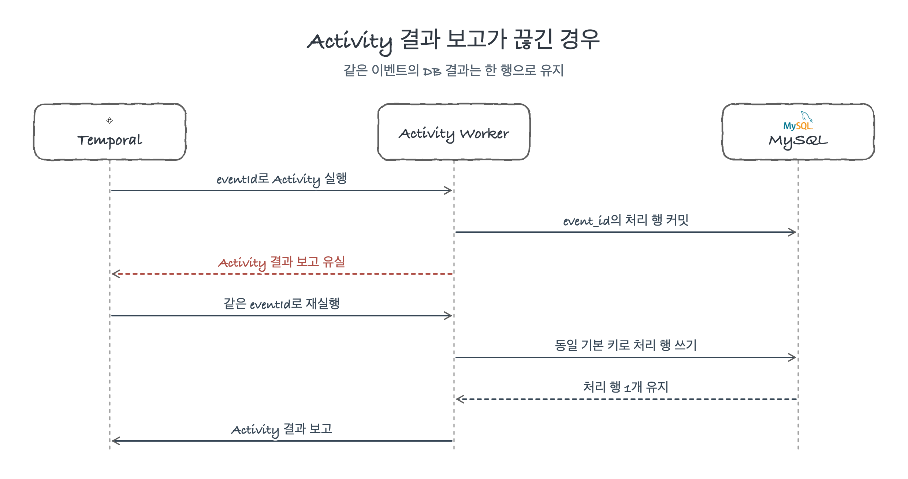

# Implementing Temporal Workflows and Activities

주문 Workflow는 후속 기록을 예약하고 Activity가 JDBC를 호출한다. 이 실습의 업무 효과는 이벤트별 처리 결과 한 행을 남기는 것이다. [Temporal Java · Workflow Basics](https://docs.temporal.io/develop/java/workflows/basics) · [Temporal Java · Activity Basics](https://docs.temporal.io/develop/java/activities/basics) · [Temporal · Activities](https://docs.temporal.io/activities)

## 1. 결정론적인 Workflow와 데이터 접근 Activity를 정의한다

OrderWorkflow.kt를 추가한다. 이력 입력의 eventId와 orderId를 명시적으로 직렬화한다. Temporal과 Spring의 데이터 변환기가 서로 독립이므로 생성자와 각 입력의 JSON 이름을 선언한다. 한 번의 Activity 제한과 전체 재시도 예산을 따로 지정한다. [Temporal Java · Workflow Basics](https://docs.temporal.io/develop/java/workflows/basics) · [Temporal Java · Activity Basics](https://docs.temporal.io/develop/java/activities/basics) · [Temporal Java · Activity Timeouts](https://docs.temporal.io/develop/java/activities/timeouts)

```kotlin
// OrderWorkflow.kt
package workflowlab

import com.fasterxml.jackson.annotation.JsonCreator
import com.fasterxml.jackson.annotation.JsonProperty
import io.temporal.activity.ActivityInterface
import io.temporal.activity.ActivityOptions
import io.temporal.common.RetryOptions
import io.temporal.workflow.Workflow
import io.temporal.workflow.WorkflowInterface
import io.temporal.workflow.WorkflowMethod
import java.time.Duration
import org.springframework.jdbc.core.JdbcTemplate
import org.springframework.stereotype.Component

const val ORDER_WORKFLOW_TYPE = "ProcessOrder"

data class OrderRequested @JsonCreator constructor(
    @param:JsonProperty("eventId") val eventId: String,
    @param:JsonProperty("orderId") val orderId: String,
    @param:JsonProperty("type") val type: String,
)

@WorkflowInterface
interface OrderWorkflow {
    @WorkflowMethod(name = ORDER_WORKFLOW_TYPE)
    fun process(event: OrderRequested)
}

class OrderWorkflowImpl : OrderWorkflow {
    private val activities = Workflow.newActivityStub(
        OrderActivities::class.java,
        ActivityOptions.newBuilder()
            .setStartToCloseTimeout(Duration.ofSeconds(10))
            .setScheduleToCloseTimeout(Duration.ofMinutes(2))
            .setRetryOptions(RetryOptions.newBuilder().setMaximumAttempts(4).build())
            .build(),
    )

    override fun process(event: OrderRequested) = activities.recordProcessed(event)
}

@ActivityInterface
interface OrderActivities {
    fun recordProcessed(event: OrderRequested)
}

@Component
class OrderActivitiesImpl(private val jdbc: JdbcTemplate) : OrderActivities {
    override fun recordProcessed(event: OrderRequested) {
        jdbc.update(
            "INSERT INTO processed_order_events (event_id, order_id) VALUES (?, ?) " +
                "ON DUPLICATE KEY UPDATE event_id = processed_order_events.event_id",
            event.eventId, event.orderId,
        )
        val owner = jdbc.queryForObject(
            "SELECT order_id FROM processed_order_events WHERE event_id = ?",
            String::class.java, event.eventId,
        )
        check(owner == event.orderId) { "event ID belongs to a different order" }
    }
}
```

## 2. 재실행은 업무 키로 방어한다

쓰기 후 결과 보고가 끊기면 Activity가 같은 이벤트로 재실행될 수 있다. event_id 기본 키는 같은 처리 행이 여러 개 생기는 것을 막는다. 실제 재고 갱신처럼 여러 변경을 적용할 경우 멱등 키 기록과 업무 변경을 한 DB 트랜잭션에 둔다. [Temporal · Activities](https://docs.temporal.io/activities) · [MySQL 8.4 · INSERT ON DUPLICATE KEY UPDATE](https://dev.mysql.com/doc/refman/8.4/en/insert-on-duplicate.html) · [AWS · Transactional Outbox](https://docs.aws.amazon.com/prescriptive-guidance/latest/cloud-design-patterns/transactional-outbox.html)



그림의 근거 · [Temporal · Activities](https://docs.temporal.io/activities) · [MySQL 8.4 · INSERT ON DUPLICATE KEY UPDATE](https://dev.mysql.com/doc/refman/8.4/en/insert-on-duplicate.html) · [AWS · Transactional Outbox](https://docs.aws.amazon.com/prescriptive-guidance/latest/cloud-design-patterns/transactional-outbox.html)
