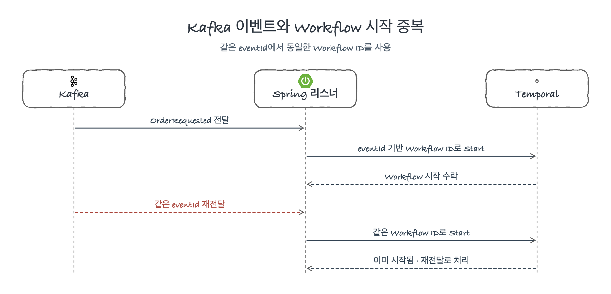

# Starting Temporal Workflows from Kafka Events

Kafka 리스너는 OrderRequested 이벤트를 받고 안정적인 Workflow ID로 실행을 시작한다. 시작 요청을 수락한 뒤 반환하고 Activity 완료는 기다리지 않는다. [Spring Kafka 3.3 · KafkaListener](https://docs.spring.io/spring-kafka/reference/3.3/kafka/receiving-messages/listener-annotation.html) · [Temporal Java · Workflow Basics](https://docs.temporal.io/develop/java/workflows/basics) · [Temporal · Workflow ID and Run ID](https://docs.temporal.io/workflow-execution/workflowid-runid)

## 1. 리스너에서 입력을 검사하고 멱등하게 시작한다

OrderEventListener.kt를 추가한다. 이 토픽은 같은 eventId가 동일한 주문과 입력을 가리키는 아웃박스 계약이다. 실행 중인 ID의 충돌과 완료된 실행 ID의 재사용을 둘 다 거절하고, 동일 이벤트의 이미 시작된 실행은 재전달로 처리한다. [Temporal SDK 1.31.0 · WorkflowClient](https://github.com/temporalio/sdk-java/blob/v1.31.0/temporal-sdk/src/main/java/io/temporal/client/WorkflowClient.java) · [Temporal SDK 1.31.0 · WorkflowOptions](https://github.com/temporalio/sdk-java/blob/v1.31.0/temporal-sdk/src/main/java/io/temporal/client/WorkflowOptions.java) · [Temporal · Workflow ID and Run ID](https://docs.temporal.io/workflow-execution/workflowid-runid) · [AWS · Transactional Outbox](https://docs.aws.amazon.com/prescriptive-guidance/latest/cloud-design-patterns/transactional-outbox.html)



그림의 근거 · [Temporal SDK 1.31.0 · WorkflowClient](https://github.com/temporalio/sdk-java/blob/v1.31.0/temporal-sdk/src/main/java/io/temporal/client/WorkflowClient.java) · [Temporal SDK 1.31.0 · WorkflowOptions](https://github.com/temporalio/sdk-java/blob/v1.31.0/temporal-sdk/src/main/java/io/temporal/client/WorkflowOptions.java) · [Temporal · Workflow ID and Run ID](https://docs.temporal.io/workflow-execution/workflowid-runid) · [AWS · Transactional Outbox](https://docs.aws.amazon.com/prescriptive-guidance/latest/cloud-design-patterns/transactional-outbox.html)

```kotlin
// OrderEventListener.kt
package workflowlab

import com.fasterxml.jackson.module.kotlin.jacksonObjectMapper
import com.fasterxml.jackson.module.kotlin.readValue
import io.temporal.api.enums.v1.WorkflowIdConflictPolicy
import io.temporal.api.enums.v1.WorkflowIdReusePolicy
import io.temporal.client.WorkflowClient
import io.temporal.client.WorkflowExecutionAlreadyStarted
import io.temporal.client.WorkflowOptions
import org.springframework.context.annotation.Bean
import org.springframework.context.annotation.Configuration
import org.springframework.kafka.annotation.KafkaListener
import org.springframework.kafka.listener.CommonContainerStoppingErrorHandler
import org.springframework.kafka.listener.CommonErrorHandler
import org.springframework.stereotype.Component
import java.util.UUID

@Component
class OrderEventListener(private val client: WorkflowClient) {
    private val mapper = jacksonObjectMapper()

    @KafkaListener(topics = ["workflow.orders"])
    fun onOrder(payload: String) {
        val event = mapper.readValue<OrderRequested>(payload)
        require(event.type == "OrderRequested" && event.orderId.length in 1..64)
        require(UUID.fromString(event.eventId).toString() == event.eventId)

        val stub = client.newUntypedWorkflowStub(
            ORDER_WORKFLOW_TYPE,
            WorkflowOptions.newBuilder()
                .setWorkflowId("order-event-" + event.eventId)
                .setTaskQueue(ORDER_QUEUE)
                .setWorkflowIdConflictPolicy(WorkflowIdConflictPolicy.WORKFLOW_ID_CONFLICT_POLICY_FAIL)
                .setWorkflowIdReusePolicy(WorkflowIdReusePolicy.WORKFLOW_ID_REUSE_POLICY_REJECT_DUPLICATE)
                .build(),
        )
        try {
            stub.start(event)
        } catch (_: WorkflowExecutionAlreadyStarted) {
            // The source outbox binds this event ID to one immutable input.
        }
    }
}

@Configuration
class KafkaFailureConfig {
    @Bean
    fun kafkaErrorHandler(): CommonErrorHandler = CommonContainerStoppingErrorHandler()
}
```

## 2. 재전달과 실패를 복구할 수 있게 둔다

시작 결과를 알 수 없는 네트워크 오류는 리스너 호출 밖으로 전파한다. 실습에서는 컨테이너가 중단되므로 원인 해소 후 다시 시작해 확인한다. 운영에서 실패 토픽으로 넘길 때는 실패 레코드 보존을 확인한 뒤 오프셋을 진행한다. Temporal의 실행 ID 중복 방지는 보존 기간의 영향을 받으므로 장기 재처리에서 DB 멱등성도 유지한다. [Spring Kafka 3.3 · Listener Containers](https://docs.spring.io/spring-kafka/reference/3.3/kafka/receiving-messages/message-listener-container.html) · [Spring Kafka 3.3 · Handling Exceptions](https://docs.spring.io/spring-kafka/reference/3.3/kafka/annotation-error-handling.html) · [Temporal · Workflow ID and Run ID](https://docs.temporal.io/workflow-execution/workflowid-runid) · [Temporal · Activities](https://docs.temporal.io/activities)
