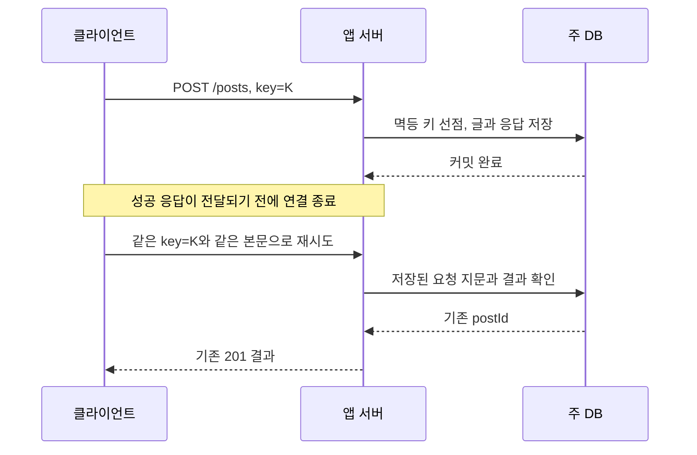

# Designing a Post Creation and Read Service

공개 게시글을 작성하고, 게시글 하나와 작성자별 최신 목록을 조회하는 서비스를 설계한다. 면접에서는 성공 응답의 의미와 작성 직후 읽기 보장을 먼저 합의하고, 관측한 병목에 따라 구조를 바꾼다.

## 1. 요구사항을 좁히고 첫 설계를 제안한다

> 텍스트 게시글 작성, 단건 조회, 작성자별 최신 목록까지 범위를 확인하겠습니다. 작성 성공은 저장소의 커밋을 뜻하고, 작성자에게는 방금 작성한 글이 바로 보여야 한다고 가정하겠습니다. 처음에는 앱과 단일 주 DB로 시작해 쓰기와 핵심 조회를 한 곳에서 처리합니다. 전체 피드와 검색이 필요한지에 따라 별도의 읽기 모델을 검토하겠습니다.

| API | 접근 방식 |
| --- | --- |
| `POST /posts` | 인증 정보에서 작성자를 구한다. 호출자는 논리적 글 작성 요청마다 멱등 키 하나를 정한다. 커밋이 끝나면 `201 Created`와 생성된 글의 위치를 돌려준다. |
| `GET /authors/{authorId}/posts/{postId}` | 작성자 ID로 저장 위치를 찾고 게시글을 읽는다. |
| `GET /authors/{authorId}/posts?cursor=…` | `created_at DESC, post_id DESC`로 정렬하고, 직전 페이지의 마지막 두 값을 커서로 사용한다. |

작성자별 목록에는 `(author_id, created_at DESC, post_id DESC)` 인덱스를 둔다. 작성자당 글 수와 읽기 대 쓰기 비율, 목표 p99 지연과 허용 복제 지연을 확인한다. 예를 들어 평균 쓰기 100건/s에 글 본문과 메타데이터가 1 KB라면 하루에 약 8.64 GB의 원본 데이터가 생긴다. 실제 용량에는 인덱스, 복제본, 저장 수명과 피크 부하를 반영한다. [RFC 9110 · 201 Created](https://www.rfc-editor.org/rfc/rfc9110.html#name-201-created) · [PostgreSQL · Indexes and ORDER BY](https://www.postgresql.org/docs/17/indexes-ordering.html)

## 2. 글 작성 요청이 타임아웃되면 어떻게 재시도하는가?

> 응답이 없으면 DB 커밋 여부를 모릅니다. 같은 글 작성 시도에 같은 멱등 키를 사용하도록 요청하고, DB의 유일 제약으로 키를 한 번만 선점합니다. 키를 선점한 요청이 글과 응답에 필요한 식별자를 한 트랜잭션으로 저장합니다. 같은 키로 다시 오면 저장한 결과를 반환하므로 커밋 직후 응답이 끊겨도 글이 하나만 생깁니다.

- **동시 요청은 어떻게 처리하나?** `(author_id, idempotency_key)`에 유일 제약을 둔다. 키를 선점한 트랜잭션만 글을 생성한다. PostgreSQL의 Read Committed에서 `INSERT ... ON CONFLICT DO NOTHING`에 충돌했다면, 별도 `SELECT` 문으로 커밋된 결과를 읽는다. 대기 시간은 요청 기한 안에서 제한한다. 첫 트랜잭션이 롤백되면 새 시도가 키를 선점할 수 있다. [PostgreSQL · Read Committed Isolation](https://www.postgresql.org/docs/17/transaction-iso.html#XACT-READ-COMMITTED) · [PostgreSQL · INSERT](https://www.postgresql.org/docs/17/sql-insert.html)
- **같은 키로 다른 본문이 오면?** 저장한 요청 지문과 비교해 충돌로 처리한다. 키의 보관 기간은 허용하는 재시도 기간을 포함한다. 기간이 지난 재시도까지 중복 방지가 필요하면 게시글에 영속적인 요청 식별자를 유지한다. [AWS Builders' Library · Making Retries Safe](https://aws.amazon.com/builders-library/making-retries-safe-with-idempotent-APIs/) · [01번 결제 타임아웃과 멱등성](01_understanding_distributed_systems_and_partial_failures.md)

## 3. 늘어난 앱 서버에 요청을 어떻게 분산하는가?

> 로드 밸런서가 준비된 앱 인스턴스들로 요청을 나누게 하겠습니다. 요청 비용이 비슷하면 라운드 로빈으로 시작하고, 요청 처리 시간이 크게 다르면 진행 중 요청 수를 반영하는 정책을 검토합니다. 앱 인스턴스에는 사용자별 필수 상태를 두지 않아 재시도가 다른 인스턴스에 도착해도 DB의 같은 멱등 기록을 사용하게 합니다.

장애 인스턴스는 헬스 체크로 제외하고, 계획된 종료 시 새 요청을 중단한 뒤 기존 요청을 마칠 시간을 준다. 앱을 늘린 뒤에도 처리량이 늘지 않으면, 앱 수부터 다시 늘리기 전에 풀 대기, 쿼리 실행 시간, DB의 CPU·I/O·잠금 대기를 분리한다. 인스턴스당 커넥션 한도와 전체 인스턴스 수의 곱도 확인한다. [02번 부하 분산과 세션](02_scaling_services_with_load_balancing_and_session_management.md)

## 4. 쓰기 부하가 단일 DB의 처리량을 넘으면 어떻게 확장하는가?

> 느린 쓰기의 원인이 잠금, 인덱스, 스토리지나 커넥션 중 어디인지 측정하겠습니다. 그 다음에도 쓰기 병목이 지속되고 주요 조회가 작성자별이라면 작성자 ID를 샤드 키로 사용하겠습니다. 같은 작성자의 글과 멱등 키 기록은 같은 샤드에 두어 한 트랜잭션 경계를 유지합니다.

작성자 ID를 해시한 논리 버킷과 물리 샤드 매핑을 두면 장비를 추가할 때 버킷 단위로 옮길 수 있다. 한 작성자에게 부하가 몰릴 때는 샤드별 지표와 작성자별 상위 부하를 함께 본다. 전체 글을 날짜 범위로 찾기 시작하면 샤드별 결과를 병합하거나 별도 조회 모델을 둔다. 작성자 정보가 없는 `GET /posts/{postId}`가 필요해지면 ID에 안정적인 라우팅 정보를 포함하거나, ID로 작성자 또는 샤드를 찾는 인덱스를 유지한다. [MongoDB · Targeted and Broadcast Operations](https://www.mongodb.com/docs/manual/sharding/#targeted-operations-vs-broadcast-operations) · [03번 파티셔닝과 샤딩](03_partitioning_and_sharding_order_data.md)

## 5. 읽기 복제본을 추가하면 새 글은 어디에 쓰는가?

> 작성자 ID로 샤드를 정하고 해당 샤드의 현재 주 DB에 씁니다. 이 구조에서는 각 샤드가 쓰기 권한을 가진 주 DB 하나와 그 변경을 복제하는 읽기 복제본을 둡니다. 일반적인 조회는 허용한 지연 범위 안에서 읽기 복제본으로 보내고, 작성 직후 조회처럼 필요한 경로는 별도로 제어합니다.

승격으로 쓰기 담당이 바뀌면 라우터가 새 주 DB를 참조하게 하고 이전 주 DB의 쓰기 권한을 차단한다. 비동기 복제에서 이미 성공 응답한 쓰기가 새 주 DB에 빠질 수 있는지는 커밋 정책과 승격 조건에 달려 있다. 성공 응답의 내구성 요구가 높다면 동기 복제나 합의 기반 저장소를 비교한다. [PostgreSQL · Streaming and Synchronous Replication](https://www.postgresql.org/docs/17/warm-standby.html#SYNCHRONOUS-REPLICATION) · [04번 복제와 합의](04_replicating_data_and_reaching_consensus.md)

## 6. 작성자가 바로 조회했는데 새 글이 보이지 않으면 어떻게 하는가?

> 쓰기 직후 읽기가 아직 해당 커밋을 반영하지 않은 복제본에 갔는지 확인하겠습니다. 우선 작성 직후 조회를 같은 샤드의 현재 주 DB에서 읽게 하겠습니다. 주 DB에 읽기 부하가 모이면, 쓰기 응답의 커밋 위치를 다음 요청까지 전달하고 그 위치를 적용한 것이 확인된 복제본에만 보냅니다. 적용이 확인되지 않으면 기한 안에서 주 DB로 보내거나 일시 조회 불가로 응답합니다.

토큰은 해당 샤드와 복제 이력에서 비교할 수 있는 위치를 가리켜야 한다. 그 위치가 반영된 복제본에서 새 스냅샷으로 읽고, 해당 쓰기보다 오래된 캐시 응답도 건너뛴다. 승격으로 이전 이력과 비교할 수 없으면 새 권한 노드에서 커밋이 유지됐는지 확인한다. 이미 승인한 쓰기가 장애 전환으로 유실됐다면 읽기 경로를 바꾸는 것만으로 복구할 수 없다. 작성자에게 적용한 보장은 그 세션의 read-your-writes이며, 다른 사용자의 일반 조회에는 합의한 복제 지연을 허용할 수 있다. [PostgreSQL · Hot Standby](https://www.postgresql.org/docs/17/hot-standby.html#HOT-STANDBY-USERS) · [05번 일관성과 지역 간 단절](05_consistency_models_and_regional_network_partitions.md)

## 면접 끝에 설계를 검증하는 방법

| 재현할 상황 | 기대할 결과와 볼 지표 |
| --- | --- |
| DB 커밋 직후 응답을 끊고 같은 키로 동시 재시도 | 같은 글 ID를 돌려받고, 동일 키로 생성한 게시글은 하나다. 중복 생성과 키 충돌 건수를 확인한다. |
| 앱 인스턴스를 늘려도 처리량이 그대로임 | 앱의 풀 대기와 DB 실행 시간을 분리해 병목을 찾는다. p99와 전체 열린 연결도 비교한다. |
| 특정 작성자에게 쓰기가 집중됨 | 전체 평균과 샤드별 p99를 함께 비교한다. 해당 작성자의 트래픽과 버킷 이동 중 오류율을 본다. |
| 복제 재생을 늦춘 직후 작성자가 조회 | 작성자의 읽기는 방금 쓴 글을 포함한다. 주 DB 우회 비율과 복제본 적용 위치, 응답 기한 초과율을 본다. |
