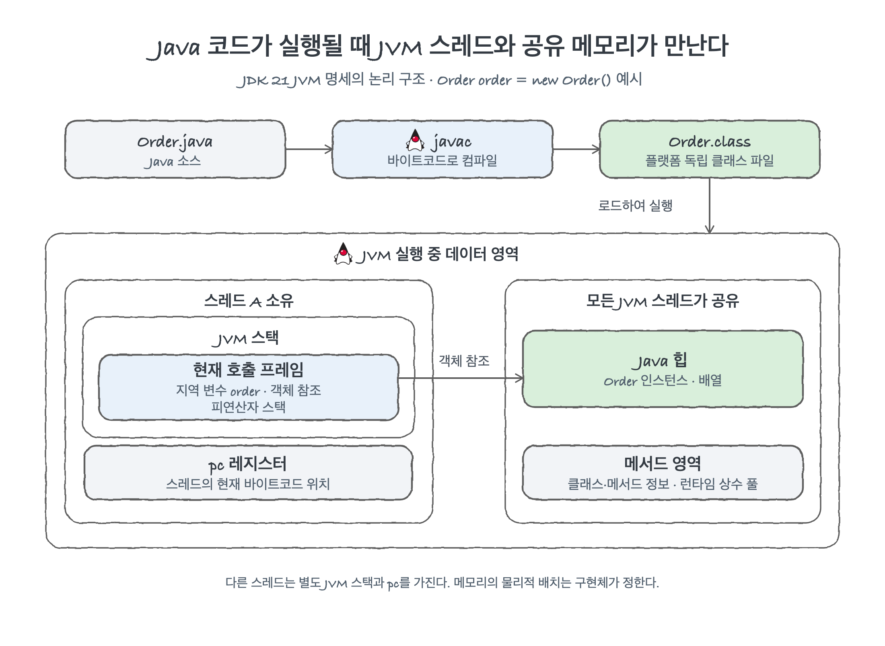
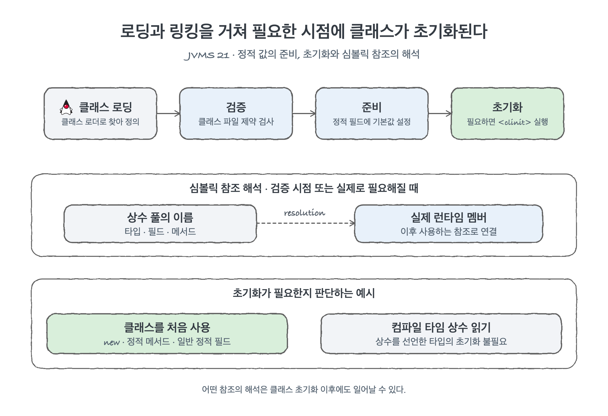
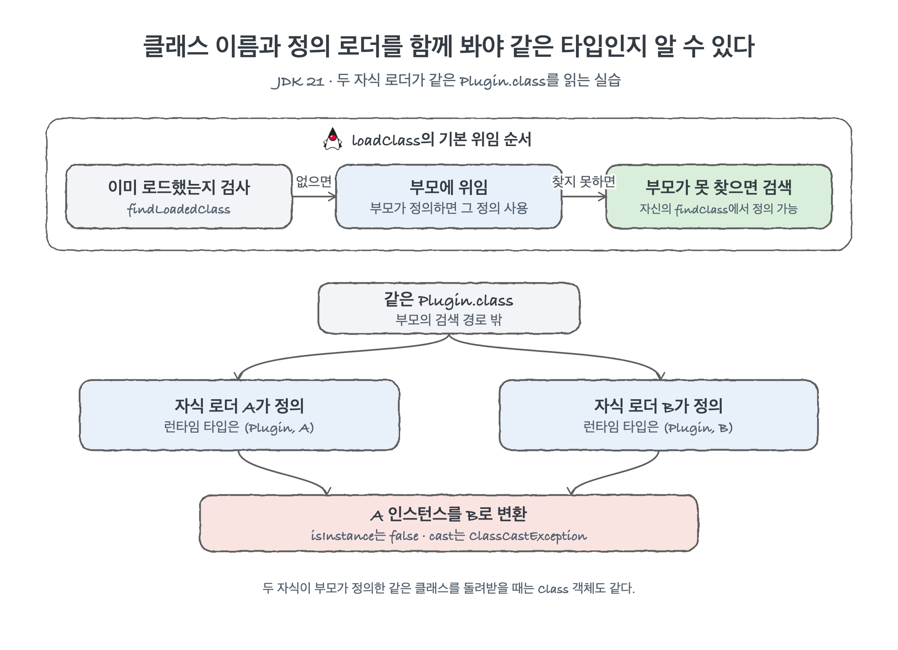

# Understanding the JVM and Class Loading

Java 소스를 컴파일해도 실행 중에 필요한 모든 타입이 미리 준비되는 것은 아니다. JVM은 클래스를 찾아 로드하고, 실행할 수 있도록 링크한 뒤, 필요한 시점에 초기화한다. 이 단계를 구분하면 정적 초기화가 언제 실행되는지, 같은 이름의 클래스 사이에서 왜 형변환이 실패하는지 설명할 수 있다. [JVM 명세 §5](https://docs.oracle.com/javase/specs/jvms/se21/html/jvms-5.html)

## 1. Java, JVM, JRE, JDK

| 용어 | 역할 |
| --- | --- |
| Java | 이 글에서는 소스 코드를 작성하는 Java 프로그래밍 언어를 뜻한다. |
| JVM (Java Virtual Machine) | `class` 파일 형식과 바이트코드의 실행 규칙을 정의하는 가상 머신이다. HotSpot은 그 규칙을 구현한 JVM이다. |
| JRE (Java Runtime Environment) | JVM과 표준 라이브러리 등 Java 프로그램을 실행하는 데 필요한 환경이다. 배포할 런타임은 JDK에 포함된 것을 쓰거나 `jlink`로 필요한 모듈을 모아 만들 수 있다. |
| JDK (Java Development Kit) | 실행 환경과 함께 `javac`, `javap`, `jlink` 같은 개발 도구를 제공한다. |

`javac`는 `.java` 소스를 `.class` 파일로 컴파일한다. `.class`는 운영체제와 하드웨어에 독립적인 형식이며, 실행 환경의 JVM이 그 형식을 읽고 바이트코드를 실행한다. HotSpot은 인터프리터와 JIT 컴파일러를 사용해 실행 중 수집한 정보를 바탕으로 코드를 기계어로 최적화한다. [JDK javac](https://docs.oracle.com/en/java/javase/21/docs/specs/man/javac.html) · [JVM 명세 §2.1](https://docs.oracle.com/javase/specs/jvms/se21/html/jvms-2.html#jvms-2.1) · [JDK jlink](https://docs.oracle.com/en/java/javase/21/docs/specs/man/jlink.html) · [HotSpot 성능 최적화](https://docs.oracle.com/en/java/javase/21/vm/java-hotspot-virtual-machine-performance-enhancements.html)

## 2. JVM의 런타임 데이터 영역

JVM 명세는 각 영역의 역할과 공유 범위를 정의한다. 메모리의 물리적 배치와 GC 알고리즘, 실행 최적화 방식은 구현체가 정한다. [JVM 명세 §2.5](https://docs.oracle.com/javase/specs/jvms/se21/html/jvms-2.html#jvms-2.5) · [JVM 명세 §2.13](https://docs.oracle.com/javase/specs/jvms/se21/html/jvms-2.html#jvms-2.13)

| 영역 | 공유 범위 | 저장하는 내용 |
| --- | --- | --- |
| 힙 (heap) | JVM 스레드 전체 | 클래스 인스턴스와 배열이 할당된다. GC가 객체의 메모리를 관리한다. |
| 메서드 영역 (method area) | JVM 스레드 전체 | 클래스별 필드·메서드 정보, 메서드 코드, 런타임 상수 풀을 담는다. 상수 풀에는 리터럴과 타입·필드·메서드의 심볼릭 참조가 들어 있다. |
| JVM 스택 | 스레드별 | 메서드 호출마다 프레임을 쌓고 호출이 끝나면 제거한다. 프레임에는 지역 변수와 연산에 쓰는 피연산자 스택이 있다. |
| `pc` 레지스터 | 스레드별 | Java 메서드 실행 중 현재 바이트코드 명령의 위치를 가리킨다. `native` 메서드 실행 중에는 값이 정의되지 않는다. |
| 네이티브 메서드 스택 | 제공하는 구현체에서 보통 스레드별 | `native` 메서드나 JVM 구현 자체의 실행에 쓰인다. |

예를 들어 `Order order = new Order();`에서 `order`의 참조는 호출 프레임의 지역 변수에 들어가고 `Order` 인스턴스는 힙에 놓인다. `Order`의 메서드 정보는 클래스 단위로 관리된다. [JVM 명세 §2.4](https://docs.oracle.com/javase/specs/jvms/se21/html/jvms-2.html#jvms-2.4) · [JVM 명세 §2.6](https://docs.oracle.com/javase/specs/jvms/se21/html/jvms-2.html#jvms-2.6)



그림의 근거 · [JDK 21 javac](https://docs.oracle.com/en/java/javase/21/docs/specs/man/javac.html) · [JVMS 21 런타임 데이터 영역](https://docs.oracle.com/javase/specs/jvms/se21/html/jvms-2.html#jvms-2.5) · [JVMS 21 호출 프레임](https://docs.oracle.com/javase/specs/jvms/se21/html/jvms-2.html#jvms-2.6)

## 3. 로딩, 링크, 초기화

| 단계 | JVM이 하는 일 |
| --- | --- |
| 로딩 (loading) | 클래스 로더가 이름에 해당하는 바이너리를 찾는다. JVM은 클래스나 인터페이스를 정의하고 런타임 표현을 만든다. |
| 링크의 검증 (verification) | 바이트코드의 타입 사용과 피연산자 스택의 상태 등 `class` 파일이 지켜야 할 제약을 점검한다. |
| 링크의 준비 (preparation) | 정적 필드를 만들고 `0`, `false`, `null` 같은 타입별 기본값을 설정한다. |
| 링크의 해석 (resolution) | 상수 풀의 심볼릭 참조를 실제 타입, 필드, 메서드 등으로 연결한다. |
| 초기화 (initialization) | 상수 값 설정을 포함한 초기화 절차를 수행하고, `<clinit>` 메서드가 있으면 실행한다. Java의 정적 초기화 블록과 실행이 필요한 정적 필드 초기화 식은 이 메서드에 들어간다. |

초기화 전에 로딩, 검증, 준비를 마친다. 심볼릭 참조는 검증 시점에 미리 해석하거나 처음 필요할 때 해석할 수 있다. 따라서 어떤 참조의 해석은 그 참조를 가진 클래스가 초기화된 뒤에도 일어날 수 있다. [JVM 명세 §5.3](https://docs.oracle.com/javase/specs/jvms/se21/html/jvms-5.html#jvms-5.3) · [JVM 명세 §5.4](https://docs.oracle.com/javase/specs/jvms/se21/html/jvms-5.html#jvms-5.4) · [JVM 명세 §5.5](https://docs.oracle.com/javase/specs/jvms/se21/html/jvms-5.html#jvms-5.5)

`new`로 인스턴스를 만들거나 정적 메서드를 호출하거나 일반 정적 필드를 처음 읽고 쓰면 해당 타입이 초기화된다. 정적 필드를 상속받아 참조할 때는 그 필드를 실제로 선언한 타입이 기준이다. `static final int LIMIT = 10;`처럼 상수 표현식으로 초기화한 기본형이나 `String` 상수를 읽을 때는 선언 타입의 초기화가 필요 없다. 클래스의 정적 초기화 코드가 실행되기 전에 상위 클래스와 기본 메서드를 선언한 상위 인터페이스의 초기화를 마친다. [Java 언어 명세 §12.4.1](https://docs.oracle.com/javase/specs/jls/se21/html/jls-12.html#jls-12.4.1)



그림의 근거 · [JVMS 21 링킹](https://docs.oracle.com/javase/specs/jvms/se21/html/jvms-5.html#jvms-5.4) · [JVMS 21 초기화](https://docs.oracle.com/javase/specs/jvms/se21/html/jvms-5.html#jvms-5.5) · [JLS 21 초기화 트리거](https://docs.oracle.com/javase/specs/jls/se21/html/jls-12.html#jls-12.4.1)

## 4. 클래스 로더의 위임과 타입의 동일성

Java 런타임의 내장 로더에는 핵심 클래스를 맡는 부트스트랩 로더, Java 플랫폼의 클래스를 맡는 플랫폼 로더, 일반적인 실행에서 애플리케이션 클래스패스의 클래스를 찾는 애플리케이션 로더가 있다. `ClassLoader.loadClass`의 기본 구현은 먼저 이미 로드한 클래스를 확인하고, 부모 로더에 위임한 다음, 부모가 찾지 못하면 자신의 `findClass`를 호출한다. [JDK ClassLoader](https://docs.oracle.com/en/java/javase/21/docs/api/java.base/java/lang/ClassLoader.html) · [ClassLoader.loadClass](https://docs.oracle.com/en/java/javase/21/docs/api/java.base/java/lang/ClassLoader.html#loadClass(java.lang.String,boolean))

클래스를 직접 로드하거나 다른 로더에 위임해 정의를 반환한 로더를 개시 로더(initiating loader)라고 한다. 정의 로더(defining loader)는 클래스를 직접 정의한 로더다. 일반 클래스의 런타임 타입은 **바이너리 이름과 정의 로더의 조합**으로 결정된다. 같은 `.class` 파일을 로더 두 개가 각각 정의하면 별개 타입이 된다. 두 로더가 부모에 위임해 같은 정의를 받으면 `Class` 객체도 같다. [JVM 명세 §5.3](https://docs.oracle.com/javase/specs/jvms/se21/html/jvms-5.html#jvms-5.3)



그림의 근거 · [JDK 21 ClassLoader](https://docs.oracle.com/en/java/javase/21/docs/api/java.base/java/lang/ClassLoader.html) · [JVMS 21 클래스 정체성](https://docs.oracle.com/javase/specs/jvms/se21/html/jvms-5.html#jvms-5.3) · [JDK 21 Class 타입 검사](https://docs.oracle.com/en/java/javase/21/docs/api/java.base/java/lang/Class.html)

## 5. JDK 21 이상에서 실행하기

빈 디렉터리에 `Plugin.java`와 `LoadingDemo.java`를 저장한다. 예제는 `Plugin`을 애플리케이션 클래스패스 밖에 두고, 두 자식 로더가 같은 파일을 각각 정의하도록 구성한다. `Class.forName`의 두 번째 인수로 초기화 여부를 지정한다. [JDK URLClassLoader](https://docs.oracle.com/en/java/javase/21/docs/api/java.base/java/net/URLClassLoader.html) · [Class.forName](https://docs.oracle.com/en/java/javase/21/docs/api/java.base/java/lang/Class.html#forName(java.lang.String,boolean,java.lang.ClassLoader))

`Plugin.java`

```java
public class Plugin {
    static {
        System.out.println("Plugin initialized");
    }
}
```

`LoadingDemo.java`

```java
import java.net.URL;
import java.net.URLClassLoader;
import java.nio.file.Path;

public class LoadingDemo {
    public static void main(String[] args) throws Exception {
        URL[] locations = {Path.of("plugin").toUri().toURL()};
        ClassLoader parent = LoadingDemo.class.getClassLoader();

        try (var firstLoader = new URLClassLoader(locations, parent);
             var secondLoader = new URLClassLoader(locations, parent)) {
            System.out.println("shared parent type = "
                    + (firstLoader.loadClass("LoadingDemo") == LoadingDemo.class));

            Class<?> first = Class.forName("Plugin", false, firstLoader);
            Class<?> second = Class.forName("Plugin", false, secondLoader);
            System.out.println("same name = " + first.getName().equals(second.getName()));
            System.out.println("same type = " + (first == second));

            System.out.println("initializing first loader's Plugin");
            Class.forName("Plugin", true, firstLoader);
            Class.forName("Plugin", true, firstLoader);

            System.out.println("initializing second loader's Plugin");
            Class.forName("Plugin", true, secondLoader);

            Object instance = first.getConstructor().newInstance();
            System.out.println("second type accepts first instance = " + second.isInstance(instance));
        }
    }
}
```

```sh
javac --release 21 -d plugin Plugin.java
javac --release 21 -d app LoadingDemo.java
java -cp app LoadingDemo
```

```text
shared parent type = true
same name = true
same type = false
initializing first loader's Plugin
Plugin initialized
initializing second loader's Plugin
Plugin initialized
second type accepts first instance = false
```

`LoadingDemo`는 부모 로더에 위임해 기존 정의를 얻는다. 두 `Plugin`은 `false`로 조회할 때 정적 블록을 실행하지 않는다. `true`로 호출하면 각 정의가 한 번씩 초기화된다. 첫 번째 정의로 만든 인스턴스를 두 번째 정의로 검사하면 `isInstance`는 `false`를 반환하고, `second.cast(instance)`를 호출하면 `ClassCastException`이 발생한다. [JVM 명세 §5.5](https://docs.oracle.com/javase/specs/jvms/se21/html/jvms-5.html#jvms-5.5) · [Class.isInstance](https://docs.oracle.com/en/java/javase/21/docs/api/java.base/java/lang/Class.html#isInstance(java.lang.Object)) · [Class.cast](https://docs.oracle.com/en/java/javase/21/docs/api/java.base/java/lang/Class.html#cast(java.lang.Object))

## 6. 오류가 발생한 단계 찾기

- `ClassNotFoundException`이 `Class.forName`에서 발생했다면 바이너리 이름과 해당 로더의 검색 경로를 확인한다. JVM이 바이트코드의 타입 참조를 해석하는 중에 클래스를 찾지 못하면 이 예외가 `NoClassDefFoundError`의 원인으로 나타날 수 있다. [Class.forName](https://docs.oracle.com/en/java/javase/21/docs/api/java.base/java/lang/Class.html#forName(java.lang.String,boolean,java.lang.ClassLoader)) · [JVM 명세 §5.3.2](https://docs.oracle.com/javase/specs/jvms/se21/html/jvms-5.html#jvms-5.3.2)
- `UnsupportedClassVersionError`가 보이면 실행 JVM이 지원하는 `class` 파일 버전과 실제 컴파일 대상 버전을 비교한다. [JVM 명세 §5.3.5](https://docs.oracle.com/javase/specs/jvms/se21/html/jvms-5.html#jvms-5.3.5)
- 정적 초기화에서 `RuntimeException`이 발생하면 첫 시도에서는 `ExceptionInInitializerError`로 감싸져 전파된다. 같은 클래스 정의의 초기화를 이후에 다시 요청하면 `NoClassDefFoundError`가 발생하므로, 최초 실패 시점의 로그에서 원인을 확인한다. [JVM 명세 §5.5](https://docs.oracle.com/javase/specs/jvms/se21/html/jvms-5.html#jvms-5.5)
