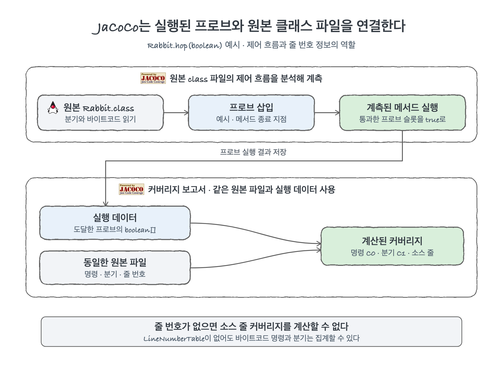
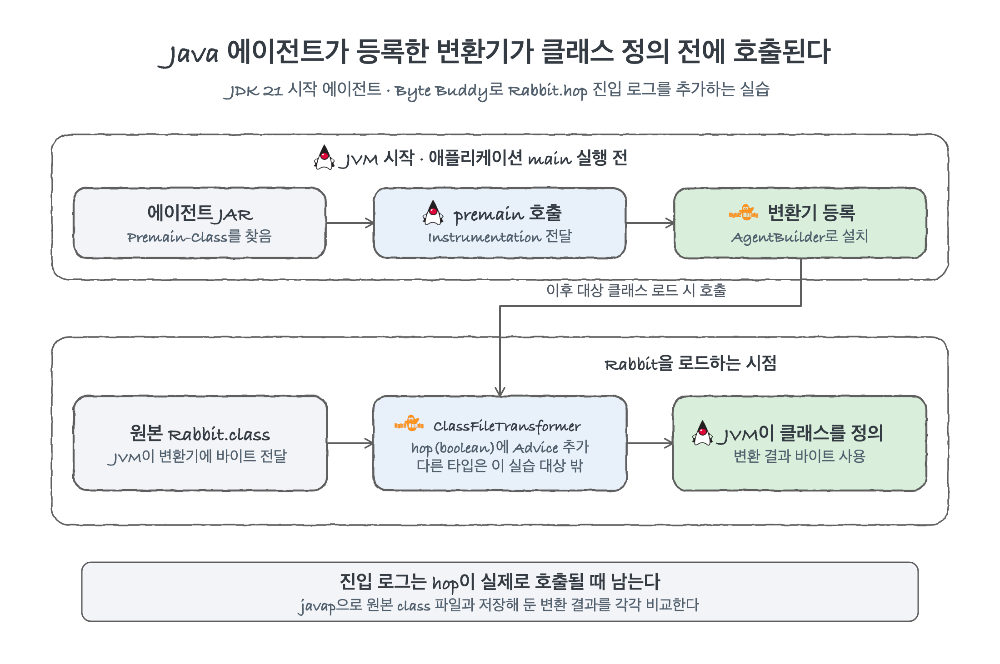

# Instrumenting Java Bytecode with Java Agents

Java 에이전트는 JVM이 클래스를 정의하기 전에 클래스 파일의 바이트를 받아 계측 명령을 추가할 수 있다. JaCoCo는 이 지점에서 테스트 대상 메서드에 실행 여부를 기록하는 명령을 넣는다. JDK 21 실습에서는 작은 `Rabbit` 클래스에 진입 로그를 삽입하고 `javap`으로 원본과 로딩 중 변환한 바이트코드를 확인한다. [JDK 21 `java.lang.instrument`](https://docs.oracle.com/en/java/javase/21/docs/api/java.instrument/java/lang/instrument/package-summary.html) · [JaCoCo Java Agent](https://www.jacoco.org/jacoco/trunk/doc/agent.html)

## 1. JaCoCo는 커버리지를 어떻게 측정할까?

JaCoCo는 원본 `.class`의 바이트코드로 제어 흐름을 분석한다. 메서드의 종료 지점과 여러 경로가 합류하는 지점으로 들어가는 간선 등에 **프로브**(probe)를 삽입한다. JVM이 프로브를 실행하면 클래스별 `boolean[]`의 해당 슬롯이 `true`가 된다. 한 번이라도 통과한 간선에서 실행 경로를 역추적할 수 있어, 프로브 몇 개로 여러 명령의 실행 여부를 추론한다. 에이전트가 기록한 실행 데이터와 실행 당시 입력으로 사용한 계측 전 클래스 파일을 결합해 보고서를 만든다. [JaCoCo 제어 흐름 분석](https://www.jacoco.org/jacoco/trunk/doc/flow.html) · [JaCoCo 클래스 ID](https://www.jacoco.org/jacoco/trunk/doc/classids.html)

| 지표 | 집계 단위 | 필요한 정보 |
| --- | --- | --- |
| 명령 커버리지(C0) | 개별 바이트코드 명령 | 명령과 프로브 실행 데이터 |
| 분기 커버리지(C1) | `if`, `switch`의 분기 결과 | 분기 명령과 프로브 실행 데이터. 예외 처리는 C1 분기로 집계하지 않는다. |
| 줄 커버리지 | 실행 가능한 소스 줄. 해당 줄의 명령 하나 이상이 실행되면 그 줄을 실행한 것으로 집계한다. | 명령과 프로브 실행 데이터, `LineNumberTable` |

`LineNumberTable`은 메서드 내 바이트코드 오프셋을 소스 줄에 대응시키는 선택적 클래스 파일 속성이다. `javac -g`로 컴파일하면 줄 번호가 들어가고 `-g:none`으로 컴파일하면 빠진다. 줄 번호가 없는 클래스에서도 명령과 분기는 집계할 수 있다. 한 줄에 여러 명령이 매핑되면 실행된 명령과 미실행 명령이 섞여 부분 커버리지로 표시될 수 있다. [JVM 명세 `LineNumberTable`](https://docs.oracle.com/javase/specs/jvms/se21/html/jvms-4.html#jvms-4.7.12) · [JaCoCo 커버리지 지표](https://www.jacoco.org/jacoco/trunk/doc/counters.html) · [JDK 21 `javac`](https://docs.oracle.com/en/java/javase/21/docs/specs/man/javac.html)



그림의 근거 · [JaCoCo 제어 흐름 분석](https://www.jacoco.org/jacoco/trunk/doc/flow.html) · [JaCoCo 클래스 ID](https://www.jacoco.org/jacoco/trunk/doc/classids.html) · [JaCoCo 커버리지 집계](https://www.jacoco.org/jacoco/trunk/doc/counters.html)

## 2. `Rabbit`의 바이트코드 읽기

JDK 21이 활성화된 빈 작업 디렉터리에서 아래 경로대로 파일을 만든다. 실습 애플리케이션은 `Rabbit.hop`에 전달한 값에 따라 `hide` 또는 `hop`을 출력한다.

```sh
mkdir -p src/demo/agent build/app build/agent build/dump lib
```

`src/demo/Rabbit.java`에 다음 클래스를 저장한다.

```java
package demo;

public final class Rabbit {
    public String hop(boolean startled) {
        if (startled) {
            return "hide";
        }
        return "hop";
    }
}
```

`src/demo/Main.java`에서 인자를 불리언으로 변환해 호출한다.

```java
package demo;

public final class Main {
    public static void main(String[] args) {
        boolean startled = args.length > 0 && Boolean.parseBoolean(args[0]);
        System.out.println(new Rabbit().hop(startled));
    }
}
```

```sh
javac --release 21 -g -d build/app src/demo/Rabbit.java src/demo/Main.java
java -cp build/app demo.Main false
javap -classpath build/app -c -l demo.Rabbit
```

첫 실행은 `hop`을 출력한다. `javap -c`에서 `iload_1`은 `startled` 값을 읽고 `ifeq`는 값이 `false`일 때 `"hop"`을 반환하는 위치로 이동한다. `true`이면 다음 명령으로 진행해 `"hide"`를 반환한다. `javap -l`은 줄 번호와 지역 변수 표를 보여준다. `javap -v`로 상수 풀과 클래스 파일 속성까지 볼 수 있다. [JDK 21 `javap`](https://docs.oracle.com/en/java/javase/21/docs/specs/man/javap.html) · [JVM 명세 `ifeq`](https://docs.oracle.com/javase/specs/jvms/se21/html/jvms-6.html#jvms-6.5.ifeq)

## 3. `-javaagent`로 메서드 진입 로그 삽입하기

`-javaagent`를 지정하면 JVM은 에이전트 JAR의 `Premain-Class`를 읽고 애플리케이션 `main` 전에 `premain`을 호출한다. 에이전트는 전달받은 `Instrumentation`에 변환기를 등록한다. 여기서는 Byte Buddy의 `AgentBuilder`로 `demo.Rabbit`의 `hop(boolean)`만 찾아 메서드 시작 부분에 `Advice`의 로그 코드를 삽입한다. [JDK 21 Java 에이전트 시작](https://docs.oracle.com/en/java/javase/21/docs/api/java.instrument/java/lang/instrument/package-summary.html) · [Byte Buddy](https://bytebuddy.net/)

`src/demo/agent/RabbitAgent.java`에 에이전트와 로그 코드를 저장한다.

```java
package demo.agent;

import java.lang.instrument.Instrumentation;
import net.bytebuddy.agent.builder.AgentBuilder;
import net.bytebuddy.asm.Advice;

import static net.bytebuddy.matcher.ElementMatchers.named;
import static net.bytebuddy.matcher.ElementMatchers.takesArguments;

public final class RabbitAgent {
    public static void premain(String options, Instrumentation instrumentation) {
        new AgentBuilder.Default()
                .disableClassFormatChanges()
                .type(named("demo.Rabbit"))
                .transform((builder, type, loader, module, domain) -> builder.visit(
                        Advice.to(HopAdvice.class).on(named("hop").and(takesArguments(boolean.class)))))
                .installOn(instrumentation);
    }

    public static final class HopAdvice {
        @Advice.OnMethodEnter
        public static void enter() {
            System.out.println("[probe] entered Rabbit.hop");
        }
    }
}
```

Byte Buddy 1.17.7을 받아 에이전트를 컴파일한다. 매니페스트가 가리키는 클래스와 `Advice` 클래스를 에이전트 JAR에 넣고 Byte Buddy JAR는 실행 클래스패스에 추가한다.

```sh
curl -fsSL -o lib/byte-buddy-1.17.7.jar \
  https://repo.maven.apache.org/maven2/net/bytebuddy/byte-buddy/1.17.7/byte-buddy-1.17.7.jar
javac --release 21 -cp lib/byte-buddy-1.17.7.jar \
  -d build/agent src/demo/agent/RabbitAgent.java
printf 'Premain-Class: demo.agent.RabbitAgent\n' > manifest.mf
jar --create --file build/rabbit-agent.jar --manifest manifest.mf -C build/agent .

java -Dnet.bytebuddy.dump=build/dump -javaagent:build/rabbit-agent.jar \
  -cp build/app:lib/byte-buddy-1.17.7.jar demo.Main false
```

```text
[probe] entered Rabbit.hop
hop
```

`net.bytebuddy.dump`를 지정한 실행은 변환한 클래스의 사본을 남긴다. 다음 명령은 원본과 덤프의 `Rabbit`을 각각 역어셈블한다. 덤프 쪽 `hop`의 앞부분에 `getstatic`, `ldc`, `invokevirtual`이 추가되어 로그를 출력하고 이어서 원래 분기가 실행된다. 같은 에이전트로 `true`를 주면 진입 로그 뒤에 `hide`가 나온다.

```sh
javap -classpath build/app -c -l demo.Rabbit
find build/dump -name 'demo.Rabbit.[0-9]*.class' -exec javap -c -l {} \;
```

`false`와 `true` 모두 같은 진입 로그를 남긴다. 분기별 실행 여부를 알려면 각 결과를 구분할 수 있는 지점에 프로브가 필요하다. JaCoCo 0.8.13으로 같은 예제를 실행하면 `Rabbit.hop`의 결과는 다음과 같다. [JaCoCo 제어 흐름 분석](https://www.jacoco.org/jacoco/trunk/doc/flow.html)

| 컴파일 옵션 | 실행 입력 | 실행된 분기 | 집계 대상 소스 줄 |
| --- | --- | --- | --- |
| `-g` | `false` | 1/2 | 3 |
| `-g` | `false`와 `true`의 실행 데이터 합산 | 2/2 | 3 |
| `-g:none` | `false` | 1/2 | 0 |



그림의 근거 · [JDK 21 시작 에이전트](https://docs.oracle.com/en/java/javase/21/docs/api/java.instrument/java/lang/instrument/package-summary.html) · [JDK 21 변환 콜백](https://docs.oracle.com/en/java/javase/21/docs/api/java.instrument/java/lang/instrument/ClassFileTransformer.html) · [Byte Buddy 1.17.7 AgentBuilder](https://github.com/raphw/byte-buddy/blob/byte-buddy-1.17.7/byte-buddy-dep/src/main/java/net/bytebuddy/agent/builder/AgentBuilder.java)

## 4. `javap`, `Instrumentation`, 에이전트 시작 시점 정리

`javap`은 지정한 클래스 파일의 바이트코드를 읽는다. 로딩 중 JVM에 전달한 바이트코드를 보려면 실습의 덤프처럼 변환 결과를 별도로 저장해 읽을 수 있다. JVM이 변환을 요청하는 지점은 `Instrumentation`에 등록된 `ClassFileTransformer.transform`이다. 변환기는 수정할 클래스의 새 바이트 배열을 반환하고, 적용할 변환이 없으면 `null`을 반환한다. [JDK 21 `javap`](https://docs.oracle.com/en/java/javase/21/docs/specs/man/javap.html) · [JDK 21 `ClassFileTransformer`](https://docs.oracle.com/en/java/javase/21/docs/api/java.instrument/java/lang/instrument/ClassFileTransformer.html)

| 시작 방식 | 매니페스트와 진입점 | 변환 시점 |
| --- | --- | --- |
| JVM 시작 시 `-javaagent` | `Premain-Class`, `premain` | 애플리케이션 `main` 전에 변환기를 등록하고 이후 로딩되는 클래스에 적용할 수 있다. |
| 실행 중 JVM에 에이전트 로딩 | `Agent-Class`, `agentmain` | 이후 로딩과 이미 로딩된 클래스의 변경을 다룰 수 있다. 실행 중 로딩 지원 여부는 JVM 구현과 설정에 따른다. |

이미 로딩된 클래스를 기존 바이트코드에서 다시 변환하려면 `retransformClasses`를 사용한다. 에이전트 JAR에 `Can-Retransform-Classes: true`가 있어야 하고 JVM과 대상 클래스가 재변환을 지원해야 한다. 재변환마다 호출할 변환기는 `addTransformer(transformer, true)`로 등록한다. 새 클래스 파일 바이트를 직접 공급하는 API는 `redefineClasses`이며 `Can-Redefine-Classes: true`와 JVM 및 대상 클래스의 지원이 필요하다. 두 API 모두 메서드 본문 변경을 지원한다. 필드·메서드의 추가나 제거, 상속 관계 변경은 제한된다. 이미 실행 중인 메서드 프레임은 기존 본문을 실행한다. 이후 호출부터 새 본문을 사용한다. [JDK 21 `Instrumentation`](https://docs.oracle.com/en/java/javase/21/docs/api/java.instrument/java/lang/instrument/Instrumentation.html) · [JVM TI `RetransformClasses`](https://docs.oracle.com/en/java/javase/21/docs/specs/jvmti.html#RetransformClasses)

JEP 451에 따라 JDK 21의 HotSpot은 실행 중 에이전트가 로딩되면 기본적으로 경고한다. JEP는 향후 실행 중 로딩의 기본 정책 변경을 예고하며, 실습에서 사용한 시작 옵션 `-javaagent`는 이 경고의 대상에서 제외된다. [OpenJDK JEP 451](https://openjdk.org/jeps/451) · [JDK 21 릴리스 노트](https://www.oracle.com/java/technologies/javase/21-relnote-issues.html)
