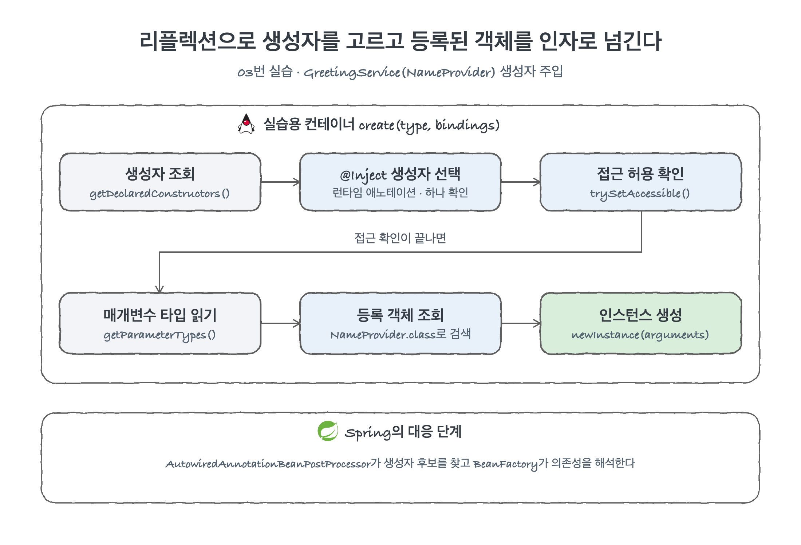
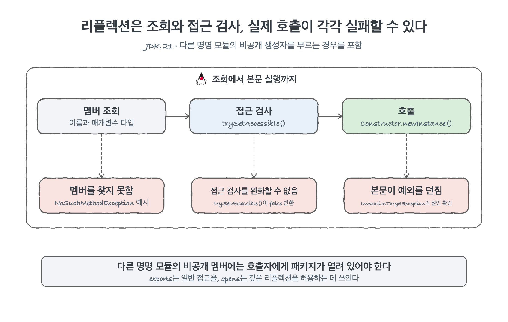

# Using Java Reflection for Dependency Injection

리플렉션을 사용하면 런타임에 클래스의 생성자·필드·메서드와 애노테이션을 조사하고 멤버에 접근할 수 있다. DI 컨테이너는 이 정보를 바탕으로 생성자의 매개변수를 확인하고, 등록한 객체를 인자로 넘겨 인스턴스를 만든다. Spring에서는 `AutowiredAnnotationBeanPostProcessor`가 주입 지점과 생성자 후보를 찾고 BeanFactory가 의존성을 해석한다. Spring 관리 빈에 생성자가 하나면 `@Autowired`를 생략할 수 있다. [Oracle · Class](https://docs.oracle.com/en/java/javase/21/docs/api/java.base/java/lang/Class.html) · [Spring Framework · Using @Autowired](https://docs.spring.io/spring-framework/reference/6.2/core/beans/annotation-config/autowired.html)

## 1. 클래스와 멤버 조회하기

| 목적 | API | 조회 범위 |
| --- | --- | --- |
| 타입 얻기 | `GreetingService.class`, `instance.getClass()` | 명시한 타입 또는 객체의 실제 런타임 클래스 |
| 이름으로 클래스 얻기 | `Class.forName(name, false, loader)` | 지정된 로더로 바이너리 이름을 해석하며 초기화는 요청하지 않음 |
| 메서드·필드 조회 | `getMethods()`, `getFields()` | 상속된 멤버를 포함하는 공개 멤버 |
| 선언된 멤버 조회 | `getDeclaredMethods()`, `getDeclaredFields()` | 해당 타입이 직접 선언한 멤버로 가시성 제한 없이 조회 |
| 생성자 조회 | `getConstructor(types…)`, `getDeclaredConstructor(types…)` | 앞의 메서드는 공개 생성자, 뒤의 메서드는 직접 선언한 생성자 |

오버로드된 메서드는 이름과 선언된 매개변수 타입으로 선택한다. 예를 들어 `int` 매개변수는 조회할 때 `int.class`로 지정한다. 멤버 배열에는 정해진 반환 순서가 없으므로 DI 컨테이너의 생성자 선택을 배열 순서에 맡기면 안 된다. 로딩과 초기화의 차이는 [01번 JVM 문서](01_understanding_the_jvm_and_class_loading.md)에서 이어진다. [Oracle · Class](https://docs.oracle.com/en/java/javase/21/docs/api/java.base/java/lang/Class.html)

## 2. 애노테이션을 읽어 생성자 주입하기

`@Target`은 애노테이션이 붙을 수 있는 위치를 정한다. `@Retention(RUNTIME)`으로 선언해야 `isAnnotationPresent()`나 `getAnnotation()`으로 런타임에 읽을 수 있다. `CLASS`는 클래스 파일에 남고, `SOURCE`는 컴파일 시점에 사용된다. 컴파일러가 애노테이션을 읽어 파일을 생성하는 흐름은 [05번 애노테이션 프로세서 문서](05_generating_code_with_java_annotation_processors.md)에서 다룬다. [Oracle · RetentionPolicy](https://docs.oracle.com/en/java/javase/21/docs/api/java.base/java/lang/annotation/RetentionPolicy.html) · [Oracle · AnnotatedElement](https://docs.oracle.com/en/java/javase/21/docs/api/java.base/java/lang/reflect/AnnotatedElement.html)

아래를 `ReflectionDemo.java`로 저장한다. 실습 컨테이너는 `@Inject` 생성자가 하나인지 확인하고, 생성자의 참조 타입 매개변수에 등록된 인스턴스를 전달한다. `Class.cast()`는 생성 결과를 요청한 타입으로 검사해 반환한다.

```java
import java.lang.annotation.ElementType;
import java.lang.annotation.Retention;
import java.lang.annotation.RetentionPolicy;
import java.lang.annotation.Target;
import java.lang.reflect.Constructor;
import java.lang.reflect.Field;
import java.lang.reflect.Method;
import java.util.Arrays;
import java.util.Map;

@Retention(RetentionPolicy.RUNTIME)
@Target(ElementType.CONSTRUCTOR)
@interface Inject {}

interface NameProvider {
    String name();
}

final class GreetingService {
    private final NameProvider names;
    private String prefix = "Hello";

    @Inject
    private GreetingService(NameProvider names) {
        this.names = names;
    }

    public String greet() {
        return prefix + ", " + names.name();
    }
}

public class ReflectionDemo {
    static <T> T create(Class<T> type, Map<Class<?>, ?> bindings)
            throws ReflectiveOperationException {
        Constructor<?>[] candidates = Arrays.stream(type.getDeclaredConstructors())
                .filter(ctor -> ctor.isAnnotationPresent(Inject.class))
                .toArray(Constructor<?>[]::new);
        if (candidates.length != 1) {
            throw new IllegalArgumentException("Expected one @Inject constructor: " + type.getName());
        }

        Constructor<?> constructor = candidates[0];
        if (!constructor.trySetAccessible()) {
            throw new IllegalAccessException("Cannot access " + constructor);
        }

        Class<?>[] parameterTypes = constructor.getParameterTypes();
        Object[] arguments = new Object[parameterTypes.length];
        for (int i = 0; i < parameterTypes.length; i++) {
            Class<?> parameterType = parameterTypes[i];
            Object dependency = bindings.get(parameterType);
            if (dependency == null) {
                throw new IllegalArgumentException("Missing binding: " + parameterType.getName());
            }
            arguments[i] = parameterType.cast(dependency);
        }
        return type.cast(constructor.newInstance(arguments));
    }

    public static void main(String[] args) throws ReflectiveOperationException {
        Map<Class<?>, ?> bindings = Map.of(NameProvider.class, (NameProvider) () -> "Java");
        GreetingService service = create(GreetingService.class, bindings);

        Method greet = service.getClass().getMethod("greet");
        System.out.println(greet.invoke(service));

        Field prefix = service.getClass().getDeclaredField("prefix");
        if (!prefix.trySetAccessible()) {
            throw new IllegalAccessException("Cannot access " + prefix);
        }
        prefix.set(service, "Hi");
        System.out.println(greet.invoke(service));
    }
}
```

```bash
javac ReflectionDemo.java
java ReflectionDemo
```

```text
Hello, Java
Hi, Java
```

`Constructor.newInstance()`가 생성자를 실행하고 `Method.invoke()`가 메서드를 실행한다. 예제 끝의 `Field.set()`은 이미 만든 객체의 가변 필드를 바꾸는 별도 리플렉션 실습이다. 이 컨테이너에는 정확한 타입으로 등록한 인스턴스만 들어간다. Spring 컨테이너를 사용할 때는 후보가 여러 개인 경우의 선택 규칙, 빈의 범위와 수명 주기도 적용된다. [Oracle · Constructor](https://docs.oracle.com/en/java/javase/21/docs/api/java.base/java/lang/reflect/Constructor.html) · [Oracle · Method](https://docs.oracle.com/en/java/javase/21/docs/api/java.base/java/lang/reflect/Method.html) · [Spring Framework · Constructor-Based DI](https://docs.spring.io/spring-framework/reference/6.2/core/beans/dependencies/factory-collaborators.html)



그림의 근거 · [JDK 21 생성자 호출](https://docs.oracle.com/en/java/javase/21/docs/api/java.base/java/lang/reflect/Constructor.html) · [Spring 6.2 생성자 주입](https://docs.spring.io/spring-framework/reference/6.2/core/beans/dependencies/factory-collaborators.html) · [Spring 생성자 후보 선택](https://docs.spring.io/spring-framework/docs/6.2.x/javadoc-api/org/springframework/beans/factory/annotation/AutowiredAnnotationBeanPostProcessor.html)

## 3. 접근 검사와 실패 지점

멤버를 찾았더라도 호출하거나 값을 바꿀 권한이 따로 필요하다. 예제의 클래스들은 같은 모듈에 있다. 다른 명명 모듈의 비공개 멤버에 접근할 때는 대상 패키지가 호출자 모듈에 열려 있어야 하며, `trySetAccessible()`은 해당 접근을 열 수 없으면 `false`를 반환한다. JPMS의 `exports`는 공개 타입에 대한 일반 접근을 열고, `opens`는 패키지 내부에 대한 깊은 리플렉션 접근을 허용한다. [Oracle · AccessibleObject](https://docs.oracle.com/en/java/javase/21/docs/api/java.base/java/lang/reflect/AccessibleObject.html) · [Java Language Specification · Module Declarations](https://docs.oracle.com/javase/specs/jls/se21/html/jls-7.html#jls-7.7)

멤버 이름이나 매개변수 타입이 맞지 않으면 조회에서 `NoSuchMethodException`이나 `NoSuchFieldException`이 발생할 수 있다. 메서드나 생성자 본문이 예외를 던지면 호출 API는 이를 `InvocationTargetException`으로 감싸므로 `getCause()`에서 실제 실패를 확인한다. [Oracle · InvocationTargetException](https://docs.oracle.com/en/java/javase/21/docs/api/java.base/java/lang/reflect/InvocationTargetException.html)



그림의 근거 · [JDK 21 멤버 조회](https://docs.oracle.com/en/java/javase/21/docs/api/java.base/java/lang/Class.html) · [JDK 21 리플렉션 접근](https://docs.oracle.com/en/java/javase/21/docs/api/java.base/java/lang/reflect/AccessibleObject.html) · [JDK 21 생성자 호출](https://docs.oracle.com/en/java/javase/21/docs/api/java.base/java/lang/reflect/Constructor.html)
