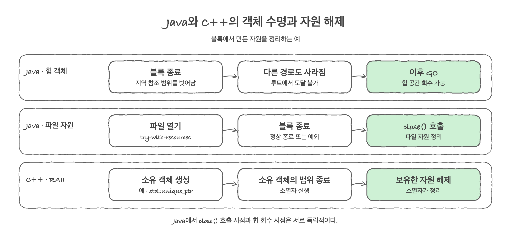
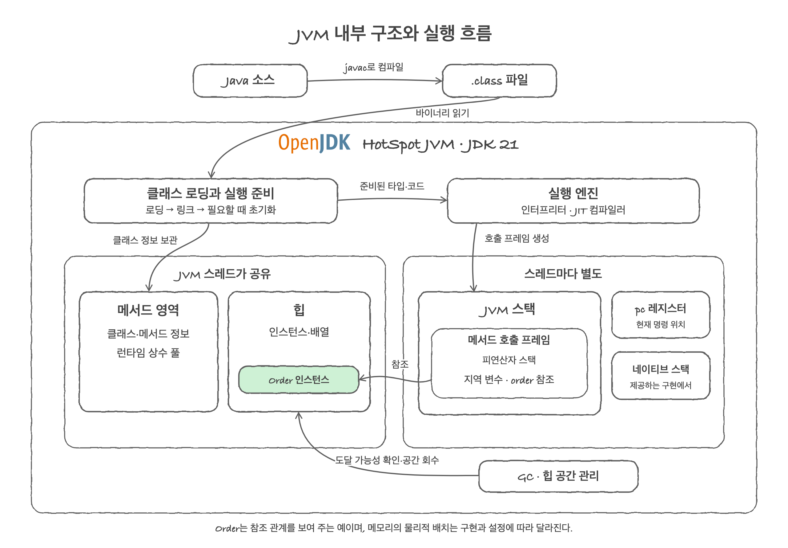
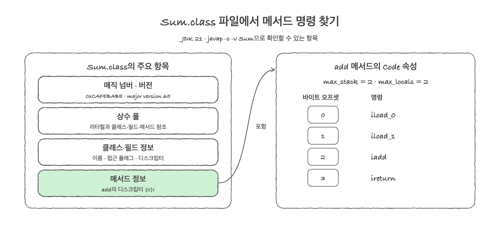
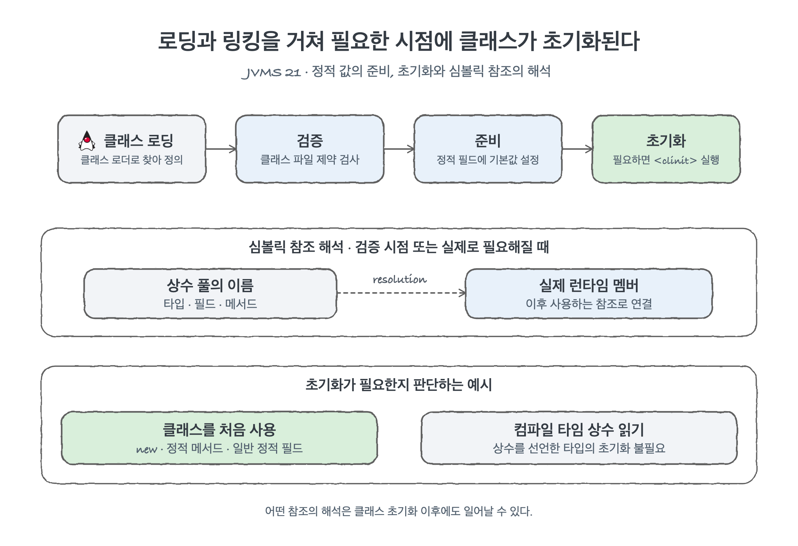
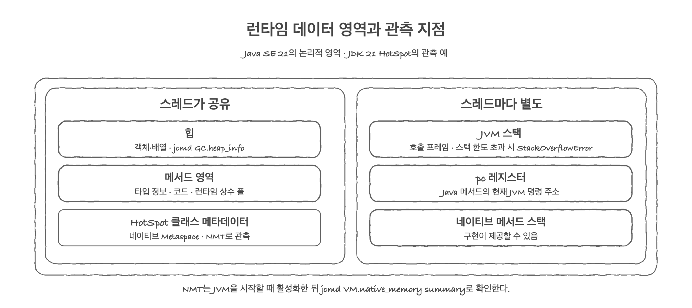
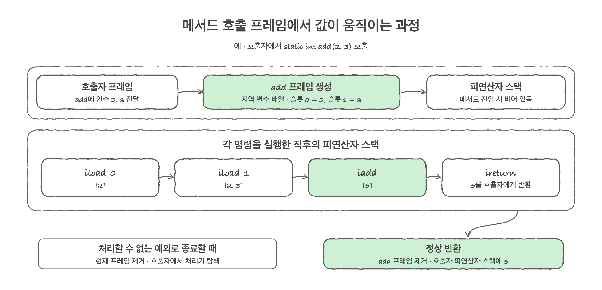
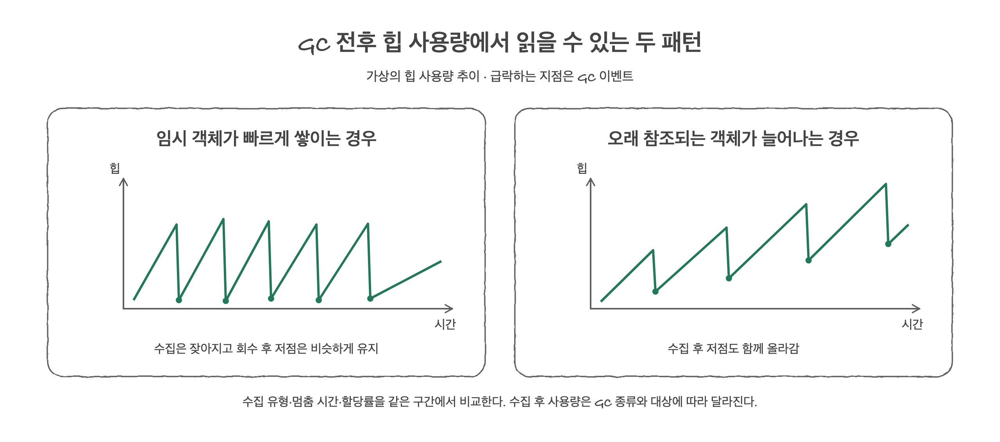

# JVM 기본 이론

Java 프로그램이 클래스 파일에서 실행되는 과정과 메서드가 사용하는 메모리를 Java SE 21 기준으로 살펴본다. 실행 최적화와 GC 관측은 JDK 21 HotSpot을 기준으로 한다. [JVMS 21 §2.1](https://docs.oracle.com/javase/specs/jvms/se21/html/jvms-2.html#jvms-2.1) · [JVMS 21 §2.5](https://docs.oracle.com/javase/specs/jvms/se21/html/jvms-2.html#jvms-2.5) · [JDK 21 HotSpot 성능 최적화](https://docs.oracle.com/en/java/javase/21/vm/java-hotspot-virtual-machine-performance-enhancements.html)

## 1. Java와 C++의 메모리 관리 비교

Java에서는 JVM이 힙 객체의 메모리를 관리한다. C++에서는 객체의 수명과 저장 기간을 소유 타입과 선언 위치로 모델링한다. 비교할 때는 객체가 차지하는 메모리와 파일·소켓처럼 직접 닫아야 할 자원을 구분한다. [JVMS 21 §2.5.3](https://docs.oracle.com/javase/specs/jvms/se21/html/jvms-2.html#jvms-2.5.3) · [C++ 작업 초안 · 객체 수명](https://eel.is/c++draft/basic.life)



Java의 힙 객체, Java의 파일 자원, C++ RAII 소유 객체에서 정리가 시작되는 지점을 비교했다. [JDK 21 참조와 도달 가능성](https://docs.oracle.com/en/java/javase/21/docs/api/java.base/java/lang/ref/package-summary.html) · [JLS 21 §14.20.3](https://docs.oracle.com/javase/specs/jls/se21/html/jls-14.html#jls-14.20.3) · [C++ 작업 초안 · 블록 변수 수명](https://eel.is/c++draft/stmt.dcl) · [C++ 작업 초안 · unique_ptr 소멸자](https://eel.is/c++draft/unique.ptr.single.dtor)

### 객체 수명과 소유권

Java의 클래스 인스턴스와 배열은 JVM 명세에서 힙에 할당된다. 참조가 지역 변수 범위를 벗어나도 다른 곳에서 객체에 도달할 수 있으면 살아 있다. 도달할 수 없게 된 시점과 메모리를 회수하는 시점은 다를 수 있다. [JVMS 21 §2.5.3](https://docs.oracle.com/javase/specs/jvms/se21/html/jvms-2.html#jvms-2.5.3) · [JDK 21 참조와 도달 가능성](https://docs.oracle.com/en/java/javase/21/docs/api/java.base/java/lang/ref/package-summary.html)

C++의 블록 지역 변수는 보통 자동 저장 기간을 가지며, 범위를 벗어날 때 소멸한다. 동적 객체도 `std::unique_ptr` 같은 소유 객체로 감싸면, 소유권을 넘기거나 해제하지 않은 경우 소유 객체가 소멸할 때 삭제가 실행된다. [C++ 작업 초안 · 블록 변수 수명](https://eel.is/c++draft/stmt.dcl) · [C++ 작업 초안 · unique_ptr](https://eel.is/c++draft/unique.ptr)

### 파일이나 소켓의 자원 해제

C++의 RAII(Resource Acquisition Is Initialization)는 자원 해제를 소유 객체의 소멸자에 연결한다. Java에서는 `AutoCloseable` 자원을 `try-with-resources`로 관리하면 초기화가 끝난 자원은 블록이 정상적으로 끝나거나 예외가 전파될 때 `close()`로 정리된다. [C++ 작업 초안 · 블록 변수 수명](https://eel.is/c++draft/stmt.dcl) · [JLS 21 §14.20.3](https://docs.oracle.com/javase/specs/jls/se21/html/jls-14.html#jls-14.20.3)

```java
try (var input = java.nio.file.Files.newInputStream(path)) {
    return input.read();
}
```

여기서 보장되는 것은 스트림을 닫는 호출이다. 스트림 객체의 힙 메모리 회수는 GC의 수명 규칙을 따른다. 실제 운영에서는 힙 사용량과 열린 파일 디스크립터 수를 각각 관찰한다. [JLS 21 §14.20.3](https://docs.oracle.com/javase/specs/jls/se21/html/jls-14.html#jls-14.20.3) · [JDK 21 참조와 도달 가능성](https://docs.oracle.com/en/java/javase/21/docs/api/java.base/java/lang/ref/package-summary.html)

## 2. JVM의 구성요소와 실행 흐름

JDK의 `javac`가 Java 소스를 `.class` 파일로 컴파일한다. JVM은 클래스 파일을 로드하고 링크한 다음, 초기화 조건을 충족할 때 초기화한다. 런타임 데이터 영역을 사용해 메서드 명령을 실행한다. [JDK 21 javac](https://docs.oracle.com/en/java/javase/21/docs/specs/man/javac.html) · [JVMS 21 §2.1](https://docs.oracle.com/javase/specs/jvms/se21/html/jvms-2.html#jvms-2.1) · [JVMS 21 §5](https://docs.oracle.com/javase/specs/jvms/se21/html/jvms-5.html)



공유 힙과 메서드 영역, 스레드별 스택과 프레임을 JVM 명세의 논리적 구조로 나타냈다. 실행 엔진은 JDK 21 HotSpot을 기준으로 그렸다. [JDK 21 javac](https://docs.oracle.com/en/java/javase/21/docs/specs/man/javac.html) · [JVMS 21 §2.5–2.6](https://docs.oracle.com/javase/specs/jvms/se21/html/jvms-2.html#jvms-2.5) · [JVMS 21 §5](https://docs.oracle.com/javase/specs/jvms/se21/html/jvms-5.html) · [JDK 21 HotSpot 성능 최적화](https://docs.oracle.com/en/java/javase/21/vm/java-hotspot-virtual-machine-performance-enhancements.html)

### 구성요소별 책임

클래스 로더는 이름에 맞는 클래스를 찾거나 부모에게 요청한다. JVM은 정의된 타입의 구조를 검증하고 필드를 준비하며, 실행에 필요한 심볼릭 참조를 해석한다. 타입마다 초기화 시점은 실제 사용 방식에 따라 달라진다. [JVMS 21 §5](https://docs.oracle.com/javase/specs/jvms/se21/html/jvms-5.html) · [JDK 21 ClassLoader](https://docs.oracle.com/en/java/javase/21/docs/api/java.base/java/lang/ClassLoader.html)

런타임 데이터 영역은 공유 힙·메서드 영역과 스레드별 `pc` 레지스터·JVM 스택 등으로 나뉜다. JVM 스택의 프레임은 메서드 호출 단위로 지역 변수와 피연산자를 관리한다. [JVMS 21 §2.5](https://docs.oracle.com/javase/specs/jvms/se21/html/jvms-2.html#jvms-2.5) · [JVMS 21 §2.6](https://docs.oracle.com/javase/specs/jvms/se21/html/jvms-2.html#jvms-2.6)

### HotSpot의 실행과 수집

HotSpot은 인터프리터로 바이트코드를 실행하고, 실행 빈도와 프로파일 정보를 바탕으로 JIT(Just-In-Time) 컴파일을 적용할 수 있다. 해석과 컴파일의 전환은 HotSpot의 실행 전략이다. [JDK 21 HotSpot 성능 최적화](https://docs.oracle.com/en/java/javase/21/vm/java-hotspot-virtual-machine-performance-enhancements.html)

GC는 도달 가능성 등을 바탕으로 힙 공간을 회수한다. JVM 명세는 특정 수집 알고리즘이나 객체 헤더 배치를 지정하지 않는다. 비교할 때는 JDK 버전과 선택한 수집기를 함께 기록한다. [JVMS 21 §2.5.3](https://docs.oracle.com/javase/specs/jvms/se21/html/jvms-2.html#jvms-2.5.3) · [JVMS 21 §2.13](https://docs.oracle.com/javase/specs/jvms/se21/html/jvms-2.html#jvms-2.13)

## 3. .class 파일과 Java 바이트코드 읽기

`.class` 파일은 `0xCAFEBABE`, 포맷 버전, 상수 풀, 타입·필드·메서드 정보와 속성을 담은 바이너리다. Java SE 21의 클래스 파일 메이저 버전은 `65`다. [JVMS 21 §4.1](https://docs.oracle.com/javase/specs/jvms/se21/html/jvms-4.html#jvms-4.1)



아래 Sum 예제를 JDK 21로 컴파일한 뒤 javap로 확인한 값이다. [JVMS 21 §4.1](https://docs.oracle.com/javase/specs/jvms/se21/html/jvms-4.html#jvms-4.1) · [JVMS 21 §4.7.3](https://docs.oracle.com/javase/specs/jvms/se21/html/jvms-4.html#jvms-4.7.3) · [JDK 21 javap](https://docs.oracle.com/en/java/javase/21/docs/specs/man/javap.html)

### 상수 풀과 메서드 코드

상수 풀에는 문자열·수치 상수 외에 클래스, 필드, 메서드의 심볼릭 참조가 들어갈 수 있다. 일반적인 Java 메서드의 실행 명령은 `Code` 속성에 있으며, 이 속성에는 `max_stack`, `max_locals`와 예외 처리 테이블도 들어간다. [JVMS 21 §4.4](https://docs.oracle.com/javase/specs/jvms/se21/html/jvms-4.html#jvms-4.4) · [JVMS 21 §4.7.3](https://docs.oracle.com/javase/specs/jvms/se21/html/jvms-4.html#jvms-4.7.3)

### javap로 명령 확인하기

JDK 21에서 다음 코드를 `Sum.java`로 저장한다. `javap -c`는 역어셈블된 명령을, `-v`는 버전과 상수 풀 등 추가 정보를 표시한다. [JDK 21 javac](https://docs.oracle.com/en/java/javase/21/docs/specs/man/javac.html) · [JDK 21 javap](https://docs.oracle.com/en/java/javase/21/docs/specs/man/javap.html)

```java
public final class Sum {
    public static int add(int a, int b) {
        return a + b;
    }
}
```

```sh
javac --release 21 Sum.java
javap -c -v Sum
```

이 메서드의 `iload_0`과 `iload_1`은 두 지역 변수 슬롯의 값을 피연산자 스택에 올린다. `iadd`는 두 값을 꺼내 합을 올리고, `ireturn`은 정수 결과를 호출자에게 반환한다. `javap` 출력의 `0`, `1` 같은 번호는 명령의 바이트 오프셋이다. [JVMS 21 §6.5](https://docs.oracle.com/javase/specs/jvms/se21/html/jvms-6.html#jvms-6.5) · [JVMS 21 §4.7.3](https://docs.oracle.com/javase/specs/jvms/se21/html/jvms-4.html#jvms-4.7.3)

## 4. 클래스 로더와 로딩·링크·초기화

일반 클래스의 런타임 타입은 바이너리 이름과 정의한 클래스 로더의 조합으로 결정된다. `ClassLoader.loadClass`의 기본 구현은 이미 로드했는지 검사하고, 부모에게 위임한 뒤, 부모가 못 찾으면 `findClass`로 자체 검색한다. [JVMS 21 §5](https://docs.oracle.com/javase/specs/jvms/se21/html/jvms-5.html) · [JDK 21 ClassLoader](https://docs.oracle.com/en/java/javase/21/docs/api/java.base/java/lang/ClassLoader.html)

### 실행 준비의 순서

로딩은 바이너리에서 클래스를 정의하는 단계다. 링크의 검증은 클래스 파일의 제약을 확인하고, 준비는 정적 필드에 기본값을 설정한다. 해석은 상수 풀의 심볼릭 참조를 실제 대상으로 연결하며, 일부 참조의 해석은 최초 사용까지 늦출 수 있다. [JVMS 21 §5](https://docs.oracle.com/javase/specs/jvms/se21/html/jvms-5.html) · [JVMS 21 §5.4](https://docs.oracle.com/javase/specs/jvms/se21/html/jvms-5.html#jvms-5.4)

초기화는 정적 초기화 코드가 동작하는 단계다. `new`, 정적 메서드 호출, 컴파일 타임 상수가 아닌 정적 필드의 최초 사용 등이 초기화를 유발한다. 클래스 리터럴과 컴파일 타임 상수의 읽기는 초기화 트리거에 해당하지 않는다. [JVMS 21 §5.5](https://docs.oracle.com/javase/specs/jvms/se21/html/jvms-5.html#jvms-5.5) · [JLS 21 §12.4.1](https://docs.oracle.com/javase/specs/jls/se21/html/jls-12.html#jls-12.4.1)



검증과 준비는 초기화 전에 끝나고, 심볼릭 참조의 해석 시점은 구현 전략에 따라 달라질 수 있다. [JVMS 21 §5.4](https://docs.oracle.com/javase/specs/jvms/se21/html/jvms-5.html#jvms-5.4) · [JVMS 21 §5.5](https://docs.oracle.com/javase/specs/jvms/se21/html/jvms-5.html#jvms-5.5) · [JLS 21 §12.4.1](https://docs.oracle.com/javase/specs/jls/se21/html/jls-12.html#jls-12.4.1)

### 초기화 시점 재현하기

다음을 `InitOrder.java`로 저장해 JDK 21에서 실행한다. 리터럴로 클래스 이름을 얻고 상수를 읽은 다음, 일반 정적 필드를 읽을 때 초기화 로그가 출력되는지 확인한다. [JLS 21 §12.4.1](https://docs.oracle.com/javase/specs/jls/se21/html/jls-12.html#jls-12.4.1)

```java
public class InitOrder {
    static class Target {
        static final int LIMIT = 10;
        static int value = initialize();

        private static int initialize() {
            System.out.println("initialized");
            return 20;
        }
    }

    public static void main(String[] args) {
        System.out.println(Target.class.getSimpleName());
        System.out.println(Target.LIMIT);
        System.out.println(Target.value);
    }
}
```

```sh
javac --release 21 InitOrder.java
java InitOrder
```

정적 초기화가 실패하면 최초 요청의 `ExceptionInInitializerError`와 이후 같은 클래스에 대한 `NoClassDefFoundError`가 함께 보일 수 있다. 최초 실패 로그에서 예외의 원인을 확인한다. [JVMS 21 §5.5](https://docs.oracle.com/javase/specs/jvms/se21/html/jvms-5.html#jvms-5.5)

## 5. JVM 런타임 데이터 영역

JVM 명세는 영역이 스레드 사이에서 공유되는지와 어떤 데이터를 다루는지 정의한다. HotSpot의 메모리 주소 배치와 크기는 구현과 설정에 따라 달라진다. [JVMS 21 §2.5](https://docs.oracle.com/javase/specs/jvms/se21/html/jvms-2.html#jvms-2.5) · [JVMS 21 §2.13](https://docs.oracle.com/javase/specs/jvms/se21/html/jvms-2.html#jvms-2.13)

### 공유 영역과 스레드별 영역

힙은 스레드가 공유하며 클래스 인스턴스와 배열을 갖는다. 메서드 영역은 타입별 필드·메서드 정보, 메서드 코드, 런타임 상수 풀 등을 갖는다. 런타임 상수 풀은 클래스나 인터페이스별 구조다. [JVMS 21 §2.5](https://docs.oracle.com/javase/specs/jvms/se21/html/jvms-2.html#jvms-2.5)

`pc` 레지스터와 JVM 스택은 스레드별로 존재한다. Java 메서드를 실행하는 동안 `pc` 레지스터는 현재 JVM 명령의 주소를 담고, 네이티브 메서드 실행 중 값은 정의되지 않는다. 구현은 네이티브 메서드 스택을 제공할 수 있다. [JVMS 21 §2.5](https://docs.oracle.com/javase/specs/jvms/se21/html/jvms-2.html#jvms-2.5)



스택 한도 초과 오류는 스레드의 호출 프레임에서, 클래스 메타데이터 사용량은 HotSpot의 네이티브 메모리에서 살펴본다. [JVMS 21 §2.5](https://docs.oracle.com/javase/specs/jvms/se21/html/jvms-2.html#jvms-2.5) · [JDK 21 클래스 메타데이터](https://docs.oracle.com/en/java/javase/21/gctuning/other-considerations.html) · [JDK 21 jcmd](https://docs.oracle.com/en/java/javase/21/docs/specs/man/jcmd.html) · [JDK 21 Native Memory Tracking](https://docs.oracle.com/en/java/javase/21/vm/native-memory-tracking.html)

### 오류 메시지와 관측 대상 연결하기

JVM 스택이 허용 범위를 넘으면 `StackOverflowError`가 발생한다. 스택 확장이나 새 스레드의 스택 확보에 필요한 메모리가 부족하거나 힙 할당을 만족할 수 없는 경우에는 각각 `OutOfMemoryError`가 발생할 수 있다. 오류 이름과 세부 메시지를 구분해 진단한다. [JVMS 21 §2.5](https://docs.oracle.com/javase/specs/jvms/se21/html/jvms-2.html#jvms-2.5)

HotSpot에서 Metaspace는 네이티브 메모리에서 클래스 메타데이터를 관리한다. 메서드 영역은 JVM 명세의 개념이며, Metaspace를 그 영역 전체의 물리적 배치로 간주할 수 없다. `jcmd`의 `GC.heap_info`로 힙을 확인하고, JVM 시작 시 NMT를 활성화한 경우 `VM.native_memory summary`로 HotSpot 내부 메모리 사용량을 구분한다. [JDK 21 클래스 메타데이터](https://docs.oracle.com/en/java/javase/21/gctuning/other-considerations.html) · [JDK 21 jcmd](https://docs.oracle.com/en/java/javase/21/docs/specs/man/jcmd.html) · [JDK 21 Native Memory Tracking](https://docs.oracle.com/en/java/javase/21/vm/native-memory-tracking.html)

## 6. JVM 스택과 메서드 호출 프레임

메서드가 호출되면 실행 스레드에 프레임이 생기고, 호출이 정상 반환하거나 예외로 끝나면 프레임이 제거된다. 프레임에는 지역 변수 배열, 피연산자 스택과 현재 메서드가 속한 타입의 런타임 상수 풀 참조가 있다. [JVMS 21 §2.6](https://docs.oracle.com/javase/specs/jvms/se21/html/jvms-2.html#jvms-2.6)



정상 반환과 처리하지 못한 예외는 모두 현재 프레임을 끝낸다. 예외의 경우 호출자에서 처리기를 찾는다. [JVMS 21 §2.6](https://docs.oracle.com/javase/specs/jvms/se21/html/jvms-2.html#jvms-2.6) · [JVMS 21 §6.5](https://docs.oracle.com/javase/specs/jvms/se21/html/jvms-6.html#jvms-6.5)

### 지역 변수 슬롯과 피연산자 스택

`static int add(int a, int b)`의 인수는 슬롯 `0`과 `1`에 들어간다. 인스턴스 메서드에서는 슬롯 `0`이 `this`여서 인수가 그 뒤에 들어간다. 지역 변수에서 `long`과 `double`은 연속한 두 슬롯을 사용한다. [JVMS 21 §2.6](https://docs.oracle.com/javase/specs/jvms/se21/html/jvms-2.html#jvms-2.6)

`iload_0`과 `iload_1`은 값을 스택에 올리고, `iadd`는 두 값을 꺼내 합을 다시 올린다. `ireturn`을 실행하면 결과가 호출자 프레임에 전달된다. 지역 변수의 값과 계산 중인 피연산자가 어떻게 이동하는지 `javap -c`로 볼 수 있다. [JVMS 21 §6.5](https://docs.oracle.com/javase/specs/jvms/se21/html/jvms-6.html#jvms-6.5) · [JDK 21 javap](https://docs.oracle.com/en/java/javase/21/docs/specs/man/javap.html)

### 예외 전파와 스택 한도

현재 메서드에 맞는 예외 처리기가 없으면 호출이 비정상 종료되고 JVM은 호출자에서 처리기를 찾는다. 깊은 호출에서 `StackOverflowError`가 보이면 반복되는 프레임과 종료 조건을 먼저 확인한다. HotSpot에서 플랫폼 스레드의 스택 크기를 바꿀 때는 `-Xss`와 스레드 수가 메모리에 미치는 영향을 함께 고려한다. [JVMS 21 §2.10](https://docs.oracle.com/javase/specs/jvms/se21/html/jvms-2.html#jvms-2.10) · [JVMS 21 §2.5](https://docs.oracle.com/javase/specs/jvms/se21/html/jvms-2.html#jvms-2.5) · [JDK 21 java 명령](https://docs.oracle.com/en/java/javase/21/docs/specs/man/java.html)

## 7. JVM 힙 할당과 GC 관측

JVM 힙은 스레드 전체가 공유하며 인스턴스와 배열을 담는다. GC 이후에도 살아 있는 객체가 많거나 다음 할당을 위한 연속 공간을 마련하지 못하면, 수집기가 동작했더라도 할당을 만족하지 못할 수 있다. [JVMS 21 §2.5.3](https://docs.oracle.com/javase/specs/jvms/se21/html/jvms-2.html#jvms-2.5.3) · [JDK 21 G1 수집기](https://docs.oracle.com/en/java/javase/21/gctuning/garbage-first-g1-garbage-collector1.html)

### 할당률과 실제 살아 있는 데이터의 크기

짧은 시간에 임시 객체를 많이 만드는 경우에는 할당률이 높아져 수집이 잦아질 수 있다. 캐시나 큐가 오래 참조하는 객체가 늘어나는 경우에는 회수 후 사용량도 커질 수 있다. 할당률, 수집 전후 점유량, 멈춤 시간과 수집 유형을 같은 구간에서 비교한다. [Oracle HotSpot GC 백서 · 세대 수집](https://www.oracle.com/technetwork/java/javase/tech/memorymanagement-whitepaper-1-150020.pdf) · [JDK 21 G1 수집기](https://docs.oracle.com/en/java/javase/21/gctuning/garbage-first-g1-garbage-collector1.html)



두 그래프는 가상의 관측 예다. 실제 로그에서는 수집 유형과 대상이 같은 구간의 회수 전후 사용량을 함께 비교한다. [Oracle HotSpot GC 백서](https://www.oracle.com/technetwork/java/javase/tech/memorymanagement-whitepaper-1-150020.pdf) · [JDK 21 G1 수집기](https://docs.oracle.com/en/java/javase/21/gctuning/garbage-first-g1-garbage-collector1.html)

### JDK 21에서 먼저 볼 지표

HotSpot에서 `-Xms`와 `-Xmx`는 각각 초기 힙 크기와 최대 힙 크기를 설정한다. 힙 한도와 프로세스 전체 메모리는 별개다. 클래스 메타데이터, 스레드 스택 같은 다른 사용량도 확인한다. [JDK 21 java 명령](https://docs.oracle.com/en/java/javase/21/docs/specs/man/java.html) · [JDK 21 Native Memory Tracking](https://docs.oracle.com/en/java/javase/21/vm/native-memory-tracking.html)

```sh
java -Xmx512m '-Xlog:gc*,safepoint' -jar app.jar
jcmd <pid> GC.heap_info
```

예시의 `512m`는 실행 옵션을 보여 주기 위한 값이다. 원인을 좁힐 때는 로그의 수집 전후 힙 사용량과 애플리케이션 지연을 함께 기록한다. `GC.heap_info`는 접근 가능한 JVM의 한 시점 힙 정보를 확인하는 명령이다. [JDK 21 java 명령](https://docs.oracle.com/en/java/javase/21/docs/specs/man/java.html) · [JDK 21 jcmd](https://docs.oracle.com/en/java/javase/21/docs/specs/man/jcmd.html)
