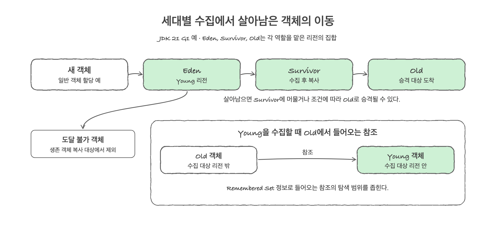
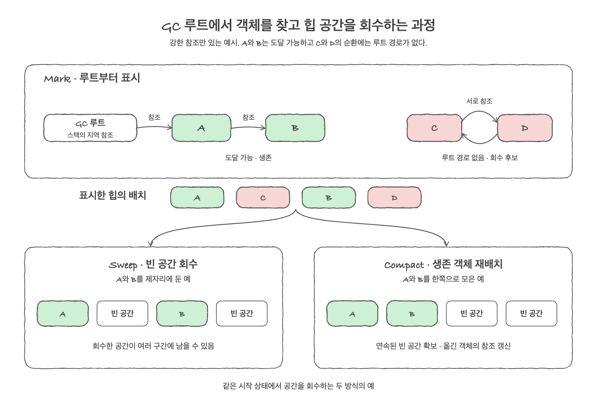
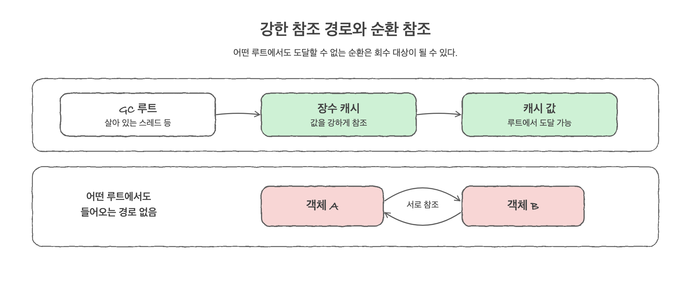
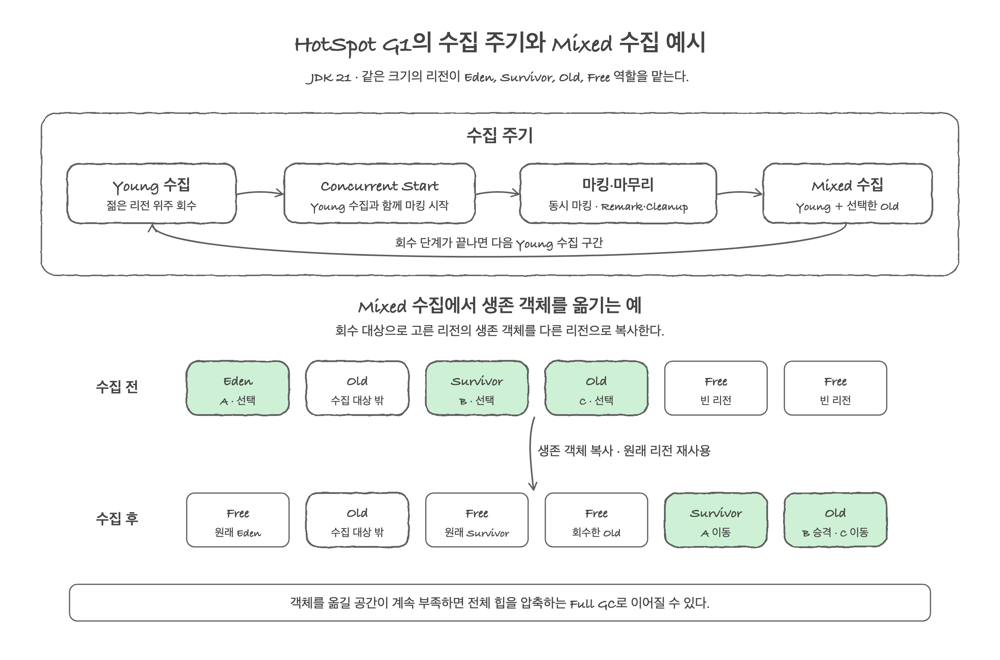
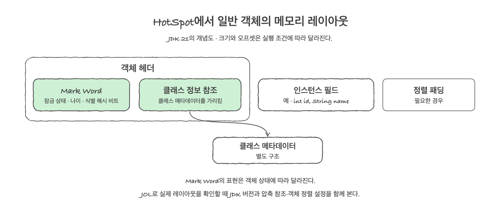
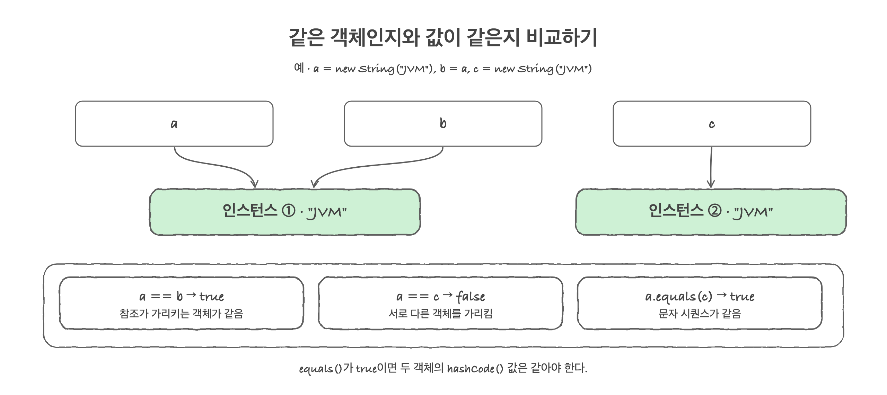
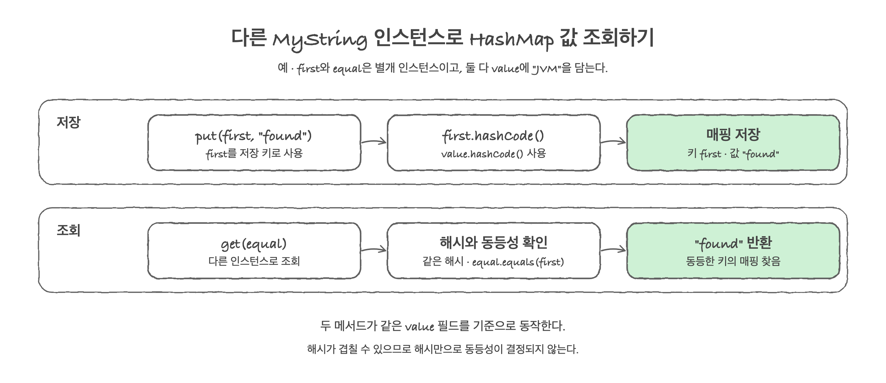

# JVM과 GC, 객체의 동일성과 동등성

힙이 객체를 회수하는 과정과 Java 코드에서 객체를 비교하는 규칙을 살펴본다. GC 동작과 객체 레이아웃의 구현 사례는 JDK 21 HotSpot을 기준으로 한다. [JVMS 21 §2.5.3](https://docs.oracle.com/javase/specs/jvms/se21/html/jvms-2.html#jvms-2.5.3) · [JDK 21 G1 수집기](https://docs.oracle.com/en/java/javase/21/gctuning/garbage-first-g1-garbage-collector1.html) · [JDK 21 Object.equals](https://docs.oracle.com/en/java/javase/21/docs/api/java.base/java/lang/Object.html#equals(java.lang.Object)) · [OpenJDK 21 Mark Word](https://github.com/openjdk/jdk/blob/jdk-21%2B35/src/hotspot/share/oops/markWord.hpp)

## 1. 세대별 가비지 컬렉션

세대별 GC는 새로 만들어진 객체 중 다수가 짧게 살아남는 경향을 활용한다. 단명 객체가 많은 영역에 수집을 집중하면 매번 오래된 데이터 전체를 조사하는 비용을 줄일 수 있다. [Oracle HotSpot GC 백서 · 세대 수집](https://www.oracle.com/technetwork/java/javase/tech/memorymanagement-whitepaper-1-150020.pdf) · [JDK 21 G1 수집기](https://docs.oracle.com/en/java/javase/21/gctuning/garbage-first-g1-garbage-collector1.html)

### 새 객체에서 오래된 객체까지

세대별 수집기에서는 젊은 세대의 Eden에 할당된 객체가 수집에서 살아남으면 Survivor로 이동할 수 있다. 객체의 나이와 공간 사정에 따라 Old로 승격된다. G1에서 Eden, Survivor, Old는 필요에 따라 각 역할을 맡는 리전의 집합이다. [Oracle HotSpot GC 백서 · 세대 수집](https://www.oracle.com/technetwork/java/javase/tech/memorymanagement-whitepaper-1-150020.pdf) · [JDK 21 G1 수집기](https://docs.oracle.com/en/java/javase/21/gctuning/garbage-first-g1-garbage-collector1.html)



세대 이동과 세대 간 참조를 G1의 리전 단위로 나타냈다. [JDK 21 G1 수집기](https://docs.oracle.com/en/java/javase/21/gctuning/garbage-first-g1-garbage-collector1.html)

### 세대를 가로지르는 참조

젊은 세대만 수집해도 Old 객체가 참조하는 Young 객체는 살아 있어야 한다. G1은 Remembered Set을 사용해 수집 대상 리전 바깥에서 들어오는 참조의 후보를 추적한다. 이 정보로 더 넓은 힙 전체를 매번 탐색하는 일을 줄인다. [JDK 21 G1 수집기](https://docs.oracle.com/en/java/javase/21/gctuning/garbage-first-g1-garbage-collector1.html)

### 운영에서 확인할 지표

젊은 세대 수집이 잦다면 할당률을 확인한다. Old 점유량과 승격이 계속 늘면 살아 있는 데이터의 증가와 승격 압력을 함께 살핀다. G1의 Mixed 수집은 Young 리전과 수집 대상으로 고른 Old 리전을 함께 처리한다. [Oracle HotSpot GC 백서 · 세대 수집](https://www.oracle.com/technetwork/java/javase/tech/memorymanagement-whitepaper-1-150020.pdf) · [JDK 21 G1 수집기](https://docs.oracle.com/en/java/javase/21/gctuning/garbage-first-g1-garbage-collector1.html) · [JDK 21 G1 튜닝](https://docs.oracle.com/en/java/javase/21/gctuning/garbage-first-garbage-collector-tuning.html)

## 2. GC의 Mark·Sweep·Compact

Mark, Sweep, Compact는 수집기가 생존 객체를 식별하고 공간을 회수하는 서로 다른 작업이다. 조합과 수행 시점은 수집기마다 다르다. [JVMS 21 §2.5.3](https://docs.oracle.com/javase/specs/jvms/se21/html/jvms-2.html#jvms-2.5.3) · [Oracle HotSpot GC 백서 · 수집 단계](https://www.oracle.com/technetwork/java/javase/tech/memorymanagement-whitepaper-1-150020.pdf) · [JDK 21 G1 수집기](https://docs.oracle.com/en/java/javase/21/gctuning/garbage-first-g1-garbage-collector1.html)



같은 힙 배치에서 시작해 Sweep 후 흩어진 빈 공간과 Compact 후 연속된 빈 공간을 비교했다. 그래프는 강한 참조만 있는 예시다. [JVMTI 21 힙 참조 종류](https://docs.oracle.com/en/java/javase/21/docs/specs/jvmti.html#jvmtiHeapReferenceKind) · [JDK 21 참조와 도달 가능성](https://docs.oracle.com/en/java/javase/21/docs/api/java.base/java/lang/ref/package-summary.html) · [Oracle HotSpot GC 백서](https://www.oracle.com/technetwork/java/javase/tech/memorymanagement-whitepaper-1-150020.pdf)

### 표시와 회수

**Mark**는 루트에서 참조를 따라가며 살아 있는 객체를 표시하는 작업이다. **Sweep**은 살아 있지 않다고 판단한 영역을 다시 할당할 수 있게 회수한다. 살아 있는 객체를 제자리에 두고 회수하면 빈 공간이 여러 구간에 흩어질 수 있다. [JVMTI 21 힙 참조 종류](https://docs.oracle.com/en/java/javase/21/docs/specs/jvmti.html#jvmtiHeapReferenceKind) · [Oracle HotSpot GC 백서 · 수집 단계](https://www.oracle.com/technetwork/java/javase/tech/memorymanagement-whitepaper-1-150020.pdf)

### 압축과 복사

**Compact**는 살아 있는 객체를 옮기고 참조를 갱신해 빈 공간을 모은다. 복사 기반 수집은 선택한 공간의 생존 객체를 다른 공간으로 옮겨 원래 공간을 다시 사용할 수 있게 한다. 이동에는 대상 공간과 참조 갱신 비용이 따른다. [Oracle HotSpot GC 백서 · 수집 단계](https://www.oracle.com/technetwork/java/javase/tech/memorymanagement-whitepaper-1-150020.pdf) · [JDK 21 G1 수집기](https://docs.oracle.com/en/java/javase/21/gctuning/garbage-first-g1-garbage-collector1.html)

### HotSpot에서 구분할 사례

JDK 21 G1의 일반 회수는 선택한 리전에서 생존 객체를 옮기는 evacuation에 기반한다. 심한 메모리 압박에서 G1이 수행하는 Full GC는 전체 힙을 대상으로 멈춤 상태에서 제자리 압축을 수행한다. Young·Mixed·Full 이벤트를 나눠 로그에서 확인한다. [JDK 21 G1 수집기](https://docs.oracle.com/en/java/javase/21/gctuning/garbage-first-g1-garbage-collector1.html)

## 3. GC 루트와 객체 도달 가능성

GC 관점에서 객체의 생존을 판단할 때는 프로그램이 시작점으로 삼는 참조에서 객체까지 경로를 찾는다. 이 시작점을 GC Roots라고 한다. JVM 도구 인터페이스에서는 스택의 지역 참조와 JNI 전역 참조 등이 루트 참조의 종류로 노출된다. [JVMTI 21 힙 참조 종류](https://docs.oracle.com/en/java/javase/21/docs/specs/jvmti.html#jvmtiHeapReferenceKind) · [JDK 21 참조와 도달 가능성](https://docs.oracle.com/en/java/javase/21/docs/api/java.base/java/lang/ref/package-summary.html)

### 순환 참조와 루트 경로

아래는 강한 참조만 있는 그래프다. `A`와 `B`가 서로 참조해도 어떤 루트에서도 둘에게 도달할 수 없으면 두 객체의 메모리는 회수 대상이 될 수 있다. 반대로 장수 캐시에서 객체까지 강한 경로가 남으면 수집만으로 그 경로는 사라지지 않는다. [JDK 21 참조와 도달 가능성](https://docs.oracle.com/en/java/javase/21/docs/api/java.base/java/lang/ref/package-summary.html) · [JDK 21 메모리 누수 진단](https://docs.oracle.com/en/java/javase/21/troubleshoot/troubleshooting-memory-leaks.html)



루트에서 따라갈 수 있는 강한 경로의 유무가 두 객체 집합의 차이다. [JDK 21 참조와 도달 가능성](https://docs.oracle.com/en/java/javase/21/docs/api/java.base/java/lang/ref/package-summary.html) · [JDK 21 메모리 누수 진단](https://docs.oracle.com/en/java/javase/21/troubleshoot/troubleshooting-memory-leaks.html)

### 강한 참조와 특수 참조

Java의 `java.lang.ref`는 soft, weak, phantom 도달 가능성을 따로 정의한다. 단순한 개수 비교로 생존 여부를 판단하기보다 어떤 참조 경로가 있는지 확인한다. 힙 덤프를 분석한다면 객체가 몇 개 있는지와 함께 무엇이 그 객체를 붙잡는지 살핀다. [JDK 21 참조와 도달 가능성](https://docs.oracle.com/en/java/javase/21/docs/api/java.base/java/lang/ref/package-summary.html) · [JDK 21 메모리 누수 진단](https://docs.oracle.com/en/java/javase/21/troubleshoot/troubleshooting-memory-leaks.html)

## 4. HotSpot G1 GC의 동작과 로그 읽기

JDK 21의 G1은 힙을 같은 크기의 리전으로 나누고, 수집할 리전 집합을 선택한다. 목표 멈춤 시간을 고려해 작업량을 조절하며 `-XX:MaxGCPauseMillis`는 시간의 상한 보장이 아니다. [JDK 21 G1 수집기](https://docs.oracle.com/en/java/javase/21/gctuning/garbage-first-g1-garbage-collector1.html) · [JDK 21 G1 튜닝](https://docs.oracle.com/en/java/javase/21/gctuning/garbage-first-garbage-collector-tuning.html)



JDK 21 HotSpot G1에서 Mixed 수집이 선택한 Young·Old 리전의 생존 객체를 옮기는 모습을 수집 전후의 배치로 나타냈다. [JDK 21 G1 수집기](https://docs.oracle.com/en/java/javase/21/gctuning/garbage-first-g1-garbage-collector1.html)

### Young 수집, 동시 마킹, Mixed 수집

Young 수집은 젊은 리전의 생존 객체를 옮긴다. Old 회수 후보를 찾기 위한 마킹의 상당 부분은 애플리케이션과 동시에 진행되지만, Remark와 같이 애플리케이션을 멈추는 단계도 있다. 마킹 이후 Mixed 수집은 Young과 선택된 Old 리전을 함께 회수한다. [JDK 21 G1 수집기](https://docs.oracle.com/en/java/javase/21/gctuning/garbage-first-g1-garbage-collector1.html)

### 대형 객체와 Full GC

리전 크기의 절반 이상인 객체는 G1에서 Humongous 객체로 분류된다. 큰 배열 할당이 잦다면 해당 리전의 사용량과 Full GC의 동반 여부를 확인한다. Evacuation에 쓸 공간이 부족해 회수가 진행되지 않으면 더 긴 Full GC로 이어질 수 있다. [JDK 21 G1 수집기](https://docs.oracle.com/en/java/javase/21/gctuning/garbage-first-g1-garbage-collector1.html) · [JDK 21 G1 튜닝](https://docs.oracle.com/en/java/javase/21/gctuning/garbage-first-garbage-collector-tuning.html)

### 처리량과 멈춤 시간을 함께 관찰하기

```sh
java -XX:+UseG1GC '-Xlog:gc*,safepoint' -jar app.jar
```

먼저 로그에서 Young·Mixed·Full 수집, 동시 마킹, 수집 전후 점유량을 구분한다. 튜닝에서는 동일한 요청 부하에서 멈춤 시간과 처리량을 함께 비교하고, 변경한 설정을 한 번에 하나씩 검증한다. [JDK 21 java 명령](https://docs.oracle.com/en/java/javase/21/docs/specs/man/java.html) · [JDK 21 G1 튜닝](https://docs.oracle.com/en/java/javase/21/gctuning/garbage-first-garbage-collector-tuning.html)

## 5. HotSpot 객체 메모리 레이아웃과 식별 해시

JVM 명세는 객체의 내부 구조를 특정하지 않는다. JDK 21 HotSpot의 일반 객체를 관찰할 때는 헤더, 인스턴스 필드, 정렬에 필요한 패딩을 구분한다. 레이아웃과 크기는 JVM 빌드, 설정, 타입에 따라 달라질 수 있다. [JVMS 21 §2.7](https://docs.oracle.com/javase/specs/jvms/se21/html/jvms-2.html#jvms-2.7) · [OpenJDK 21 oopDesc](https://raw.githubusercontent.com/openjdk/jdk/jdk-21%2B35/src/hotspot/share/oops/oop.hpp) · [OpenJDK Java Object Layout](https://github.com/openjdk/jol)

### 헤더에는 어떤 정보가 들어가는가

JDK 21 HotSpot 소스의 일반 객체 헤더는 Mark Word와 클래스 메타데이터를 가리키는 부분을 포함한다. Mark Word는 정상 상태의 식별 해시 비트, 객체 나이, 잠금 상태 등을 표현하는 데 쓰이며, 표현은 객체의 상태에 따라 달라진다. [OpenJDK 21 Mark Word](https://github.com/openjdk/jdk/blob/jdk-21%2B35/src/hotspot/share/oops/markWord.hpp) · [OpenJDK 21 oopDesc](https://raw.githubusercontent.com/openjdk/jdk/jdk-21%2B35/src/hotspot/share/oops/oop.hpp)



Mark Word의 표현은 객체 상태에 따라 달라진다. 실제 오프셋과 크기는 실행 환경에서 JOL 등으로 확인한다. [OpenJDK 21 oopDesc](https://raw.githubusercontent.com/openjdk/jdk/jdk-21%2B35/src/hotspot/share/oops/oop.hpp) · [OpenJDK 21 Mark Word](https://github.com/openjdk/jdk/blob/jdk-21%2B35/src/hotspot/share/oops/markWord.hpp) · [OpenJDK Java Object Layout](https://github.com/openjdk/jol)

### 해시와 메모리 주소

`System.identityHashCode(obj)`는 클래스가 `hashCode()`를 재정의했는지와 관계없이 기본 식별 해시를 반환한다. 서로 다른 객체의 해시값이 같을 수 있다. 이 값은 식별 해시 API의 반환값으로 해석한다. 객체 참조의 동일성은 `==`로 판단한다. [JDK 21 System.identityHashCode](https://docs.oracle.com/en/java/javase/21/docs/api/java.base/java/lang/System.html#identityHashCode(java.lang.Object)) · [JDK 21 Object.hashCode](https://docs.oracle.com/en/java/javase/21/docs/api/java.base/java/lang/Object.html#hashCode()) · [JLS 21 §15.21.3](https://docs.oracle.com/javase/specs/jls/se21/html/jls-15.html#jls-15.21.3)

### 필드 배치와 크기 관찰하기

JOL(Java Object Layout)은 JVM의 실제 레이아웃을 관찰하는 도구다. 인스턴스 크기와 참조를 따라 도달한 객체 그래프의 크기를 구분해 해석하고, 보고서에 JDK 버전과 압축 참조·객체 정렬 조건을 함께 기록한다. [OpenJDK Java Object Layout](https://github.com/openjdk/jol) · [JDK 21 HotSpot 성능 최적화](https://docs.oracle.com/en/java/javase/21/vm/java-hotspot-virtual-machine-performance-enhancements.html)

## 6. Object의 동일성과 값 동등성

참조의 동일성은 두 참조가 같은 객체를 가리키는지를 뜻한다. 값 동등성은 클래스가 `equals()`의 계약으로 정의한다. `Object.equals()`의 기본 구현은 동일성을 비교한다. [JLS 21 §15.21.3](https://docs.oracle.com/javase/specs/jls/se21/html/jls-15.html#jls-15.21.3) · [JDK 21 Object.equals](https://docs.oracle.com/en/java/javase/21/docs/api/java.base/java/lang/Object.html#equals(java.lang.Object))

### 참조 비교와 값 비교

참조 타입의 `a == b`는 둘이 같은 객체나 배열을 가리키거나 둘 다 `null`일 때 참이다. 값 비교가 필요한 클래스는 값의 기준을 정의한다. 예를 들어 `String.equals()`는 두 문자열의 문자 시퀀스가 같으면 참이다. [JLS 21 §15.21.3](https://docs.oracle.com/javase/specs/jls/se21/html/jls-15.html#jls-15.21.3) · [JDK 21 String.equals](https://docs.oracle.com/en/java/javase/21/docs/api/java.base/java/lang/String.html#equals(java.lang.Object))



참조 비교와 문자열 값 비교의 결과가 어떻게 달라지는지 보여 준다. [JLS 21 §15.21.3](https://docs.oracle.com/javase/specs/jls/se21/html/jls-15.html#jls-15.21.3) · [JDK 21 String.equals](https://docs.oracle.com/en/java/javase/21/docs/api/java.base/java/lang/String.html#equals(java.lang.Object)) · [JDK 21 Object.hashCode](https://docs.oracle.com/en/java/javase/21/docs/api/java.base/java/lang/Object.html#hashCode())

### equals와 hashCode의 계약

`equals()`는 반사성, 대칭성, 추이성, 일관성을 갖고, `null`에는 거짓을 반환해야 한다. 두 객체가 `equals()`로 동등하면 해시코드가 같아야 한다. 해시코드가 같다는 사실만으로 동등성을 결정할 수는 없다. [JDK 21 Object.equals](https://docs.oracle.com/en/java/javase/21/docs/api/java.base/java/lang/Object.html#equals(java.lang.Object)) · [JDK 21 Object.hashCode](https://docs.oracle.com/en/java/javase/21/docs/api/java.base/java/lang/Object.html#hashCode())

### 컬렉션 키로 쓰는 필드

`equals()`의 비교 필드를 `hashCode()`에도 반영한다. 맵의 키로 들어간 뒤에 그 키의 동등성에 영향을 주는 필드가 바뀌는 사용은 피한다. 값 객체에 불변 필드를 사용하면 비교 기준을 유지할 수 있다. [JDK 21 Object.hashCode](https://docs.oracle.com/en/java/javase/21/docs/api/java.base/java/lang/Object.html#hashCode()) · [JDK 21 Map](https://docs.oracle.com/en/java/javase/21/docs/api/java.base/java/util/Map.html)

## 7. MyString에서 equals()와 hashCode() 구현하기

`MyString`은 문자열 하나로 값을 정의한다. 서로 다른 인스턴스도 같은 문자열을 담으면 동등하게 취급하고, 해시 기반 컬렉션에서도 같은 키로 사용할 수 있게 두 메서드를 함께 구현한다. [JDK 21 Object.equals](https://docs.oracle.com/en/java/javase/21/docs/api/java.base/java/lang/Object.html#equals(java.lang.Object)) · [JDK 21 Object.hashCode](https://docs.oracle.com/en/java/javase/21/docs/api/java.base/java/lang/Object.html#hashCode()) · [JDK 21 HashMap](https://docs.oracle.com/en/java/javase/21/docs/api/java.base/java/util/HashMap.html)

### 값 비교의 기준 구현하기

다음 코드를 `MyString.java`로 저장한다. 타입을 `final`로 두고, 생성할 때 `null`을 거부한다. `equals()`와 `hashCode()`는 같은 `value` 필드를 사용한다. [JDK 21 Object.equals](https://docs.oracle.com/en/java/javase/21/docs/api/java.base/java/lang/Object.html#equals(java.lang.Object)) · [JDK 21 Object.hashCode](https://docs.oracle.com/en/java/javase/21/docs/api/java.base/java/lang/Object.html#hashCode()) · [JDK 21 Objects](https://docs.oracle.com/en/java/javase/21/docs/api/java.base/java/util/Objects.html)

```java
import java.util.HashMap;
import java.util.Objects;

public final class MyString {
    private final String value;

    public MyString(String value) {
        this.value = Objects.requireNonNull(value);
    }

    @Override
    public boolean equals(Object other) {
        return other instanceof MyString that && value.equals(that.value);
    }

    @Override
    public int hashCode() {
        return value.hashCode();
    }

    public static void main(String[] args) {
        var first = new MyString("JVM");
        var equal = new MyString(new String("JVM"));
        var third = new MyString("JVM");
        var different = new MyString("GC");

        var values = new HashMap<MyString, String>();
        values.put(first, "found");

        if (first == equal || !first.equals(first) || !first.equals(equal)
                || !equal.equals(first) || !equal.equals(third) || !first.equals(third)
                || first.equals(different) || first.equals(null) || first.equals("JVM")
                || first.hashCode() != equal.hashCode()
                || !"found".equals(values.get(equal))) {
            throw new AssertionError("MyString equality contract failed");
        }
        System.out.println("MyString equality checks passed");
    }
}
```



본문의 MyString 실행 예에서 equals()와 hashCode()는 같은 value 필드를 사용한다. [JDK 21 Object.hashCode](https://docs.oracle.com/en/java/javase/21/docs/api/java.base/java/lang/Object.html#hashCode()) · [JDK 21 HashMap.get](https://docs.oracle.com/en/java/javase/21/docs/api/java.base/java/util/HashMap.html#get(java.lang.Object))

### 독립 인스턴스와 HashMap 조회 확인하기

```sh
javac --release 21 MyString.java
java MyString
```

검증은 객체 참조의 동일성, 내용의 동등성, 다른 타입·`null` 처리, 동등한 값의 해시와 `HashMap.get` 결과를 확인한다. 동등하지 않은 두 값이 반드시 다른 해시코드를 내야 한다는 조건은 두지 않는다. [JLS 21 §15.21.3](https://docs.oracle.com/javase/specs/jls/se21/html/jls-15.html#jls-15.21.3) · [JDK 21 Object.equals](https://docs.oracle.com/en/java/javase/21/docs/api/java.base/java/lang/Object.html#equals(java.lang.Object)) · [JDK 21 Object.hashCode](https://docs.oracle.com/en/java/javase/21/docs/api/java.base/java/lang/Object.html#hashCode()) · [JDK 21 HashMap](https://docs.oracle.com/en/java/javase/21/docs/api/java.base/java/util/HashMap.html)
