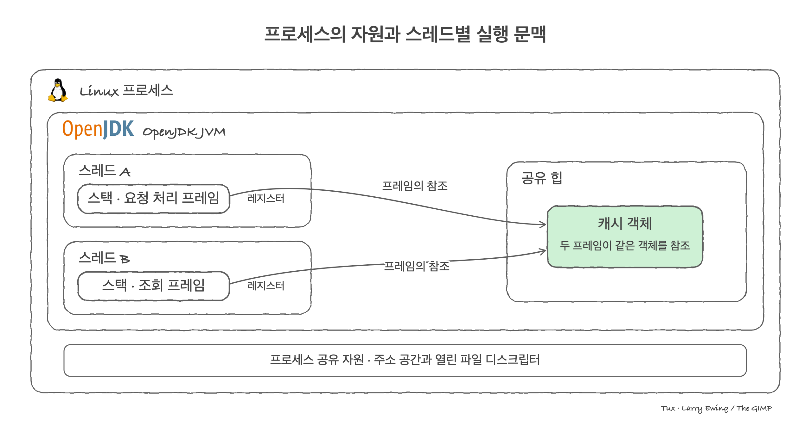
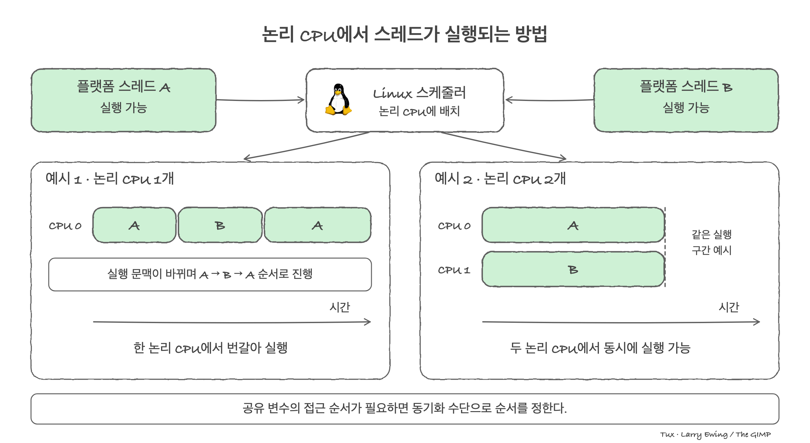
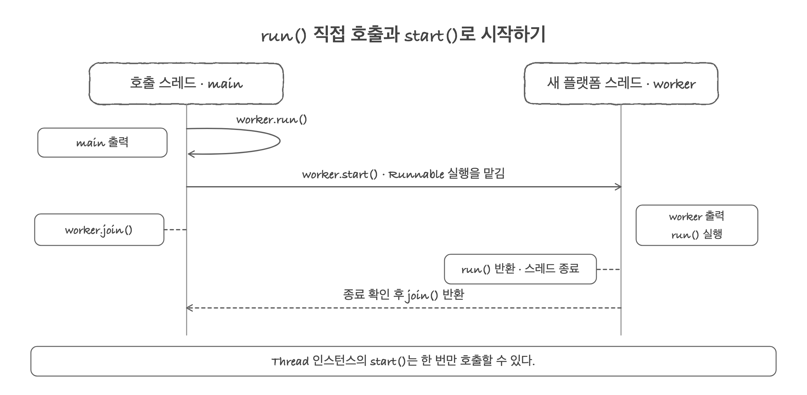
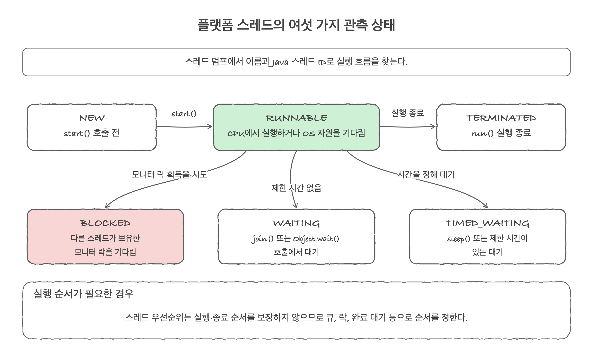
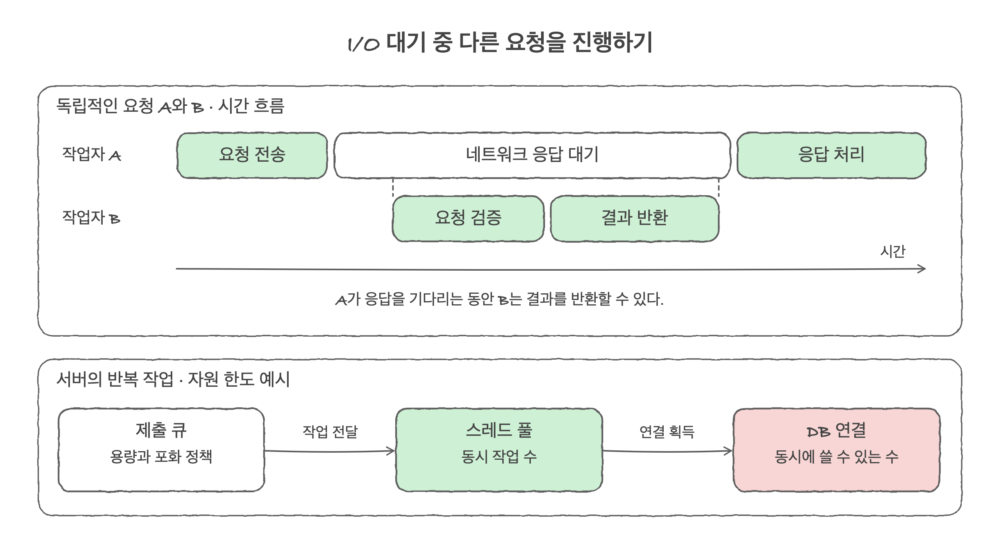
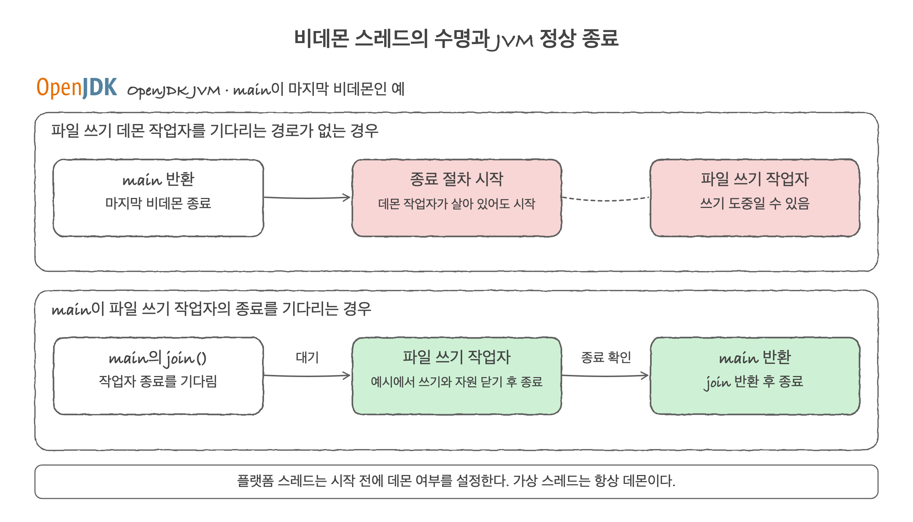

# Java 멀티스레드 기본 이론

프로세스 안에서 스레드가 어떤 자원을 공유하는지 살펴보고, Java 21의 플랫폼 스레드를 직접 시작해 실행 상태와 종료 조건을 확인한다. 운영체제 동작은 Linux를 예로 든다. [JDK 21 Thread](https://docs.oracle.com/en/java/javase/21/docs/api/java.base/java/lang/Thread.html) · [Linux pthreads(7)](https://man7.org/linux/man-pages/man7/pthreads.7.html)

## 1. 프로세스와 스레드

프로세스는 실행 중인 프로그램이 사용하는 주소 공간과 자원을 담는다. Linux의 한 프로세스 안에서는 스레드들이 메모리와 열린 파일 디스크립터를 공유한다. 스레드마다 실행 위치를 나타내는 레지스터와 스택이 있어 호출 경로는 독립적으로 진행된다. 공유 객체를 여러 스레드가 수정할 수 있다면 접근 규칙을 정해야 한다. [Linux pthreads(7)](https://man7.org/linux/man-pages/man7/pthreads.7.html) · [JVMS 21 §2.5](https://docs.oracle.com/javase/specs/jvms/se21/html/jvms-2.html#jvms-2.5) · [JLS 21 §17.4](https://docs.oracle.com/javase/specs/jls/se21/html/jls-17.html#jls-17.4)

아래 그림에서 프레임은 스레드 안에서 관리되고, 서로 다른 프레임의 참조가 같은 힙 객체를 가리킨다. [JVMS 21 §2.5–2.6](https://docs.oracle.com/javase/specs/jvms/se21/html/jvms-2.html#jvms-2.5)



스레드 A와 B는 각각 자신의 스택과 레지스터를 쓰고, 각 스택의 프레임은 같은 힙 객체를 참조할 수 있다. [Linux pthreads(7)](https://man7.org/linux/man-pages/man7/pthreads.7.html) · [JVMS 21 §2.5–2.6](https://docs.oracle.com/javase/specs/jvms/se21/html/jvms-2.html#jvms-2.5)

## 2. CPU 코어와 OS 스케줄링

실행 가능한 플랫폼 스레드는 OS 스케줄러가 논리 CPU에 배치한다. 논리 CPU 하나에서도 여러 스레드가 번갈아 진행할 수 있고, 서로 다른 논리 CPU에서는 실제로 동시에 실행될 수 있다. 전자는 동시성, 후자는 병렬 실행을 설명하는 예다. 스레드 수, CPU에서 실행 중인 작업 수, I/O 응답을 기다리는 작업 수를 나누면 지연 원인을 좁히기 쉽다. [Linux sched(7)](https://man7.org/linux/man-pages/man7/sched.7.html) · [JDK 21 가상 스레드 · 동시성과 처리량](https://docs.oracle.com/en/java/javase/21/core/virtual-threads.html)



같은 논리 CPU에서는 스레드가 번갈아 진행하고, 서로 다른 논리 CPU에서는 같은 시간에 실행할 수 있다. [Linux sched(7)](https://man7.org/linux/man-pages/man7/sched.7.html) · [JDK 21 가상 스레드 · 동시성과 처리량](https://docs.oracle.com/en/java/javase/21/core/virtual-threads.html) · [JLS 21 §17.4](https://docs.oracle.com/javase/specs/jls/se21/html/jls-17.html#jls-17.4)

스케줄러가 실행할 스레드를 바꾸면 다른 실행 문맥을 사용한다. 같은 공유 변수에 두 작업이 접근하는 순서는 CPU 수와 무관하게 달라질 수 있으므로 스케줄링 순서를 동기화 조건으로 삼지 않는다. [Linux sched(7)](https://man7.org/linux/man-pages/man7/sched.7.html) · [JLS 21 §17.4](https://docs.oracle.com/javase/specs/jls/se21/html/jls-17.html#jls-17.4)

## 3. 스레드 생성과 시작

`Runnable`은 실행할 작업을 나타내고, `Thread.start()`는 새 스레드에 실행을 맡긴다. 일반 플랫폼 스레드의 `run()`을 직접 호출하면 호출한 스레드에서 실행된다. `Thread` 인스턴스는 한 번만 시작할 수 있으며, 작업을 다시 제출해야 한다면 새 스레드를 만들거나 실행기를 사용한다. [JDK 21 Thread.start와 run](https://docs.oracle.com/en/java/javase/21/docs/api/java.base/java/lang/Thread.html#start()) · [JDK 21 ExecutorService](https://docs.oracle.com/en/java/javase/21/docs/api/java.base/java/util/concurrent/ExecutorService.html)



같은 Runnable도 run() 직접 호출은 main에서, start()로 시작한 실행은 worker에서 진행된다. [JDK 21 Thread.start와 run](https://docs.oracle.com/en/java/javase/21/docs/api/java.base/java/lang/Thread.html#start()) · [JDK 21 Thread.currentThread와 join](https://docs.oracle.com/en/java/javase/21/docs/api/java.base/java/lang/Thread.html)

다음 코드를 `StartDemo.java`에 저장해 실행하면 첫 줄은 `main`, 두 번째 줄은 `worker`에서 출력된다. `join()`은 시작한 작업의 종료를 기다린다. [JDK 21 Thread.currentThread와 join](https://docs.oracle.com/en/java/javase/21/docs/api/java.base/java/lang/Thread.html)

```java
public class StartDemo {
    public static void main(String[] args) throws InterruptedException {
        Runnable task = () -> System.out.println(Thread.currentThread().getName());
        Thread worker = Thread.ofPlatform().name("worker").unstarted(task);

        worker.run();
        worker.start();
        worker.join();
    }
}
```

```sh
javac --release 21 StartDemo.java
java StartDemo
```

## 4. 스레드의 이름·ID·상태·우선순위

의미 있는 이름은 스레드 덤프에서 작업 역할을 찾는 데 도움이 된다. `threadId()`는 JVM이 제공하는 Java 스레드 ID를 반환한다. `getState()`가 반환하는 값은 Java의 관측 상태이며, `RUNNABLE`에는 실제로 실행 중인 경우와 OS 자원을 기다리는 경우가 함께 포함될 수 있다. [JDK 21 Thread.threadId와 getState](https://docs.oracle.com/en/java/javase/21/docs/api/java.base/java/lang/Thread.html#threadId()) · [JDK 21 Thread.State](https://docs.oracle.com/en/java/javase/21/docs/api/java.base/java/lang/Thread.State.html) · [JDK 21 jcmd](https://docs.oracle.com/en/java/javase/21/docs/specs/man/jcmd.html)



getState()는 관측 순간의 Java 스레드 상태를 보여준다. 종료를 기다릴 때는 join()을 사용한다. [JDK 21 Thread.threadId와 getState](https://docs.oracle.com/en/java/javase/21/docs/api/java.base/java/lang/Thread.html#threadId()) · [JDK 21 Thread.State](https://docs.oracle.com/en/java/javase/21/docs/api/java.base/java/lang/Thread.State.html) · [JDK 21 Thread.setPriority](https://docs.oracle.com/en/java/javase/21/docs/api/java.base/java/lang/Thread.html#setPriority(int))

`BLOCKED`는 모니터 락 획득을 기다리는 상태다. 시간 제한 없는 `join()`이나 `Object.wait()`는 `WAITING`을, `sleep()`은 `TIMED_WAITING`을 만들 수 있다. 상태는 순간값이므로 한 번의 `getState()` 조회만으로 작업 완료 여부를 정하지 않는다. [JDK 21 Thread.State](https://docs.oracle.com/en/java/javase/21/docs/api/java.base/java/lang/Thread.State.html)

플랫폼 스레드에는 우선순위가 있지만 실행 선후나 종료 순서를 보장하는 계약은 없다. 작업 순서에는 큐, 락, 완료 대기처럼 프로그램에서 의미를 정의하는 수단을 사용한다. 가상 스레드의 우선순위는 고정된다. [JDK 21 Thread.setPriority](https://docs.oracle.com/en/java/javase/21/docs/api/java.base/java/lang/Thread.html#setPriority(int)) · [JDK 21 BlockingQueue](https://docs.oracle.com/en/java/javase/21/docs/api/java.base/java/util/concurrent/BlockingQueue.html)

## 5. 멀티스레드 구조를 쓰는 이유

독립적인 요청이 각자 네트워크 응답을 기다린다면 한 요청이 대기하는 동안 다른 요청을 진행할 수 있다. CPU 연산은 분리 가능한 작업이 충분하고 사용 가능한 코어가 있을 때 병렬화가 효과를 낸다. 공용 락, DB 연결 수, 외부 서비스의 처리 한도가 병목이면 스레드만 늘려도 완료 건수가 늘지 않을 수 있다. 처리량과 지연, 대기 중인 작업 수를 함께 관찰한다. [JDK 21 가상 스레드 · 처리량과 자원 제한](https://docs.oracle.com/en/java/javase/21/core/virtual-threads.html) · [JDK 21 ThreadPoolExecutor · 큐와 풀 크기](https://docs.oracle.com/en/java/javase/21/docs/api/java.base/java/util/concurrent/ThreadPoolExecutor.html)



작업자는 독립적인 요청의 대기를 겹칠 수 있다. 처리량은 큐와 스레드 풀을 지나 만나는 공유 자원의 한도에도 영향을 받는다. [JDK 21 가상 스레드 · 처리량과 자원 제한](https://docs.oracle.com/en/java/javase/21/core/virtual-threads.html) · [JDK 21 ThreadPoolExecutor · 큐와 풀 크기](https://docs.oracle.com/en/java/javase/21/docs/api/java.base/java/util/concurrent/ThreadPoolExecutor.html)

직접 만든 스레드 하나는 생명주기 학습에 적합하다. 서버에서 반복적으로 작업을 받는다면 `ExecutorService`로 제출과 실행 정책을 분리하고, 플랫폼 스레드 풀에서는 스레드 수와 큐 용량, 포화 시 제출 처리 정책을 함께 정한다. [JDK 21 ExecutorService](https://docs.oracle.com/en/java/javase/21/docs/api/java.base/java/util/concurrent/ExecutorService.html) · [JDK 21 ThreadPoolExecutor](https://docs.oracle.com/en/java/javase/21/docs/api/java.base/java/util/concurrent/ThreadPoolExecutor.html)

## 6. 데몬 스레드와 JVM 종료

시작된 비데몬 스레드가 모두 종료하면 JVM의 정상 종료 절차가 시작된다. 살아 있는 데몬 스레드만으로는 이 절차를 늦출 수 없다. 플랫폼 스레드는 시작 전에 데몬 여부를 설정할 수 있고, 가상 스레드는 항상 데몬이다. [JDK 21 Thread · Daemon과 setDaemon](https://docs.oracle.com/en/java/javase/21/docs/api/java.base/java/lang/Thread.html#setDaemon(boolean)) · [JDK 21 Runtime · Shutdown Sequence](https://docs.oracle.com/en/java/javase/21/docs/api/java.base/java/lang/Runtime.html#shutdown)



파일 쓰기의 완료를 기다리는 예에서는 main이 join()을 호출하고 작업자 종료를 확인한 뒤 반환한다. [JDK 21 Thread · Daemon과 setDaemon](https://docs.oracle.com/en/java/javase/21/docs/api/java.base/java/lang/Thread.html#setDaemon(boolean)) · [JDK 21 Runtime · Shutdown Sequence](https://docs.oracle.com/en/java/javase/21/docs/api/java.base/java/lang/Runtime.html#shutdown) · [JDK 21 Thread.join](https://docs.oracle.com/en/java/javase/21/docs/api/java.base/java/lang/Thread.html#join())

파일 쓰기나 배치 결과 반영을 끝까지 기다려야 한다면 작업 완료를 기다리는 경로를 둔다. 직접 만든 스레드는 `join()`을, 실행기에 제출한 작업은 필요한 경우 `Future.get()`이나 실행기 종료 대기를 사용한다. 데몬 여부는 JVM 생명주기에 대한 설정이다. [JDK 21 Thread.join](https://docs.oracle.com/en/java/javase/21/docs/api/java.base/java/lang/Thread.html#join()) · [JDK 21 ExecutorService](https://docs.oracle.com/en/java/javase/21/docs/api/java.base/java/util/concurrent/ExecutorService.html)
