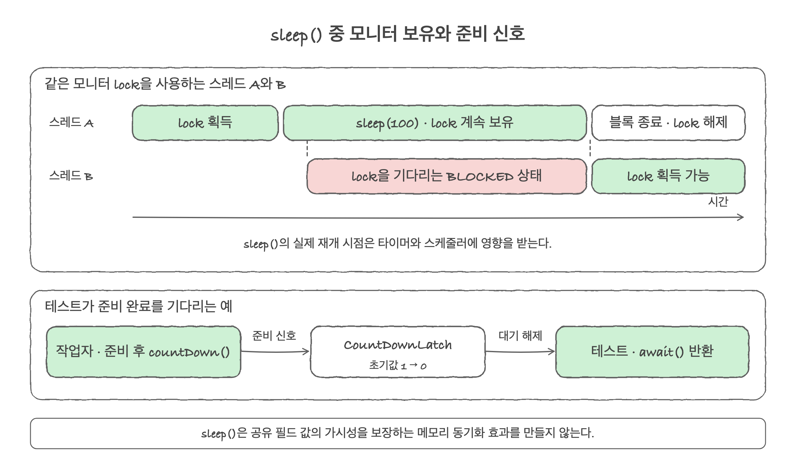
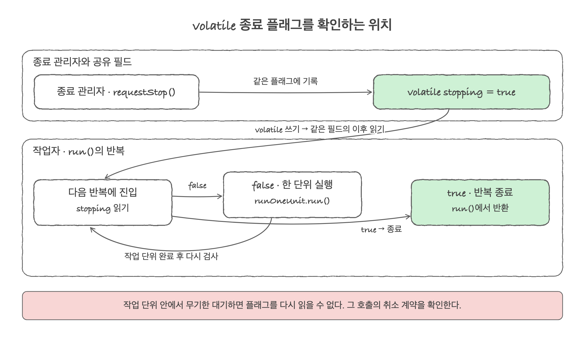
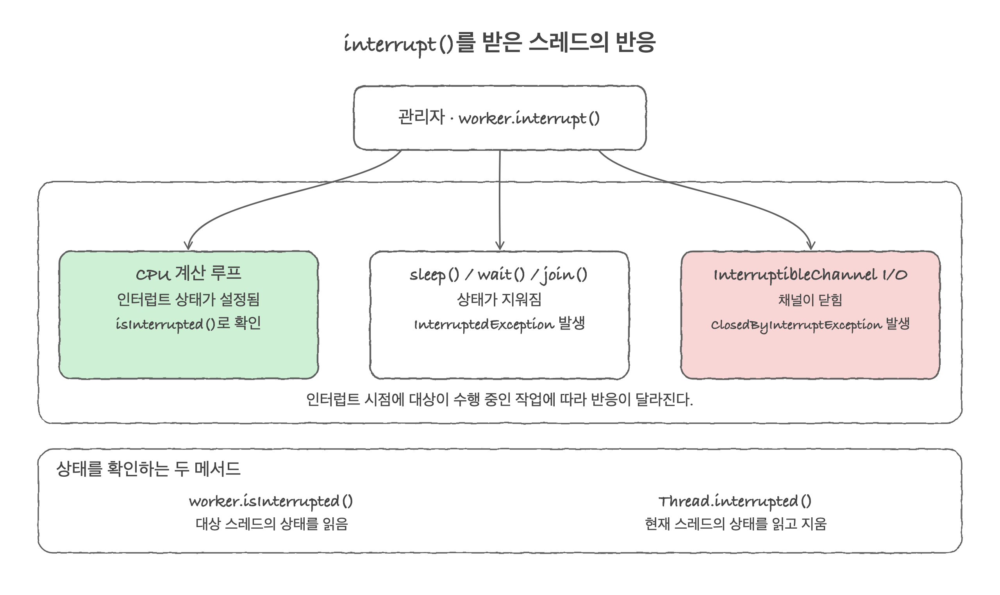
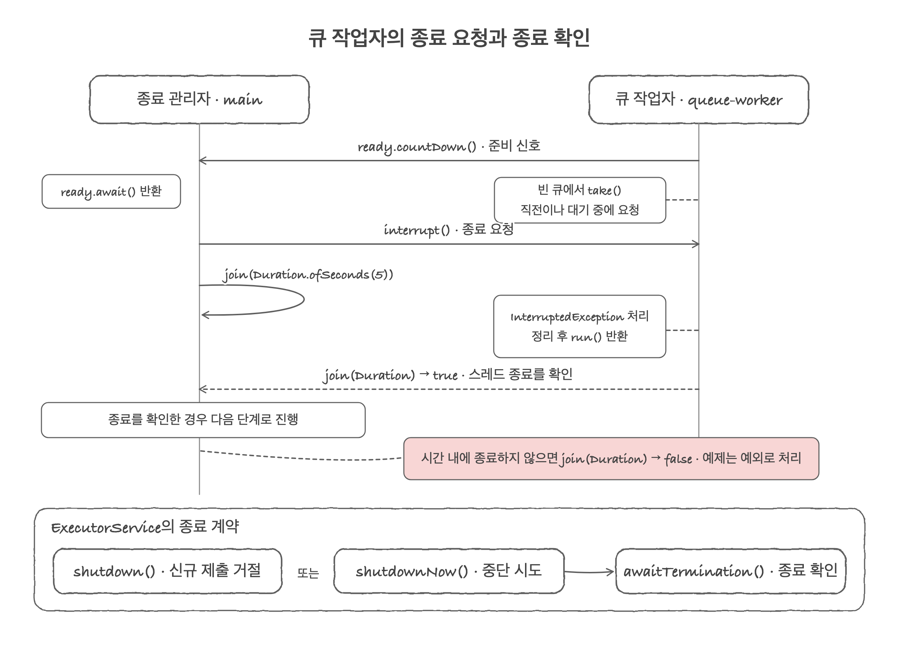

# Java 스레드 제어와 종료 동기화

동작을 잠시 미루는 `sleep()`, 중단을 요청하는 종료 플래그와 인터럽트, 종료를 확인하는 `join()`의 역할을 나눠 살펴본다. [JDK 21 Thread](https://docs.oracle.com/en/java/javase/21/docs/api/java.base/java/lang/Thread.html) · [JLS 21 §17.4.5](https://docs.oracle.com/javase/specs/jls/se21/html/jls-17.html#jls-17.4.5)

## 1. sleep()과 실행 순서에 의존할 때의 문제

`Thread.sleep()`은 호출한 현재 스레드를 지정 시간 동안 잠시 멈춘다. 실제 재개 시점은 시스템 타이머와 스케줄러에 영향을 받고, 호출 전에 보유한 모니터도 계속 보유한다. 다른 스레드가 그 모니터를 획득해야 한다면 잠든 시간만큼 작업이 늦어질 수 있다. [JDK 21 Thread.sleep](https://docs.oracle.com/en/java/javase/21/docs/api/java.base/java/lang/Thread.html#sleep(long))



sleep() 중에는 보유한 모니터가 유지된다. 시작 순서는 준비 신호를 보내는 래치로 조율할 수 있다. [JDK 21 Thread.sleep](https://docs.oracle.com/en/java/javase/21/docs/api/java.base/java/lang/Thread.html#sleep(long)) · [JDK 21 CountDownLatch](https://docs.oracle.com/en/java/javase/21/docs/api/java.base/java/util/concurrent/CountDownLatch.html) · [JLS 21 §17.3](https://docs.oracle.com/javase/specs/jls/se21/html/jls-17.html#jls-17.3)

테스트에서 시작 순서를 조율하려면 `CountDownLatch`로 준비 완료를 알린다. 종료가 필요하면 `join()`으로 기다린다. `sleep()` 자체에는 메모리 동기화 효과가 없으므로 잠시 쉰 뒤 공유 필드를 다시 읽는다고 값의 가시성이 보장되지는 않는다. [JDK 21 CountDownLatch](https://docs.oracle.com/en/java/javase/21/docs/api/java.base/java/util/concurrent/CountDownLatch.html) · [JLS 21 §17.3](https://docs.oracle.com/javase/specs/jls/se21/html/jls-17.html#jls-17.3) · [JDK 21 Thread.join](https://docs.oracle.com/en/java/javase/21/docs/api/java.base/java/lang/Thread.html#join())

## 2. 종료 플래그로 중단 요청 전달하기

반복 작업 사이에 종료 요청을 확인할 수 있으면 `volatile boolean`으로 요청을 전달할 수 있다. 플래그를 기록하는 작업은 같은 플래그를 이후에 읽는 작업에 happens-before 관계를 만든다. 종료 요청을 전해도 작업자는 현재 단계가 끝나야 다음 플래그 검사를 한다. [JLS 21 §17.4.5](https://docs.oracle.com/javase/specs/jls/se21/html/jls-17.html#jls-17.4.5)



작업자는 현재 단위가 끝난 뒤 플래그를 다시 읽는다. 종료 요청이 쓰인 뒤의 읽기는 변경된 값을 볼 수 있다. [JLS 21 §17.4.5](https://docs.oracle.com/javase/specs/jls/se21/html/jls-17.html#jls-17.4.5) · [JDK 21 Thread.interrupt](https://docs.oracle.com/en/java/javase/21/docs/api/java.base/java/lang/Thread.html#interrupt())

아래 패턴은 작업 하나가 제한된 시간 안에 끝나는 경우에 맞는다. `runOneUnit` 내부에서 무기한 대기할 수 있다면 플래그만 바꿔서는 작업자가 대기에서 빠져나오지 못한다. 대기 API가 인터럽트를 지원하는지 함께 확인한다. [JLS 21 §17.4.5](https://docs.oracle.com/javase/specs/jls/se21/html/jls-17.html#jls-17.4.5) · [JDK 21 Thread.interrupt](https://docs.oracle.com/en/java/javase/21/docs/api/java.base/java/lang/Thread.html#interrupt())

```java
final class FlagWorker implements Runnable {
    private final Runnable runOneUnit;
    private volatile boolean stopping;

    FlagWorker(Runnable runOneUnit) {
        this.runOneUnit = runOneUnit;
    }

    void requestStop() {
        stopping = true;
    }

    @Override
    public void run() {
        while (!stopping) {
            runOneUnit.run();
        }
    }
}
```

## 3. 스레드 인터럽트

`interrupt()`는 대상 스레드에 중단 요청을 전달한다. 대상이 `sleep()`, `wait()`, `join()` 중이면 상태가 지워지고 `InterruptedException`이 발생한다. 일반 실행 중이면 인터럽트 상태를 설정한다. CPU 연산 루프는 `isInterrupted()`를 확인할 지점을 직접 두어야 한다. [JDK 21 Thread.interrupt](https://docs.oracle.com/en/java/javase/21/docs/api/java.base/java/lang/Thread.html#interrupt())



실행 중인 루프는 인터럽트 상태를 검사하고, 대기와 I/O에서는 호출한 API의 인터럽트 계약에 맞춰 처리한다. [JDK 21 Thread.interrupt](https://docs.oracle.com/en/java/javase/21/docs/api/java.base/java/lang/Thread.html#interrupt()) · [JDK 21 Thread.isInterrupted와 interrupted](https://docs.oracle.com/en/java/javase/21/docs/api/java.base/java/lang/Thread.html#interrupted()) · [JDK 21 InterruptibleChannel](https://docs.oracle.com/en/java/javase/21/docs/api/java.base/java/nio/channels/InterruptibleChannel.html)

`isInterrupted()`는 대상의 상태를 읽고, 정적 `Thread.interrupted()`는 현재 스레드의 상태를 읽으면서 지운다. 라이브러리에서 요청을 처리할 수 없다면 `InterruptedException`을 상위로 전달하거나, 전달이 불가능한 경계에서는 상태를 복구한 후 계약에 맞게 반환한다. 스레드의 최상위 작업이 인터럽트를 정상 종료 요청으로 소비하는 경우에는 정리 후 반환할 수 있다. [JDK 21 Thread.isInterrupted와 interrupted](https://docs.oracle.com/en/java/javase/21/docs/api/java.base/java/lang/Thread.html#interrupted()) · [JDK 21 ExecutorService · 종료 예제](https://docs.oracle.com/en/java/javase/21/docs/api/java.base/java/util/concurrent/ExecutorService.html)

블로킹 I/O의 반응은 API별로 다르다. 예를 들어 `InterruptibleChannel`의 I/O를 하던 스레드에 인터럽트가 들어오면 채널이 닫히고 `ClosedByInterruptException`이 발생한다. 서비스에서 종료를 설계할 때는 사용 중인 호출의 시간 제한과 취소 계약을 확인한다. [JDK 21 InterruptibleChannel](https://docs.oracle.com/en/java/javase/21/docs/api/java.base/java/nio/channels/InterruptibleChannel.html)

## 4. 종료 요청과 종료 확인 분리하기

종료를 요청한 쪽은 자원 정리가 끝날 때까지 `join()`으로 기다릴 수 있다. 대상 스레드에서 수행한 작업은 다른 스레드가 그 종료를 성공적으로 감지한 뒤에 보인다. JDK 21의 `join(Duration)`은 제한 시간까지 종료했는지를 반환한다. 시간이 지나면 처리 결과를 완료로 기록하기 전에 별도로 확인한다. [JLS 21 §17.4.5](https://docs.oracle.com/javase/specs/jls/se21/html/jls-17.html#jls-17.4.5) · [JDK 21 Thread.join](https://docs.oracle.com/en/java/javase/21/docs/api/java.base/java/lang/Thread.html#join(java.time.Duration))

실행기에서는 `shutdown()`으로 새 작업을 거절하고 제출된 작업을 진행시킨다. `shutdownNow()`는 실행 중 작업의 중단을 시도하고 시작하지 않은 작업을 반환한다. 완료 여부는 `awaitTermination()`으로 확인하며, 인터럽트에 응답하지 않는 작업에는 중단 요청만으로 완료가 보장되지 않는다. [JDK 21 ExecutorService · 종료 계약](https://docs.oracle.com/en/java/javase/21/docs/api/java.base/java/util/concurrent/ExecutorService.html)

다음 예의 준비 래치는 작업자가 시작 지점에 도달했음을 알린다. 인터럽트가 `take()` 진입 직전이나 대기 중에 전달되면 작업자는 예외를 처리하고 종료한다. 호출자는 종료를 확인한 뒤에만 다음 단계로 진행한다. [JDK 21 CountDownLatch](https://docs.oracle.com/en/java/javase/21/docs/api/java.base/java/util/concurrent/CountDownLatch.html) · [JDK 21 BlockingQueue.take](https://docs.oracle.com/en/java/javase/21/docs/api/java.base/java/util/concurrent/BlockingQueue.html#take()) · [JDK 21 Thread.join](https://docs.oracle.com/en/java/javase/21/docs/api/java.base/java/lang/Thread.html#join())



준비 래치는 시작 지점을 알리고, interrupt()는 중단을 요청하며, join(Duration)은 제한 시간 내의 스레드 종료 여부를 반환한다. [JLS 21 §17.4.5](https://docs.oracle.com/javase/specs/jls/se21/html/jls-17.html#jls-17.4.5) · [JDK 21 Thread.join](https://docs.oracle.com/en/java/javase/21/docs/api/java.base/java/lang/Thread.html#join()) · [JDK 21 BlockingQueue.take](https://docs.oracle.com/en/java/javase/21/docs/api/java.base/java/util/concurrent/BlockingQueue.html#take()) · [JDK 21 ExecutorService · 종료 계약](https://docs.oracle.com/en/java/javase/21/docs/api/java.base/java/util/concurrent/ExecutorService.html)

```java
import java.time.Duration;
import java.util.concurrent.CountDownLatch;
import java.util.concurrent.LinkedBlockingQueue;

public class ShutdownDemo {
    public static void main(String[] args) throws InterruptedException {
        var queue = new LinkedBlockingQueue<String>();
        var ready = new CountDownLatch(1);
        Thread worker = Thread.ofPlatform().name("queue-worker").start(() -> {
            ready.countDown();
            try {
                System.out.println(queue.take());
            } catch (InterruptedException requested) {
                // 최상위 작업에서 종료 요청을 소비한다.
                System.out.println("worker released");
            }
        });

        try {
            ready.await();
        } finally {
            worker.interrupt();
        }
        if (!worker.join(Duration.ofSeconds(5))) {
            throw new IllegalStateException("worker did not terminate");
        }
        System.out.println("worker terminated");
    }
}
```

```sh
javac --release 21 ShutdownDemo.java
java ShutdownDemo
```
