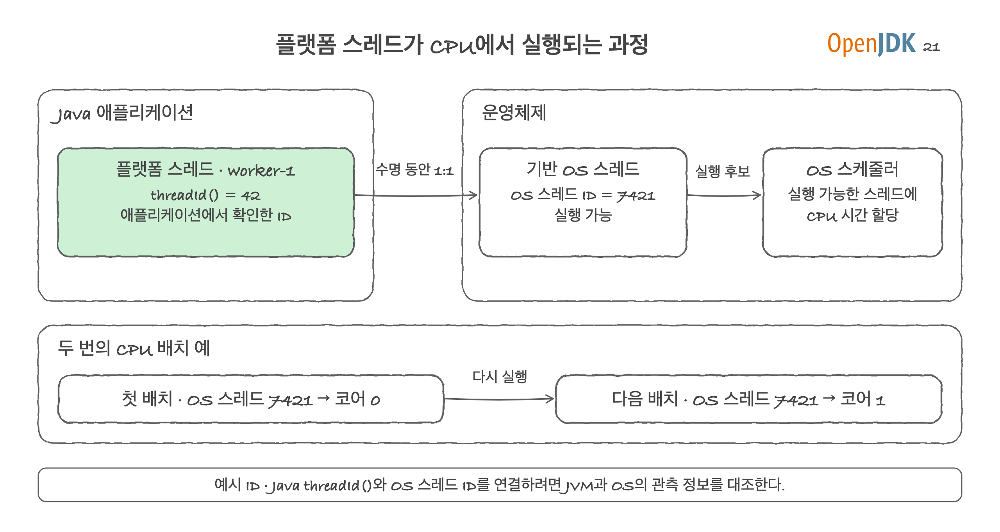
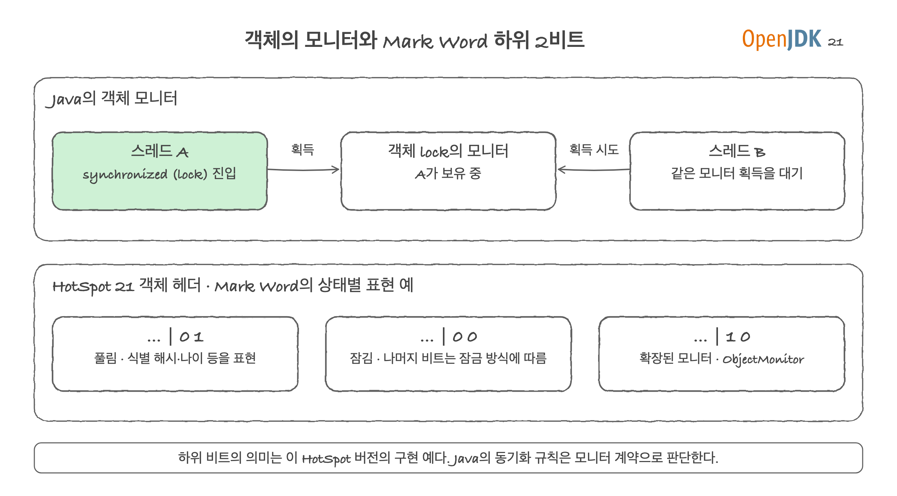
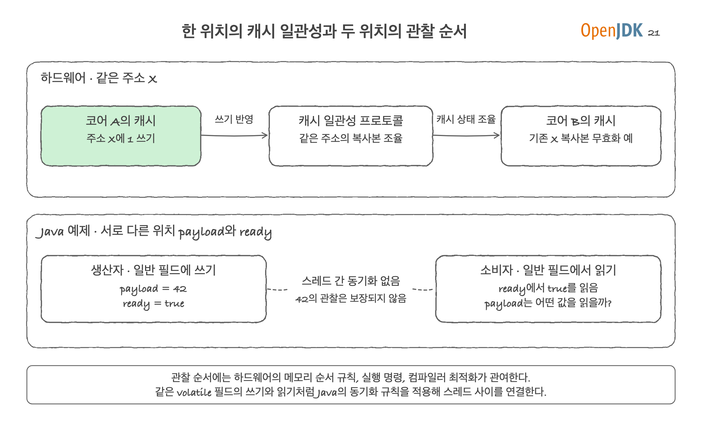
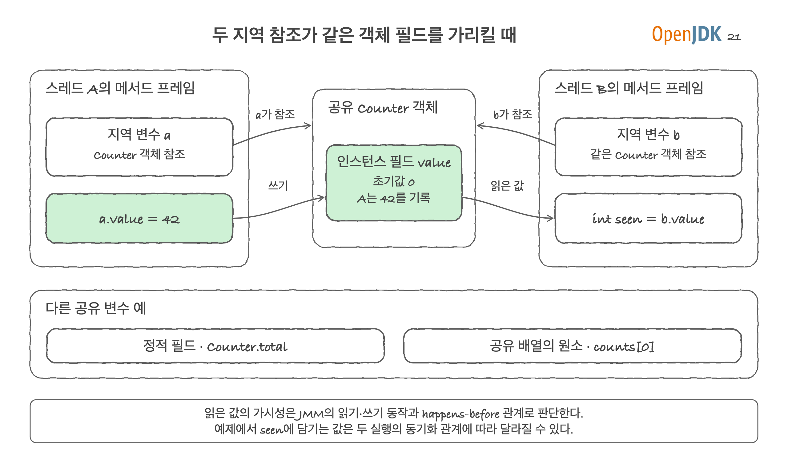
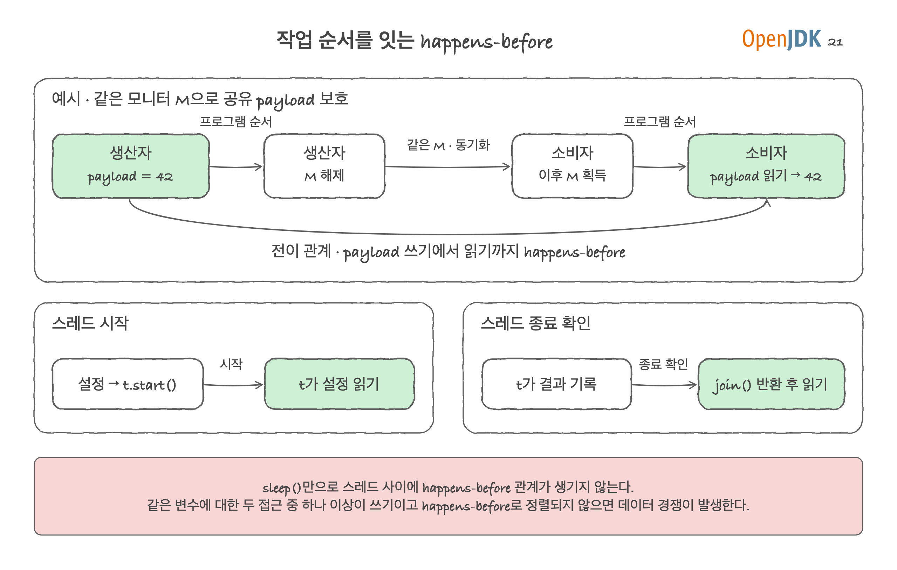
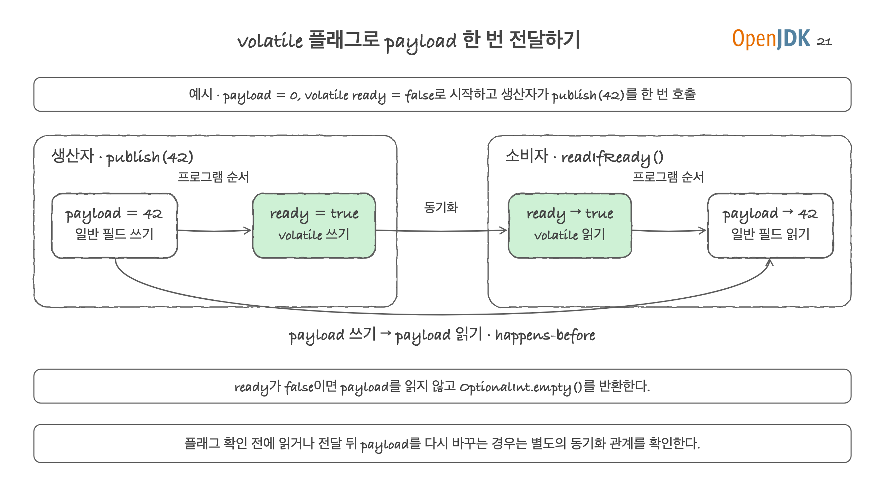
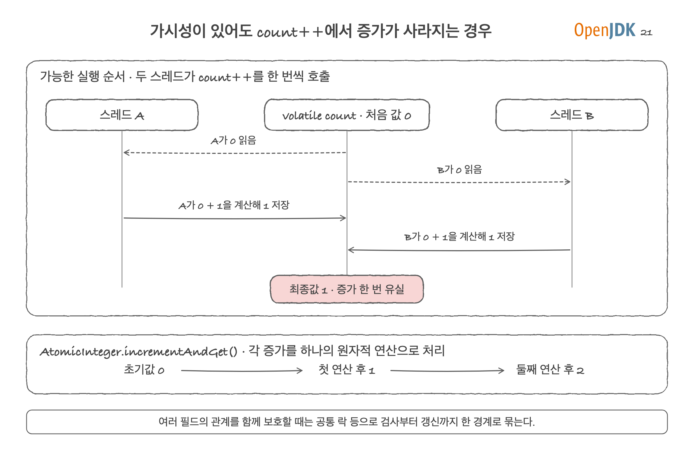
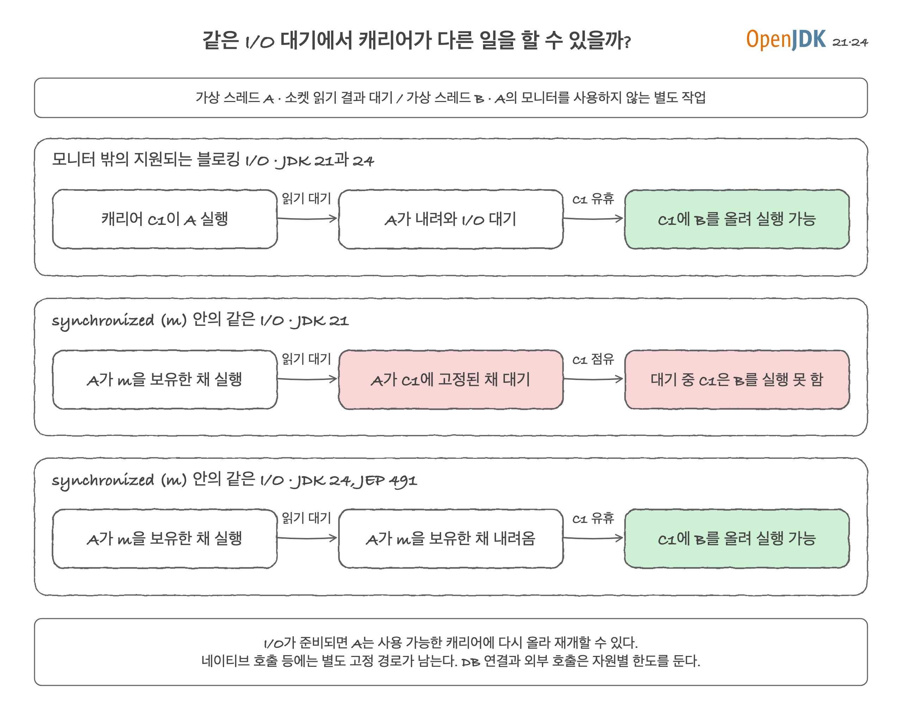

# JVM 스레드와 Java 메모리 모델

플랫폼 스레드의 실행 주체, HotSpot의 객체 잠금 표현, Java 메모리 모델의 가시성 규칙을 살펴본다. Java SE 21을 기준으로 하며, 가상 스레드의 모니터 동작은 JDK 24에서 바뀐 부분을 함께 다룬다. [JLS 21 §17](https://docs.oracle.com/javase/specs/jls/se21/html/jls-17.html) · [JDK 21 가상 스레드](https://docs.oracle.com/en/java/javase/21/core/virtual-threads.html) · [JDK 24 주요 변경](https://docs.oracle.com/en/java/javase/25/migrate/significant-changes-jdk-24.html)

## 1. 플랫폼 스레드와 커널 스레드

JDK 21의 플랫폼 스레드는 수명 동안 기반 OS 스레드와 연결된다. OS 스케줄러는 실행 가능한 OS 스레드를 CPU에 배치한다. Java 스레드 이름과 `threadId()`는 애플리케이션 관측값이므로 OS 스레드 식별자와 연결하려면 JVM과 OS가 제공하는 별도 정보를 확인한다. [JDK 21 가상 스레드 · 플랫폼 스레드](https://docs.oracle.com/en/java/javase/21/core/virtual-threads.html) · [JDK 21 Thread.threadId](https://docs.oracle.com/en/java/javase/21/docs/api/java.base/java/lang/Thread.html#threadId()) · [Linux sched(7)](https://man7.org/linux/man-pages/man7/sched.7.html)



플랫폼 스레드에 연결된 OS 스레드는 실행 차례에 따라 서로 다른 CPU 코어에 배치될 수 있다. [JDK 21 가상 스레드 · 플랫폼 스레드](https://docs.oracle.com/en/java/javase/21/core/virtual-threads.html) · [JDK 21 Thread.threadId](https://docs.oracle.com/en/java/javase/21/docs/api/java.base/java/lang/Thread.html#threadId()) · [Linux sched(7)](https://man7.org/linux/man-pages/man7/sched.7.html)

## 2. 객체 헤더와 잠금 상태 비트

Java는 각 객체에 대응하는 모니터를 정의한다. HotSpot의 객체 헤더에는 객체 상태에 따라 식별 해시·나이·락 상태 등을 표현하는 Mark Word가 있다. OpenJDK 21 소스의 하위 두 비트 예에서 `01`은 풀린 상태, `00`은 잠긴 상태, `10`은 확장된 모니터를 나타낸다. 잠긴 경우의 나머지 비트는 사용 중인 잠금 방식에 따라 다른 내용을 담는다. [JLS 21 §17.1](https://docs.oracle.com/javase/specs/jls/se21/html/jls-17.html#jls-17.1) · [OpenJDK 21 Mark Word](https://github.com/openjdk/jdk/blob/jdk-21%2B35/src/hotspot/share/oops/markWord.hpp)



Java 코드는 같은 객체의 모니터로 동기화하고, HotSpot 분석에서는 해당 버전의 Mark Word 형식을 확인한다. [OpenJDK 21 Mark Word](https://github.com/openjdk/jdk/blob/jdk-21%2B35/src/hotspot/share/oops/markWord.hpp) · [JLS 21 §17.1](https://docs.oracle.com/javase/specs/jls/se21/html/jls-17.html#jls-17.1) · [JVMS 21 §2.7](https://docs.oracle.com/javase/specs/jvms/se21/html/jvms-2.html#jvms-2.7)

헤더 비트는 JDK 버전과 JVM 구현에 따라 달라질 수 있다. Java 코드의 동기화는 모니터 계약을 기준으로 작성하고, 헤더 형식은 특정 HotSpot 버전을 분석할 때 참고한다. [JVMS 21 §2.7](https://docs.oracle.com/javase/specs/jvms/se21/html/jvms-2.html#jvms-2.7) · [JLS 21 §17.1](https://docs.oracle.com/javase/specs/jls/se21/html/jls-17.html#jls-17.1)

## 3. CPU 캐시 일관성과 메모리 접근 순서

여러 코어가 캐시를 사용하면 하드웨어의 캐시 일관성 프로토콜이 같은 메모리 위치의 값 변경을 조율한다. 여러 위치에 대한 메모리 접근이 어떤 순서로 관찰되는지는 하드웨어의 메모리 순서 규칙과 명령, 컴파일러 최적화에도 영향을 받는다. Java에서 스레드 사이에 순서를 보장하려면 Java 메모리 모델의 동기화 규칙을 사용한다. [Linux 커널 메모리 배리어 · CPU 캐시와 순서](https://docs.kernel.org/core-api/wrappers/memory-barriers.html) · [JLS 21 §17.4](https://docs.oracle.com/javase/specs/jls/se21/html/jls-17.html#jls-17.4)



캐시 일관성은 같은 주소의 복사본을 조율한다. Java에서 서로 다른 필드 사이에 순서를 보장하려면 스레드 간 동기화가 필요하다. [Linux 커널 메모리 배리어 · CPU 캐시와 순서](https://docs.kernel.org/core-api/wrappers/memory-barriers.html) · [JLS 21 §17.4](https://docs.oracle.com/javase/specs/jls/se21/html/jls-17.html#jls-17.4)

## 4. 공유 변수와 스레드의 읽기·쓰기

Java 메모리 모델(JMM)은 스레드의 읽기와 쓰기가 어떤 값을 관찰할 수 있는지 정의한다. 인스턴스 필드, 정적 필드, 배열 원소는 공유 변수가 될 수 있다. 지역 변수와 메서드 매개변수는 각 실행에 속하지만, 그 변수에 담긴 참조를 통해 여러 스레드가 같은 객체의 필드에 접근할 수 있다. [JLS 21 §17.4.1](https://docs.oracle.com/javase/specs/jls/se21/html/jls-17.html#jls-17.4.1) · [JVMS 21 §2.6](https://docs.oracle.com/javase/specs/jvms/se21/html/jvms-2.html#jvms-2.6)



지역 참조는 각각의 실행 프레임에 있고, 두 참조가 가리키는 같은 객체 필드는 스레드 사이에 공유될 수 있다. [JLS 21 §17.4.1](https://docs.oracle.com/javase/specs/jls/se21/html/jls-17.html#jls-17.4.1) · [JVMS 21 §2.6](https://docs.oracle.com/javase/specs/jvms/se21/html/jvms-2.html#jvms-2.6) · [JLS 21 §17.4.5](https://docs.oracle.com/javase/specs/jls/se21/html/jls-17.html#jls-17.4.5)

메인 메모리와 작업 메모리는 공유 변수와 스레드가 관찰한 값을 떠올리기 위한 설명 모델이다. 특정 레지스터나 CPU 캐시를 가리킨다고 가정하면 Java 코드의 가시성을 판단하기 어렵다. JMM에서는 실행의 읽기·쓰기·동기화 동작과 happens-before 관계를 추적한다. [JLS 21 §17.4.2](https://docs.oracle.com/javase/specs/jls/se21/html/jls-17.html#jls-17.4.2) · [JLS 21 §17.4.5](https://docs.oracle.com/javase/specs/jls/se21/html/jls-17.html#jls-17.4.5)

## 5. 스레드 사이에서 작업 순서를 보장하기

한 스레드의 프로그램 순서와 스레드 간 동기화가 연결되면 happens-before 관계가 성립한다. 같은 모니터를 해제한 동작과 이후 그 모니터를 획득한 동작, 스레드를 `start()`하기 전의 동작과 시작된 스레드의 동작, 대상 스레드의 작업과 그 종료를 확인한 뒤의 동작이 대표적인 예다. [JLS 21 §17.4.4–17.4.5](https://docs.oracle.com/javase/specs/jls/se21/html/jls-17.html#jls-17.4.5)



같은 모니터의 해제와 이후 획득을 각 스레드의 프로그램 순서와 이으면 생산자의 쓰기가 소비자의 읽기보다 happens-before에 놓인다. [JLS 21 §17.4.4–17.4.5](https://docs.oracle.com/javase/specs/jls/se21/html/jls-17.html#jls-17.4.5) · [JLS 21 §17.3](https://docs.oracle.com/javase/specs/jls/se21/html/jls-17.html#jls-17.3)

생산자가 값을 써 놓고 소비자가 값을 읽을 때 어떤 동기화 지점이 두 작업을 연결하는지 표시한다. 동일 변수에 대한 접근이 충돌하고 하나 이상이 쓰기이며 두 접근이 happens-before로 정렬되지 않으면 데이터 경쟁이 발생한다. 실행 순서를 맞추기 위한 `sleep()`은 그 연결을 만들지 않는다. [JLS 21 §17.3](https://docs.oracle.com/javase/specs/jls/se21/html/jls-17.html#jls-17.3) · [JLS 21 §17.4.5](https://docs.oracle.com/javase/specs/jls/se21/html/jls-17.html#jls-17.4.5)

## 6. volatile과 메모리 가시성

같은 `volatile` 필드에 대한 쓰기는 동기화 순서상 이후의 읽기보다 happens-before에 놓인다. 한 번만 전달하는 아래 예에서 소비자가 `ready == true`를 읽으면, 생산자가 그 플래그보다 먼저 기록한 `payload`도 볼 수 있다. 조건을 확인하기 전에 `payload`를 읽거나, 전달 뒤 같은 데이터를 별도 동기화 없이 계속 바꾸는 방식에는 이 관계가 그대로 적용되지 않는다. [JLS 21 §17.4.4–17.4.5](https://docs.oracle.com/javase/specs/jls/se21/html/jls-17.html#jls-17.4.5)

```java
final class OneShotPublication {
    private int payload;
    private volatile boolean ready;

    void publish(int value) { // 한 생산자가 한 번 호출한다.
        payload = value;
        ready = true;
    }

    java.util.OptionalInt readIfReady() {
        return ready ? java.util.OptionalInt.of(payload) : java.util.OptionalInt.empty();
    }
}
```



한 번만 전달하는 예에서 ready의 true를 읽은 소비자는 플래그를 쓰기 전에 기록한 payload를 볼 수 있다. [JLS 21 §17.4.4–17.4.5](https://docs.oracle.com/javase/specs/jls/se21/html/jls-17.html#jls-17.4.5)

## 7. 경쟁 조건과 원자성

`volatile int`에도 `count++`는 읽기·덧셈·쓰기의 복합 연산이다. 두 스레드가 0을 읽은 뒤 각각 1을 쓰면 두 번 증가했어도 최종 값은 1이다. 단일 카운터를 원자적으로 증가시키려면 `AtomicInteger.incrementAndGet()`을 사용한다. 여러 필드의 관계를 함께 보호할 때는 공통 락으로 검사와 변경을 묶는 등 별도의 원자적 경계를 정한다. [JLS 21 §15.14.2](https://docs.oracle.com/javase/specs/jls/se21/html/jls-15.html#jls-15.14.2) · [JLS 21 §17.1](https://docs.oracle.com/javase/specs/jls/se21/html/jls-17.html#jls-17.1) · [JDK 21 AtomicInteger](https://docs.oracle.com/en/java/javase/21/docs/api/java.base/java/util/concurrent/atomic/AtomicInteger.html)



volatile은 개별 읽기와 쓰기에 적용된다. 읽기와 덧셈과 쓰기를 한 번에 처리하려면 원자적 증가 연산이 필요하다. [JLS 21 §15.14.2](https://docs.oracle.com/javase/specs/jls/se21/html/jls-15.html#jls-15.14.2) · [JDK 21 AtomicInteger](https://docs.oracle.com/en/java/javase/21/docs/api/java.base/java/util/concurrent/atomic/AtomicInteger.html) · [JLS 21 §17.1](https://docs.oracle.com/javase/specs/jls/se21/html/jls-17.html#jls-17.1)

## 8. 가상 스레드와 캐리어

가상 스레드도 `Thread`다. JVM 스케줄러는 많은 가상 스레드를 실행하는 데 플랫폼 스레드인 캐리어를 사용한다. 지원되는 블로킹 I/O에서 가상 스레드가 캐리어에서 내려오면 그 캐리어가 다른 가상 스레드를 실행할 수 있다. 이미 CPU가 포화된 연산을 빠르게 만드는 기능으로 보기보다 대기하는 요청이 많은 서비스의 동시 처리에 활용한다. [JDK 21 가상 스레드 · 스케줄링](https://docs.oracle.com/en/java/javase/21/core/virtual-threads.html)



JDK 24의 JEP 491은 Java 모니터로 인한 고정을 해소해, 모니터 안에서 지원되는 I/O를 기다리는 중에도 캐리어를 재사용할 수 있게 한다. [JDK 21 가상 스레드 · 스케줄링](https://docs.oracle.com/en/java/javase/21/core/virtual-threads.html) · [JDK 24 주요 변경 · JEP 491](https://docs.oracle.com/en/java/javase/25/migrate/significant-changes-jdk-24.html) · [JDK 21 가상 스레드 · 채택 가이드](https://docs.oracle.com/en/java/javase/21/core/virtual-threads.html)

가상 스레드는 JDK 21부터 정식 기능이다. JDK 21에서는 `synchronized` 영역 안에서 블로킹할 때 캐리어에 고정되는 경우가 있다. JDK 24의 JEP 491은 Java 모니터에서 비롯되는 이 고정을 해소했다. 네이티브 호출처럼 별도로 고정될 수 있는 경로가 있으므로, 문제를 분석할 때는 실행 중인 JDK 버전과 블로킹 위치를 함께 확인한다. [JDK 21 가상 스레드 · 고정](https://docs.oracle.com/en/java/javase/21/core/virtual-threads.html) · [JDK 24 주요 변경 · JEP 491](https://docs.oracle.com/en/java/javase/25/migrate/significant-changes-jdk-24.html)

요청마다 가상 스레드를 만드는 실행기는 `Executors.newVirtualThreadPerTaskExecutor()`로 얻는다. DB 연결이나 외부 요청의 동시 실행 한도는 연결 풀과 `Semaphore` 같은 자원 제한 수단으로 별도로 관리할 수 있다. [JDK 21 Executors](https://docs.oracle.com/en/java/javase/21/docs/api/java.base/java/util/concurrent/Executors.html#newVirtualThreadPerTaskExecutor()) · [JDK 21 가상 스레드 · 채택 가이드](https://docs.oracle.com/en/java/javase/21/core/virtual-threads.html)
