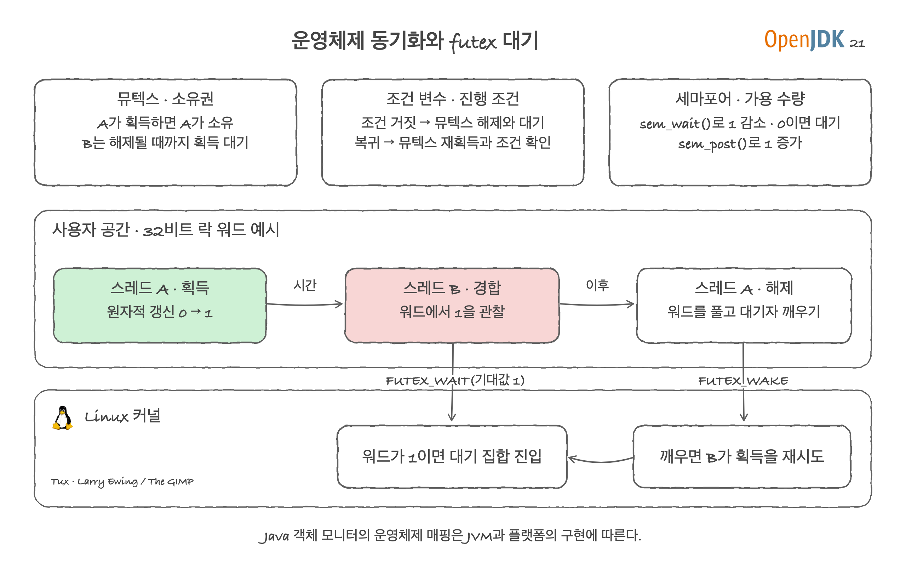
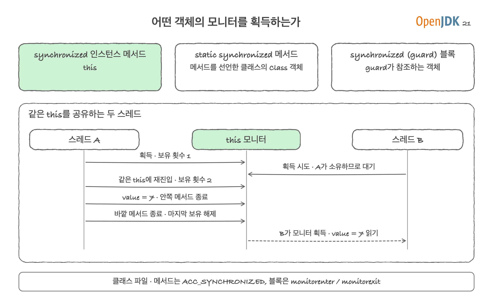
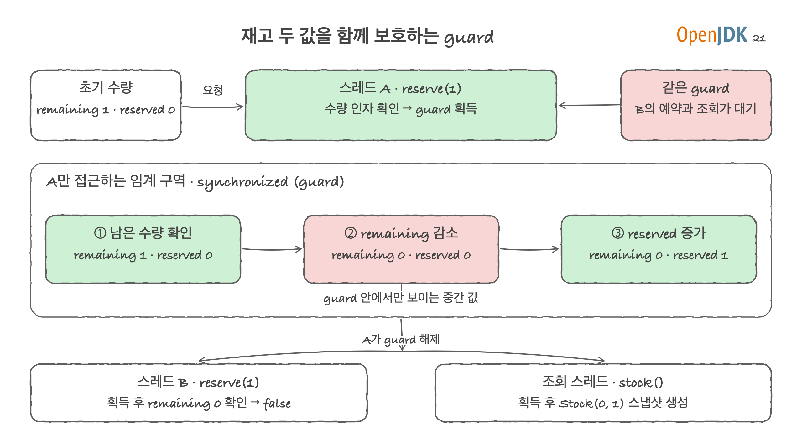
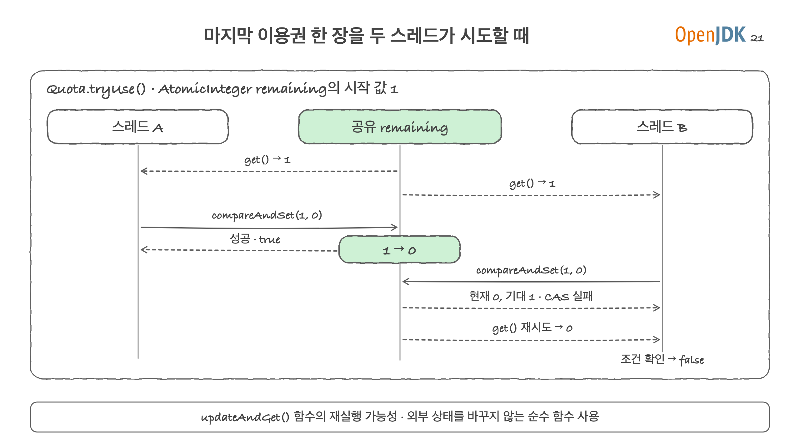
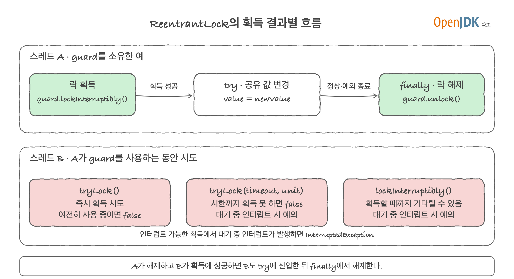
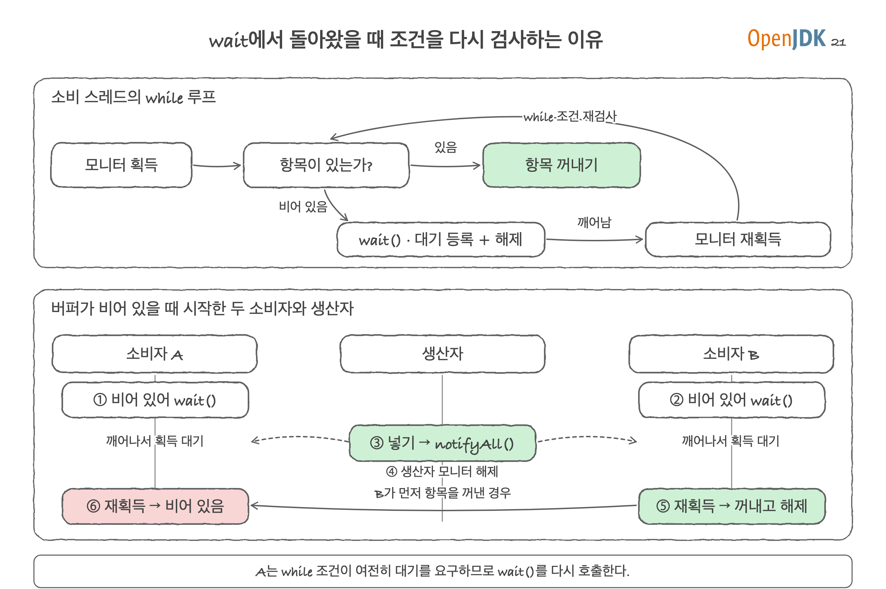
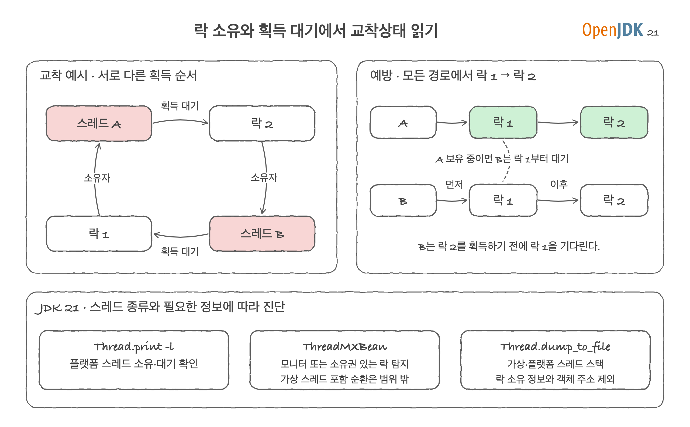
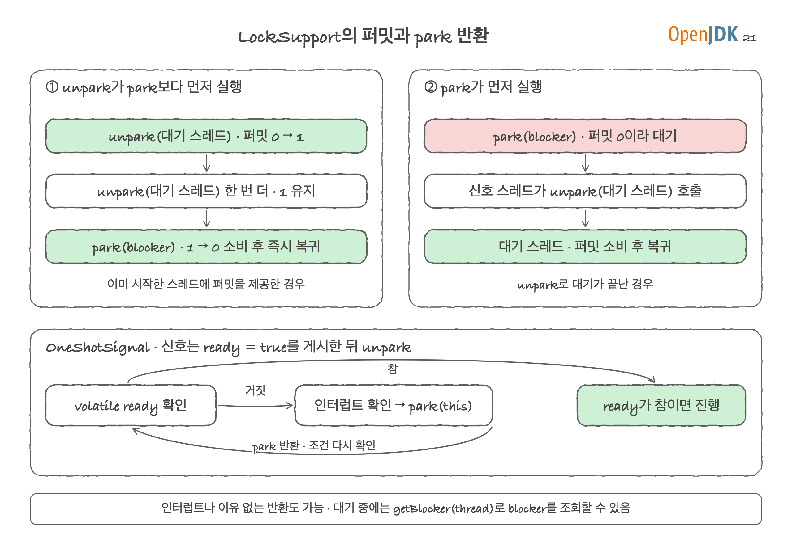

# 락으로 Java 스레드 동기화하기

Java SE 21을 기준으로 공유 상태를 보호하는 락, 단일 변수의 원자적 갱신, 스레드 대기와 교착상태 진단을 살펴본다. Linux 동기화 기능은 구현 계층을 이해하는 데 사용한다. [JLS 21 §17](https://docs.oracle.com/javase/specs/jls/se21/html/jls-17.html) · [Linux futex(2)](https://man7.org/linux/man-pages/man2/futex.2.html)

## 1. 운영체제 동기화와 커널 객체



경합 없는 락 획득은 사용자 공간에서 처리할 수 있고, 경합한 스레드는 futex 값 비교를 거쳐 대기할 수 있다. [POSIX `pthread_mutex_lock`](https://man7.org/linux/man-pages/man3/pthread_mutex_lock.3p.html#DESCRIPTION) · [POSIX `pthread_cond_wait`](https://man7.org/linux/man-pages/man3/pthread_cond_wait.3p.html#DESCRIPTION) · [Linux sem_overview(7)](https://man7.org/linux/man-pages/man7/sem_overview.7.html#DESCRIPTION) · [Linux futex(2)](https://man7.org/linux/man-pages/man2/futex.2.html#DESCRIPTION)

- **뮤텍스**는 소유권을 가진 상호 배제 장치다. POSIX `pthread_mutex_lock()`으로 획득에 성공한 스레드가 소유자가 된다. 같은 스레드의 재획득 동작은 뮤텍스 유형에 따라 달라진다. [POSIX `pthread_mutex_lock`](https://man7.org/linux/man-pages/man3/pthread_mutex_lock.3p.html#DESCRIPTION)
- **조건 변수**는 공유 상태가 진행 조건을 만족할 때까지 반복해서 대기하는 데 쓴다. `pthread_cond_wait()`는 연관 뮤텍스의 해제와 대기 진입을 원자적으로 처리한다. 성공적으로 돌아오면 뮤텍스를 다시 보유하며, 공유 상태로 표현한 조건을 다시 검사한다. [POSIX `pthread_cond_wait`](https://man7.org/linux/man-pages/man3/pthread_cond_wait.3p.html#DESCRIPTION)
- **세마포어**는 사용 가능한 수량을 카운터로 관리한다. POSIX `sem_wait()`는 카운터를 하나 줄이고, 값이 0이면 줄일 수 있을 때까지 대기한다. `sem_post()`는 카운터를 하나 늘리고 대기 중인 스레드가 진행할 수 있게 한다. [Linux sem_overview(7)](https://man7.org/linux/man-pages/man7/sem_overview.7.html#DESCRIPTION) · [Linux sem_wait(3)](https://man7.org/linux/man-pages/man3/sem_wait.3.html#DESCRIPTION) · [Linux sem_post(3)](https://man7.org/linux/man-pages/man3/sem_post.3.html#DESCRIPTION)

Linux `futex`는 사용자 공간의 32비트 값에 커널의 대기와 깨우기를 연결한다. `FUTEX_WAIT`는 해당 값이 기대값과 여전히 같을 때만 잠들며, 읽기·비교·대기 진입은 같은 워드에 대한 동시 futex 연산과 관련해 원자적이다. 경합 없는 락 획득은 사용자 공간의 원자적 연산으로 처리할 수 있다. 커널은 같은 워드에 대한 대기 같은 연산을 처리하는 동안 내부 상태를 관리한다. [Linux futex(2)](https://man7.org/linux/man-pages/man2/futex.2.html#DESCRIPTION)

Linux 커널 내부의 뮤텍스는 소유자와 대기열을 가진 `struct mutex`로 구현된다. Java 객체의 모니터는 명세가 정의한 동기화 단위이며, 이를 운영체제의 어떤 객체나 호출로 구현할지는 JVM과 플랫폼에 달려 있다. [Linux 커널 뮤텍스 설계](https://www.kernel.org/doc/html/latest/locking/mutex-design.html#implementation) · [JLS 21 §17.1](https://docs.oracle.com/javase/specs/jls/se21/html/jls-17.html#jls-17.1)

## 2. synchronized 메서드와 모니터 락

Java의 각 객체에는 모니터가 연결된다. 한 번에 한 스레드가 소유할 수 있고, 소유 스레드는 같은 모니터에 재진입할 수 있다. 인스턴스 `synchronized` 메서드는 `this`, `static synchronized` 메서드는 메서드를 선언한 클래스의 `Class` 객체, `synchronized (guard)` 블록은 `guard`가 참조하는 객체의 모니터를 사용한다. 메서드나 블록이 정상적으로 끝나거나 예외로 끝날 때 모니터가 자동으로 해제된다. [JLS 21 §17.1](https://docs.oracle.com/javase/specs/jls/se21/html/jls-17.html#jls-17.1)



같은 모니터에서 재진입이 가능하며, 그 모니터를 해제한 뒤 획득하는 스레드는 앞선 쓰기를 관찰할 수 있다. [JLS 21 §17.1](https://docs.oracle.com/javase/specs/jls/se21/html/jls-17.html#jls-17.1) · [JVMS 21 §2.11.10](https://docs.oracle.com/javase/specs/jvms/se21/html/jvms-2.html#jvms-2.11.10) · [JLS 21 §17.4.5](https://docs.oracle.com/javase/specs/jls/se21/html/jls-17.html#jls-17.4.5)

클래스 파일에서 `synchronized` 메서드는 `ACC_SYNCHRONIZED` 플래그로 표시된다. `synchronized` 블록은 `monitorenter`와 `monitorexit` 명령어로 모니터 진입과 해제를 표현한다. 같은 모니터를 해제한 동작은 그 모니터를 이후 획득하는 동작에 happens-before 관계를 형성한다. 따라서 락 안에서 기록한 공유 상태를 같은 락 안의 후속 읽기에서 관찰할 수 있다. [JVMS 21 §2.11.10](https://docs.oracle.com/javase/specs/jvms/se21/html/jvms-2.html#jvms-2.11.10) · [JLS 21 §17.4.5](https://docs.oracle.com/javase/specs/jls/se21/html/jls-17.html#jls-17.4.5)

## 3. synchronized로 보호할 범위와 불변식

재고 예약은 남은 수량 확인, 남은 수량 감소, 예약 수량 증가를 하나의 임계 구역에 둔다. 예제의 불변식은 `remaining + reserved == 초기 재고`다. 두 값의 일관된 조합이 필요한 조회도 같은 `guard`를 획득한 뒤 스냅샷을 만든다. 이렇게 하면 두 스레드가 마지막 한 개를 함께 예약하거나 조회가 갱신 중간의 값 조합을 보는 것을 막을 수 있다. [JLS 21 §17.1](https://docs.oracle.com/javase/specs/jls/se21/html/jls-17.html#jls-17.1) · [JLS 21 §17.4.5](https://docs.oracle.com/javase/specs/jls/se21/html/jls-17.html#jls-17.4.5)



재고 확인부터 예약 수량 변경까지 같은 guard에 묶고, 두 값을 함께 읽는 조회에서도 같은 락을 획득한다. [JLS 21 §17.1](https://docs.oracle.com/javase/specs/jls/se21/html/jls-17.html#jls-17.1) · [JLS 21 §17.4.5](https://docs.oracle.com/javase/specs/jls/se21/html/jls-17.html#jls-17.4.5)

```java
final class Inventory {
    record Stock(int remaining, int reserved) {}

    private final Object guard = new Object();
    private int remaining;
    private int reserved;

    Inventory(int initialQuantity) {
        if (initialQuantity < 0) {
            throw new IllegalArgumentException("negative inventory");
        }
        remaining = initialQuantity;
    }

    boolean reserve(int quantity) {
        if (quantity <= 0) {
            throw new IllegalArgumentException("quantity must be positive");
        }
        synchronized (guard) {
            if (remaining < quantity) {
                return false;
            }
            remaining -= quantity;
            reserved += quantity;
            return true;
        }
    }

    Stock stock() {
        synchronized (guard) {
            return new Stock(remaining, reserved);
        }
    }
}
```

락 경계는 불변식을 완성하는 데 필요한 범위로 잡는다. 예제에서는 입력값 검증을 락 밖에서 할 수 있고, 상태 변경이 끝난 뒤 스냅샷을 사용한 로깅도 락 밖에서 할 수 있다. 락을 보유한 상태로 원격 호출이나 외부 콜백을 실행하면 호출이 돌아올 때까지 다른 스레드의 같은 모니터 획득이 지연될 수 있다. [JLS 21 §17.1](https://docs.oracle.com/javase/specs/jls/se21/html/jls-17.html#jls-17.1)

## 4. 비블로킹 동기화와 원자 변수 연산

`java.util.concurrent.atomic`은 단일 변수의 락 프리 갱신을 지원한다. 독립 카운터는 `incrementAndGet()`으로 읽기·증가·쓰기를 한 연산으로 처리한다. 조건부 갱신은 `compareAndSet(expected, update)`로 시도하고, 값이 달라져 실패하면 새 값으로 조건부터 검토한다. 경쟁 시 같은 스레드가 재시도할 수 있으며, `updateAndGet()`에 넘기는 함수도 재실행될 수 있으므로 순수 함수로 작성한다. [JDK 21 원자 변수 패키지](https://docs.oracle.com/en/java/javase/21/docs/api/java.base/java/util/concurrent/atomic/package-summary.html) · [JDK 21 AtomicInteger](https://docs.oracle.com/en/java/javase/21/docs/api/java.base/java/util/concurrent/atomic/AtomicInteger.html)



CAS 실패 뒤에는 최신 값을 다시 읽고 조건부터 검사하므로 같은 이용권을 두 번 쓰지 않는다. [JDK 21 AtomicInteger.compareAndSet](https://docs.oracle.com/en/java/javase/21/docs/api/java.base/java/util/concurrent/atomic/AtomicInteger.html#compareAndSet(int,int)) · [JDK 21 원자 변수 패키지](https://docs.oracle.com/en/java/javase/21/docs/api/java.base/java/util/concurrent/atomic/package-summary.html) · [JDK 21 AtomicReference](https://docs.oracle.com/en/java/javase/21/docs/api/java.base/java/util/concurrent/atomic/AtomicReference.html)

다음 예제는 잔여 이용권 한 값에서 0 미만으로 감소할 수 없다는 조건을 지킨다. 여러 필드가 하나의 불변식을 공유한다면 같은 락으로 묶거나, 각 필드를 하나의 불변 상태 객체에 담아 `AtomicReference`로 교체할 수 있다. [JDK 21 AtomicInteger.compareAndSet](https://docs.oracle.com/en/java/javase/21/docs/api/java.base/java/util/concurrent/atomic/AtomicInteger.html#compareAndSet(int,int)) · [JDK 21 AtomicReference](https://docs.oracle.com/en/java/javase/21/docs/api/java.base/java/util/concurrent/atomic/AtomicReference.html) · [JLS 21 §17.1](https://docs.oracle.com/javase/specs/jls/se21/html/jls-17.html#jls-17.1)

```java
import java.util.concurrent.atomic.AtomicInteger;

final class Quota {
    private final AtomicInteger remaining = new AtomicInteger(100);

    boolean tryUse() {
        int current;
        do {
            current = remaining.get();
            if (current == 0) {
                return false;
            }
        } while (!remaining.compareAndSet(current, current - 1));
        return true;
    }
}
```

## 5. ReentrantLock과 획득 대기 제어

`ReentrantLock`은 재진입 가능한 상호 배제 락이다. 성공한 획득과 해제는 모니터 락에 대응하는 메모리 동기화 효과를 제공한다. `lock()` 또는 `lockInterruptibly()` 호출은 `try` 바로 앞에 두고, `tryLock()` 계열은 `true`를 받았을 때만 `try`에 진입한다. 획득한 락은 `finally`에서 해제한다. [JDK 21 Lock · Memory Synchronization](https://docs.oracle.com/en/java/javase/21/docs/api/java.base/java/util/concurrent/locks/Lock.html#memory-synchronization) · [JDK 21 ReentrantLock](https://docs.oracle.com/en/java/javase/21/docs/api/java.base/java/util/concurrent/locks/ReentrantLock.html)



락 획득에 성공했을 때만 try에 진입하고, 공유 값 사용이 끝나면 finally에서 획득한 락을 해제한다. [JDK 21 Lock · Memory Synchronization](https://docs.oracle.com/en/java/javase/21/docs/api/java.base/java/util/concurrent/locks/Lock.html#memory-synchronization) · [JDK 21 ReentrantLock.lockInterruptibly](https://docs.oracle.com/en/java/javase/21/docs/api/java.base/java/util/concurrent/locks/ReentrantLock.html#lockInterruptibly()) · [JDK 21 ReentrantLock.tryLock](https://docs.oracle.com/en/java/javase/21/docs/api/java.base/java/util/concurrent/locks/ReentrantLock.html#tryLock(long,java.util.concurrent.TimeUnit))

시간 제한이 있는 `tryLock(timeout, unit)`은 제한 시간 동안 획득하지 못하면 `false`를 반환한다. `lockInterruptibly()`와 시간 제한이 있는 `tryLock()`은 획득 대기 중 인터럽트에 `InterruptedException`으로 응답한다. 아래 예제에서 제한 시간은 락 획득에 적용된다. [JDK 21 ReentrantLock.lockInterruptibly](https://docs.oracle.com/en/java/javase/21/docs/api/java.base/java/util/concurrent/locks/ReentrantLock.html#lockInterruptibly()) · [JDK 21 ReentrantLock.tryLock](https://docs.oracle.com/en/java/javase/21/docs/api/java.base/java/util/concurrent/locks/ReentrantLock.html#tryLock(long,java.util.concurrent.TimeUnit))

```java
import java.util.OptionalInt;
import java.util.concurrent.TimeUnit;
import java.util.concurrent.locks.ReentrantLock;

final class Limit {
    private final ReentrantLock guard = new ReentrantLock();
    private int value;

    void set(int newValue) throws InterruptedException {
        guard.lockInterruptibly();
        try {
            value = newValue;
        } finally {
            guard.unlock();
        }
    }

    OptionalInt tryRead(long timeout, TimeUnit unit) throws InterruptedException {
        if (!guard.tryLock(timeout, unit)) {
            return OptionalInt.empty();
        }
        try {
            return OptionalInt.of(value);
        } finally {
            guard.unlock();
        }
    }
}
```

## 6. wait, notify, notifyAll과 조건 재검사

`wait()`, `notify()`, `notifyAll()`은 대상 객체의 모니터를 가진 스레드가 호출한다. `wait()`는 대상 객체의 대기 집합에 등록한 뒤 그 객체에 대한 모니터 보유를 모두 해제한다. 다른 객체의 모니터 보유는 유지된다. `wait()`에서 정상 복귀하거나 대기 도중 인터럽트로 예외를 던지기 전에는 대상 모니터를 다시 획득한다. [JLS 21 §17.2](https://docs.oracle.com/javase/specs/jls/se21/html/jls-17.html#jls-17.2) · [JDK 21 Object.wait](https://docs.oracle.com/en/java/javase/21/docs/api/java.base/java/lang/Object.html#wait(long,int))

`notify()`는 대기 집합의 한 스레드를 임의로 선택하고 `notifyAll()`은 모두를 깨운다. 깨어난 스레드는 알림을 보낸 스레드가 모니터를 해제해야 다시 획득할 수 있다. 모니터를 재획득하기 전에 다른 스레드가 상태를 변경할 수 있고, 이유 없이 깨어나는 경우도 있으므로 `while`로 조건을 다시 검사한다. [JLS 21 §17.2.1–2](https://docs.oracle.com/javase/specs/jls/se21/html/jls-17.html#jls-17.2) · [JDK 21 Object.wait](https://docs.oracle.com/en/java/javase/21/docs/api/java.base/java/lang/Object.html#wait(long,int))



알림을 받은 소비자는 모니터를 다시 획득한 뒤 버퍼 상태를 재검사한다. [JLS 21 §17.2](https://docs.oracle.com/javase/specs/jls/se21/html/jls-17.html#jls-17.2) · [JDK 21 Object.wait](https://docs.oracle.com/en/java/javase/21/docs/api/java.base/java/lang/Object.html#wait(long,int)) · [JDK 21 Object.notifyAll](https://docs.oracle.com/en/java/javase/21/docs/api/java.base/java/lang/Object.html#notifyAll()) · [JDK 21 Condition · bounded buffer 예제](https://docs.oracle.com/en/java/javase/21/docs/api/java.base/java/util/concurrent/locks/Condition.html)

아래 버퍼에서는 생산자가 빈자리를, 소비자가 항목을 기다린다. 같은 대기 집합에 두 종류의 대기자가 있으므로 상태를 바꾼 뒤 `notifyAll()`을 호출하고, 각 대기자가 자기 조건을 검사한다. 대기 집합을 조건별로 분리하려면 `ReentrantLock.newCondition()`으로 `notFull`, `notEmpty`를 만들고 `await()`와 `signal()`을 사용할 수 있다. [JDK 21 Object.notifyAll](https://docs.oracle.com/en/java/javase/21/docs/api/java.base/java/lang/Object.html#notifyAll()) · [JDK 21 Condition · bounded buffer 예제](https://docs.oracle.com/en/java/javase/21/docs/api/java.base/java/util/concurrent/locks/Condition.html)

```java
import java.util.ArrayDeque;

final class BoundedBuffer {
    private final ArrayDeque<String> items = new ArrayDeque<>();
    private final int capacity = 4;

    synchronized void put(String item) throws InterruptedException {
        while (items.size() == capacity) {
            wait();
        }
        items.addLast(item);
        notifyAll();
    }

    synchronized String take() throws InterruptedException {
        while (items.isEmpty()) {
            wait();
        }
        String item = items.removeFirst();
        notifyAll();
        return item;
    }
}
```

## 7. 교착상태 예방과 JDK 21 진단

스레드 A가 락 1을 가진 채 락 2를, 스레드 B가 락 2를 가진 채 락 1을 기다리면 서로 진행할 수 없다. 두 락이 모두 필요한 경로에서 항상 같은 순서로 획득하면 이런 순환을 제거할 수 있다. [JLS 21 §17.1](https://docs.oracle.com/javase/specs/jls/se21/html/jls-17.html#jls-17.1) · [JDK 21 ThreadMXBean.findMonitorDeadlockedThreads](https://docs.oracle.com/en/java/javase/21/docs/api/java.management/java/lang/management/ThreadMXBean.html#findMonitorDeadlockedThreads())



스레드별 소유와 대기 관계를 이어 순환을 찾고, 여러 락을 획득하는 경로의 순서를 통일한다. [JLS 21 §17.1](https://docs.oracle.com/javase/specs/jls/se21/html/jls-17.html#jls-17.1) · [JDK 21 ThreadMXBean.findDeadlockedThreads](https://docs.oracle.com/en/java/javase/21/docs/api/java.management/java/lang/management/ThreadMXBean.html#findDeadlockedThreads()) · [JDK 21 jcmd · Thread.print](https://docs.oracle.com/en/java/javase/21/docs/specs/man/jcmd.html) · [JDK 21 가상 스레드 가이드 · jcmd 스레드 덤프](https://docs.oracle.com/en/java/javase/21/core/virtual-threads.html)

플랫폼 스레드의 교착상태는 `jcmd <pid> Thread.print -l`에서 각 스레드가 기다리는 락과 소유한 락을 찾아 연결한다. `ThreadMXBean.findMonitorDeadlockedThreads()`는 객체 모니터의 순환을, `findDeadlockedThreads()`는 객체 모니터와 `ReentrantLock` 같은 소유권 있는 동기화 장치의 순환을 찾는다. JDK 21의 두 메서드는 가상 스레드가 포함된 순환을 탐지 범위에서 제외한다. [JDK 21 jcmd · Thread.print](https://docs.oracle.com/en/java/javase/21/docs/specs/man/jcmd.html) · [JDK 21 ThreadMXBean.findMonitorDeadlockedThreads](https://docs.oracle.com/en/java/javase/21/docs/api/java.management/java/lang/management/ThreadMXBean.html#findMonitorDeadlockedThreads()) · [JDK 21 ThreadMXBean.findDeadlockedThreads](https://docs.oracle.com/en/java/javase/21/docs/api/java.management/java/lang/management/ThreadMXBean.html#findDeadlockedThreads())

가상 스레드의 스택은 `jcmd <pid> Thread.dump_to_file -format=json <file>`로 확인할 수 있다. 이 덤프는 플랫폼 스레드와 가상 스레드의 스택을 함께 보여 주며 락 소유 정보와 객체 주소는 제공 범위에서 제외한다. [JDK 21 가상 스레드 가이드 · jcmd 스레드 덤프](https://docs.oracle.com/en/java/javase/21/core/virtual-threads.html)

## 8. LockSupport의 퍼밋과 park 반환

`LockSupport`의 퍼밋은 스레드마다 최대 하나다. 시작된 스레드에 대해 `unpark(thread)`가 먼저 실행되어 퍼밋을 제공하면 뒤이은 `park()`가 그 퍼밋을 소비하고 곧바로 반환한다. 사용하지 않은 퍼밋이 있는 상태에서 `unpark()`를 반복해도 퍼밋은 하나로 유지된다. [JDK 21 LockSupport](https://docs.oracle.com/en/java/javase/21/docs/api/java.base/java/util/concurrent/locks/LockSupport.html) · [JDK 21 LockSupport.unpark](https://docs.oracle.com/en/java/javase/21/docs/api/java.base/java/util/concurrent/locks/LockSupport.html#unpark(java.lang.Thread))



스레드별 퍼밋은 최대 하나이며, park가 반환한 뒤에 진행 조건을 확인한다. [JDK 21 LockSupport.unpark](https://docs.oracle.com/en/java/javase/21/docs/api/java.base/java/util/concurrent/locks/LockSupport.html#unpark(java.lang.Thread)) · [JDK 21 LockSupport.park](https://docs.oracle.com/en/java/javase/21/docs/api/java.base/java/util/concurrent/locks/LockSupport.html#park(java.lang.Object)) · [JLS 21 §17.4.5](https://docs.oracle.com/javase/specs/jls/se21/html/jls-17.html#jls-17.4.5)

`park()`는 퍼밋을 받거나 인터럽트됐을 때, 또는 이유 없이 반환할 수 있다. 깨어난 이유를 반환값으로 제공하지 않으므로 `volatile`이나 원자 변수로 게시한 진행 조건을 반복해서 검사하고 인터럽트를 별도로 처리한다. `park(blocker)`를 쓰면 `LockSupport.getBlocker(thread)`로 대기의 원인을 나타내는 객체를 조회할 수 있다. [JDK 21 LockSupport.park](https://docs.oracle.com/en/java/javase/21/docs/api/java.base/java/util/concurrent/locks/LockSupport.html#park(java.lang.Object)) · [JDK 21 LockSupport.getBlocker](https://docs.oracle.com/en/java/javase/21/docs/api/java.base/java/util/concurrent/locks/LockSupport.html#getBlocker(java.lang.Thread))

아래 코드는 한 스레드가 한 번의 신호를 기다리는 예다. 신호를 보내는 쪽은 진행 조건을 먼저 게시하고, 그 조건을 기다리는 스레드에 `unpark()`를 호출한다. 이 사이에 다른 `park()` 호출이 끼어들면 퍼밋을 먼저 소비할 수 있으므로 대기 조건 확인과 `park()` 사이에는 블로킹 작업을 두지 않는다. [JDK 21 LockSupport](https://docs.oracle.com/en/java/javase/21/docs/api/java.base/java/util/concurrent/locks/LockSupport.html) · [JLS 21 §17.4.5](https://docs.oracle.com/javase/specs/jls/se21/html/jls-17.html#jls-17.4.5)

```java
import java.util.concurrent.locks.LockSupport;

final class OneShotSignal {
    private volatile boolean ready;

    void await() throws InterruptedException {
        while (!ready) {
            if (Thread.interrupted()) {
                throw new InterruptedException();
            }
            LockSupport.park(this);
        }
    }

    void signal(Thread waiter) {
        ready = true;
        LockSupport.unpark(waiter);
    }
}
```
