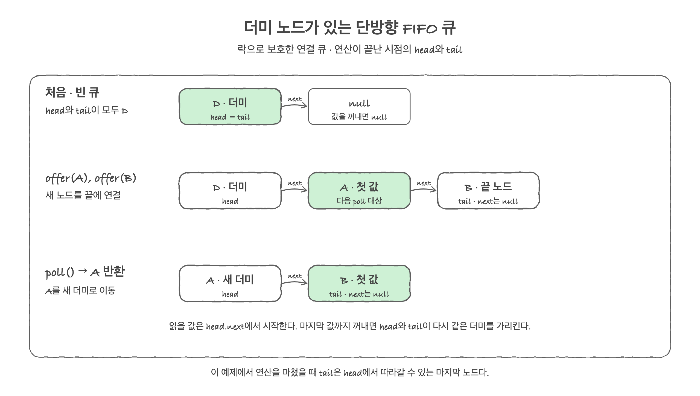
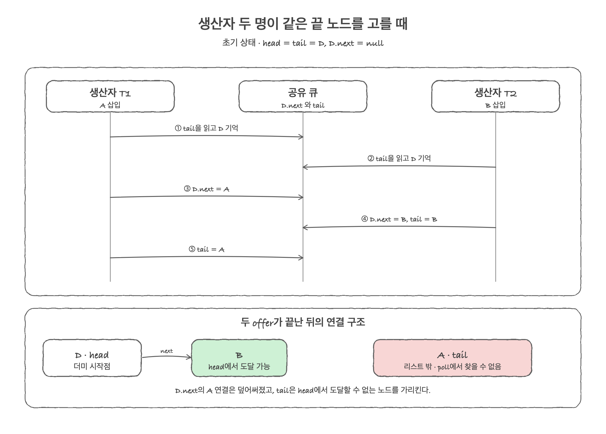
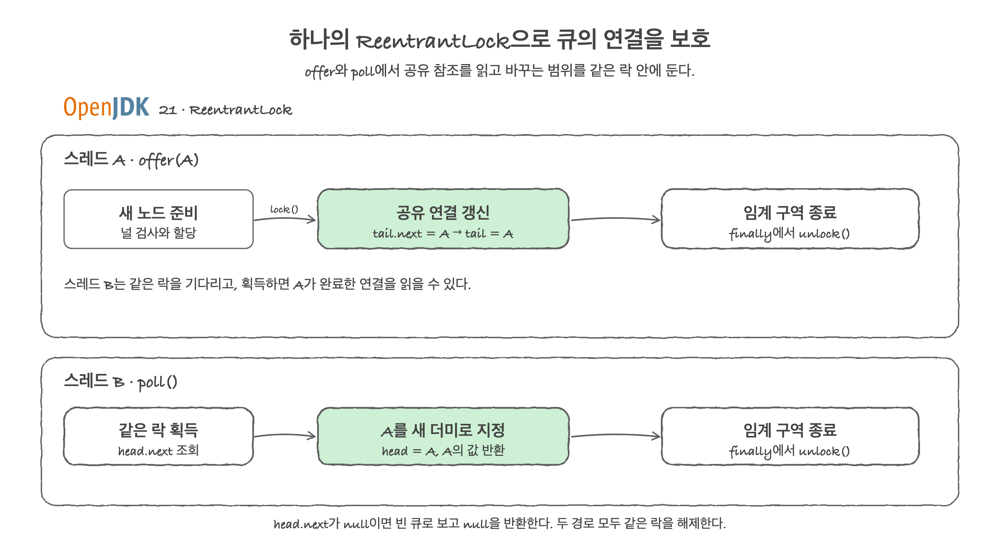
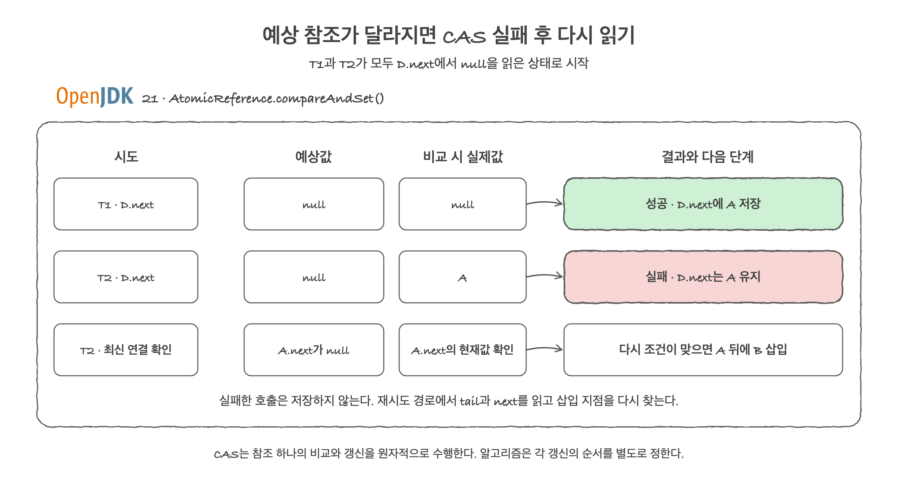
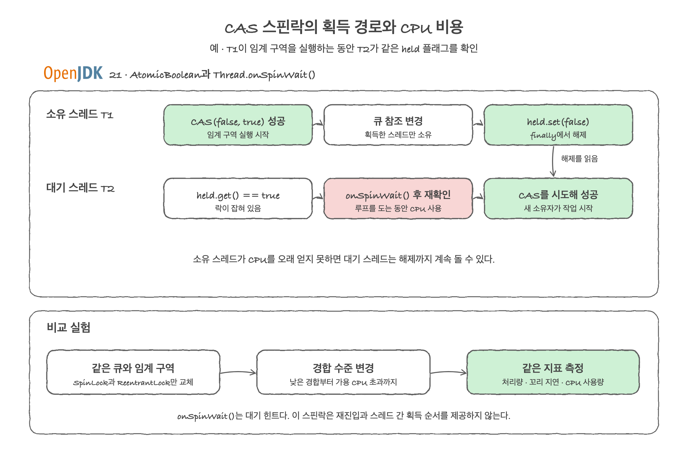
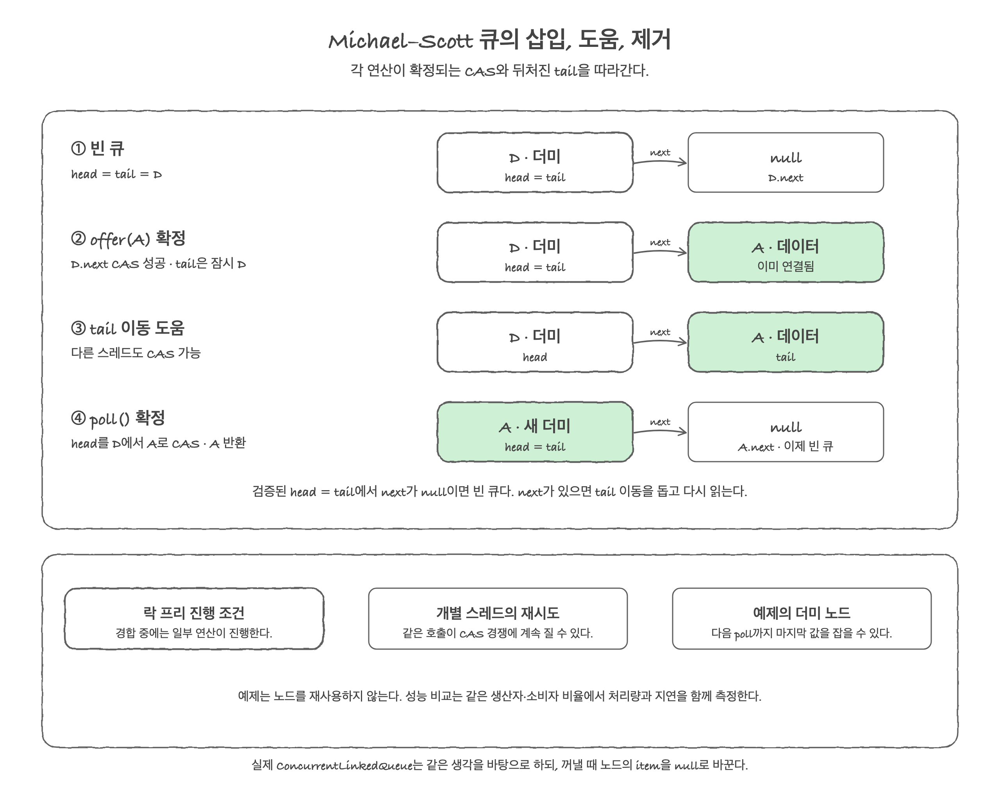

# 동시 연결 리스트와 큐 구현

한 방향으로 연결된 노드에 여러 스레드가 값을 넣고 빼는 FIFO 큐를 구현한다. Java 21에서 동일한 자료구조를 락으로 보호하는 방법과 Michael–Scott 알고리즘에서 CAS로 연결 상태를 갱신하는 방법을 살펴본다. [Java 21 Queue](https://docs.oracle.com/en/java/javase/21/docs/api/java.base/java/util/Queue.html) · [Michael–Scott 큐 의사코드](https://www.cs.rochester.edu/research/synchronization/pseudocode/queues.html)

## 1. 연결 리스트와 멀티스레딩

단방향 리스트의 노드는 값과 다음 노드를 가리키는 `next`를 갖는다. 이 리스트를 큐로 쓰면 `offer`는 끝에 노드를 붙이고 `poll`은 가장 먼저 들어온 값을 꺼낸다. 아래의 구현은 `head`가 가리키는 더미 노드 다음부터 값을 보관하고, 시작할 때는 `head`와 `tail`이 같은 더미를 가리킨다. Java의 `LinkedList`는 이중 연결 리스트이며, 여러 스레드가 구조를 변경하며 공유할 때 외부 동기화가 필요하다. [Java 21 LinkedList](https://docs.oracle.com/en/java/javase/21/docs/api/java.base/java/util/LinkedList.html) · [Java 21 Queue](https://docs.oracle.com/en/java/javase/21/docs/api/java.base/java/util/Queue.html) · [Michael–Scott 큐 초기화](https://www.cs.rochester.edu/research/synchronization/pseudocode/queues.html)



더미 노드 다음에 저장 값이 이어지는 FIFO 큐의 삽입과 제거를 나타냈다. [Java 21 Queue의 FIFO 규칙](https://docs.oracle.com/en/java/javase/21/docs/api/java.base/java/util/Queue.html) · [Michael–Scott 큐의 연결 구조](https://www.cs.rochester.edu/research/synchronization/pseudocode/queues.html)

락으로 보호할 버전에서 각 연산이 끝나면 `tail`은 `head`에서 도달할 수 있는 마지막 노드이며 `tail.next == null`이다. `head.next == null`이면 큐가 비어 있고 `head == tail`이다. 아직 꺼내지 않은 값은 `head.next`부터 삽입 순서대로 한 번씩 나타나야 한다. 이 관계가 구현에서 유지할 불변식이다. [Java 21 Queue의 FIFO 규칙](https://docs.oracle.com/en/java/javase/21/docs/api/java.base/java/util/Queue.html) · [Michael–Scott 큐의 연결 구조](https://www.cs.rochester.edu/research/synchronization/pseudocode/queues.html)

## 2. 동시 삽입으로 연결이 끊기는 과정

현재 `tail`을 지역 변수에 저장하고, 그 노드의 `next`를 새 노드로 바꾼 뒤 `tail`을 갱신한다고 하자. 빈 큐에서 생산자 둘이 같은 `tail`을 먼저 읽으면, 아래처럼 각 읽기와 쓰기가 즉시 보이는 실행에서도 T2가 T1의 연결을 덮어쓴다. `tail`과 `next`를 개별적으로 `volatile`로 선언해도 이 순서는 가능하다. [JLS 21 §17.4.3–17.4.5](https://docs.oracle.com/javase/specs/jls/se21/html/jls-17.html#jls-17.4.3)



공유 참조를 개별적으로 읽고 쓰는 순서만으로도 삽입 유실과 구조 손상이 함께 발생할 수 있다. [JLS 21 §17.4.3](https://docs.oracle.com/javase/specs/jls/se21/html/jls-17.html#jls-17.4.3) · [Java 21 Queue의 삽입·제거 규칙](https://docs.oracle.com/en/java/javase/21/docs/api/java.base/java/util/Queue.html)

두 `offer`가 모두 반환해도 `poll`은 리스트에서 A를 찾을 수 없다. T2의 쓰기가 A로 향하는 연결을 없앴고, 마지막 `tail` 쓰기가 리스트 바깥의 노드를 끝으로 지정했다. 이후 삽입도 A 뒤에 붙으면 `head`에서 읽을 수 없다. 이처럼 연결과 끝 참조를 함께 갱신해야 하는 연산에서 갱신 유실과 구조 손상이 동시에 발생할 수 있다. [JLS 21 §17.4.3](https://docs.oracle.com/javase/specs/jls/se21/html/jls-17.html#jls-17.4.3) · [Java 21 Queue의 삽입·제거 규칙](https://docs.oracle.com/en/java/javase/21/docs/api/java.base/java/util/Queue.html)

## 3. 하나의 락으로 삽입과 제거 보호하기

두 메서드가 같은 `ReentrantLock`을 획득한 동안만 큐의 참조를 읽고 바꾼다. `offer`는 `next`와 `tail`을 함께 갱신한다. `poll`은 첫 데이터 노드를 새 더미로 삼아 값을 제거하며, 마지막 값을 꺼낼 때는 `head`가 이미 `tail`을 가리키므로 빈 큐의 조건이 성립한다. 이후에 락을 얻은 스레드는 앞선 임계 구역의 쓰기를 볼 수 있다. [Java 21 Lock의 메모리 동기화](https://docs.oracle.com/en/java/javase/21/docs/api/java.base/java/util/concurrent/locks/Lock.html) · [Java 21 ReentrantLock 사용 패턴](https://docs.oracle.com/en/java/javase/21/docs/api/java.base/java/util/concurrent/locks/ReentrantLock.html) · [Michael–Scott 큐의 더미 노드](https://www.cs.rochester.edu/research/synchronization/pseudocode/queues.html)



노드 할당에서 락 해제까지, 두 연산이 같은 락으로 큐의 불변식을 유지하는 과정을 그렸다. [Java 21 Lock의 메모리 동기화](https://docs.oracle.com/en/java/javase/21/docs/api/java.base/java/util/concurrent/locks/Lock.html) · [Java 21 ReentrantLock 사용 패턴](https://docs.oracle.com/en/java/javase/21/docs/api/java.base/java/util/concurrent/locks/ReentrantLock.html) · [Michael–Scott 큐의 더미 노드](https://www.cs.rochester.edu/research/synchronization/pseudocode/queues.html)

```java
import java.util.Objects;
import java.util.concurrent.locks.ReentrantLock;

final class LockedLinkedQueue<E> {
    private static final class Node<E> {
        private final E item;
        private Node<E> next;

        private Node(E item) {
            this.item = item;
        }
    }

    private final ReentrantLock lock = new ReentrantLock();
    private Node<E> head = new Node<>(null);
    private Node<E> tail = head;

    boolean offer(E item) {
        Node<E> node = new Node<>(Objects.requireNonNull(item));
        lock.lock();
        try {
            tail.next = node;
            tail = node;
            return true;
        } finally {
            lock.unlock();
        }
    }

    E poll() {
        lock.lock();
        try {
            Node<E> next = head.next;
            if (next == null) {
                return null;
            }
            head = next;
            return next.item;
        } finally {
            lock.unlock();
        }
    }
}
```

이 예제는 `poll()`의 `null`을 빈 큐 표시로 사용하므로 `offer(null)`을 거부한다. 노드 할당은 락을 얻기 전에 수행하고, 락을 얻은 뒤의 두 메서드는 `finally`에서 락을 해제한다. [Java 21 Queue의 null 규칙](https://docs.oracle.com/en/java/javase/21/docs/api/java.base/java/util/Queue.html) · [Java 21 ReentrantLock 사용 패턴](https://docs.oracle.com/en/java/javase/21/docs/api/java.base/java/util/concurrent/locks/ReentrantLock.html)

## 4. CAS에 실패하면 최신 상태로 재시도하기

CAS(compare-and-set)는 현재 값이 예상값과 같을 때만 새 값으로 원자적으로 바꾼다. `AtomicReference.compareAndSet`은 객체 참조를 `==`로 비교한다. T1과 T2가 모두 `D.next`에서 `null`을 읽었어도 먼저 수행된 `compareAndSet(null, A)`가 성공하면 같은 위치에 대한 T2의 `compareAndSet(null, B)`는 실패한다. T2는 최신 참조를 다시 읽고, 이어 붙일 노드를 다시 찾는다. [Java 21 AtomicReference.compareAndSet](https://docs.oracle.com/en/java/javase/21/docs/api/java.base/java/util/concurrent/atomic/AtomicReference.html#compareAndSet(V,V)) · [Michael–Scott 큐 `enqueue` E4–E17](https://www.cs.rochester.edu/research/synchronization/pseudocode/queues.html)



같은 위치에 대한 두 CAS를 비교해 실패 시 공유 값을 유지하고 최신 상태로 재시도하는 흐름을 그렸다. [Java 21 AtomicReference.compareAndSet](https://docs.oracle.com/en/java/javase/21/docs/api/java.base/java/util/concurrent/atomic/AtomicReference.html#compareAndSet(V,V)) · [Michael–Scott 큐 `enqueue` E4–E17](https://www.cs.rochester.edu/research/synchronization/pseudocode/queues.html)

성공한 CAS는 대상 참조 한 곳을 바꾼다. 여러 참조가 필요한 큐에서는 어느 갱신이 연산을 확정하는지, 읽은 상태가 바뀌었을 때 어디에서 다시 시작하는지를 설계해야 한다. Java 21에서 `AtomicReference.get()`은 volatile 읽기와 같은 효과를 내고, 성공한 CAS에는 volatile 쓰기의 효과가 있어 새로 연결한 노드의 초기화가 그 연결을 읽는 스레드에 보인다. [Java 21 AtomicReference](https://docs.oracle.com/en/java/javase/21/docs/api/java.base/java/util/concurrent/atomic/AtomicReference.html) · [Java 21 VarHandle.compareAndSet](https://docs.oracle.com/en/java/javase/21/docs/api/java.base/java/lang/invoke/VarHandle.html#compareAndSet(java.lang.Object...)) · [JLS 21 §17.4.5](https://docs.oracle.com/javase/specs/jls/se21/html/jls-17.html#jls-17.4.5)

## 5. CAS로 스핀락 구현하기

아래 `SpinLock`은 플래그가 비어 보일 때만 CAS를 시도한다. 먼저 CAS로 `false`를 `true`로 바꾼 스레드가 임계 구역에 들어간다. 소유 스레드의 `set(false)`는 volatile 쓰기이며, 이후 새 소유자가 CAS로 락을 획득하면 앞선 임계 구역의 쓰기가 보인다. 예제는 소유권 검사를 생략하므로 획득한 스레드만 `finally`에서 해제하며, 동일 스레드가 다시 획득하면 계속 대기한다. [Java 21 AtomicBoolean](https://docs.oracle.com/en/java/javase/21/docs/api/java.base/java/util/concurrent/atomic/AtomicBoolean.html) · [JLS 21 §17.4.5](https://docs.oracle.com/javase/specs/jls/se21/html/jls-17.html#jls-17.4.5) · [Mellor-Crummey·Scott의 스핀락 논문](https://www.cs.rochester.edu/u/scott/papers/1991_TOCS_synch.pdf)



스핀락의 획득·해제와 대기 루프를 따라가고, 정확히 같은 큐를 비교하는 실험 조건을 함께 제시했다. [Java 21 AtomicBoolean](https://docs.oracle.com/en/java/javase/21/docs/api/java.base/java/util/concurrent/atomic/AtomicBoolean.html) · [Java 21 Thread.onSpinWait](https://docs.oracle.com/en/java/javase/21/docs/api/java.base/java/lang/Thread.html#onSpinWait()) · [Mellor-Crummey·Scott의 스핀락 논문](https://www.cs.rochester.edu/u/scott/papers/1991_TOCS_synch.pdf) · [OpenJDK JMH 프로파일링 예제](https://github.com/openjdk/jmh/blob/master/jmh-samples/src/main/java/org/openjdk/jmh/samples/JMHSample_35_Profilers.java)

```java
import java.util.concurrent.atomic.AtomicBoolean;

final class SpinLock {
    private final AtomicBoolean held = new AtomicBoolean();

    void lock() {
        while (held.get() || !held.compareAndSet(false, true)) {
            Thread.onSpinWait();
        }
    }

    void unlock() {
        held.set(false);
    }
}
```

`Thread.onSpinWait()`는 런타임에 루프에서 대기 중이라는 힌트를 준다. 스핀은 임계 구역이 짧고 소유자가 계속 실행될 때 대기 스레드를 재스케줄하는 비용을 줄일 수 있다. 경합이 크거나 실행 가능한 스레드가 CPU보다 많아 소유자의 실행이 밀리면, 대기 스레드도 CPU를 쓰면서 해제를 기다린다. 위 구현에는 획득 순서가 없어서 먼저 기다린 스레드가 반복해서 밀릴 수 있다. [Java 21 Thread.onSpinWait](https://docs.oracle.com/en/java/javase/21/docs/api/java.base/java/lang/Thread.html#onSpinWait()) · [Mellor-Crummey·Scott의 스핀락 논문](https://www.cs.rochester.edu/u/scott/papers/1991_TOCS_synch.pdf) · [Michael–Scott 큐 논문 §1](https://www.cs.rochester.edu/u/scott/papers/1996_PODC_queues.pdf)

스핀 비용을 비교하려면 `LockedLinkedQueue`의 `lock` 필드를 `SpinLock`으로 교체한 버전과 기본 `ReentrantLock` 버전을 각각 측정한다. 노드와 임계 구역은 그대로 두고, 대기 스레드가 거의 없는 경우부터 가용 CPU를 초과하는 경우까지 스레드 수를 바꾼다. 처리량·꼬리 지연과 함께 CPU 사용량을 보면 대기 비용을 파악할 수 있다. [Java 21 ReentrantLock](https://docs.oracle.com/en/java/javase/21/docs/api/java.base/java/util/concurrent/locks/ReentrantLock.html) · [Mellor-Crummey·Scott의 스핀락 실험](https://www.cs.rochester.edu/u/scott/papers/1991_TOCS_synch.pdf) · [OpenJDK JMH 프로파일링 예제](https://github.com/openjdk/jmh/blob/master/jmh-samples/src/main/java/org/openjdk/jmh/samples/JMHSample_35_Profilers.java)

## 6. Michael–Scott 방식으로 락 프리 큐 구현하기

`head`는 현재 더미를, 그 다음 노드는 첫 데이터를 가리킨다. `tail`은 리스트의 끝을 찾는 출발점으로, 노드가 방금 연결되면 마지막 노드보다 한 칸 뒤처질 수 있다. 이때 다른 스레드가 `tail`을 앞으로 옮기는 작업을 도울 수 있다. `offer`는 마지막 노드의 `next`를 `null`에서 새 노드로 바꾸는 CAS에서 확정한다. 그 다음의 `tail` CAS는 다른 스레드가 먼저 성공해도 된다. [Michael–Scott 큐 `enqueue` E4–E17](https://www.cs.rochester.edu/research/synchronization/pseudocode/queues.html) · [Michael–Scott 큐 논문 §2](https://www.cs.rochester.edu/u/scott/papers/1996_PODC_queues.pdf)



끝 참조가 잠시 뒤처질 때의 도움 동작과 head를 전진시키는 제거의 확정 지점을 그렸다. [Michael–Scott 큐 `enqueue` E4–E17](https://www.cs.rochester.edu/research/synchronization/pseudocode/queues.html) · [Michael–Scott 큐 논문 §1–3](https://www.cs.rochester.edu/u/scott/papers/1996_PODC_queues.pdf) · [OpenJDK 21 ConcurrentLinkedQueue 소스](https://github.com/openjdk/jdk/blob/jdk-21%2B35/src/java.base/share/classes/java/util/concurrent/ConcurrentLinkedQueue.java) · [OpenJDK JMH 비대칭 그룹 예제](https://github.com/openjdk/jmh/blob/master/jmh-samples/src/main/java/org/openjdk/jmh/samples/JMHSample_15_Asymmetric.java)

`poll`은 `head`와 `tail`이 같을 때 `head.next`를 확인한다. 검증된 `head`의 `next`가 `null`이면 그 읽기 시점에 큐가 비어 있었다. `next`가 있으면 삽입은 끝났고 `tail`만 뒤처졌으므로 `tail` 이동을 돕고 다시 읽는다. 데이터가 있는 일반 경로는 `head`를 다음 노드로 바꾸는 CAS에서 제거를 확정하고, CAS에 성공한 스레드만 해당 값을 반환한다. [Michael–Scott 큐 `dequeue` D1–D20](https://www.cs.rochester.edu/research/synchronization/pseudocode/queues.html) · [Michael–Scott 큐 논문 §3](https://www.cs.rochester.edu/u/scott/papers/1996_PODC_queues.pdf)

```java
import java.util.Objects;
import java.util.concurrent.atomic.AtomicReference;

final class MichaelScottQueue<E> {
    private static final class Node<E> {
        private final E item;
        private final AtomicReference<Node<E>> next = new AtomicReference<>();

        private Node(E item) {
            this.item = item;
        }
    }

    private final AtomicReference<Node<E>> head;
    private final AtomicReference<Node<E>> tail;

    MichaelScottQueue() {
        Node<E> dummy = new Node<>(null);
        head = new AtomicReference<>(dummy);
        tail = new AtomicReference<>(dummy);
    }

    boolean offer(E item) {
        Node<E> node = new Node<>(Objects.requireNonNull(item));
        while (true) {
            Node<E> last = tail.get();
            Node<E> next = last.next.get();
            if (last != tail.get()) {
                continue;
            }
            if (next != null) {
                tail.compareAndSet(last, next);
                continue;
            }
            if (last.next.compareAndSet(null, node)) {
                tail.compareAndSet(last, node);
                return true;
            }
        }
    }

    E poll() {
        while (true) {
            Node<E> first = head.get();
            Node<E> last = tail.get();
            Node<E> next = first.next.get();
            if (first != head.get()) {
                continue;
            }
            if (first == last) {
                if (next == null) {
                    return null;
                }
                tail.compareAndSet(last, next);
                continue;
            }
            E item = next.item;
            if (head.compareAndSet(first, next)) {
                return item;
            }
        }
    }
}
```

생산자가 노드를 연결한 뒤 멈춰도 다른 생산자나 소비자가 `tail`을 옮겨 연산을 계속할 수 있다. 경쟁 중에는 실행을 이어가는 스레드의 연산 가운데 일부가 진행하는 **lock-free** 성질이 있다. 같은 스레드가 CAS 경쟁에서 계속 지는 실행은 가능하므로 각 호출이 정해진 단계 안에 끝나는 **wait-free** 보장은 없다. 이 성질은 자료구조 알고리즘의 진행 조건이며 JVM의 GC나 스케줄링에 걸리는 시간까지 정하지 않는다. [Michael–Scott 큐 논문 §1–3](https://www.cs.rochester.edu/u/scott/papers/1996_PODC_queues.pdf)

예제에서는 삽입마다 새 노드를 만들고 빠진 노드를 재사용하지 않는다. 다른 스레드가 이전 노드에 대한 Java 참조를 갖고 있으면 GC는 해당 객체를 회수할 수 없다. 이 조건에서 원래 의사코드의 노드 주소 재사용에 따른 ABA를 피하므로 포인터에 재사용 횟수를 붙일 필요가 없다. 예제의 `item`은 `final`이라 새 더미가 된 노드는 마지막으로 꺼낸 값을 다음 성공적인 `poll`까지 잡고 있을 수 있다. JDK 21 `ConcurrentLinkedQueue`는 GC 환경에 맞게 알고리즘을 변형했고, `poll`에서 노드의 `item`을 `null`로 바꾼다. [Java 21 참조 도달 가능성](https://docs.oracle.com/en/java/javase/21/docs/api/java.base/java/lang/ref/package-summary.html) · [Michael–Scott 큐 의사코드](https://www.cs.rochester.edu/research/synchronization/pseudocode/queues.html) · [OpenJDK 21 ConcurrentLinkedQueue 소스](https://github.com/openjdk/jdk/blob/jdk-21%2B35/src/java.base/share/classes/java/util/concurrent/ConcurrentLinkedQueue.java)

### JDK 큐와 락 기반 구현 비교하기

비교 대상은 `MichaelScottQueue`, JDK 21의 `ConcurrentLinkedQueue`, `ReentrantLock`과 `SpinLock`으로 각각 보호한 연결 큐다. 모든 구현에서 동일한 `offer`와 `poll`을 호출한다. `ConcurrentLinkedQueue`는 용량 제한이 없는 스레드 안전 FIFO 큐이며, JDK 21의 `size()`는 노드 순회가 필요하고 실행 중 변경을 반영한 정확한 시점의 길이를 보장하지 않으므로 측정 루프에서는 호출하지 않는다. [Java 21 ConcurrentLinkedQueue](https://docs.oracle.com/en/java/javase/21/docs/api/java.base/java/util/concurrent/ConcurrentLinkedQueue.html) · [OpenJDK JMH 비대칭 그룹 예제](https://github.com/openjdk/jmh/blob/master/jmh-samples/src/main/java/org/openjdk/jmh/samples/JMHSample_15_Asymmetric.java)

- 측정 전에 빈 큐와 단일 스레드 FIFO를 확인한다. 경쟁 검증에서는 각 생산자가 고유 값을 넣도록 하고 소비 결과의 누락·중복을 검사한다. 생산자별 순서는 소비자 한 명으로 검사하면 반환 후 기록 경쟁의 영향을 피할 수 있다. [Java 21 Queue의 FIFO 규칙](https://docs.oracle.com/en/java/javase/21/docs/api/java.base/java/util/Queue.html) · [Michael–Scott 큐 논문 §3](https://www.cs.rochester.edu/u/scott/papers/1996_PODC_queues.pdf)
- JMH에서 먼저 각 워커가 `offer`와 `poll`을 한 번씩 수행하는 부하로 1스레드와 경합 상태를 비교한다. 별도 측정에서는 `@Group`, `@GroupThreads`, `@State(Scope.Group)`으로 큐를 공유하는 생산자·소비자 그룹을 구성해 1:1, 다수:1, 다수:다수를 구분한다. 같은 초기 큐 깊이와 입력 값으로 시작하고, 측정 구간 밖에서 쌓인 데이터와 빈 `poll` 횟수를 확인한다. [OpenJDK JMH 비대칭 그룹 예제](https://github.com/openjdk/jmh/blob/master/jmh-samples/src/main/java/org/openjdk/jmh/samples/JMHSample_15_Asymmetric.java) · [Java 21 Queue.poll](https://docs.oracle.com/en/java/javase/21/docs/api/java.base/java/util/Queue.html#poll())
- 워밍업과 여러 JVM 포크를 적용하고 JDK 빌드, CPU, 스레드 수, 힙 크기, GC를 기록한다. 처리량, 성공한 제거 건수, 빈 `poll` 비율을 함께 해석하며 별도의 `SampleTime` 실행에서 연산 지연 분포를 수집한다. CPU 사용량과 `-prof gc`의 할당·수집 지표를 함께 보면 스핀 대기나 노드 할당의 영향을 살필 수 있다. [OpenJDK JMH 포크 예제](https://github.com/openjdk/jmh/blob/master/jmh-samples/src/main/java/org/openjdk/jmh/samples/JMHSample_12_Forking.java) · [OpenJDK JMH 측정 모드](https://github.com/openjdk/jmh/blob/master/jmh-core/src/main/java/org/openjdk/jmh/annotations/Mode.java) · [OpenJDK JMH 프로파일링 예제](https://github.com/openjdk/jmh/blob/master/jmh-samples/src/main/java/org/openjdk/jmh/samples/JMHSample_35_Profilers.java)
