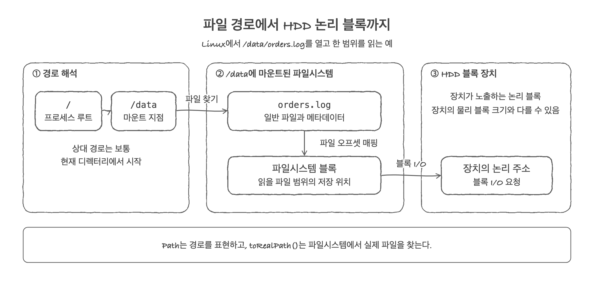
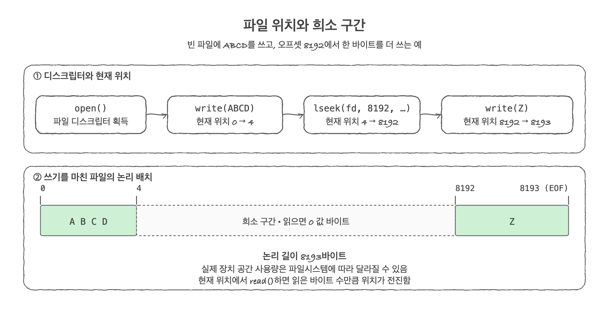
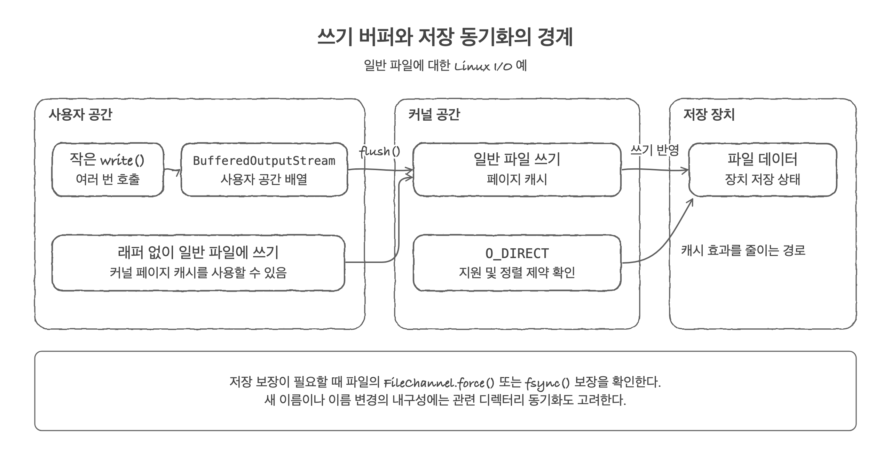
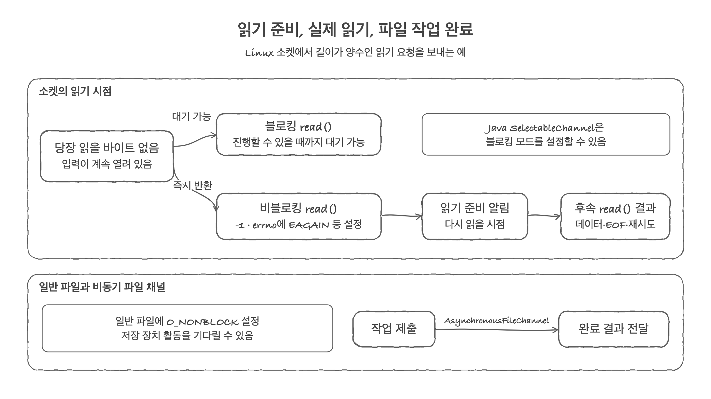
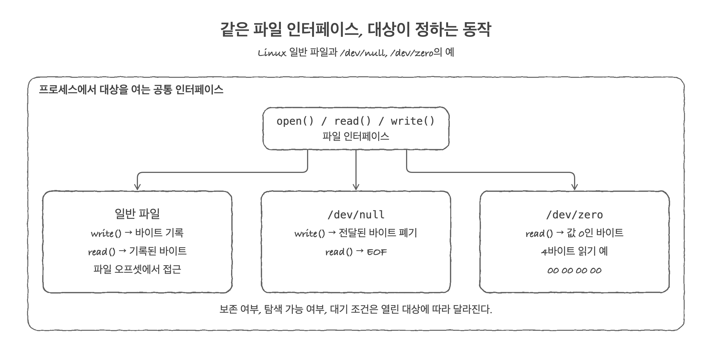

# 파일 저장 구조와 I/O 기본 이론

경로로 파일을 열 때 운영체제가 찾는 대상과, 데이터가 버퍼를 거쳐 저장되는 과정을 살펴본다. 운영체제 예시는 Linux, Java API는 JDK 21을 기준으로 한다. [Linux 경로 해석](https://man7.org/linux/man-pages/man7/path_resolution.7.html) · [Linux VFS](https://docs.kernel.org/filesystems/vfs.html) · [JDK 21 Path](https://docs.oracle.com/en/java/javase/21/docs/api/java.base/java/nio/file/Path.html)

## 1. HDD의 논리 블록과 파일 경로

운영체제는 HDD를 블록 장치로 다룬다. 블록 장치의 논리 블록 크기와 물리 블록 크기는 다를 수 있다. 파일시스템은 블록 장치나 파티션을 바탕으로 디렉터리와 파일을 구성하고, 저장된 파일의 데이터를 어느 범위에서 읽을지 관리한다. 파일 경로는 디렉터리를 따라 객체를 찾는 이름이다. 하나의 디렉터리 트리에는 여러 장치의 파일시스템을 마운트할 수 있다. [Linux 블록 장치 큐 속성](https://docs.kernel.org/block/queue-sysfs.html) · [Linux VFS](https://docs.kernel.org/filesystems/vfs.html) · [Linux 경로 해석 · Mount points](https://man7.org/linux/man-pages/man7/path_resolution.7.html)

Linux의 절대 경로는 프로세스가 보는 루트에서 해석하고, 상대 경로는 일반적으로 프로세스의 현재 디렉터리에서 시작한다. 심볼릭 링크를 따라갈지 여부는 마지막 경로 요소에 적용하는 연산에도 좌우된다. Java의 `Path`는 경로를 표현하며, `toRealPath()`는 실제 파일을 찾아 경로를 확인한다. [Linux 경로 해석](https://man7.org/linux/man-pages/man7/path_resolution.7.html) · [JDK 21 Path.toRealPath](https://docs.oracle.com/en/java/javase/21/docs/api/java.base/java/nio/file/Path.html#toRealPath(java.nio.file.LinkOption...))



마운트 지점에서 파일을 찾은 뒤 파일 오프셋을 저장 위치로 해석한다. [Linux 경로 해석 · Mount points](https://man7.org/linux/man-pages/man7/path_resolution.7.html) · [Linux VFS](https://docs.kernel.org/filesystems/vfs.html) · [Linux 블록 장치 큐 속성](https://docs.kernel.org/block/queue-sysfs.html)

## 2. 파일로 보조 기억 장치 사용하기

일반 파일은 바이트와 메타데이터를 보존하는 단위다. Linux에서 `open()`에 성공하면 파일 디스크립터를 얻는다. 열린 파일의 현재 위치를 사용하는 `read()`는 그 위치에서 읽기 시작해 읽은 바이트 수만큼 위치를 전진시킨다. 탐색 가능한 파일에서는 `lseek()`로 위치를 바꿀 수 있다. [Linux open(2)](https://man7.org/linux/man-pages/man2/open.2.html) · [Linux read(2)](https://man7.org/linux/man-pages/man2/read.2.html) · [Linux lseek(2)](https://man7.org/linux/man-pages/man2/lseek.2.html)



파일 오프셋을 끝 너머로 옮긴 쓰기는 논리 길이와 실제 공간 사용량을 다르게 만들 수 있다. [Linux open(2)](https://man7.org/linux/man-pages/man2/open.2.html) · [Linux read(2)](https://man7.org/linux/man-pages/man2/read.2.html) · [Linux lseek(2) · File holes](https://man7.org/linux/man-pages/man2/lseek.2.html)

파일에서 오프셋을 끝 너머로 이동한 뒤 데이터를 쓰면 그 사이가 희소 구간으로 남을 수 있다. 그 구간을 읽으면 값이 0인 바이트를 얻는다. 파일시스템이 실제 장치 공간을 얼마나 사용하는지는 파일의 논리 길이와 다를 수 있다. [Linux lseek(2) · File holes](https://man7.org/linux/man-pages/man2/lseek.2.html)

## 3. 버퍼링 I/O와 버퍼를 우회하는 I/O

Java의 `BufferedOutputStream`은 여러 작은 쓰기를 사용자 공간의 배열에 모아 하위 스트림 호출을 줄인다. 이 래퍼를 빼도 일반 파일 I/O에서 운영체제는 페이지 캐시를 사용할 수 있다. Linux의 `O_DIRECT`는 파일 I/O의 캐시 효과를 줄이려는 별도 옵션으로, 지원 여부와 버퍼·길이·오프셋의 정렬 제약은 파일시스템에 따라 다르다. [JDK 21 BufferedOutputStream](https://docs.oracle.com/en/java/javase/21/docs/api/java.base/java/io/BufferedOutputStream.html) · [Linux VFS · Address Space Object](https://docs.kernel.org/filesystems/vfs.html) · [Linux open(2) · O_DIRECT](https://man7.org/linux/man-pages/man2/open.2.html)



사용자 공간의 flush(), 커널 페이지 캐시, 저장 장치의 동기화는 각각 적용 범위가 다르다. [JDK 21 BufferedOutputStream](https://docs.oracle.com/en/java/javase/21/docs/api/java.base/java/io/BufferedOutputStream.html) · [Linux VFS · Address Space Object](https://docs.kernel.org/filesystems/vfs.html) · [Linux open(2) · O_DIRECT](https://man7.org/linux/man-pages/man2/open.2.html) · [Linux fsync(2)](https://man7.org/linux/man-pages/man2/fsync.2.html) · [JDK 21 FileChannel.force](https://docs.oracle.com/en/java/javase/21/docs/api/java.base/java/nio/channels/FileChannel.html#force(boolean))

Java 스트림의 `flush()`는 그 스트림에 남은 바이트를 하위 대상으로 밀어낸다. 전원 장애 후에도 데이터가 남아야 한다면 파일에 대해 `FileChannel.force()`나 OS의 `fsync()`가 제공하는 보장을 따로 확인한다. Linux에서는 새 파일 이름이나 이름 변경 자체의 내구성까지 필요할 때 디렉터리 동기화도 고려한다. [JDK 21 OutputStream.flush](https://docs.oracle.com/en/java/javase/21/docs/api/java.base/java/io/OutputStream.html#flush()) · [JDK 21 FileChannel.force](https://docs.oracle.com/en/java/javase/21/docs/api/java.base/java/nio/channels/FileChannel.html#force(boolean)) · [Linux fsync(2)](https://man7.org/linux/man-pages/man2/fsync.2.html)

## 4. Non-blocking I/O와 읽기 준비

블로킹 I/O는 진행 가능한 시점까지 호출자가 대기할 수 있다. Linux에서 비블로킹으로 연 소켓이나 파이프에 당장 읽을 데이터가 없지만 입력이 끝나지도 않았다면 `read()`가 실패하고 `errno`에 `EAGAIN`을 설정할 수 있다. 소켓에서는 `EWOULDBLOCK`도 확인한다. 읽기 준비 알림은 후속 읽기를 시도할 시점이며, 실제로 몇 바이트를 읽었는지와 EOF 여부는 읽기 호출에서 확인한다. [Linux read(2)](https://man7.org/linux/man-pages/man2/read.2.html) · [Linux epoll(7)](https://man7.org/linux/man-pages/man7/epoll.7.html)



소켓 준비 알림 뒤에는 읽기를 시도하고, 비동기 파일 채널은 제출한 작업의 완료 결과를 돌려준다. [Linux read(2)](https://man7.org/linux/man-pages/man2/read.2.html) · [Linux epoll(7)](https://man7.org/linux/man-pages/man7/epoll.7.html) · [Linux open(2) · O_NONBLOCK](https://man7.org/linux/man-pages/man2/open.2.html) · [JDK 21 AsynchronousFileChannel](https://docs.oracle.com/en/java/javase/21/docs/api/java.base/java/nio/channels/AsynchronousFileChannel.html)

Linux에서 `O_NONBLOCK`은 일반 파일과 블록 장치 I/O에 현재 영향을 주지 않으며, 장치 활동이 필요하면 대기할 수 있다. Java에서는 `SelectableChannel`이 블로킹 모드를 제공하고, 별도의 비동기 파일 채널은 이미 제출한 작업의 완료 결과를 전달할 수 있다. [Linux open(2) · O_NONBLOCK](https://man7.org/linux/man-pages/man2/open.2.html) · [JDK 21 SelectableChannel](https://docs.oracle.com/en/java/javase/21/docs/api/java.base/java/nio/channels/SelectableChannel.html) · [JDK 21 AsynchronousFileChannel](https://docs.oracle.com/en/java/javase/21/docs/api/java.base/java/nio/channels/AsynchronousFileChannel.html)

## 5. 장치 파일과 파일 인터페이스

Linux의 장치 파일에 대한 읽기와 쓰기는 해당 장치가 정의한 동작으로 이어진다. 예를 들어 `/dev/null`에 쓴 데이터는 버려지고 읽으면 EOF다. `/dev/zero`를 읽으면 0 값의 바이트를 얻는다. 파일을 여는 인터페이스를 공유하더라도 데이터가 저장되는지, 탐색이 가능한지, 읽기나 쓰기가 기다릴 수 있는지는 대상별로 확인한다. [Linux VFS · File Operations](https://docs.kernel.org/filesystems/vfs.html) · [Linux null(4)와 zero(4)](https://man7.org/linux/man-pages/man4/null.4.html) · [Linux lseek(2)](https://man7.org/linux/man-pages/man2/lseek.2.html)



같은 호출도 대상의 파일 연산에 따라 다른 결과를 돌려준다. [Linux VFS · File Operations](https://docs.kernel.org/filesystems/vfs.html) · [Linux null(4)와 zero(4)](https://man7.org/linux/man-pages/man4/null.4.html)

```sh
printf 'discard this\n' > /dev/null
od -An -tx1 -N4 /dev/zero
```
