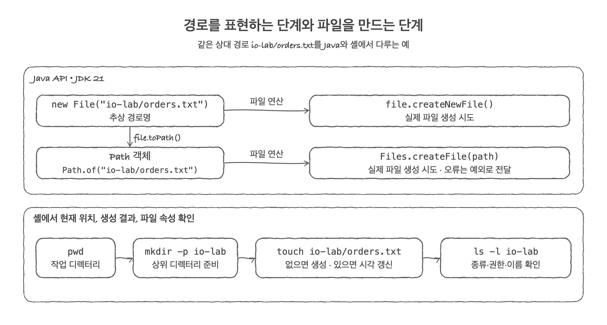
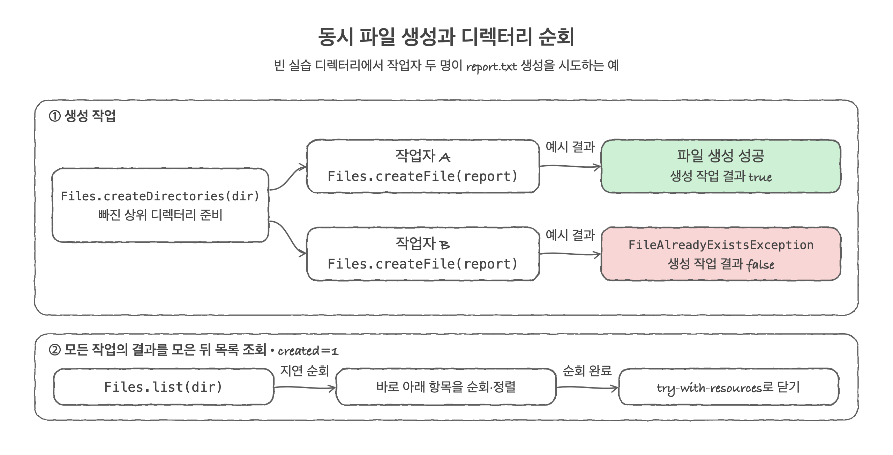
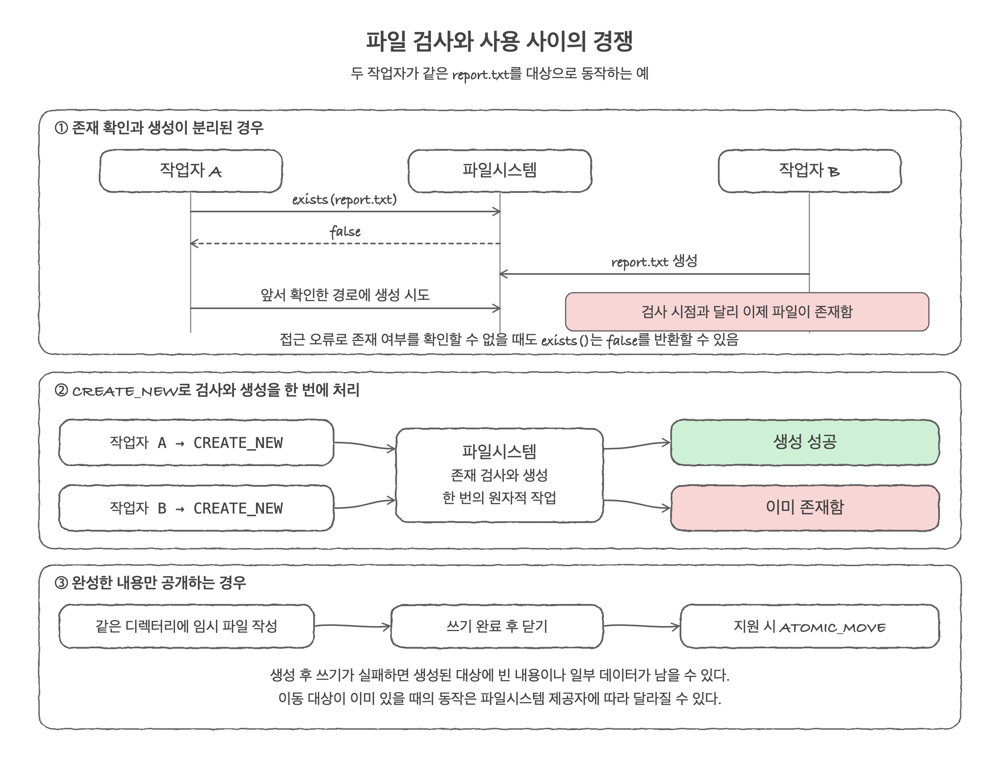

# Java 파일 관리와 접근 경쟁 조건

Java 21의 파일 경로 API와 디렉터리 순회를 익히고, 동시에 같은 파일을 만들 때 생성과 오류 처리를 하나의 작업으로 묶는 방법을 살펴본다. [JDK 21 File](https://docs.oracle.com/en/java/javase/21/docs/api/java.base/java/io/File.html) · [JDK 21 Path](https://docs.oracle.com/en/java/javase/21/docs/api/java.base/java/nio/file/Path.html) · [JDK 21 Files](https://docs.oracle.com/en/java/javase/21/docs/api/java.base/java/nio/file/Files.html)

## 1. File 클래스와 콘솔의 파일 명령

`File`은 추상 경로명을 나타낸다. `new File("orders.txt")`는 이름을 만들고, 실제 생성은 `createNewFile()` 같은 연산을 호출할 때 일어난다. 새 코드에서는 `Path.of()`로 경로를 만들고 `Files`로 실제 연산을 수행하면 실패를 예외로 구분하기 쉽다. 기존 `File`은 `toPath()`로 연결할 수 있다. [JDK 21 File.createNewFile](https://docs.oracle.com/en/java/javase/21/docs/api/java.base/java/io/File.html#createNewFile()) · [JDK 21 File.toPath](https://docs.oracle.com/en/java/javase/21/docs/api/java.base/java/io/File.html#toPath()) · [JDK 21 Files](https://docs.oracle.com/en/java/javase/21/docs/api/java.base/java/nio/file/Files.html)



경로 객체를 만든 뒤 파일 연산을 호출하고, 상대 경로가 해석되는 작업 위치를 확인한다. [JDK 21 File.createNewFile](https://docs.oracle.com/en/java/javase/21/docs/api/java.base/java/io/File.html#createNewFile()) · [JDK 21 Path.toAbsolutePath](https://docs.oracle.com/en/java/javase/21/docs/api/java.base/java/nio/file/Path.html#toAbsolutePath()) · [GNU ls(1)](https://man7.org/linux/man-pages/man1/ls.1.html) · [GNU touch(1)](https://man7.org/linux/man-pages/man1/touch.1.html)

리눅스 콘솔에서 `pwd`로 현재 작업 디렉터리를 확인하고, `ls -l`로 대상의 종류·권한·이름을 함께 본다. `touch`는 없는 파일을 만들 수 있고, 이미 있는 파일이면 일반적으로 타임스탬프를 갱신한다. Java에서 현재 작업 디렉터리를 기준으로 상대 경로를 사용할 때도 실행 위치를 확인한다. [Bash 매뉴얼 · pwd](https://man7.org/linux/man-pages/man1/bash.1.html) · [GNU ls(1)](https://man7.org/linux/man-pages/man1/ls.1.html) · [GNU touch(1)](https://man7.org/linux/man-pages/man1/touch.1.html) · [JDK 21 Path.toAbsolutePath](https://docs.oracle.com/en/java/javase/21/docs/api/java.base/java/nio/file/Path.html#toAbsolutePath())

```sh
pwd
mkdir -p io-lab
touch io-lab/orders.txt
ls -l io-lab
```

## 2. 파일 생성과 디렉터리 목록 조회

`Files.createDirectories()`로 빠진 상위 디렉터리를 만들고, `Files.createFile()`로 기존 파일과 충돌하면 실패하는 생성 작업을 수행한다. `Files.list()`는 바로 아래 항목을 지연 순회하는 스트림을 반환한다. 순회를 마치면 try-with-resources로 닫고, 결과 순서가 필요하면 직접 정렬한다. [JDK 21 Files.createDirectories](https://docs.oracle.com/en/java/javase/21/docs/api/java.base/java/nio/file/Files.html#createDirectories(java.nio.file.Path,java.nio.file.attribute.FileAttribute...)) · [JDK 21 Files.createFile](https://docs.oracle.com/en/java/javase/21/docs/api/java.base/java/nio/file/Files.html#createFile(java.nio.file.Path,java.nio.file.attribute.FileAttribute...)) · [JDK 21 Files.list](https://docs.oracle.com/en/java/javase/21/docs/api/java.base/java/nio/file/Files.html#list(java.nio.file.Path))



빈 디렉터리의 예에서는 생성에 성공한 작업자 한 명을 집계한 뒤 디렉터리를 순회한다. [JDK 21 Files.createFile](https://docs.oracle.com/en/java/javase/21/docs/api/java.base/java/nio/file/Files.html#createFile(java.nio.file.Path,java.nio.file.attribute.FileAttribute...)) · [JDK 21 Files.list](https://docs.oracle.com/en/java/javase/21/docs/api/java.base/java/nio/file/Files.html#list(java.nio.file.Path)) · [JDK 21 ExecutorService.invokeAll](https://docs.oracle.com/en/java/javase/21/docs/api/java.base/java/util/concurrent/ExecutorService.html#invokeAll(java.util.Collection))

아래 예제는 한 디렉터리에 같은 이름으로 파일을 만들려는 두 작업을 동시에 제출한다. 빈 실습 디렉터리에서 실행하면 로컬 기본 파일시스템에서 한 작업은 생성하고, 나머지는 이미 존재한다는 결과를 받는다. 예제는 이미 존재하는 경우만 처리하고 다른 I/O 실패는 호출자에게 전달한다. [JDK 21 Files.createFile](https://docs.oracle.com/en/java/javase/21/docs/api/java.base/java/nio/file/Files.html#createFile(java.nio.file.Path,java.nio.file.attribute.FileAttribute...)) · [JDK 21 ExecutorService.invokeAll](https://docs.oracle.com/en/java/javase/21/docs/api/java.base/java/util/concurrent/ExecutorService.html#invokeAll(java.util.Collection))

```java
import java.io.IOException;
import java.nio.file.FileAlreadyExistsException;
import java.nio.file.Files;
import java.nio.file.Path;
import java.util.List;
import java.util.concurrent.Callable;
import java.util.concurrent.Executors;

public class CreateOnce {
    private static boolean tryCreate(Path file) throws IOException {
        try {
            Files.createFile(file);
            return true;
        } catch (FileAlreadyExistsException alreadyCreated) {
            return false;
        }
    }

    public static void main(String[] args) throws Exception {
        Path directory = Files.createDirectories(Path.of(args[0]));
        Path file = directory.resolve("report.txt");
        Callable<Boolean> task = () -> tryCreate(file);
        int winners = 0;
        try (var workers = Executors.newFixedThreadPool(2)) {
            for (var outcome : workers.invokeAll(List.of(task, task))) {
                if (outcome.get()) {
                    winners++;
                }
            }
        }
        System.out.println("created=" + winners);
        try (var files = Files.list(directory)) {
            files.map(Path::getFileName).sorted().forEach(System.out::println);
        }
    }
}
```

```sh
javac --release 21 CreateOnce.java
java CreateOnce "$(mktemp -d)"
```

## 3. 파일 접근 오류와 검사·사용 사이의 경쟁

`Files.exists(path)`가 반환한 뒤 다른 스레드나 프로세스가 경로를 만들거나 삭제할 수 있다. `exists()`에서 거짓을 받았어도 접근 오류 때문에 존재 여부를 판단하지 못했을 수 있다. 실제 목적이 생성이라면 `createFile()`이나 `CREATE_NEW`를 사용하고, 조회라면 읽기를 시도한 결과와 예외를 처리한다. `CREATE_NEW`는 파일 존재 검사와 생성을 하나의 원자적 동작으로 제공한다. [JDK 21 Files.exists](https://docs.oracle.com/en/java/javase/21/docs/api/java.base/java/nio/file/Files.html#exists(java.nio.file.Path,java.nio.file.LinkOption...)) · [JDK 21 StandardOpenOption.CREATE_NEW](https://docs.oracle.com/en/java/javase/21/docs/api/java.base/java/nio/file/StandardOpenOption.html#CREATE_NEW)

원자적 생성이 보장하는 범위는 파일을 여는 시점이다. 생성한 뒤 쓰기가 실패하면 빈 파일이나 일부만 기록된 파일이 남을 수 있다. 완성된 파일 이름만 독자에게 보여 주려면 같은 디렉터리의 임시 파일에 작성해 닫은 뒤, 제공자가 지원하는 경우 `ATOMIC_MOVE`로 공개한다. 대상이 이미 존재할 때의 결과는 제공자에 따라 달라질 수 있으므로 덮어쓰기 정책은 따로 확인한다. [JDK 21 Files.move](https://docs.oracle.com/en/java/javase/21/docs/api/java.base/java/nio/file/Files.html#move(java.nio.file.Path,java.nio.file.Path,java.nio.file.CopyOption...)) · [JDK 21 StandardCopyOption](https://docs.oracle.com/en/java/javase/21/docs/api/java.base/java/nio/file/StandardCopyOption.html)



원자적 생성의 보장은 열기 시점에 적용된다. 완성된 파일을 공개할 때는 파일을 닫고 이동한다. [JDK 21 Files.exists](https://docs.oracle.com/en/java/javase/21/docs/api/java.base/java/nio/file/Files.html#exists(java.nio.file.Path,java.nio.file.LinkOption...)) · [JDK 21 StandardOpenOption.CREATE_NEW](https://docs.oracle.com/en/java/javase/21/docs/api/java.base/java/nio/file/StandardOpenOption.html#CREATE_NEW) · [JDK 21 Files.move](https://docs.oracle.com/en/java/javase/21/docs/api/java.base/java/nio/file/Files.html#move(java.nio.file.Path,java.nio.file.Path,java.nio.file.CopyOption...))
