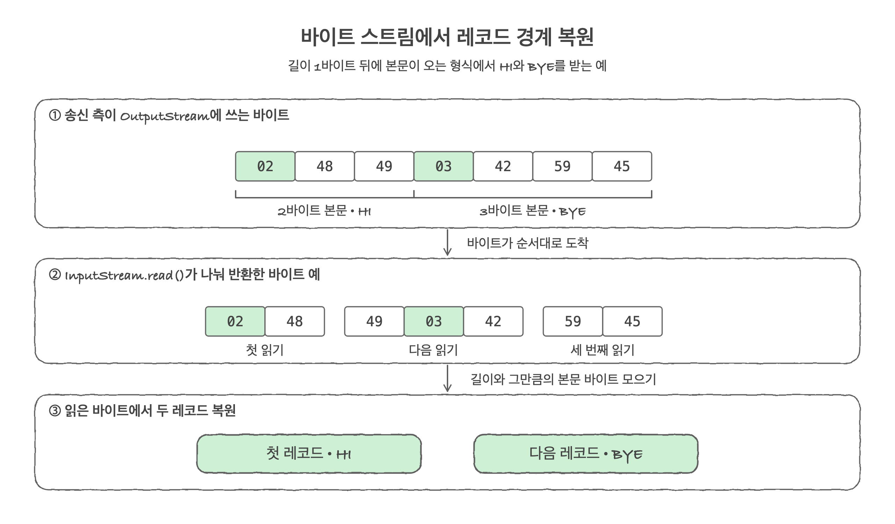
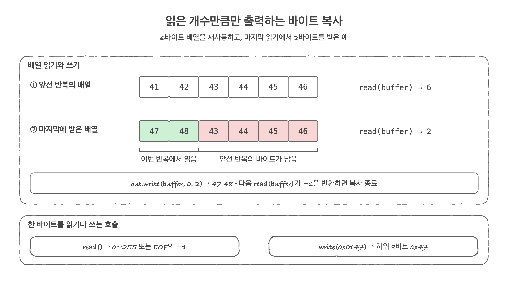
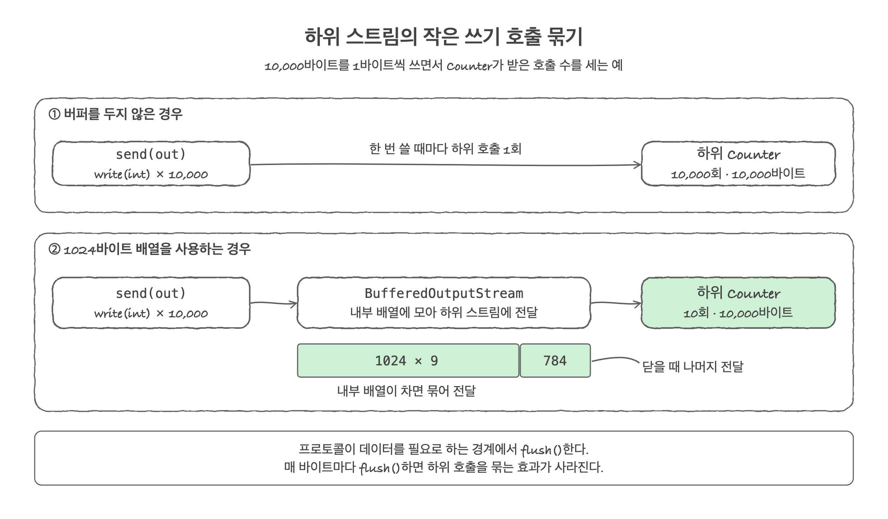
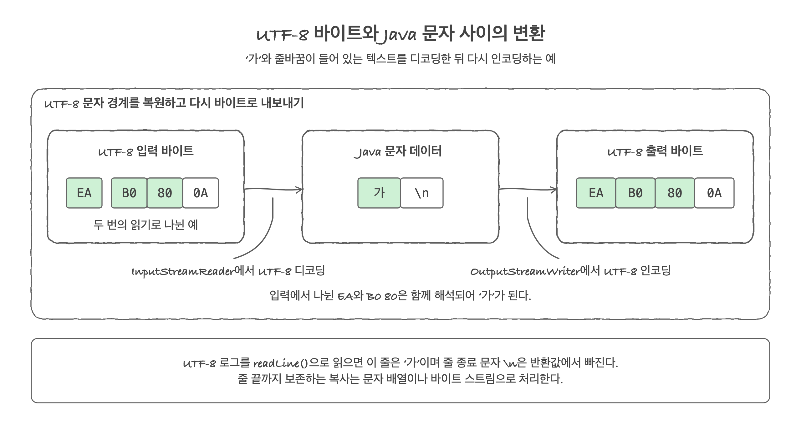

# Java I/O 스트림과 문자 인코딩

파일과 소켓에서 바이트를 순서대로 읽고 쓰는 스트림 계약을 살펴본다. 하위 스트림 호출을 버퍼로 묶고, 텍스트 경계에서는 문자 인코딩을 지정한다. [JDK 21 InputStream](https://docs.oracle.com/en/java/javase/21/docs/api/java.base/java/io/InputStream.html) · [JDK 21 BufferedOutputStream](https://docs.oracle.com/en/java/javase/21/docs/api/java.base/java/io/BufferedOutputStream.html) · [JDK 21 InputStreamReader](https://docs.oracle.com/en/java/javase/21/docs/api/java.base/java/io/InputStreamReader.html)

## 1. 스트림 데이터의 흐름

입력 스트림은 데이터를 앞에서부터 공급하고, 출력 스트림은 호출자가 넘기는 데이터를 목적지에 보낸다. 한 번에 몇 바이트가 오는지는 소스와 요청 크기에 따라 달라진다. 구분자나 길이가 들어 있는 데이터 형식을 다룰 때는 이 바이트 흐름 위에서 레코드의 경계를 복원한다. [JDK 21 InputStream.read](https://docs.oracle.com/en/java/javase/21/docs/api/java.base/java/io/InputStream.html#read(byte%5B%5D)) · [JDK 21 DataInput](https://docs.oracle.com/en/java/javase/21/docs/api/java.base/java/io/DataInput.html)



읽기 호출의 반환 경계와 레코드 경계가 달라질 수 있으므로 데이터 형식의 길이로 레코드를 복원한다. [JDK 21 InputStream.read](https://docs.oracle.com/en/java/javase/21/docs/api/java.base/java/io/InputStream.html#read(byte%5B%5D)) · [JDK 21 DataInput](https://docs.oracle.com/en/java/javase/21/docs/api/java.base/java/io/DataInput.html)

스트림은 try-with-resources로 닫는다. 내용을 통째로 메모리에 올려도 되는 입력이라면 `readAllBytes()`가 편리하다. 크기를 예측하기 어려운 입력은 일정 크기의 배열로 반복해 읽고, 처리량 제한이 필요하면 누적 바이트 수도 추적한다. [JLS 21 §14.20.3](https://docs.oracle.com/javase/specs/jls/se21/html/jls-14.html#jls-14.20.3) · [JDK 21 InputStream.readAllBytes](https://docs.oracle.com/en/java/javase/21/docs/api/java.base/java/io/InputStream.html#readAllBytes())

## 2. InputStream과 OutputStream

`InputStream.read()`는 0~255의 바이트 값 또는 EOF를 나타내는 `-1`을 반환한다. 배열을 받는 `read(byte[])`는 실제로 읽은 길이를 반환하므로 배열 전체를 내보내면 이전 반복에서 남은 바이트가 섞일 수 있다. `OutputStream.write(int)`는 전달한 정수의 하위 8비트만 쓴다. [JDK 21 InputStream.read](https://docs.oracle.com/en/java/javase/21/docs/api/java.base/java/io/InputStream.html#read()) · [JDK 21 OutputStream.write](https://docs.oracle.com/en/java/javase/21/docs/api/java.base/java/io/OutputStream.html#write(int))



배열을 재사용할 때는 read가 돌려준 길이만큼만 출력한다. [JDK 21 InputStream.read](https://docs.oracle.com/en/java/javase/21/docs/api/java.base/java/io/InputStream.html#read(byte%5B%5D)) · [JDK 21 OutputStream.write](https://docs.oracle.com/en/java/javase/21/docs/api/java.base/java/io/OutputStream.html#write(byte%5B%5D,int,int))

아래 복사는 읽은 바이트 범위만 출력한다. 대상 경로를 `CREATE_NEW`로 열면 기존 파일을 덮어쓰지 않으며, 복사 도중 I/O가 실패하면 새 대상에 일부 데이터가 남을 수 있다. [JDK 21 InputStream.read](https://docs.oracle.com/en/java/javase/21/docs/api/java.base/java/io/InputStream.html#read(byte%5B%5D)) · [JDK 21 OutputStream.write](https://docs.oracle.com/en/java/javase/21/docs/api/java.base/java/io/OutputStream.html#write(byte%5B%5D,int,int)) · [JDK 21 StandardOpenOption.CREATE_NEW](https://docs.oracle.com/en/java/javase/21/docs/api/java.base/java/nio/file/StandardOpenOption.html#CREATE_NEW)

```java
import java.nio.file.Files;
import java.nio.file.Path;
import java.nio.file.StandardOpenOption;

public class CopyBytes {
    public static void main(String[] args) throws Exception {
        try (var in = Files.newInputStream(Path.of(args[0]));
             var out = Files.newOutputStream(Path.of(args[1]),
                     StandardOpenOption.CREATE_NEW, StandardOpenOption.WRITE)) {
            byte[] buffer = new byte[8192];
            for (int count; (count = in.read(buffer)) != -1; ) {
                out.write(buffer, 0, count);
            }
        }
    }
}
```

## 3. BufferedOutputStream으로 작은 쓰기 묶기

`BufferedOutputStream`은 작은 쓰기를 내부 배열에 모으고 필요할 때 하위 스트림에 전달한다. I/O 대상에 데이터가 빨리 도달해야 하는 프로토콜이라면 필요한 경계에서 `flush()`를 호출한다. 매 바이트마다 `flush()`하면 호출을 묶는 효과를 잃는다. [JDK 21 BufferedOutputStream](https://docs.oracle.com/en/java/javase/21/docs/api/java.base/java/io/BufferedOutputStream.html) · [JDK 21 OutputStream.flush](https://docs.oracle.com/en/java/javase/21/docs/api/java.base/java/io/OutputStream.html#flush())



내부 배열에 작은 쓰기를 모으면 예제의 하위 스트림 호출 수가 10,000회에서 10회로 줄어든다. [JDK 21 BufferedOutputStream.write와 flush](https://docs.oracle.com/en/java/javase/21/docs/api/java.base/java/io/BufferedOutputStream.html)

아래 예제는 같은 10,000바이트를 한 바이트씩 쓰고 하위 스트림의 호출 횟수를 센다. 직접 쓰면 10,000번, 버퍼를 사용하면 10번이다. 이는 Java 메서드 호출 수를 확인하는 예이며, 파일이나 네트워크의 처리량은 실제 작업에서 따로 측정한다. [JDK 21 BufferedOutputStream.write와 flush](https://docs.oracle.com/en/java/javase/21/docs/api/java.base/java/io/BufferedOutputStream.html)

```java
import java.io.BufferedOutputStream;
import java.io.IOException;
import java.io.OutputStream;

public class BufferedWrites {
    static final class Counter extends OutputStream {
        private int calls;
        private int bytes;

        @Override
        public void write(int value) {
            calls++;
            bytes++;
        }

        @Override
        public void write(byte[] data, int offset, int length) {
            calls++;
            bytes += length;
        }
    }

    private static void send(OutputStream out) throws IOException {
        for (int value = 0; value < 10_000; value++) {
            out.write(value);
        }
    }

    public static void main(String[] args) throws IOException {
        var plain = new Counter();
        send(plain);
        var batched = new Counter();
        try (var out = new BufferedOutputStream(batched, 1024)) {
            send(out);
        }
        System.out.printf("calls=%d/%d, bytes=%d/%d%n",
                plain.calls, batched.calls, plain.bytes, batched.bytes);
    }
}
```

## 4. Reader와 Writer로 문자 처리하기

`InputStreamReader`는 바이트를 지정한 문자셋으로 디코딩하고, `OutputStreamWriter`는 문자를 바이트로 인코딩한다. 멀티바이트 문자의 경계가 한 번의 바이트 읽기에 맞춰지지 않아도 디코더는 스트림을 이어서 해석할 수 있다. 파일 형식이나 통신 규약에 정해진 문자셋을 양쪽에 같은 값으로 넘긴다. [JDK 21 InputStreamReader](https://docs.oracle.com/en/java/javase/21/docs/api/java.base/java/io/InputStreamReader.html) · [JDK 21 OutputStreamWriter](https://docs.oracle.com/en/java/javase/21/docs/api/java.base/java/io/OutputStreamWriter.html)

UTF-8 로그를 줄 단위로 읽을 때는 `Files.newBufferedReader(path, UTF_8)`로 시작할 수 있다. `BufferedReader.readLine()`이 돌려주는 문자열에는 줄 끝 문자가 포함되지 않는다. 줄 끝까지 그대로 보존할 때는 문자 배열이나 바이트 스트림으로 복사한다. [JDK 21 Files.newBufferedReader](https://docs.oracle.com/en/java/javase/21/docs/api/java.base/java/nio/file/Files.html#newBufferedReader(java.nio.file.Path,java.nio.charset.Charset)) · [JDK 21 BufferedReader.readLine](https://docs.oracle.com/en/java/javase/21/docs/api/java.base/java/io/BufferedReader.html#readLine())



디코더는 여러 읽기가 나눈 UTF-8 문자를 이어 해석하며, readLine()은 줄 끝 문자를 제외한다. [JDK 21 InputStreamReader](https://docs.oracle.com/en/java/javase/21/docs/api/java.base/java/io/InputStreamReader.html) · [JDK 21 OutputStreamWriter](https://docs.oracle.com/en/java/javase/21/docs/api/java.base/java/io/OutputStreamWriter.html) · [JDK 21 BufferedReader.readLine](https://docs.oracle.com/en/java/javase/21/docs/api/java.base/java/io/BufferedReader.html#readLine())
