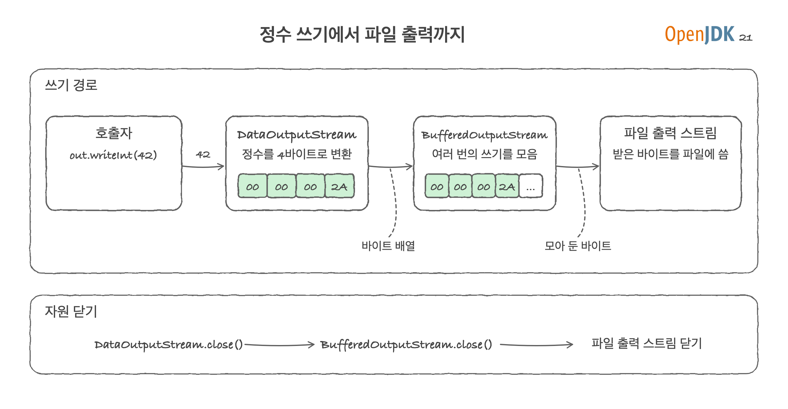
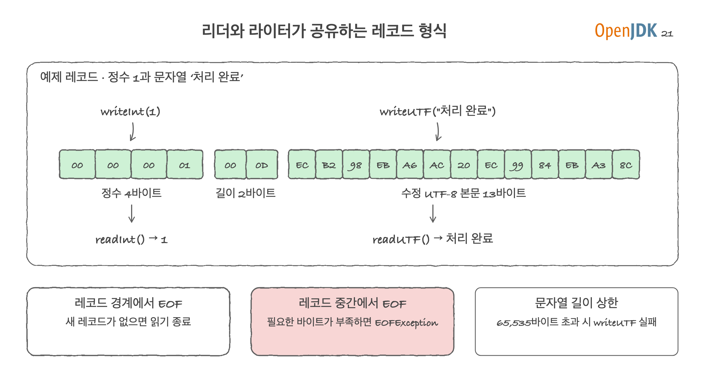
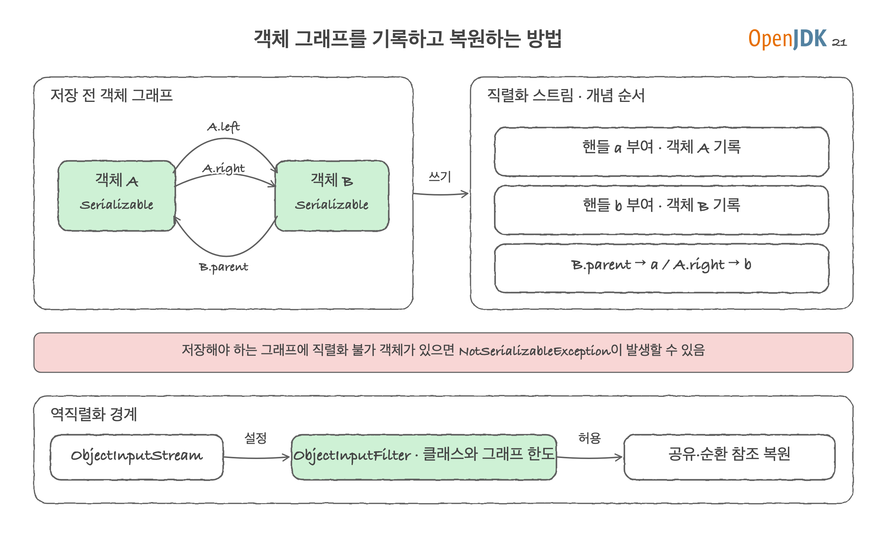
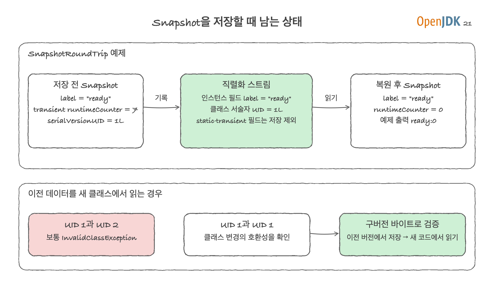
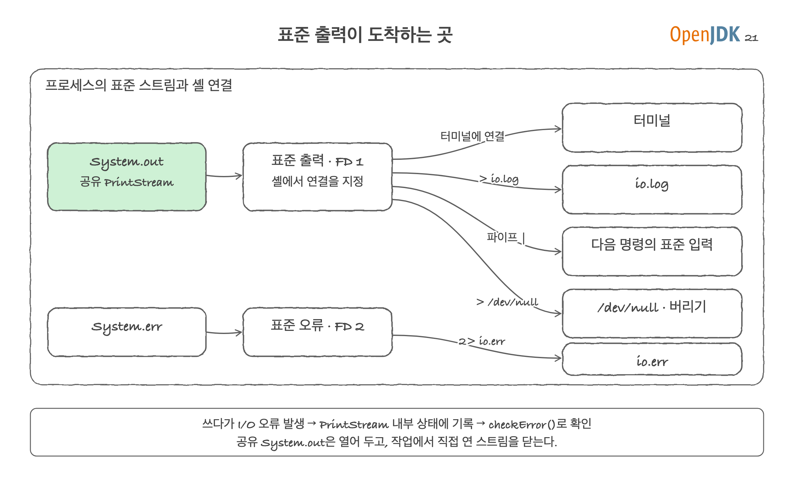

# Java 보조 스트림과 객체 직렬화

기존 스트림에 버퍼링과 데이터 형식 처리를 겹쳐 쌓는 구조를 살펴본다. Java 기본형을 기록하는 방법, 객체 그래프를 저장하고 읽는 방법, 표준 출력이 연결되는 대상을 JDK 21 기준으로 다룬다. [JDK 21 FilterOutputStream](https://docs.oracle.com/en/java/javase/21/docs/api/java.base/java/io/FilterOutputStream.html) · [JDK 21 직렬화 명세](https://docs.oracle.com/en/java/javase/21/docs/specs/serialization/index.html) · [JDK 21 System.out](https://docs.oracle.com/en/java/javase/21/docs/api/java.base/java/lang/System.html#out)

## 1. 보조 스트림으로 기능 조합하기

`FilterOutputStream` 계열은 자신이 감싼 스트림으로 데이터를 전달하면서 새로운 동작을 더한다. 아래 조합에서는 `DataOutputStream`이 기본형을 바이트로 인코딩하고, `BufferedOutputStream`이 바이트 쓰기를 모아 파일 스트림에 전달한다. 바깥 스트림의 `close()`가 하위 스트림도 닫는 계약을 확인한다. [JDK 21 FilterOutputStream](https://docs.oracle.com/en/java/javase/21/docs/api/java.base/java/io/FilterOutputStream.html) · [JDK 21 DataOutputStream](https://docs.oracle.com/en/java/javase/21/docs/api/java.base/java/io/DataOutputStream.html) · [JDK 21 BufferedOutputStream](https://docs.oracle.com/en/java/javase/21/docs/api/java.base/java/io/BufferedOutputStream.html)



기본형 인코딩과 버퍼링은 서로 다른 스트림이 맡으며, 바깥 스트림을 닫으면 래핑된 스트림도 닫힌다. [JDK 21 FilterOutputStream](https://docs.oracle.com/en/java/javase/21/docs/api/java.base/java/io/FilterOutputStream.html) · [JDK 21 DataOutputStream](https://docs.oracle.com/en/java/javase/21/docs/api/java.base/java/io/DataOutputStream.html) · [JDK 21 BufferedOutputStream](https://docs.oracle.com/en/java/javase/21/docs/api/java.base/java/io/BufferedOutputStream.html)

## 2. DataInputStream과 DataOutputStream

`writeInt()`는 4바이트를 상위 바이트부터 쓰고, `readInt()`는 같은 형식을 읽는다. 값의 타입과 순서는 읽고 쓰는 코드에서 맞춰야 한다. `readUTF()`와 `writeUTF()`는 2바이트 길이와 Java의 수정 UTF-8을 사용하며, 문자열의 인코딩된 길이가 65,535바이트를 넘으면 `writeUTF()`가 실패한다. 외부 규약이 표준 UTF-8을 요구하면 그 규약의 길이 형식과 문자셋을 따로 적용한다. [JDK 21 DataOutputStream.writeInt](https://docs.oracle.com/en/java/javase/21/docs/api/java.base/java/io/DataOutputStream.html#writeInt(int)) · [JDK 21 DataOutputStream.writeUTF](https://docs.oracle.com/en/java/javase/21/docs/api/java.base/java/io/DataOutputStream.html#writeUTF(java.lang.String)) · [JDK 21 DataInput.readUTF](https://docs.oracle.com/en/java/javase/21/docs/api/java.base/java/io/DataInput.html#readUTF())



정수와 문자열은 기록한 순서대로 읽고, 수정 UTF-8의 길이 필드는 인코딩한 바이트 수를 담는다. [JDK 21 DataOutputStream.writeInt](https://docs.oracle.com/en/java/javase/21/docs/api/java.base/java/io/DataOutputStream.html#writeInt(int)) · [JDK 21 DataOutputStream.writeUTF](https://docs.oracle.com/en/java/javase/21/docs/api/java.base/java/io/DataOutputStream.html#writeUTF(java.lang.String)) · [JDK 21 DataInputStream](https://docs.oracle.com/en/java/javase/21/docs/api/java.base/java/io/DataInputStream.html)

다음 코드는 버전 번호와 텍스트를 순서대로 기록하고 같은 순서로 읽는다. 한 기본형에 필요한 바이트가 모자라면 `EOFException`이 발생한다. 레코드를 여러 번 읽는 형식에서는 새 레코드 시작 전의 정상 EOF와 레코드 도중의 잘림을 구분해 처리한다. [JDK 21 DataInputStream](https://docs.oracle.com/en/java/javase/21/docs/api/java.base/java/io/DataInputStream.html) · [JDK 21 DataOutputStream](https://docs.oracle.com/en/java/javase/21/docs/api/java.base/java/io/DataOutputStream.html)

```java
import java.io.ByteArrayInputStream;
import java.io.ByteArrayOutputStream;
import java.io.DataInputStream;
import java.io.DataOutputStream;

public class DataRecord {
    public static void main(String[] args) throws Exception {
        var bytes = new ByteArrayOutputStream();
        try (var out = new DataOutputStream(bytes)) {
            out.writeInt(1);
            out.writeUTF("처리 완료");
        }
        try (var in = new DataInputStream(new ByteArrayInputStream(bytes.toByteArray()))) {
            int version = in.readInt();
            if (version != 1) {
                throw new IllegalArgumentException("unsupported version " + version);
            }
            System.out.println(in.readUTF());
        }
    }
}
```

## 3. 객체를 직렬화하고 다시 읽기

`ObjectOutputStream.writeObject()`는 기본 직렬화에서 객체의 저장 대상 필드와 그 필드가 참조하는 객체 그래프를 기록한다. `Serializable`은 직렬화를 허용하는 표시 인터페이스다. 기록해야 할 그래프에 직렬화할 수 없는 객체가 있으면 `NotSerializableException`이 발생할 수 있다. 스트림 안에서 공유한 참조와 순환 구조는 핸들을 통해 표현된다. [JDK 21 Serializable](https://docs.oracle.com/en/java/javase/21/docs/api/java.base/java/io/Serializable.html) · [JDK 21 직렬화 명세 · Writing to an Object Stream](https://docs.oracle.com/en/java/javase/21/docs/specs/serialization/serial-arch.html) · [JDK 21 ObjectOutputStream](https://docs.oracle.com/en/java/javase/21/docs/api/java.base/java/io/ObjectOutputStream.html)



스트림 핸들은 공유 참조와 순환을 표현하며, 역직렬화 입력 필터를 적용해 허용할 클래스를 제한할 수 있다. [JDK 21 직렬화 명세 · Writing to an Object Stream](https://docs.oracle.com/en/java/javase/21/docs/specs/serialization/serial-arch.html) · [JDK 21 ObjectInputFilter](https://docs.oracle.com/en/java/javase/21/docs/api/java.base/java/io/ObjectInputFilter.html)

외부 요청의 데이터 형식은 필요한 필드만 명시적으로 읽고 검증할 수 있게 설계한다. 기존 시스템에서 Java 역직렬화가 필요하다면 읽을 수 있는 클래스와 객체 그래프의 깊이·크기를 `ObjectInputFilter`로 제한한다. 필터는 기본값만으로 자동 활성화되지 않으므로 실제 스트림이나 프로세스에 적용된 설정을 확인한다. [JDK 21 ObjectInputStream](https://docs.oracle.com/en/java/javase/21/docs/api/java.base/java/io/ObjectInputStream.html) · [JDK 21 ObjectInputFilter](https://docs.oracle.com/en/java/javase/21/docs/api/java.base/java/io/ObjectInputFilter.html)

## 4. 버전 호환성과 저장에서 제외할 필드

기본 직렬화에서는 `static`과 `transient` 필드가 객체의 저장 상태에서 빠진다. 클래스의 `serialVersionUID`가 스트림에 기록된 값과 다르면 일반적으로 `InvalidClassException`이 발생한다. UID가 같더라도 모든 클래스 변경이 호환되는 것은 아니므로, 오래된 데이터가 있다면 이전 버전으로 만든 값을 새 코드에서 읽는 시험을 둔다. [JDK 21 Serializable](https://docs.oracle.com/en/java/javase/21/docs/api/java.base/java/io/Serializable.html) · [JDK 21 직렬화 명세 · Serializable Fields](https://docs.oracle.com/en/java/javase/21/docs/specs/serialization/serial-arch.html) · [JDK 21 직렬화 버전 호환성](https://docs.oracle.com/en/java/javase/21/docs/specs/serialization/version.html)



예제에서 label은 ready로 복원되고 runtimeCounter는 기본값 0으로 남으며, 클래스 호환성은 이전 버전의 저장 데이터로 확인한다. [JDK 21 직렬화 명세 · Serializable Fields](https://docs.oracle.com/en/java/javase/21/docs/specs/serialization/serial-arch.html) · [JDK 21 직렬화 버전 호환성](https://docs.oracle.com/en/java/javase/21/docs/specs/serialization/version.html) · [JDK 21 Serializable](https://docs.oracle.com/en/java/javase/21/docs/api/java.base/java/io/Serializable.html)

아래 예제는 같은 실행에서 만든 바이트를 읽는다. `Snapshot`의 라벨은 복원되고, `transient`로 표시한 실행 전용 값은 기본값으로 남는다. 입력 필터는 이 예제가 읽는 타입과 그래프 범위를 제한한다. [JDK 21 직렬화 명세 · Serializable Fields](https://docs.oracle.com/en/java/javase/21/docs/specs/serialization/serial-arch.html) · [JDK 21 ObjectInputStream.setObjectInputFilter](https://docs.oracle.com/en/java/javase/21/docs/api/java.base/java/io/ObjectInputStream.html#setObjectInputFilter(java.io.ObjectInputFilter))

```java
import java.io.ByteArrayInputStream;
import java.io.ByteArrayOutputStream;
import java.io.ObjectInputFilter;
import java.io.ObjectInputStream;
import java.io.ObjectOutputStream;
import java.io.Serial;
import java.io.Serializable;

public class SnapshotRoundTrip {
    private static final class Snapshot implements Serializable {
        @Serial
        private static final long serialVersionUID = 1L;

        private final String label;
        private transient int runtimeCounter;

        private Snapshot(String label, int runtimeCounter) {
            this.label = label;
            this.runtimeCounter = runtimeCounter;
        }
    }

    public static void main(String[] args) throws Exception {
        var bytes = new ByteArrayOutputStream();
        try (var out = new ObjectOutputStream(bytes)) {
            out.writeObject(new Snapshot("ready", 7));
        }
        try (var in = new ObjectInputStream(new ByteArrayInputStream(bytes.toByteArray()))) {
            in.setObjectInputFilter(info -> {
                if (info.depth() > 4 || info.references() > 16) {
                    return ObjectInputFilter.Status.REJECTED;
                }
                Class<?> type = info.serialClass();
                if (type == null) {
                    return ObjectInputFilter.Status.UNDECIDED;
                }
                return type == Snapshot.class
                        ? ObjectInputFilter.Status.ALLOWED
                        : ObjectInputFilter.Status.REJECTED;
            });
            var restored = (Snapshot) in.readObject();
            System.out.println(restored.label + ":" + restored.runtimeCounter);
        }
    }
}
```

## 5. System.out과 장치 파일

`System.out`은 JVM이 이미 열어 둔 표준 출력 `PrintStream`이다. 실행 환경에 따라 터미널, 파일, 파이프로 이어질 수 있다. Unix 계열 셸에서 `>`는 기본적으로 표준 출력인 파일 디스크립터 1을 지정한 파일에 연결하고, `2>`는 표준 오류를 별도로 보낸다. Linux에서는 `/dev/null`을 표준 출력 대상으로 지정할 수도 있다. [JDK 21 System.out](https://docs.oracle.com/en/java/javase/21/docs/api/java.base/java/lang/System.html#out) · [Bash 매뉴얼 · REDIRECTION](https://man7.org/linux/man-pages/man1/bash.1.html) · [Linux null(4)](https://man7.org/linux/man-pages/man4/null.4.html)



셸이 표준 출력과 표준 오류의 목적지를 따로 연결하고, PrintStream의 쓰기 오류 여부는 checkError()로 확인한다. [JDK 21 System.out](https://docs.oracle.com/en/java/javase/21/docs/api/java.base/java/lang/System.html#out) · [Bash 매뉴얼 · REDIRECTION](https://man7.org/linux/man-pages/man1/bash.1.html) · [JDK 21 PrintStream.checkError](https://docs.oracle.com/en/java/javase/21/docs/api/java.base/java/io/PrintStream.html#checkError()) · [Linux null(4)](https://man7.org/linux/man-pages/man4/null.4.html)

`PrintStream`은 쓰기 중 발생한 I/O 오류를 내부 상태에 기록하므로, 호출 결과를 확인해야 할 때는 `checkError()`를 사용한다. 애플리케이션 전체에서 공유하는 표준 출력은 개별 작업이 닫지 않고, 해당 작업이 직접 연 파일 스트림을 닫는다. [JDK 21 PrintStream](https://docs.oracle.com/en/java/javase/21/docs/api/java.base/java/io/PrintStream.html) · [JDK 21 PrintStream.checkError](https://docs.oracle.com/en/java/javase/21/docs/api/java.base/java/io/PrintStream.html#checkError())

```sh
javac --release 21 DataRecord.java SnapshotRoundTrip.java
java DataRecord > io.log 2> io.err
java SnapshotRoundTrip
```
