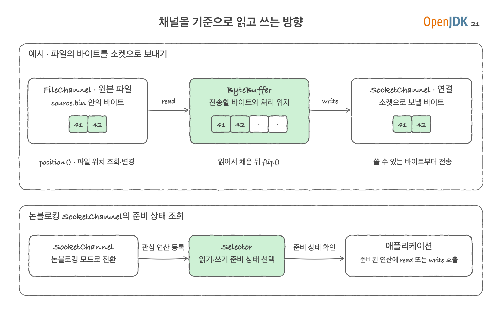
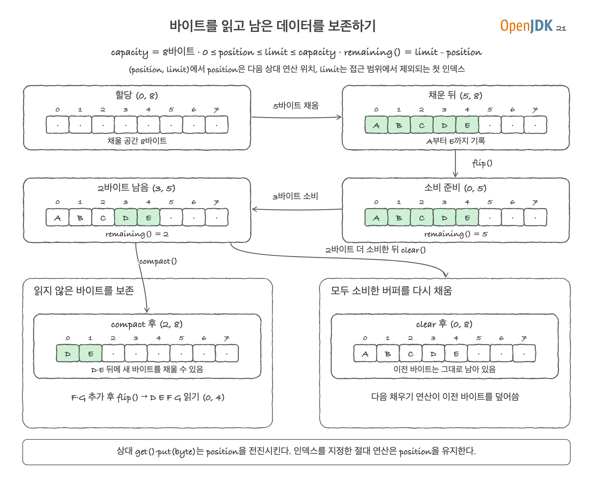
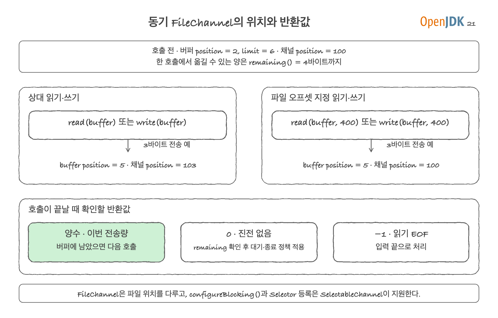
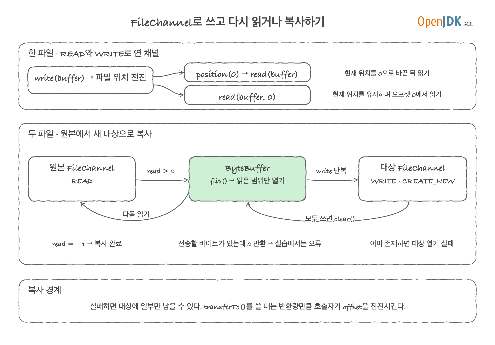
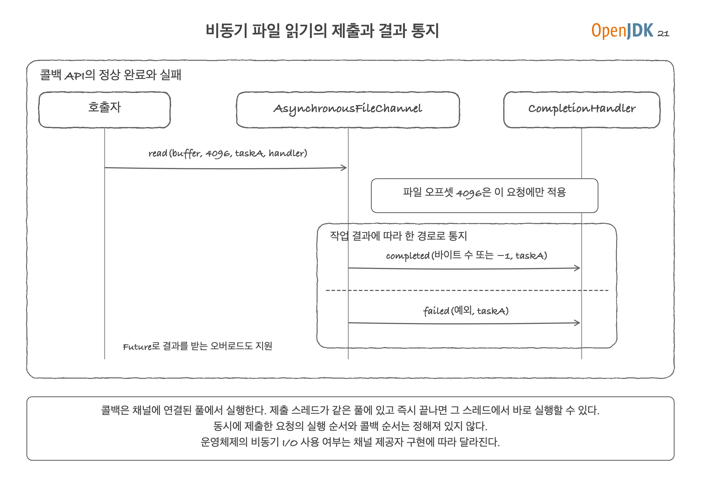
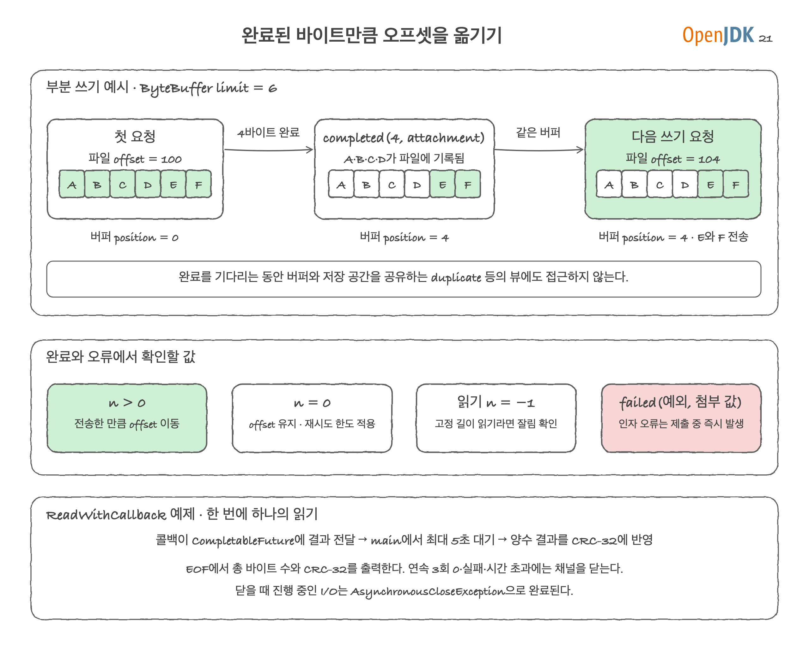
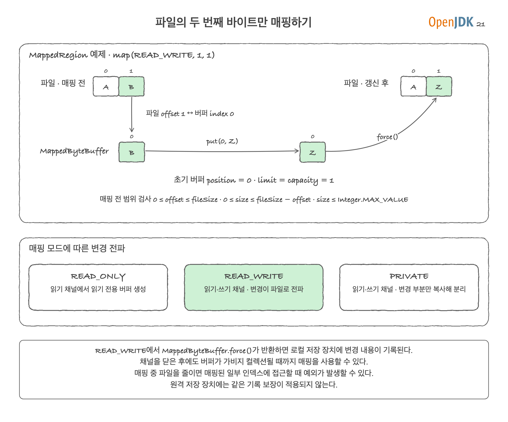

# Java NIO 채널과 버퍼 사용

Java 21에서 버퍼의 상태를 추적하며 파일을 복사하고, 콜백으로 비동기 읽기 결과를 받으며, 파일의 일부를 메모리에 매핑한다. [Java 21 java.nio.channels 패키지](https://docs.oracle.com/en/java/javase/21/docs/api/java.base/java/nio/channels/package-summary.html) · [Java 21 FileChannel](https://docs.oracle.com/en/java/javase/21/docs/api/java.base/java/nio/channels/FileChannel.html) · [Java 21 AsynchronousFileChannel](https://docs.oracle.com/en/java/javase/21/docs/api/java.base/java/nio/channels/AsynchronousFileChannel.html)

## 1. Java NIO API에서 채널과 버퍼의 역할

채널(`Channel`)은 파일이나 소켓 같은 I/O 대상과의 연결을 나타낸다. `ByteBuffer`는 그 연결을 통해 주고받는 바이트와 현재 처리 위치를 담는다. `channel.read(buffer)`는 채널에서 버퍼로, `channel.write(buffer)`는 버퍼에서 채널로 데이터를 옮긴다. 메서드 이름의 방향은 채널을 기준으로 읽는다. [Java 21 채널 패키지](https://docs.oracle.com/en/java/javase/21/docs/api/java.base/java/nio/channels/package-summary.html) · [Java 21 ReadableByteChannel.read](https://docs.oracle.com/en/java/javase/21/docs/api/java.base/java/nio/channels/ReadableByteChannel.html#read(java.nio.ByteBuffer)) · [Java 21 WritableByteChannel.write](https://docs.oracle.com/en/java/javase/21/docs/api/java.base/java/nio/channels/WritableByteChannel.html#write(java.nio.ByteBuffer))



read와 write의 방향은 채널을 기준으로 읽고, Selector의 준비 통지는 애플리케이션의 I/O 호출로 이어진다. [Java 21 채널 패키지](https://docs.oracle.com/en/java/javase/21/docs/api/java.base/java/nio/channels/package-summary.html) · [Java 21 FileChannel](https://docs.oracle.com/en/java/javase/21/docs/api/java.base/java/nio/channels/FileChannel.html) · [Java 21 Selector](https://docs.oracle.com/en/java/javase/21/docs/api/java.base/java/nio/channels/Selector.html)

`SelectableChannel`은 논블로킹 모드로 설정한 뒤 `Selector`에 등록할 수 있다. 예를 들어 `SocketChannel`을 등록하면 `Selector`가 읽기나 쓰기 같은 관심 연산의 준비 상태를 알려 주고, 애플리케이션이 해당 채널에 I/O를 호출한다. `FileChannel`은 `SeekableByteChannel`을 구현하며 파일 내 위치를 조회하거나 바꿀 수 있다. [Java 21 SelectableChannel](https://docs.oracle.com/en/java/javase/21/docs/api/java.base/java/nio/channels/SelectableChannel.html) · [Java 21 Selector](https://docs.oracle.com/en/java/javase/21/docs/api/java.base/java/nio/channels/Selector.html) · [Java 21 SocketChannel](https://docs.oracle.com/en/java/javase/21/docs/api/java.base/java/nio/channels/SocketChannel.html) · [Java 21 FileChannel](https://docs.oracle.com/en/java/javase/21/docs/api/java.base/java/nio/channels/FileChannel.html)

## 2. Buffer의 position, limit, capacity

`capacity`는 고정된 원소 수, `limit`는 현재 접근 범위에서 제외되는 첫 인덱스, `position`은 다음 상대 연산의 위치다. 항상 `0 ≤ position ≤ limit ≤ capacity`이고 `remaining()`은 `limit - position`이다. `ByteBuffer`에서 각 값의 단위는 바이트다. 상대 `get()`과 `put(byte)`는 `position`을 앞으로 옮긴다. 인덱스를 지정하는 절대 연산은 `position`을 유지한다. [Java 21 Buffer 상태와 상대·절대 연산](https://docs.oracle.com/en/java/javase/21/docs/api/java.base/java/nio/Buffer.html) · [Java 21 ByteBuffer](https://docs.oracle.com/en/java/javase/21/docs/api/java.base/java/nio/ByteBuffer.html)

- `flip()`은 기존 `position`을 새 `limit`로, `position`을 `0`으로 설정한다. 채널에서 버퍼로 읽은 바이트만 `get()`이나 채널 쓰기로 넘길 때 쓴다. [Java 21 Buffer.flip](https://docs.oracle.com/en/java/javase/21/docs/api/java.base/java/nio/Buffer.html#flip())
- `clear()`는 `position`을 `0`으로, `limit`를 `capacity`로 되돌린다. 이전 바이트는 메모리에 남으며 이후 버퍼를 채우는 연산이 덮어쓸 수 있다. [Java 21 Buffer.clear](https://docs.oracle.com/en/java/javase/21/docs/api/java.base/java/nio/Buffer.html#clear())
- `compact()`는 아직 소비하지 않은 `[position, limit)`의 바이트를 앞으로 옮긴다. `position`은 보존한 바이트 수, `limit`는 `capacity`가 된다. 이전 데이터에 이어 새 바이트를 받을 때 쓴다. [Java 21 ByteBuffer.compact](https://docs.oracle.com/en/java/javase/21/docs/api/java.base/java/nio/ByteBuffer.html#compact())

아래 그림의 각 쌍은 `(position, limit)`다. 용량 8인 버퍼에 5바이트를 채우고 그중 3바이트를 소비했다. 남은 2바이트를 유지할 때는 `compact()`를 호출하고, 모두 소비해 버퍼를 새로 채울 때는 `clear()`를 호출한다. `compact()` 후 새 바이트를 채운 뒤에는 `flip()`을 호출해 보존한 바이트와 새 바이트를 함께 읽는다. [Java 21 ByteBuffer.allocate](https://docs.oracle.com/en/java/javase/21/docs/api/java.base/java/nio/ByteBuffer.html#allocate(int)) · [Java 21 Buffer.flip과 clear](https://docs.oracle.com/en/java/javase/21/docs/api/java.base/java/nio/Buffer.html) · [Java 21 ByteBuffer.compact](https://docs.oracle.com/en/java/javase/21/docs/api/java.base/java/nio/ByteBuffer.html#compact())



flip은 채운 바이트만 열고, compact는 읽지 않은 바이트를 이어 받을 수 있게 앞쪽에 보존한다. [Java 21 Buffer.flip과 clear](https://docs.oracle.com/en/java/javase/21/docs/api/java.base/java/nio/Buffer.html) · [Java 21 ByteBuffer.compact](https://docs.oracle.com/en/java/javase/21/docs/api/java.base/java/nio/ByteBuffer.html#compact())

## 3. 동기 채널에서 읽기와 쓰기

동기 `FileChannel.read`와 `write`는 호출이 끝날 때 처리한 바이트 수를 반환하거나 예외를 던진다. `configureBlocking`은 `SelectableChannel`의 메서드다. `FileChannel`에는 논블로킹 전환이나 `Selector` 등록 API가 없다. [Java 21 FileChannel](https://docs.oracle.com/en/java/javase/21/docs/api/java.base/java/nio/channels/FileChannel.html) · [Java 21 SelectableChannel.configureBlocking](https://docs.oracle.com/en/java/javase/21/docs/api/java.base/java/nio/channels/SelectableChannel.html#configureBlocking(boolean))



채널이 실제로 옮긴 바이트 수만큼 버퍼 위치가 전진하며, 채널의 파일 위치는 상대 호출에서 함께 전진한다. [Java 21 FileChannel 위치 지정 I/O](https://docs.oracle.com/en/java/javase/21/docs/api/java.base/java/nio/channels/FileChannel.html#read(java.nio.ByteBuffer,long)) · [Java 21 ReadableByteChannel.read](https://docs.oracle.com/en/java/javase/21/docs/api/java.base/java/nio/channels/ReadableByteChannel.html#read(java.nio.ByteBuffer)) · [Java 21 WritableByteChannel.write](https://docs.oracle.com/en/java/javase/21/docs/api/java.base/java/nio/channels/WritableByteChannel.html#write(java.nio.ByteBuffer))

한 번에 옮길 수 있는 최대량은 호출 시점의 `buffer.remaining()`이다. 읽기와 쓰기는 성공적으로 옮긴 만큼 버퍼의 `position`을 전진시키고 `limit`를 유지한다. 상대 `FileChannel.read(buffer)`와 `write(buffer)`는 채널의 파일 위치도 전진시킨다. 위치를 지정하는 `read(buffer, offset)`과 `write(buffer, offset)`은 채널의 파일 위치를 유지한다. [Java 21 ReadableByteChannel.read](https://docs.oracle.com/en/java/javase/21/docs/api/java.base/java/nio/channels/ReadableByteChannel.html#read(java.nio.ByteBuffer)) · [Java 21 WritableByteChannel.write](https://docs.oracle.com/en/java/javase/21/docs/api/java.base/java/nio/channels/WritableByteChannel.html#write(java.nio.ByteBuffer)) · [Java 21 FileChannel 위치 지정 I/O](https://docs.oracle.com/en/java/javase/21/docs/api/java.base/java/nio/channels/FileChannel.html#read(java.nio.ByteBuffer,long))

읽기에서 양수는 읽은 양, `-1`은 EOF, `0`은 이번 호출에서 옮긴 바이트가 없음을 뜻한다. 양수가 `remaining()`보다 작아도 다음 호출이 필요할 수 있다. 쓰기에서는 버퍼에 남은 바이트가 있으면 이어서 쓴다. 버퍼가 비어 있거나 가득 차서 `remaining() == 0`이라면 먼저 상태를 확인한다. 비어 있지 않은 작업에서 계속 `0`을 받으면 대기나 종료 조건을 적용해 루프가 CPU를 소모하지 않도록 한다. 예를 들어 논블로킹 소켓에서 `0`을 받으면 `Selector`에서 해당 연산의 다음 준비 상태를 기다릴 수 있다. [Java 21 FileChannel.read](https://docs.oracle.com/en/java/javase/21/docs/api/java.base/java/nio/channels/FileChannel.html#read(java.nio.ByteBuffer)) · [Java 21 FileChannel.write](https://docs.oracle.com/en/java/javase/21/docs/api/java.base/java/nio/channels/FileChannel.html#write(java.nio.ByteBuffer)) · [Java 21 SelectableChannel 논블로킹 모드](https://docs.oracle.com/en/java/javase/21/docs/api/java.base/java/nio/channels/SelectableChannel.html)

## 4. 단일 파일 채널 I/O와 파일 복사 실습

한 파일에 쓰고 같은 위치에서 다시 읽을 때는 `READ`와 `WRITE`로 연 채널 하나를 쓸 수 있다. `write(buffer)`가 전진시킨 파일 위치를 `position(0)`으로 되돌리거나, `read(buffer, 0)`으로 위치를 지정한다. 두 파일을 복사할 때는 원본 읽기 채널과 대상 쓰기 채널을 각각 열고, 버퍼 하나로 두 채널 사이의 데이터를 전달한다. [Java 21 FileChannel.open](https://docs.oracle.com/en/java/javase/21/docs/api/java.base/java/nio/channels/FileChannel.html#open(java.nio.file.Path,java.nio.file.OpenOption...)) · [Java 21 FileChannel 위치 지정 읽기](https://docs.oracle.com/en/java/javase/21/docs/api/java.base/java/nio/channels/FileChannel.html#read(java.nio.ByteBuffer,long))



파일 복사에서는 읽은 범위만 flip으로 열고, 부분 쓰기가 끝나 버퍼를 모두 소비한 뒤 clear로 다시 채울 준비를 한다. [Java 21 FileChannel.read](https://docs.oracle.com/en/java/javase/21/docs/api/java.base/java/nio/channels/FileChannel.html#read(java.nio.ByteBuffer)) · [Java 21 FileChannel.write](https://docs.oracle.com/en/java/javase/21/docs/api/java.base/java/nio/channels/FileChannel.html#write(java.nio.ByteBuffer)) · [Java 21 Buffer 상태 전환](https://docs.oracle.com/en/java/javase/21/docs/api/java.base/java/nio/Buffer.html)

아래 실습은 새 대상만 만드는 `CREATE_NEW`를 사용한다. 대상이 이미 존재하면 파일 열기가 실패하므로 대상이 원본 경로이거나 원본을 가리키는 하드 링크 또는 심볼릭 링크여도 기존 파일을 보호한다. 파일 존재 확인과 생성은 하나의 원자적 연산이다. 복사 도중 실패하면 생성된 대상에 일부 바이트가 남을 수 있다. [Java 21 FileChannel.open](https://docs.oracle.com/en/java/javase/21/docs/api/java.base/java/nio/channels/FileChannel.html#open(java.nio.file.Path,java.util.Set,java.nio.file.attribute.FileAttribute...)) · [Java 21 Files.newByteChannel의 CREATE_NEW 조건](https://docs.oracle.com/en/java/javase/21/docs/api/java.base/java/nio/file/Files.html#newByteChannel(java.nio.file.Path,java.util.Set,java.nio.file.attribute.FileAttribute...))

`ChannelCopy.java`에 저장하고 `java ChannelCopy.java source.bin target.bin`으로 실행한다. 읽은 만큼만 `flip()`으로 노출하고, 부분 쓰기에 대비해 버퍼를 다 소비한 뒤 `clear()`한다. 이 로컬 파일 실습은 전송할 바이트가 있는 상태에서 호출 결과가 `0`이면 오류로 종료한다. 빈 파일과 버퍼 용량보다 큰 파일을 복사해 바이트가 일치하는지 확인하고, 원본 경로를 대상으로 다시 지정해 열기가 거부되는지 확인할 수 있다. [Java 21 FileChannel.read](https://docs.oracle.com/en/java/javase/21/docs/api/java.base/java/nio/channels/FileChannel.html#read(java.nio.ByteBuffer)) · [Java 21 FileChannel.write](https://docs.oracle.com/en/java/javase/21/docs/api/java.base/java/nio/channels/FileChannel.html#write(java.nio.ByteBuffer)) · [Java 21 Buffer 상태 전환](https://docs.oracle.com/en/java/javase/21/docs/api/java.base/java/nio/Buffer.html) · [JDK 21 java 소스 파일 실행](https://docs.oracle.com/en/java/javase/21/docs/specs/man/java.html)

```java
import java.io.IOException;
import java.nio.ByteBuffer;
import java.nio.channels.FileChannel;
import java.nio.file.Path;

import static java.nio.file.StandardOpenOption.CREATE_NEW;
import static java.nio.file.StandardOpenOption.READ;
import static java.nio.file.StandardOpenOption.WRITE;

class ChannelCopy {
    public static void main(String[] args) throws IOException {
        if (args.length != 2) {
            throw new IllegalArgumentException("Usage: java ChannelCopy.java SOURCE TARGET");
        }

        var buffer = ByteBuffer.allocate(16 * 1024);
        try (var input = FileChannel.open(Path.of(args[0]), READ);
             var output = FileChannel.open(Path.of(args[1]), WRITE, CREATE_NEW)) {
            int read;
            while ((read = input.read(buffer)) != -1) {
                if (read == 0) {
                    throw new IOException("File read made no progress");
                }
                buffer.flip();
                while (buffer.hasRemaining()) {
                    if (output.write(buffer) == 0) {
                        throw new IOException("File write made no progress");
                    }
                }
                buffer.clear();
            }
        }
    }
}
```

`input.transferTo(offset, count, output)`으로 복사할 수도 있다. 이 메서드는 원본 채널의 현재 위치를 그대로 유지하므로, 호출자가 반환된 바이트 수만큼 다음 `offset`을 증가시킨다. 한 번에 전부 옮긴다는 보장이 없고 `0`도 반환할 수 있다. 로컬 파일에서 옮길 범위가 남은 채로 `0`을 받았다면 원본 크기를 확인하고, 이어서 복사해야 하는 범위는 해당 위치에서 버퍼 기반 읽기·쓰기 루프로 처리할 수 있다. [Java 21 FileChannel.transferTo](https://docs.oracle.com/en/java/javase/21/docs/api/java.base/java/nio/channels/FileChannel.html#transferTo(long,long,java.nio.channels.WritableByteChannel)) · [Java 21 FileChannel 위치 지정 읽기](https://docs.oracle.com/en/java/javase/21/docs/api/java.base/java/nio/channels/FileChannel.html#read(java.nio.ByteBuffer,long))

## 5. 콜백 기반 NIO.2 파일 I/O

`AsynchronousFileChannel`은 `read(buffer, offset, attachment, handler)`와 대응하는 `write`로 작업을 제출한다. 결과는 `CompletionHandler`로 전달된다. `Future`를 반환하는 오버로드도 있다. 채널에 공유 파일 위치가 없으므로 각 요청에 파일 오프셋을 지정한다. 여러 요청을 동시에 제출하면 실행 순서와 콜백 호출 순서는 명세에서 정하지 않는다. [Java 21 AsynchronousFileChannel](https://docs.oracle.com/en/java/javase/21/docs/api/java.base/java/nio/channels/AsynchronousFileChannel.html)

완료 콜백은 채널에 연결된 스레드 풀의 스레드에서 실행된다. 제출 스레드도 해당 풀에 속하고 I/O가 즉시 끝나면 제출 스레드가 콜백을 직접 호출할 수 있다. 채널 제공자가 풀에 제출하는 작업의 성격은 구현에 따라 달라진다. Java API가 보장하는 범위는 작업 제출과 결과 통지의 계약이며, 운영체제의 비동기 I/O 기능 사용 여부는 구현을 확인해야 한다. [Java 21 AsynchronousFileChannel 스레드 풀](https://docs.oracle.com/en/java/javase/21/docs/api/java.base/java/nio/channels/AsynchronousFileChannel.html) · [Java 21 AsynchronousFileChannel.open의 executor 조건](https://docs.oracle.com/en/java/javase/21/docs/api/java.base/java/nio/channels/AsynchronousFileChannel.html#open(java.nio.file.Path,java.util.Set,java.util.concurrent.ExecutorService,java.nio.file.attribute.FileAttribute...))



비동기 채널에는 공유 파일 위치가 없으며 각 요청에 오프셋을 지정하고 결과를 CompletionHandler로 받는다. [Java 21 AsynchronousFileChannel](https://docs.oracle.com/en/java/javase/21/docs/api/java.base/java/nio/channels/AsynchronousFileChannel.html) · [Java 21 AsynchronousFileChannel 스레드 풀](https://docs.oracle.com/en/java/javase/21/docs/api/java.base/java/nio/channels/AsynchronousFileChannel.html)

## 6. CompletionHandler로 완료와 실패 처리하기

요청을 제출하면 완료될 때까지 해당 `ByteBuffer`와 같은 저장 공간을 공유하는 뷰에 접근하지 않는다. 요청이 여러 개면 겹치지 않는 버퍼 저장 공간을 배정하고, 순서가 필요한 파일 범위는 앞선 쓰기의 완료 후 제출한다. 파일 오프셋과 버퍼 `position`은 별개다. 다음 요청의 파일 오프셋은 성공한 바이트 수만큼 옮기고, 이전 요청이 이동시킨 버퍼 `position`은 이어서 쓸 때 그대로 활용한다. [Java 21 AsynchronousFileChannel의 동시 작업 및 버퍼 접근 규칙](https://docs.oracle.com/en/java/javase/21/docs/api/java.base/java/nio/channels/AsynchronousFileChannel.html) · [Java 21 ByteBuffer.duplicate](https://docs.oracle.com/en/java/javase/21/docs/api/java.base/java/nio/ByteBuffer.html#duplicate())



부분 쓰기에서는 완료된 길이만큼 파일 오프셋을 이동하고, I/O가 전진시킨 버퍼 위치에서 다음 쓰기를 시작한다. [Java 21 AsynchronousFileChannel의 동시 작업 및 버퍼 접근 규칙](https://docs.oracle.com/en/java/javase/21/docs/api/java.base/java/nio/channels/AsynchronousFileChannel.html) · [Java 21 AsynchronousFileChannel.write](https://docs.oracle.com/en/java/javase/21/docs/api/java.base/java/nio/channels/AsynchronousFileChannel.html#write(java.nio.ByteBuffer,long,A,java.nio.channels.CompletionHandler)) · [Java 21 CompletableFuture.get](https://docs.oracle.com/en/java/javase/21/docs/api/java.base/java/util/concurrent/CompletableFuture.html#get(long,java.util.concurrent.TimeUnit)) · [Java 21 CRC32.update](https://docs.oracle.com/en/java/javase/21/docs/api/java.base/java/util/zip/CRC32.html#update(java.nio.ByteBuffer))

`completed(n, attachment)`에서 양수 `n`은 이번에 처리한 바이트 수다. 읽기에서 `-1`은 EOF다. 고정 길이 영역을 읽을 때는 버퍼가 다 차기 전에 EOF에 도달하면 필요한 데이터가 부족한 경우로 처리한다. 부분 쓰기에서는 `hasRemaining()`이 참인 동안 같은 버퍼와 갱신한 파일 오프셋으로 다시 요청한다. `0`에는 진전이 없으므로 오프셋을 유지하고 재시도 한도 같은 정책을 적용한다. 작업 실패는 `failed`에서 받고, 잘못된 오프셋과 같은 제출 인자 오류는 제출 호출에서 즉시 예외가 될 수 있다. [Java 21 AsynchronousFileChannel.read](https://docs.oracle.com/en/java/javase/21/docs/api/java.base/java/nio/channels/AsynchronousFileChannel.html#read(java.nio.ByteBuffer,long,A,java.nio.channels.CompletionHandler)) · [Java 21 AsynchronousFileChannel.write](https://docs.oracle.com/en/java/javase/21/docs/api/java.base/java/nio/channels/AsynchronousFileChannel.html#write(java.nio.ByteBuffer,long,A,java.nio.channels.CompletionHandler)) · [Java 21 AsynchronousByteChannel.read](https://docs.oracle.com/en/java/javase/21/docs/api/java.base/java/nio/channels/AsynchronousByteChannel.html#read(java.nio.ByteBuffer,A,java.nio.channels.CompletionHandler))

`ReadWithCallback.java`에 저장하고 `java ReadWithCallback.java source.bin`으로 실행한다. 콜백은 바이트 수나 실패만 `CompletableFuture`에 전달하고 바로 반환한다. `main`에서 한 번에 한 요청의 결과를 최대 5초 기다리며, 연속해서 3번 `0`을 받으면 실패로 처리한다. 양수 결과는 짧은 읽기까지 모두 CRC-32에 반영한다. EOF에서는 총 바이트 수와 체크섬을 출력한다. 실패나 시간 초과 때 `try`가 끝나며 채널이 닫히고, 진행 중인 I/O가 있으면 `AsynchronousCloseException`으로 완료된다. [Java 21 CompletionHandler 실행 규칙](https://docs.oracle.com/en/java/javase/21/docs/api/java.base/java/nio/channels/CompletionHandler.html) · [Java 21 AsynchronousFileChannel](https://docs.oracle.com/en/java/javase/21/docs/api/java.base/java/nio/channels/AsynchronousFileChannel.html) · [Java 21 CompletableFuture.get](https://docs.oracle.com/en/java/javase/21/docs/api/java.base/java/util/concurrent/CompletableFuture.html#get(long,java.util.concurrent.TimeUnit)) · [Java 21 CRC32.update](https://docs.oracle.com/en/java/javase/21/docs/api/java.base/java/util/zip/CRC32.html#update(java.nio.ByteBuffer))

```java
import java.io.IOException;
import java.nio.ByteBuffer;
import java.nio.channels.AsynchronousFileChannel;
import java.nio.channels.CompletionHandler;
import java.nio.file.Path;
import java.util.concurrent.CompletableFuture;
import java.util.concurrent.TimeUnit;
import java.util.zip.CRC32;

import static java.nio.file.StandardOpenOption.READ;

class ReadWithCallback {
    private static final CompletionHandler<Integer, CompletableFuture<Integer>> HANDLER =
            new CompletionHandler<>() {
                @Override
                public void completed(Integer count, CompletableFuture<Integer> result) {
                    result.complete(count);
                }

                @Override
                public void failed(Throwable cause, CompletableFuture<Integer> result) {
                    result.completeExceptionally(cause);
                }
            };

    public static void main(String[] args) throws Exception {
        if (args.length != 1) {
            throw new IllegalArgumentException("Usage: java ReadWithCallback.java SOURCE");
        }

        var buffer = ByteBuffer.allocate(4096);
        var checksum = new CRC32();
        long offset = 0;
        int zeroReads = 0;
        try (var channel = AsynchronousFileChannel.open(Path.of(args[0]), READ)) {
            while (true) {
                var result = new CompletableFuture<Integer>();
                channel.read(buffer, offset, result, HANDLER);
                int read = result.get(5, TimeUnit.SECONDS);
                if (read == -1) {
                    break;
                }
                if (read == 0) {
                    if (++zeroReads == 3) {
                        throw new IOException("File read made no progress");
                    }
                    continue;
                }

                zeroReads = 0;
                offset += read;
                buffer.flip();
                checksum.update(buffer);
                buffer.clear();
            }
        }
        System.out.printf("%d bytes, CRC-32 %08x%n", offset, checksum.getValue());
    }
}
```

## 7. 메모리 매핑으로 파일의 일부에 접근하기

`FileChannel.map(mode, offset, size)`는 파일의 바이트 범위를 `MappedByteBuffer`로 노출한다. 버퍼의 인덱스 `0`은 파일의 `offset`에 해당하며 초기 `position`은 `0`, `limit`와 `capacity`는 `size`다. `offset`은 음이 아니어야 하고, `size`는 `0` 이상 `Integer.MAX_VALUE` 이하다. 파일 밖으로 넘어가는 범위의 동작은 명세에 정해져 있지 않으므로, 매핑 전 `offset ≤ fileSize`와 `size ≤ fileSize - offset`을 확인하는 방식으로 오버플로 없이 범위를 검사할 수 있다. 새 파일에 쓰기 매핑을 만들 때는 필요한 크기까지 먼저 데이터를 써서 영역을 마련한다. [Java 21 FileChannel.map](https://docs.oracle.com/en/java/javase/21/docs/api/java.base/java/nio/channels/FileChannel.html#map(java.nio.channels.FileChannel.MapMode,long,long)) · [Java 21 FileChannel.write](https://docs.oracle.com/en/java/javase/21/docs/api/java.base/java/nio/channels/FileChannel.html#write(java.nio.ByteBuffer,long))



파일 오프셋 1과 매핑된 버퍼 인덱스 0이 같은 바이트를 가리키며, 로컬 장치 반영에는 버퍼의 force()를 호출한다. [Java 21 FileChannel.map](https://docs.oracle.com/en/java/javase/21/docs/api/java.base/java/nio/channels/FileChannel.html#map(java.nio.channels.FileChannel.MapMode,long,long)) · [Java 21 MappedByteBuffer.force](https://docs.oracle.com/en/java/javase/21/docs/api/java.base/java/nio/MappedByteBuffer.html#force()) · [Java 21 FileChannel.MapMode.PRIVATE](https://docs.oracle.com/en/java/javase/21/docs/api/java.base/java/nio/channels/FileChannel.MapMode.html#PRIVATE) · [Java 21 MappedByteBuffer의 파일 변경과 접근 규칙](https://docs.oracle.com/en/java/javase/21/docs/api/java.base/java/nio/MappedByteBuffer.html)

- `READ_ONLY`는 읽기 권한이 있는 채널에서 읽기 전용 버퍼를 만든다. [Java 21 FileChannel.MapMode.READ_ONLY](https://docs.oracle.com/en/java/javase/21/docs/api/java.base/java/nio/channels/FileChannel.MapMode.html#READ_ONLY) · [Java 21 FileChannel.map 열기 조건](https://docs.oracle.com/en/java/javase/21/docs/api/java.base/java/nio/channels/FileChannel.html#map(java.nio.channels.FileChannel.MapMode,long,long))
- `READ_WRITE`는 읽기·쓰기 권한이 있는 채널에서 매핑하며, 버퍼에 대한 변경이 파일에 전파된다. 저장 장치 반영까지 필요하면 `MappedByteBuffer.force()`를 호출한다. 로컬 장치에서는 이 메서드가 반환할 때 변경 내용이 그 장치에 기록되어 있으며, 원격 장치에는 같은 보장이 없다. `FileChannel.force()`가 매핑을 통해 바꾼 데이터를 반영하는지는 구현에 따라 달라진다. [Java 21 FileChannel.MapMode.READ_WRITE](https://docs.oracle.com/en/java/javase/21/docs/api/java.base/java/nio/channels/FileChannel.MapMode.html#READ_WRITE) · [Java 21 MappedByteBuffer.force](https://docs.oracle.com/en/java/javase/21/docs/api/java.base/java/nio/MappedByteBuffer.html#force()) · [Java 21 FileChannel.force](https://docs.oracle.com/en/java/javase/21/docs/api/java.base/java/nio/channels/FileChannel.html#force(boolean))
- `PRIVATE`는 읽기·쓰기 권한이 있는 채널이 필요하다. 변경한 부분은 쓰기 시 복사 방식으로 분리되고 파일에는 반영되지 않는다. [Java 21 FileChannel.MapMode.PRIVATE](https://docs.oracle.com/en/java/javase/21/docs/api/java.base/java/nio/channels/FileChannel.MapMode.html#PRIVATE) · [Java 21 FileChannel.map 열기 조건](https://docs.oracle.com/en/java/javase/21/docs/api/java.base/java/nio/channels/FileChannel.html#map(java.nio.channels.FileChannel.MapMode,long,long))

채널을 닫은 뒤에도 `MappedByteBuffer`와 매핑은 유효하며 버퍼가 가비지 컬렉션될 때까지 유지된다. 매핑이 사용되는 동안 파일을 `truncate`하면 일부 인덱스가 접근 불가능해질 수 있고, 그 영역을 건드리면 종류와 발생 시점이 명세에 정해져 있지 않은 예외가 발생할 수 있다. 파일 크기를 변경하는 코드와 매핑을 사용하는 코드가 함께 있다면 매핑 사용 기간 동안 파일을 줄이지 않도록 조정한다. [Java 21 FileChannel.map 수명](https://docs.oracle.com/en/java/javase/21/docs/api/java.base/java/nio/channels/FileChannel.html#map(java.nio.channels.FileChannel.MapMode,long,long)) · [Java 21 MappedByteBuffer의 파일 변경과 접근 규칙](https://docs.oracle.com/en/java/javase/21/docs/api/java.base/java/nio/MappedByteBuffer.html)

`MappedRegion.java`에 저장하고 `java MappedRegion.java mapped.bin`으로 실행한다. 새 파일에 `A`, `B`를 먼저 쓰고 파일의 두 번째 바이트만 매핑한다. 버퍼 인덱스 `0`을 `Z`로 바꾸고 `force()`를 호출한다. 같은 채널에서 위치 지정 읽기를 수행해 파일의 두 번째 바이트를 확인하면 전체 파일은 `AZ`가 된다. [Java 21 FileChannel.open](https://docs.oracle.com/en/java/javase/21/docs/api/java.base/java/nio/channels/FileChannel.html#open(java.nio.file.Path,java.nio.file.OpenOption...)) · [Java 21 FileChannel.map](https://docs.oracle.com/en/java/javase/21/docs/api/java.base/java/nio/channels/FileChannel.html#map(java.nio.channels.FileChannel.MapMode,long,long)) · [Java 21 MappedByteBuffer.force](https://docs.oracle.com/en/java/javase/21/docs/api/java.base/java/nio/MappedByteBuffer.html#force())

```java
import java.io.IOException;
import java.nio.ByteBuffer;
import java.nio.channels.FileChannel;
import java.nio.file.Path;

import static java.nio.file.StandardOpenOption.CREATE_NEW;
import static java.nio.file.StandardOpenOption.READ;
import static java.nio.file.StandardOpenOption.WRITE;

class MappedRegion {
    public static void main(String[] args) throws IOException {
        if (args.length != 1) {
            throw new IllegalArgumentException("Usage: java MappedRegion.java NEW_FILE");
        }

        try (var channel = FileChannel.open(Path.of(args[0]), READ, WRITE, CREATE_NEW)) {
            var initial = ByteBuffer.wrap(new byte[] {'A', 'B'});
            while (initial.hasRemaining()) {
                if (channel.write(initial) == 0) {
                    throw new IOException("File write made no progress");
                }
            }

            var region = channel.map(FileChannel.MapMode.READ_WRITE, 1, 1);
            region.put(0, (byte) 'Z');
            region.force();

            var check = ByteBuffer.allocate(1);
            if (channel.read(check, 1) != 1) {
                throw new IOException("Could not read the mapped byte");
            }
            check.flip();
            System.out.println((char) check.get());
        }
    }
}
```
