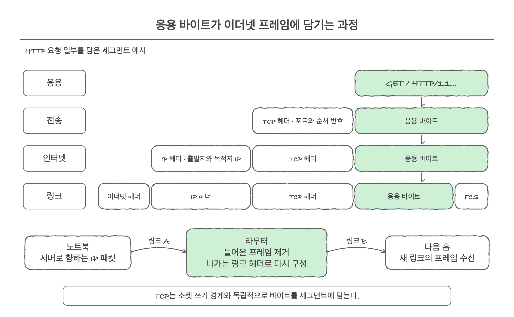
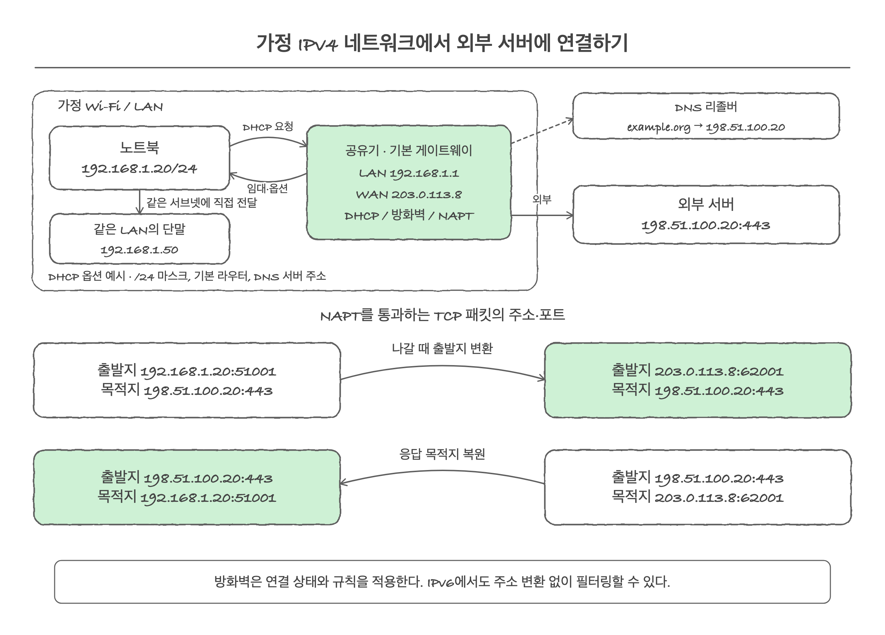
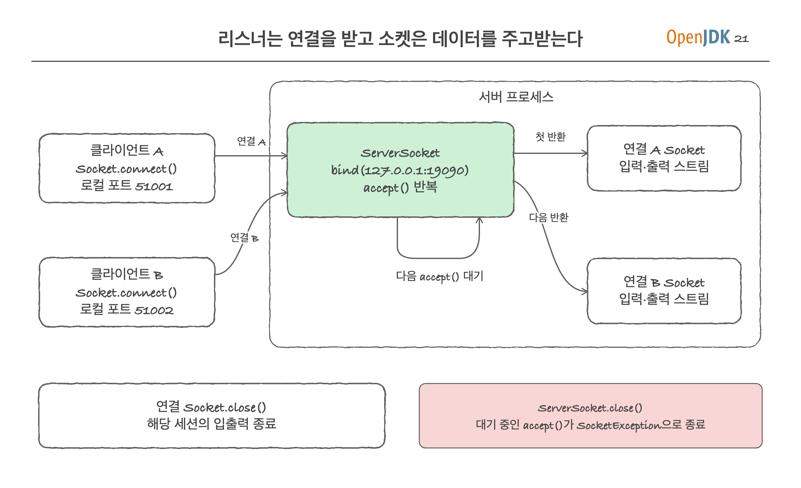
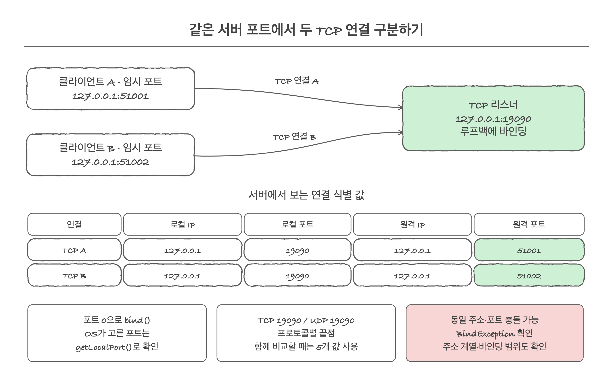
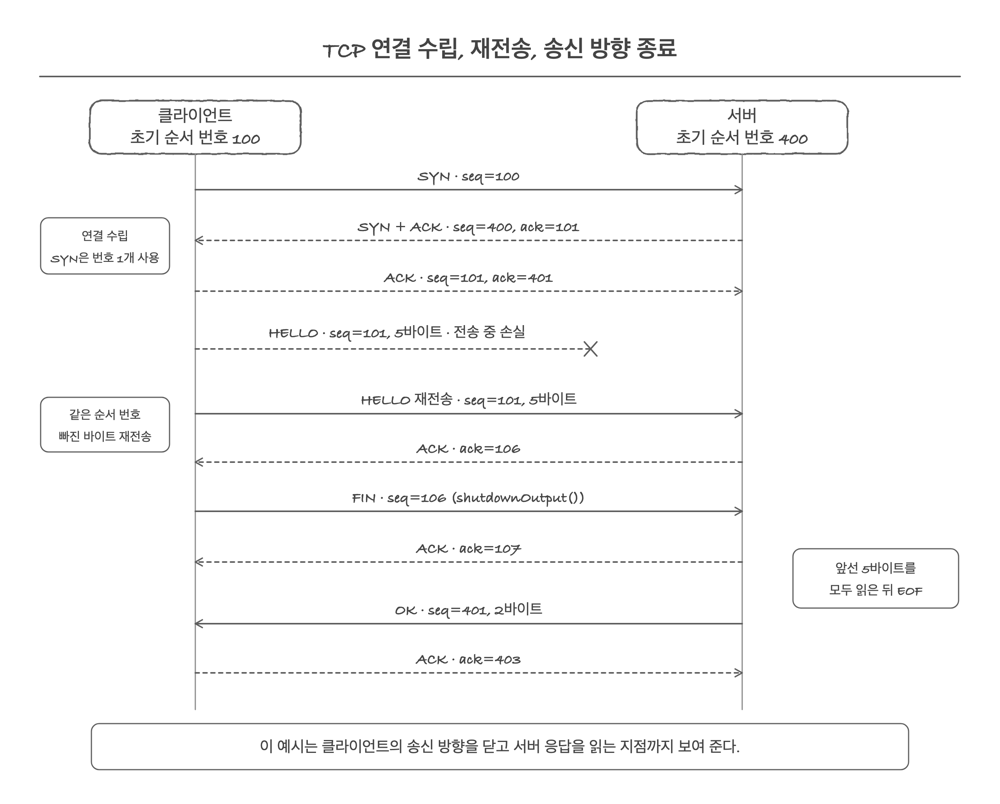
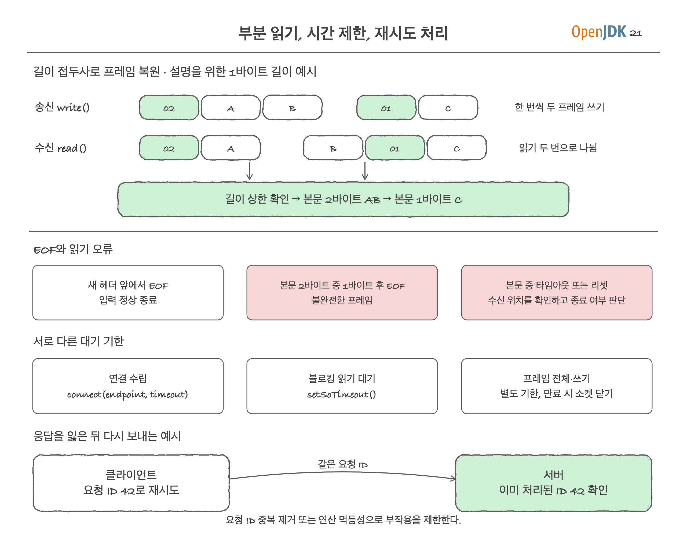

# TCP 네트워크와 소켓 이해하기

브라우저와 서버가 교환하는 애플리케이션 데이터가 네트워크를 건너는 과정과, Java 21에서 TCP 연결을 여닫고 데이터를 읽는 방법을 살펴본다. [RFC 1122 §1.1.3](https://www.rfc-editor.org/rfc/rfc1122.html#section-1.1.3) · [JDK 21 Socket](https://docs.oracle.com/en/java/javase/21/docs/api/java.base/java/net/Socket.html)

## 1. TCP/IP 계층과 캡슐화

- **응용 계층**은 HTTP나 DNS처럼 서로 해석할 메시지와 교환 규칙을 정의한다. TCP를 사용하는 애플리케이션은 소켓에 바이트를 쓰고, 받은 바이트를 자기 프로토콜에 맞춰 해석한다. [RFC 1122 §1.1.3](https://www.rfc-editor.org/rfc/rfc1122.html#section-1.1.3) · [RFC 9293 §2.2](https://www.rfc-editor.org/rfc/rfc9293.html#section-2.2)
- **전송 계층**의 TCP는 바이트 스트림을 세그먼트로 보내며, 헤더에는 송수신 포트와 순서 번호 등이 들어간다. **인터넷 계층**의 IP는 IP 주소를 기준으로 데이터그램을 목적지 쪽으로 전달한다. TCP 세그먼트는 IP 데이터그램의 페이로드가 된다. [RFC 9293 §2.2, §3.1](https://www.rfc-editor.org/rfc/rfc9293.html#section-3.1) · [RFC 1122 §1.1.3](https://www.rfc-editor.org/rfc/rfc1122.html#section-1.1.3)
- **링크 계층**은 이더넷이나 Wi-Fi 등 현재 링크에서 다음 홉으로 패킷을 보낸다. 이더넷 구간에서는 IP 패킷을 프레임에 담으며, 라우터를 거칠 때마다 나가는 링크에 맞는 프레임으로 다시 감싼다. [RFC 1122 §1.1.3, §2.3.3](https://www.rfc-editor.org/rfc/rfc1122.html#section-1.1.3) · [RFC 894](https://www.rfc-editor.org/rfc/rfc894.html)

아래 그림은 이더넷에서 TCP 데이터를 보내는 한 구간을 단순화한 것이다. TCP의 세그먼트 분할은 애플리케이션이 소켓에 쓴 메시지 경계와 독립적이다. [RFC 9293 §3.7](https://www.rfc-editor.org/rfc/rfc9293.html#section-3.7) · [RFC 894](https://www.rfc-editor.org/rfc/rfc894.html)

각 계층은 자기 헤더를 추가하고, 라우터는 나가는 링크에 맞춰 프레임을 새로 만든다. [RFC 9293 §3.7](https://www.rfc-editor.org/rfc/rfc9293.html#section-3.7) · [RFC 894](https://www.rfc-editor.org/rfc/rfc894.html) · [RFC 1122 §1.1.3, §2.3.3](https://www.rfc-editor.org/rfc/rfc1122.html#section-1.1.3)

## 2. 가정용 공유기와 인터넷 연결

노트북이 가정의 Wi-Fi에 접속하면 단말은 LAN의 구성원이 된다. 전형적인 IPv4 구성에서 DHCP 서버는 단말에 주소를 임대하고, 서브넷 마스크, 기본 라우터, DNS 서버 주소를 옵션으로 내려준다. 이 역할들은 공유기 한 대에 들어 있을 수 있으며, DHCP 서버나 DNS 조회를 처리하는 서버를 따로 둘 수도 있다. [RFC 2131 §1, §3.1](https://www.rfc-editor.org/rfc/rfc2131.html#section-3.1) · [RFC 2132 §3.3, §3.5, §3.8](https://www.rfc-editor.org/rfc/rfc2132.html#section-3.3) · [RFC 1034 §2.4](https://www.rfc-editor.org/rfc/rfc1034.html#section-2.4)

공유기의 NAPT는 나가는 TCP 연결의 주소·포트 매핑으로 들어오는 응답을 단말에 돌려준다. [RFC 2132 §3.3, §3.5, §3.8](https://www.rfc-editor.org/rfc/rfc2132.html#section-3.3) · [RFC 3022 §2.2](https://www.rfc-editor.org/rfc/rfc3022.html#section-2.2) · [RFC 6092 §3.3](https://www.rfc-editor.org/rfc/rfc6092.html#section-3.3)

애플리케이션이 도메인 이름으로 접속하면 리졸버는 DNS에서 목적지 주소를 찾는다. 같은 서브넷의 목적지로는 링크에서 직접 전달하고, 로컬 라우팅 정보에 더 구체적인 경로가 없으면 외부 목적지로 향하는 패킷을 기본 게이트웨이에 보낸다. [RFC 1034 §2.4, §5.2](https://www.rfc-editor.org/rfc/rfc1034.html#section-5.2) · [RFC 1122 §3.3.1](https://www.rfc-editor.org/rfc/rfc1122.html#section-3.3.1)

흔한 IPv4 구성에서 단말은 `192.168.1.20` 같은 사설 주소를 사용한다. 공유기가 NAPT를 사용하면 외부로 나가는 패킷의 출발지 IP와 포트를 WAN 쪽 매핑으로 바꾸고, 돌아오는 패킷의 목적지를 해당 단말로 되돌린다. 방화벽은 연결 상태와 규칙을 바탕으로 통과 여부를 결정한다. IPv6에서는 라우터 광고와 SLAAC 또는 DHCPv6를 사용하는 구성이 가능하며, 주소 변환 없이도 IPv6 방화벽이 외부에서 시작한 연결을 정책에 따라 필터링할 수 있다. [RFC 1918 §3](https://www.rfc-editor.org/rfc/rfc1918.html#section-3) · [RFC 3022 §2.2](https://www.rfc-editor.org/rfc/rfc3022.html#section-2.2) · [RFC 7084 §4.3](https://www.rfc-editor.org/rfc/rfc7084.html#section-4.3) · [RFC 6092 §3.3](https://www.rfc-editor.org/rfc/rfc6092.html#section-3.3)

## 3. 소켓과 연결 생명주기

소켓은 통신을 위해 애플리케이션이 사용하는 끝점이다. Java의 `ServerSocket`은 `bind()`로 로컬 주소와 포트에 묶여 새 연결을 기다리고, `accept()`는 연결마다 별도의 `Socket`을 반환한다. 클라이언트는 `Socket.connect()`에 서버 주소를 넘기고, 연결된 양쪽은 각자의 `Socket`에서 입력과 출력 스트림을 얻는다. [JDK 21 ServerSocket.bind와 accept](https://docs.oracle.com/en/java/javase/21/docs/api/java.base/java/net/ServerSocket.html#bind(java.net.SocketAddress,int)) · [JDK 21 Socket.connect와 스트림](https://docs.oracle.com/en/java/javase/21/docs/api/java.base/java/net/Socket.html#connect(java.net.SocketAddress,int))

연결 데이터를 처리한 뒤에는 `accept()`가 반환한 소켓을 닫는다. 서버에서 리스너를 닫으면 대기 중인 `accept()`가 예외로 풀린다. 이미 수락한 연결은 각 소켓의 소유자가 닫으며, 아래 그림에서 `accept()`가 한 번 끝난 뒤 리스너는 그다음 연결을 받을 수 있다. [JDK 21 ServerSocket.accept](https://docs.oracle.com/en/java/javase/21/docs/api/java.base/java/net/ServerSocket.html#accept()) · [JDK 21 ServerSocket.close](https://docs.oracle.com/en/java/javase/21/docs/api/java.base/java/net/ServerSocket.html#close()) · [JDK 21 Socket.close](https://docs.oracle.com/en/java/javase/21/docs/api/java.base/java/net/Socket.html#close())

리스너와 연결별 Socket은 수명과 닫는 주체가 각각 다르다. [JDK 21 ServerSocket.accept](https://docs.oracle.com/en/java/javase/21/docs/api/java.base/java/net/ServerSocket.html#accept()) · [JDK 21 ServerSocket.close](https://docs.oracle.com/en/java/javase/21/docs/api/java.base/java/net/ServerSocket.html#close()) · [JDK 21 Socket.close](https://docs.oracle.com/en/java/javase/21/docs/api/java.base/java/net/Socket.html#close())

## 4. 포트 바인딩과 연결 식별

포트 번호에는 전송 프로토콜이 함께 붙는다. 예를 들어 TCP의 `19090`과 UDP의 `19090`은 별도의 전송 끝점이다. TCP 서버는 `127.0.0.1:19090`처럼 로컬 주소를 지정해 바인딩할 수 있고, 와일드카드 주소는 해당 주소 계열의 여러 로컬 인터페이스를 포괄할 수 있다. 로컬 바인딩이 충돌하면 Java는 `BindException`을 보고할 수 있다. [RFC 6335 §6](https://www.rfc-editor.org/rfc/rfc6335.html#section-6) · [JDK 21 InetSocketAddress](https://docs.oracle.com/en/java/javase/21/docs/api/java.base/java/net/InetSocketAddress.html) · [JDK 21 BindException](https://docs.oracle.com/en/java/javase/21/docs/api/java.base/java/net/BindException.html)

두 연결이 서버 포트를 공유해도 원격 포트가 달라 서로 다른 연결로 식별된다. [RFC 9293 §3.9.1.1](https://www.rfc-editor.org/rfc/rfc9293.html#section-3.9.1.1) · [RFC 6335 §6](https://www.rfc-editor.org/rfc/rfc6335.html#section-6) · [RFC 6056 §2.2](https://www.rfc-editor.org/rfc/rfc6056.html#section-2.2)

클라이언트가 로컬 포트를 지정하지 않고 연결하면 일반적으로 OS가 임시 포트(ephemeral port)를 고른다. 서버도 `bind()`할 때 포트 `0`을 넘기면 OS가 할당한 실제 포트를 `getLocalPort()`로 확인할 수 있다. [RFC 6056 §2.1–2.2](https://www.rfc-editor.org/rfc/rfc6056.html#section-2.2) · [JDK 21 ServerSocket.bind](https://docs.oracle.com/en/java/javase/21/docs/api/java.base/java/net/ServerSocket.html#bind(java.net.SocketAddress,int)) · [JDK 21 ServerSocket.getLocalPort](https://docs.oracle.com/en/java/javase/21/docs/api/java.base/java/net/ServerSocket.html#getLocalPort())

TCP에서 연결은 `(로컬 IP, 로컬 포트, 원격 IP, 원격 포트)`로 구분한다. 예를 들어 서버가 `127.0.0.1:19090` 하나에서 들어도 클라이언트의 포트가 `51001`과 `51002`라면 서로 다른 연결이다. 프로토콜이 TCP로 고정이라는 전제를 풀면 프로토콜까지 포함한 5개 값으로 통신을 구분한다. [RFC 9293 §3.9.1.1](https://www.rfc-editor.org/rfc/rfc9293.html#section-3.9.1.1) · [RFC 6056 §2.2](https://www.rfc-editor.org/rfc/rfc6056.html#section-2.2)

## 5. TCP 연결 수립과 바이트 스트림

보통 클라이언트가 `SYN`을 보내고 서버가 `SYN+ACK`로 응답한 뒤 클라이언트가 `ACK`를 보낸다. 이 3방향 핸드셰이크에서 양쪽은 초기 순서 번호를 알리고 상대가 보낸 번호를 확인한다. 연결이 성립하면 각 방향으로 순서가 유지되는 바이트 스트림을 보낼 수 있다. TCP는 순서 번호와 재전송으로 세그먼트 손실을 처리한다. [RFC 9293 §2.2](https://www.rfc-editor.org/rfc/rfc9293.html#section-2.2) · [RFC 9293 §3.5](https://www.rfc-editor.org/rfc/rfc9293.html#section-3.5)

한 방향을 FIN으로 닫은 뒤에도 반대 방향으로 응답을 받을 수 있다. [RFC 9293 §3.5](https://www.rfc-editor.org/rfc/rfc9293.html#section-3.5) · [RFC 9293 §3.6.1](https://www.rfc-editor.org/rfc/rfc9293.html#section-3.6.1) · [JDK 21 Socket.shutdownOutput](https://docs.oracle.com/en/java/javase/21/docs/api/java.base/java/net/Socket.html#shutdownOutput())

정상 종료에서 한쪽은 자신의 송신 방향을 `FIN`으로 닫을 수 있고, 상대 방향은 계속 열려 있을 수 있다. Java에서 `shutdownOutput()`을 호출하면 앞서 쓴 데이터 뒤에 TCP의 정상적인 송신 종료가 이어진다. 상대가 앞선 바이트를 모두 읽으면 입력 스트림에 EOF가 나타난다. 송신을 닫은 쪽도 상대의 응답을 읽을 수 있다. [RFC 9293 §3.6.1](https://www.rfc-editor.org/rfc/rfc9293.html#section-3.6.1) · [JDK 21 Socket.shutdownOutput](https://docs.oracle.com/en/java/javase/21/docs/api/java.base/java/net/Socket.html#shutdownOutput()) · [JDK 21 InputStream.read](https://docs.oracle.com/en/java/javase/21/docs/api/java.base/java/io/InputStream.html#read())

## 6. 소켓 프로그래밍에서 자주 생기는 문제

프레임 경계, 대기 기한, 요청 중복 여부는 애플리케이션이 별도로 판단한다. [RFC 9293 §3.7](https://www.rfc-editor.org/rfc/rfc9293.html#section-3.7) · [JDK 21 Socket.setSoTimeout](https://docs.oracle.com/en/java/javase/21/docs/api/java.base/java/net/Socket.html#setSoTimeout(int)) · [RFC 9110 §9.2.2](https://www.rfc-editor.org/rfc/rfc9110.html#section-9.2.2)

- **메시지 경계와 부분 읽기**. `write()` 두 번이 `read()` 한 번에 들어오거나 한 번 쓴 내용이 여러 읽기로 나뉠 수 있다. 길이 접두사나 구분자를 합의하고, 헤더와 본문을 각각 끝까지 모은다. 최대 길이를 합의하고 길이 값을 검사한 뒤 버퍼를 할당한다. [RFC 9293 §3.7](https://www.rfc-editor.org/rfc/rfc9293.html#section-3.7) · [JDK 21 DataInputStream.readFully](https://docs.oracle.com/en/java/javase/21/docs/api/java.base/java/io/DataInputStream.html#readFully(byte%5B%5D))
- **EOF와 오류**. 다음 메시지가 시작되기 전의 `read() == -1`은 입력 종료로 처리할 수 있다. 헤더나 본문 도중의 EOF는 불완전한 메시지다. 타임아웃이나 연결 리셋에서는 예외가 발생할 수 있으므로, 받은 바이트 수를 확인하지 않고 같은 스트림에서 새 메시지 파싱을 시작하면 경계가 어긋날 수 있다. [JDK 21 InputStream.read](https://docs.oracle.com/en/java/javase/21/docs/api/java.base/java/io/InputStream.html#read()) · [JDK 21 DataInputStream.readFully](https://docs.oracle.com/en/java/javase/21/docs/api/java.base/java/io/DataInputStream.html#readFully(byte%5B%5D)) · [JDK 21 Socket.getInputStream](https://docs.oracle.com/en/java/javase/21/docs/api/java.base/java/net/Socket.html#getInputStream())
- **시간 제한과 느린 클라이언트**. 연결 수립, 블로킹 읽기, 프레임 전체 수신, 쓰기 대기는 각각 시간이 걸릴 수 있다. `connect(endpoint, timeout)`과 `setSoTimeout()`은 각각 연결 수립과 블로킹 읽기 대기에 적용된다. 프레임 전체나 쓰기에 기한이 필요하면 경과 시간을 추적하거나 기한에 소켓을 닫는 제어가 별도로 필요하다. 처리 중인 연결 수와 대기 큐에도 한도를 정하면 느린 상대가 점유할 자원의 범위를 정할 수 있다. [JDK 21 Socket.connect](https://docs.oracle.com/en/java/javase/21/docs/api/java.base/java/net/Socket.html#connect(java.net.SocketAddress,int)) · [JDK 21 Socket.setSoTimeout](https://docs.oracle.com/en/java/javase/21/docs/api/java.base/java/net/Socket.html#setSoTimeout(int)) · [JDK 21 Socket.close](https://docs.oracle.com/en/java/javase/21/docs/api/java.base/java/net/Socket.html#close()) · [JDK 21 ThreadPoolExecutor](https://docs.oracle.com/en/java/javase/21/docs/api/java.base/java/util/concurrent/ThreadPoolExecutor.html)
- **재시도와 중복 처리**. 클라이언트가 응답을 잃으면 서버에서 이미 요청을 처리했는지 모를 수 있다. TCP 재전송은 전송 계층의 기능이다. 부작용이 있는 애플리케이션 요청을 다시 보낼 때는 멱등 연산이나 요청 ID를 사용한 중복 제거처럼 재시도의 의미를 별도로 정의한다. [RFC 9293 §2.2](https://www.rfc-editor.org/rfc/rfc9293.html#section-2.2) · [RFC 9110 §9.2.2](https://www.rfc-editor.org/rfc/rfc9110.html#section-9.2.2)
