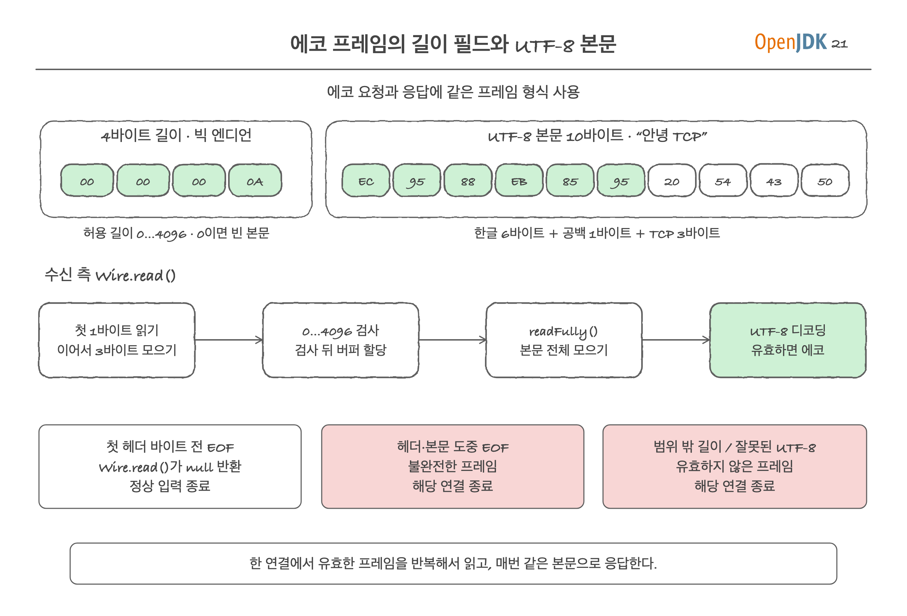
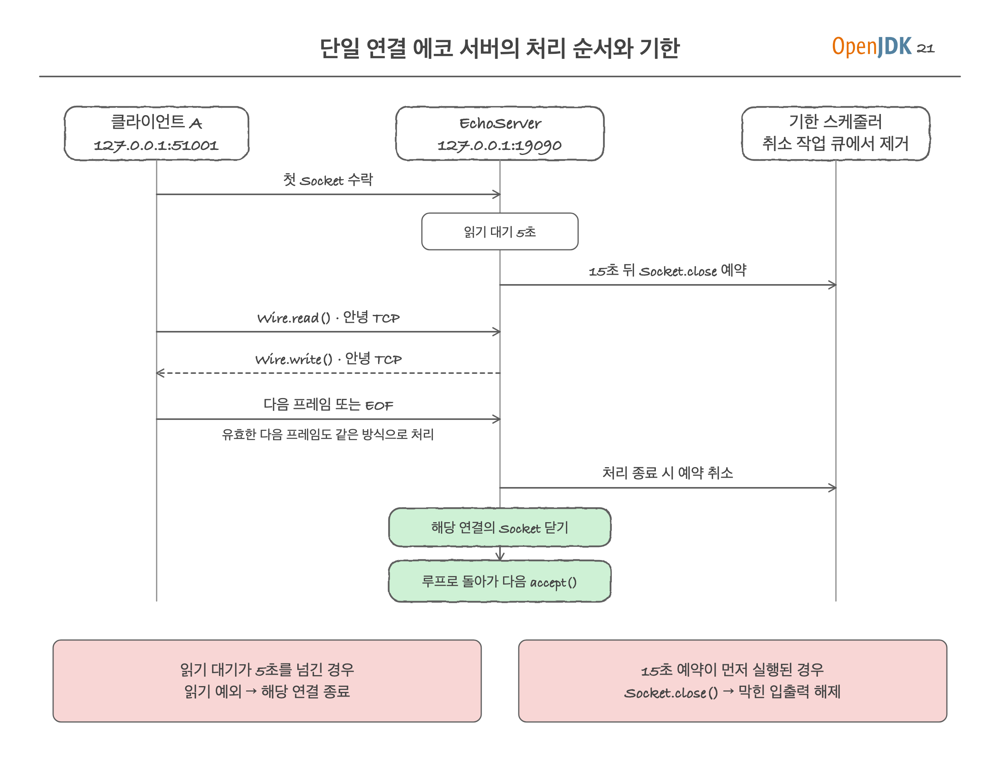
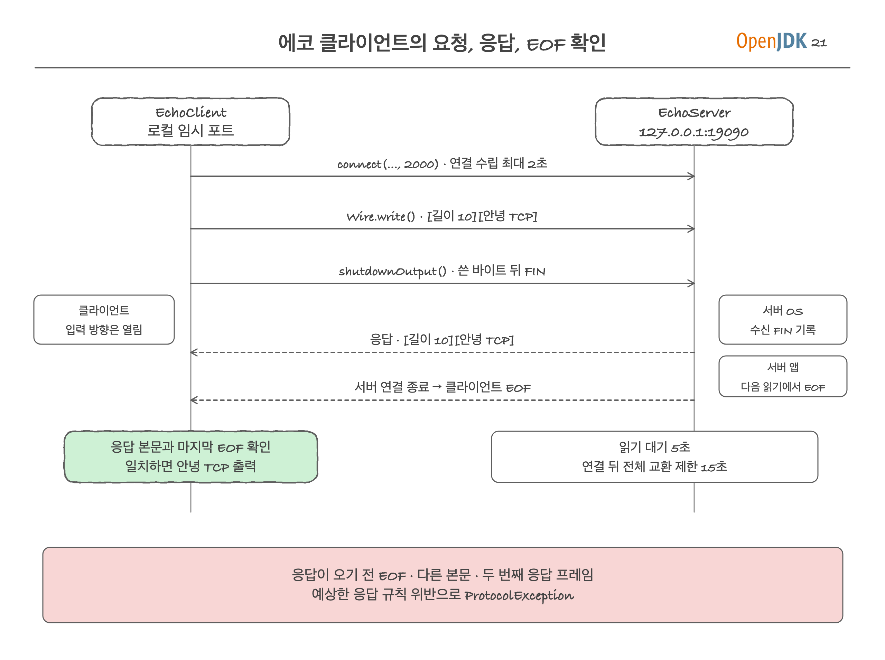
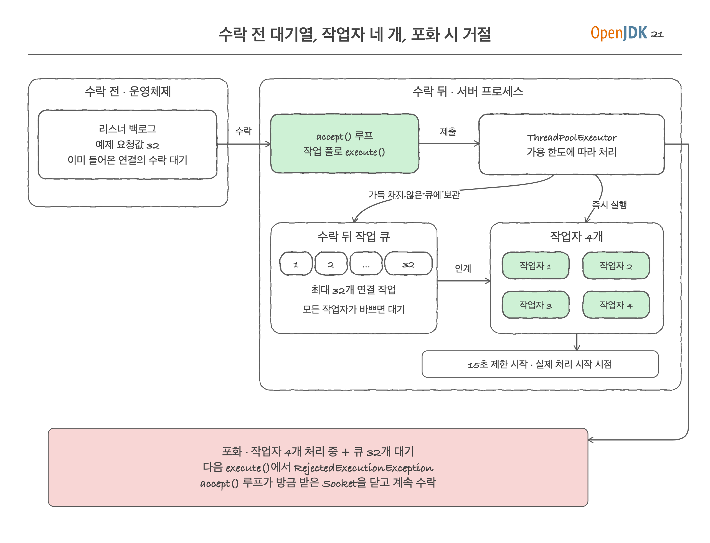
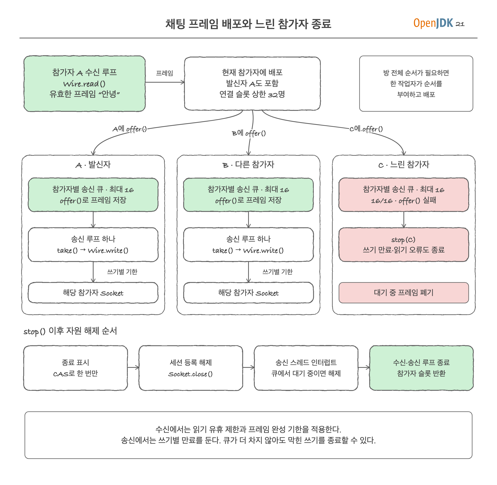
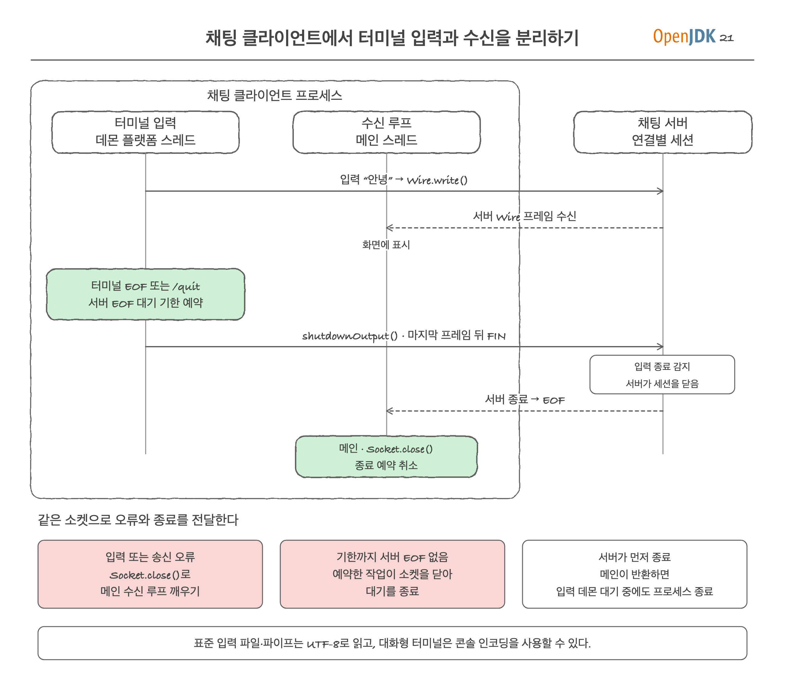

# Java TCP 에코와 채팅 서비스 만들기

`127.0.0.1:19090`에서 Java 21 에코 서버와 클라이언트를 실행하고, 같은 프레임을 여러 참가자에게 전송하는 채팅 구조로 확장한다. [JDK 21 ServerSocket](https://docs.oracle.com/en/java/javase/21/docs/api/java.base/java/net/ServerSocket.html) · [JDK 21 Socket](https://docs.oracle.com/en/java/javase/21/docs/api/java.base/java/net/Socket.html)

## 1. 작은 에코 프로토콜 정하기

요청과 응답은 `[4바이트 길이][UTF-8 본문]` 형식이다. 길이는 빅 엔디언 정수이고 헤더를 제외한 본문의 바이트 수다. 빈 메시지를 포함해 `0`에서 `4096`까지 허용한다. 서버는 유효한 요청마다 같은 본문으로 응답하며, 한 연결에서 여러 프레임을 처리한다. 이 길이 규칙은 예제의 응용 계층에서 정한다. [RFC 9293 §3.7](https://www.rfc-editor.org/rfc/rfc9293.html#section-3.7) · [RFC 3629 §3](https://www.rfc-editor.org/rfc/rfc3629.html#section-3) · [JDK 21 DataOutputStream.writeInt](https://docs.oracle.com/en/java/javase/21/docs/api/java.base/java/io/DataOutputStream.html#writeInt(int))



길이 필드는 헤더를 제외한 UTF-8 바이트 수이고, 서버와 클라이언트는 같은 Wire 규칙을 사용한다. [JDK 21 DataOutputStream.writeInt](https://docs.oracle.com/en/java/javase/21/docs/api/java.base/java/io/DataOutputStream.html#writeInt(int)) · [JDK 21 DataInputStream](https://docs.oracle.com/en/java/javase/21/docs/api/java.base/java/io/DataInputStream.html) · [RFC 3629 §3](https://www.rfc-editor.org/rfc/rfc3629.html#section-3)

첫 헤더 바이트를 읽기 전에 EOF를 만나면 정상적인 입력 종료로 처리한다. 헤더나 본문이 덜 왔거나, 길이가 허용 범위 밖이거나, 잘못된 UTF-8이면 예외로 해당 연결을 끝낸다. `Wire.java`는 이 규칙을 서버와 클라이언트에 공통으로 적용한다. [JDK 21 DataInputStream](https://docs.oracle.com/en/java/javase/21/docs/api/java.base/java/io/DataInputStream.html) · [JDK 21 CharsetDecoder](https://docs.oracle.com/en/java/javase/21/docs/api/java.base/java/nio/charset/CharsetDecoder.html) · [JDK 21 CharsetEncoder](https://docs.oracle.com/en/java/javase/21/docs/api/java.base/java/nio/charset/CharsetEncoder.html)

```java
import java.io.DataInputStream;
import java.io.DataOutputStream;
import java.io.IOException;
import java.net.InetSocketAddress;
import java.net.ProtocolException;
import java.nio.ByteBuffer;
import java.nio.CharBuffer;
import java.nio.charset.StandardCharsets;

final class Wire {
    static final InetSocketAddress ADDRESS = new InetSocketAddress("127.0.0.1", 19090);
    private static final int MAX_BYTES = 4096;

    static String read(DataInputStream input) throws IOException {
        int first = input.read();
        if (first == -1) {
            return null;
        }

        int length = (first << 24)
                | (input.readUnsignedByte() << 16)
                | (input.readUnsignedByte() << 8)
                | input.readUnsignedByte();
        checkLength(length);
        byte[] body = new byte[length];
        input.readFully(body);
        return StandardCharsets.UTF_8.newDecoder().decode(ByteBuffer.wrap(body)).toString();
    }

    static void write(DataOutputStream output, String message) throws IOException {
        checkLength(message.length());
        ByteBuffer encoded = StandardCharsets.UTF_8.newEncoder().encode(CharBuffer.wrap(message));
        checkLength(encoded.remaining());
        byte[] body = new byte[encoded.remaining()];
        encoded.get(body);
        output.writeInt(body.length);
        output.write(body);
        output.flush();
    }

    private static void checkLength(int length) throws ProtocolException {
        if (length < 0 || length > MAX_BYTES) {
            throw new ProtocolException("Frame length out of range: " + length);
        }
    }
}
```

## 2. TCP 에코 서버 만들기

`EchoServer.java`는 루프백에 바인딩하고 연결 한 개를 처리한 뒤 다음 연결을 받는다. 읽기 대기는 5초로 제한한다. 연결 처리를 시작한 후에는 15초 뒤 소켓을 닫도록 예약하여, 상대가 바이트를 조금씩 보내거나 응답을 읽지 않아 작업자가 계속 대기하는 시간을 제한한다. 정상 종료 시 예약을 취소하고, 취소된 작업은 예약 큐에서 제거한다. [JDK 21 ServerSocket](https://docs.oracle.com/en/java/javase/21/docs/api/java.base/java/net/ServerSocket.html) · [JDK 21 Socket.setSoTimeout과 close](https://docs.oracle.com/en/java/javase/21/docs/api/java.base/java/net/Socket.html#setSoTimeout(int)) · [JDK 21 ScheduledThreadPoolExecutor](https://docs.oracle.com/en/java/javase/21/docs/api/java.base/java/util/concurrent/ScheduledThreadPoolExecutor.html)



5초 읽기 제한과 별개로 15초 후 소켓을 닫아, 천천히 받거나 응답을 쓰다 막힌 연결을 해제한다. [JDK 21 ServerSocket](https://docs.oracle.com/en/java/javase/21/docs/api/java.base/java/net/ServerSocket.html) · [JDK 21 Socket.setSoTimeout과 close](https://docs.oracle.com/en/java/javase/21/docs/api/java.base/java/net/Socket.html#setSoTimeout(int)) · [JDK 21 ScheduledThreadPoolExecutor](https://docs.oracle.com/en/java/javase/21/docs/api/java.base/java/util/concurrent/ScheduledThreadPoolExecutor.html)

```java
import java.io.BufferedInputStream;
import java.io.BufferedOutputStream;
import java.io.DataInputStream;
import java.io.DataOutputStream;
import java.io.IOException;
import java.net.ServerSocket;
import java.net.Socket;
import java.util.concurrent.ScheduledFuture;
import java.util.concurrent.ScheduledThreadPoolExecutor;
import java.util.concurrent.TimeUnit;

public class EchoServer {
    public static void main(String[] args) throws IOException {
        try (var deadlines = newDeadlines(); var listener = listen()) {
            while (true) {
                handle(listener.accept(), deadlines);
            }
        }
    }

    static ServerSocket listen() throws IOException {
        return new ServerSocket(Wire.ADDRESS.getPort(), 32, Wire.ADDRESS.getAddress());
    }

    static ScheduledThreadPoolExecutor newDeadlines() {
        var deadlines = new ScheduledThreadPoolExecutor(1);
        deadlines.setRemoveOnCancelPolicy(true);
        return deadlines;
    }

    static ScheduledFuture<?> closeAfter(ScheduledThreadPoolExecutor deadlines, Socket socket) {
        return deadlines.schedule(() -> {
            try {
                socket.close();
            } catch (IOException failure) {
                System.err.println("Close failed: " + failure);
            }
        }, 15, TimeUnit.SECONDS);
    }

    static void handle(Socket socket, ScheduledThreadPoolExecutor deadlines) {
        try (socket) {
            socket.setSoTimeout(5_000);
            var expiry = closeAfter(deadlines, socket);
            try {
                var input = new DataInputStream(new BufferedInputStream(socket.getInputStream()));
                var output = new DataOutputStream(new BufferedOutputStream(socket.getOutputStream()));
                String message;
                while ((message = Wire.read(input)) != null) {
                    Wire.write(output, message);
                }
            } finally {
                expiry.cancel(false);
            }
        } catch (IOException failure) {
            System.err.println("Connection ended: " + failure);
        }
    }
}
```

## 3. TCP 에코 클라이언트 만들기

`EchoClient.java`는 최대 2초 동안 연결을 시도한다. 연결한 뒤 메시지를 한 건 보내고 `shutdownOutput()`으로 송신 방향을 닫은 다음 응답 한 건과 EOF를 확인한다. 응답 전에 EOF를 만나면 응답 누락으로 처리한다. 읽기는 5초, 전체 교환은 서버와 같은 15초 제한을 사용한다. [JDK 21 Socket.connect](https://docs.oracle.com/en/java/javase/21/docs/api/java.base/java/net/Socket.html#connect(java.net.SocketAddress,int)) · [JDK 21 Socket.setSoTimeout](https://docs.oracle.com/en/java/javase/21/docs/api/java.base/java/net/Socket.html#setSoTimeout(int)) · [JDK 21 Socket.shutdownOutput](https://docs.oracle.com/en/java/javase/21/docs/api/java.base/java/net/Socket.html#shutdownOutput()) · [JDK 21 ScheduledThreadPoolExecutor.schedule](https://docs.oracle.com/en/java/javase/21/docs/api/java.base/java/util/concurrent/ScheduledThreadPoolExecutor.html#schedule(java.lang.Runnable,long,java.util.concurrent.TimeUnit))



클라이언트는 송신을 닫은 뒤에도 수신을 이어가며 일치하는 에코와 마지막 EOF를 확인한다. [JDK 21 Socket.connect](https://docs.oracle.com/en/java/javase/21/docs/api/java.base/java/net/Socket.html#connect(java.net.SocketAddress,int)) · [JDK 21 Socket.shutdownOutput](https://docs.oracle.com/en/java/javase/21/docs/api/java.base/java/net/Socket.html#shutdownOutput()) · [JDK 21 Socket.setSoTimeout](https://docs.oracle.com/en/java/javase/21/docs/api/java.base/java/net/Socket.html#setSoTimeout(int))

```java
import java.io.DataInputStream;
import java.io.DataOutputStream;
import java.io.IOException;
import java.net.ProtocolException;
import java.net.Socket;

public class EchoClient {
    public static void main(String[] args) throws IOException {
        String message = args.length == 0 ? "안녕 TCP" : args[0];
        try (var deadlines = EchoServer.newDeadlines(); var socket = new Socket()) {
            socket.connect(Wire.ADDRESS, 2_000);
            socket.setSoTimeout(5_000);
            var expiry = EchoServer.closeAfter(deadlines, socket);
            try {
                var input = new DataInputStream(socket.getInputStream());
                var output = new DataOutputStream(socket.getOutputStream());
                Wire.write(output, message);
                socket.shutdownOutput();

                String reply = Wire.read(input);
                if (!message.equals(reply) || Wire.read(input) != null) {
                    throw new ProtocolException("Expected one matching echo followed by EOF");
                }
                System.out.println(reply);
            } finally {
                expiry.cancel(false);
            }
        }
    }
}
```

같은 디렉터리에 소스 세 개를 저장한다. 첫 터미널에서는 컴파일 후 서버를 시작하고, 두 번째 터미널에서 클라이언트를 실행하면 `안녕 TCP`가 출력된다. [JDK 21 javac](https://docs.oracle.com/en/java/javase/21/docs/specs/man/javac.html) · [JDK 21 java](https://docs.oracle.com/en/java/javase/21/docs/specs/man/java.html)

```sh
# 첫 터미널
javac --release 21 -encoding UTF-8 Wire.java EchoServer.java EchoClient.java
java EchoServer

# 두 번째 터미널
java EchoClient '안녕 TCP'
```

## 4. 연결을 제한하는 멀티스레드 구조

연결 하나가 읽기를 기다리는 동안 다른 연결을 처리하도록 `BoundedEchoServer.java`는 `accept()` 루프에서 연결을 작업 풀에 넘긴다. 작업자 네 개가 처리 중인 연결을 맡으며, 대기 중인 연결은 32개까지 보관한다. 포화로 제출이 거절되면 수락한 소켓을 즉시 닫는다. 리스너의 백로그는 OS에 요청하는 수락 전 대기 규모이고, 작업 풀의 큐는 수락 후 대기하는 작업 수를 제한한다. 15초 제한은 작업자가 연결을 처리하기 시작할 때부터 적용된다. [JDK 21 ServerSocket](https://docs.oracle.com/en/java/javase/21/docs/api/java.base/java/net/ServerSocket.html) · [JDK 21 ThreadPoolExecutor](https://docs.oracle.com/en/java/javase/21/docs/api/java.base/java/util/concurrent/ThreadPoolExecutor.html) · [JDK 21 ArrayBlockingQueue](https://docs.oracle.com/en/java/javase/21/docs/api/java.base/java/util/concurrent/ArrayBlockingQueue.html)



리스너 백로그는 수락 전에, 작업 큐 32개는 수락 뒤에 적용되며 처리 기한은 작업자가 시작할 때부터 센다. [JDK 21 ServerSocket](https://docs.oracle.com/en/java/javase/21/docs/api/java.base/java/net/ServerSocket.html) · [JDK 21 ThreadPoolExecutor](https://docs.oracle.com/en/java/javase/21/docs/api/java.base/java/util/concurrent/ThreadPoolExecutor.html) · [JDK 21 ArrayBlockingQueue](https://docs.oracle.com/en/java/javase/21/docs/api/java.base/java/util/concurrent/ArrayBlockingQueue.html)

```java
import java.io.IOException;
import java.net.Socket;
import java.util.concurrent.ArrayBlockingQueue;
import java.util.concurrent.RejectedExecutionException;
import java.util.concurrent.ThreadPoolExecutor;
import java.util.concurrent.TimeUnit;

public class BoundedEchoServer {
    public static void main(String[] args) throws IOException {
        try (var deadlines = EchoServer.newDeadlines();
             var workers = new ThreadPoolExecutor(
                     4, 4, 0, TimeUnit.MILLISECONDS,
                     new ArrayBlockingQueue<>(32), new ThreadPoolExecutor.AbortPolicy());
             var listener = EchoServer.listen()) {
            while (true) {
                Socket socket = listener.accept();
                try {
                    workers.execute(() -> EchoServer.handle(socket, deadlines));
                } catch (RejectedExecutionException rejected) {
                    try {
                        socket.close();
                    } catch (IOException failure) {
                        System.err.println("Close failed: " + failure);
                    }
                }
            }
        }
    }
}
```

단일 연결 서버를 종료한 뒤 아래 명령으로 다른 형태의 서버를 시작한다. 같은 `EchoClient`를 여러 터미널에서 실행해 각각 자신의 응답을 확인할 수 있다. [JDK 21 javac](https://docs.oracle.com/en/java/javase/21/docs/specs/man/javac.html) · [JDK 21 java](https://docs.oracle.com/en/java/javase/21/docs/specs/man/java.html)

```sh
javac --release 21 -encoding UTF-8 Wire.java EchoServer.java EchoClient.java BoundedEchoServer.java
java BoundedEchoServer
```

## 5. 여러 참가자에게 전송하는 채팅 서버로 확장하기

채팅 서버는 같은 길이·UTF-8 규칙을 사용하고, 유효한 프레임을 읽으면 보낸 사람을 포함한 현재 참가자에게 복제한다. 연결마다 수신 루프 하나와 송신 루프 하나를 두고, 소켓에 프레임을 쓰는 주체는 송신 루프 한 곳으로 제한한다. 각 수신 루프는 참가자별 큐에만 메시지를 넣는다. 동시에 여러 참가자가 보낸 메시지에 방 전체의 단일 순서가 필요하면, 한 작업자가 프레임에 순서를 부여하고 배포하도록 설계한다. [RFC 9293 §2.2](https://www.rfc-editor.org/rfc/rfc9293.html#section-2.2) · [JDK 21 DataOutputStream](https://docs.oracle.com/en/java/javase/21/docs/api/java.base/java/io/DataOutputStream.html) · [JDK 21 BlockingQueue](https://docs.oracle.com/en/java/javase/21/docs/api/java.base/java/util/concurrent/BlockingQueue.html)



참가자별 큐와 단일 송신 루프를 두며, 큐 포화나 쓰기 만료가 난 참가자만 종료한다. [JDK 21 BlockingQueue](https://docs.oracle.com/en/java/javase/21/docs/api/java.base/java/util/concurrent/BlockingQueue.html) · [JDK 21 Socket.close](https://docs.oracle.com/en/java/javase/21/docs/api/java.base/java/net/Socket.html#close()) · [JDK 21 Thread.join과 interrupt](https://docs.oracle.com/en/java/javase/21/docs/api/java.base/java/lang/Thread.html)

예를 들어 참가자 32명과 참가자별 큐 16개 프레임을 상한으로 둔다. 배포에는 기다리지 않는 `offer()`를 쓰고 큐가 가득 차면 해당 참가자를 종료한다. 송신은 `take()`로 다음 프레임을 기다리며, 다른 루프가 종료를 알릴 때 소켓을 닫아 네트워크 I/O를 풀고 송신 스레드에 인터럽트를 보내 큐 대기도 풀어 준다. 송신 루프에는 프레임 쓰기별 만료를 설정해, 새 메시지가 없어 큐 포화가 드러나지 않아도 막힌 쓰기를 종료할 수 있게 한다. [JDK 21 Semaphore.tryAcquire](https://docs.oracle.com/en/java/javase/21/docs/api/java.base/java/util/concurrent/Semaphore.html#tryAcquire()) · [JDK 21 ArrayBlockingQueue](https://docs.oracle.com/en/java/javase/21/docs/api/java.base/java/util/concurrent/ArrayBlockingQueue.html) · [JDK 21 Socket.close](https://docs.oracle.com/en/java/javase/21/docs/api/java.base/java/net/Socket.html#close()) · [JDK 21 ScheduledThreadPoolExecutor.schedule](https://docs.oracle.com/en/java/javase/21/docs/api/java.base/java/util/concurrent/ScheduledThreadPoolExecutor.html#schedule(java.lang.Runnable,long,java.util.concurrent.TimeUnit))

아래 의사코드에서 `stop`은 참가자의 종료 표시를 원자적으로 한 번만 설정한다. 세션을 목록에서 지운 뒤 소켓을 닫고 송신 대기를 깨운다. 대기 중인 송신 프레임은 종료 시 버리고, 참가자 한도는 수신과 송신 루프가 모두 끝난 뒤 반환한다. 이 예제는 참가자별 읽기 유휴 제한도 두며, 유효한 프레임을 완성해야 다시 갱신되는 기한을 두면 조금씩 도착하는 불완전한 프레임도 중단할 수 있다. [JDK 21 AtomicBoolean.compareAndSet](https://docs.oracle.com/en/java/javase/21/docs/api/java.base/java/util/concurrent/atomic/AtomicBoolean.html#compareAndSet(boolean,boolean)) · [JDK 21 Thread.join과 interrupt](https://docs.oracle.com/en/java/javase/21/docs/api/java.base/java/lang/Thread.html) · [JDK 21 Socket.setSoTimeout과 close](https://docs.oracle.com/en/java/javase/21/docs/api/java.base/java/net/Socket.html#setSoTimeout(int))

```text
accept → 참가자 슬롯 확보 실패 시 소켓 닫기
       → 성공 시 세션을 생성하고, 송신 스레드 참조를 저장한 뒤 세션 등록
       → 수신·송신 루프 실행

수신 루프 → Wire.read로 프레임 하나 읽기
          → EOF, 형식 오류, 만료 시 stop(자신)
          → 유효한 프레임이면 등록된 세션을 순회
             각 큐의 offer가 실패하면 stop(해당 세션)

송신 루프 → outgoing.take로 프레임 하나 받기
          → 쓰기 기한을 등록하고 Wire.write로 전송한 뒤 기한 취소
          → 전송 실패나 인터럽트 시 stop(자신)

stop      → 이미 종료 중이면 반환
          → 등록 해제, 소켓 닫기, 송신 스레드 깨우기
관리 작업 → 두 루프가 끝난 뒤 참가자 슬롯 반환
```

## 6. 터미널에서 입력과 수신을 함께 처리하는 채팅 클라이언트

채팅 클라이언트는 서버의 프레임을 읽는 작업과 사용자의 입력을 보내는 작업을 분리한다. 로컬 입력의 EOF나 `/quit`은 마지막 `Wire.write()`가 끝난 뒤 `shutdownOutput()`으로 알린다. 서버가 읽기 종료를 감지해 세션을 닫으면 클라이언트의 수신 루프도 EOF에 도달한다. 파일 또는 파이프에서 들어오는 표준 입력은 UTF-8로 읽고, 대화형 터미널에서는 콘솔의 문자 인코딩을 사용할 수 있다. [JDK 21 Socket.shutdownOutput](https://docs.oracle.com/en/java/javase/21/docs/api/java.base/java/net/Socket.html#shutdownOutput()) · [JDK 21 InputStreamReader](https://docs.oracle.com/en/java/javase/21/docs/api/java.base/java/io/InputStreamReader.html) · [JDK 21 Console.charset와 reader](https://docs.oracle.com/en/java/javase/21/docs/api/java.base/java/io/Console.html#charset())



채팅 클라이언트는 입력이 끝나면 송신을 닫고, 메인은 서버 EOF 또는 오류까지 수신을 맡는다. [JDK 21 Socket.shutdownOutput](https://docs.oracle.com/en/java/javase/21/docs/api/java.base/java/net/Socket.html#shutdownOutput()) · [JDK 21 Thread · Daemon threads](https://docs.oracle.com/en/java/javase/21/docs/api/java.base/java/lang/Thread.html#setDaemon(boolean)) · [JDK 21 Socket.close](https://docs.oracle.com/en/java/javase/21/docs/api/java.base/java/net/Socket.html#close())

수신 루프를 메인 스레드에 두고, 입력 전용 플랫폼 스레드는 데몬으로 둔다. 서버가 먼저 닫으면 메인이 소켓을 닫고 반환할 수 있으며, 입력 스레드가 다음 줄을 기다리는 동안에도 프로세스를 종료할 수 있다. 아래 발췌에서 `scheduleQuitDeadline`은 정해진 시간 안에 EOF가 오지 않으면 소켓이 닫히도록 예약한다. 메인은 `Wire.read()`로 받은 프레임을 화면에 출력하다가 EOF나 예외가 발생하면 소켓을 닫고 종료 예약을 취소한다. `stopConnection`은 입력이나 송신에 오류가 생겼을 때 소켓을 닫아 수신 루프를 깨운다. [JDK 21 Thread · Daemon threads](https://docs.oracle.com/en/java/javase/21/docs/api/java.base/java/lang/Thread.html#setDaemon(boolean)) · [JDK 21 BufferedReader.readLine](https://docs.oracle.com/en/java/javase/21/docs/api/java.base/java/io/BufferedReader.html#readLine()) · [JDK 21 Socket.close](https://docs.oracle.com/en/java/javase/21/docs/api/java.base/java/net/Socket.html#close()) · [JDK 21 ScheduledFuture](https://docs.oracle.com/en/java/javase/21/docs/api/java.base/java/util/concurrent/ScheduledFuture.html)

```java
// BufferedReader terminal; DataOutputStream output; Socket socket;
// Runnable scheduleQuitDeadline; Runnable stopConnection;
Thread.ofPlatform().name("chat-terminal").daemon(true).start(() -> {
    try {
        String line;
        while ((line = terminal.readLine()) != null && !line.equals("/quit")) {
            Wire.write(output, line);
        }
        scheduleQuitDeadline.run();
        socket.shutdownOutput();
    } catch (IOException failure) {
        stopConnection.run();
    }
});
```
