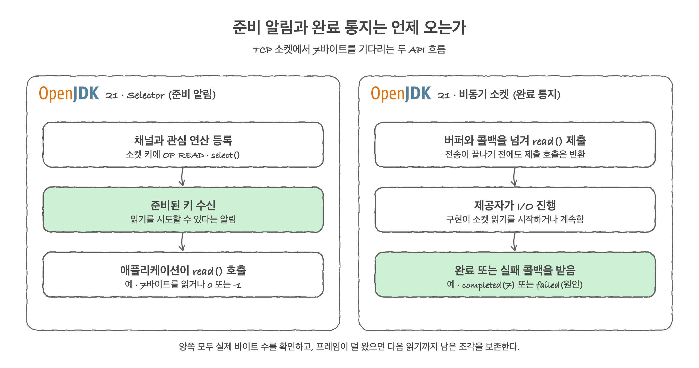
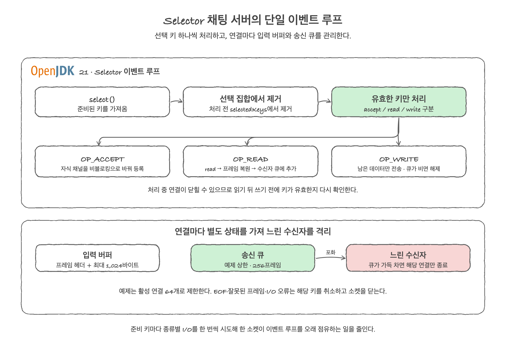
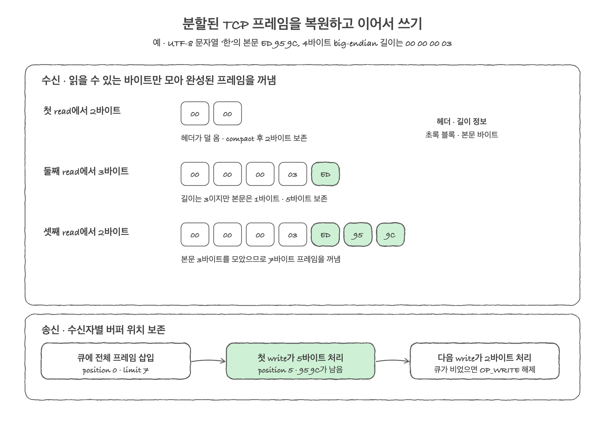
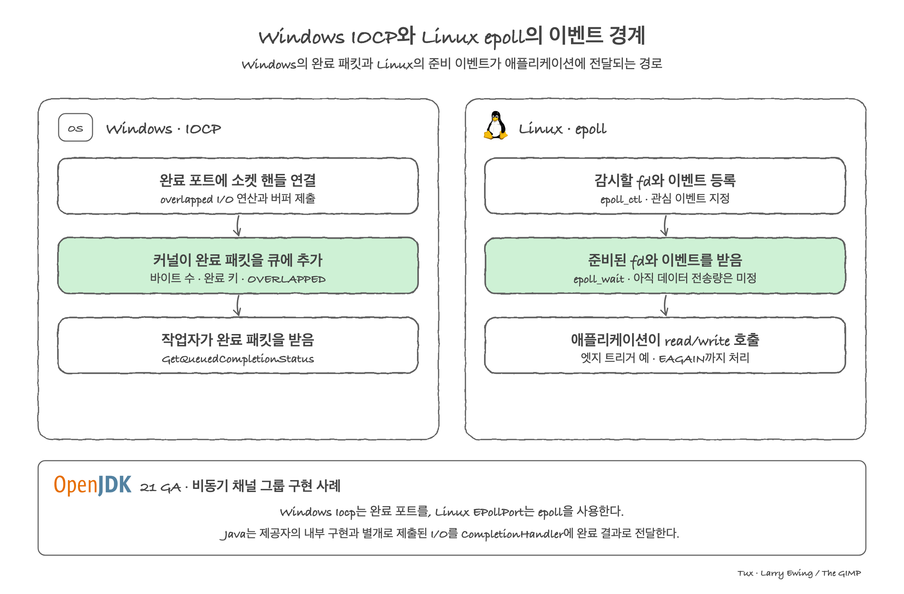
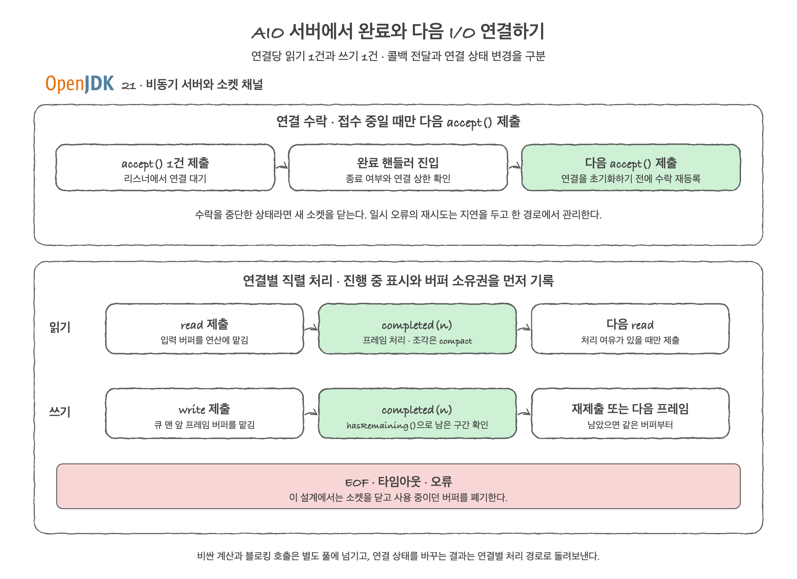
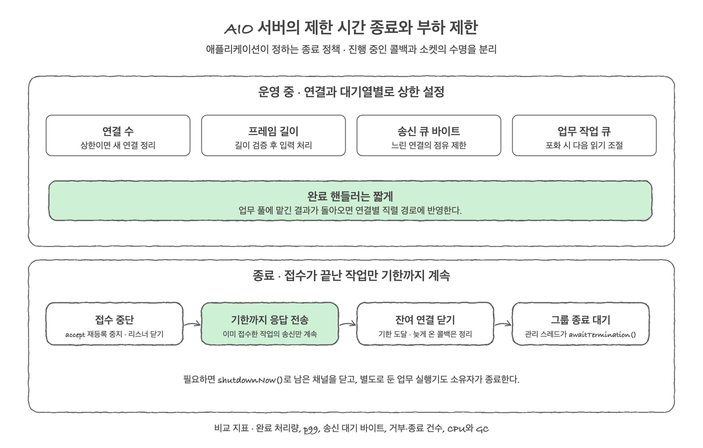

# Selector와 비동기 TCP 서버 설계

## 1. I/O 멀티플렉싱의 기본 원리

I/O 멀티플렉싱은 여러 채널에서 어떤 I/O를 진행할 수 있는지 한 곳에서 기다리는 방식이다. Java 21의 `Selector`에서 리스너는 `OP_ACCEPT`, 연결된 소켓은 보통 `OP_READ`로 등록한다. `SelectionKey`의 관심 집합은 감시할 연산을, 준비 집합은 최근 선택에서 준비됐다고 감지한 연산을 나타낸다. [Java 21 Selector](https://docs.oracle.com/en/java/javase/21/docs/api/java.base/java/nio/channels/Selector.html) · [Java 21 SelectionKey](https://docs.oracle.com/en/java/javase/21/docs/api/java.base/java/nio/channels/SelectionKey.html)



동일한 소켓 입력을 준비 상태 선택과 비동기 완료 처리에서 각각 추적한 예다. [Java 21 Selector](https://docs.oracle.com/en/java/javase/21/docs/api/java.base/java/nio/channels/Selector.html) · [Java 21 SocketChannel](https://docs.oracle.com/en/java/javase/21/docs/api/java.base/java/nio/channels/SocketChannel.html) · [Java 21 AsynchronousSocketChannel](https://docs.oracle.com/en/java/javase/21/docs/api/java.base/java/nio/channels/AsynchronousSocketChannel.html)

준비 상태(readiness) 모델에서는 `select()`가 반환한 뒤 애플리케이션이 직접 `accept`, `read`, `write`를 호출하고 그 결과를 처리한다. 준비 알림은 힌트이므로 논블로킹 `accept()`는 `null`을, `read()`나 `write()`는 `0`을 반환할 수 있다. 완료 통지(completion) 모델에서는 먼저 연산과 버퍼를 제출하고, 이후 완료 시점에 전송 바이트 수나 실패 원인을 받는다. 두 모델 모두 한 번의 I/O에서 처리한 바이트 수를 확인해야 한다. [Java 21 SelectionKey의 준비 집합](https://docs.oracle.com/en/java/javase/21/docs/api/java.base/java/nio/channels/SelectionKey.html) · [Java 21 ServerSocketChannel.accept](https://docs.oracle.com/en/java/javase/21/docs/api/java.base/java/nio/channels/ServerSocketChannel.html#accept()) · [Java 21 SocketChannel](https://docs.oracle.com/en/java/javase/21/docs/api/java.base/java/nio/channels/SocketChannel.html) · [Java 21 AsynchronousSocketChannel](https://docs.oracle.com/en/java/javase/21/docs/api/java.base/java/nio/channels/AsynchronousSocketChannel.html)

단일 Selector 설계에서는 한 이벤트 루프가 채널 등록과 관심 집합 변경, 연결별 버퍼와 큐를 맡는다. 한 연결에 처리할 바이트나 프레임 수를 제한해 다음 키도 처리할 시간을 확보한다. 외부 스레드가 만든 처리 결과가 있다면 작업 큐에 넣고 `selector.wakeup()`으로 루프를 깨운다. 루프가 큐에서 결과를 꺼내 연결 상태에 반영한다. [Java 21 Selector의 동시성 및 wakeup](https://docs.oracle.com/en/java/javase/21/docs/api/java.base/java/nio/channels/Selector.html) · [Linux epoll(7)의 기아 방지](https://man7.org/linux/man-pages/man7/epoll.7.html)

## 2. Selector 기반 단일 스레드 채팅 서버

TCP는 순서가 보장된 바이트 스트림을 제공한다. 송신 측이 한 번에 쓴 메시지가 여러 `read()`에 걸쳐 들어오거나, 여러 메시지가 한 `read()`에 들어올 수 있다. 예제는 `[4바이트 big-endian 본문 길이][1~1,024바이트 본문]`을 한 프레임으로 정의한다. 연결마다 입력 버퍼를 하나 두고, 완성된 프레임을 읽은 뒤 `compact()`로 불완전한 헤더나 본문을 다음 읽기까지 보존한다. [RFC 9293 §2.2 TCP 바이트 스트림](https://www.rfc-editor.org/rfc/rfc9293.html#section-2.2) · [Java 21 ByteBuffer](https://docs.oracle.com/en/java/javase/21/docs/api/java.base/java/nio/ByteBuffer.html)



채팅 예제의 관심 연산과 연결별 버퍼·큐를 한 이벤트 루프에서 관리하는 구조다. [Java 21 Selector의 selectedKeys](https://docs.oracle.com/en/java/javase/21/docs/api/java.base/java/nio/channels/Selector.html#selectedKeys()) · [Java 21 ServerSocketChannel.accept](https://docs.oracle.com/en/java/javase/21/docs/api/java.base/java/nio/channels/ServerSocketChannel.html#accept()) · [Java 21 SelectionKey의 OP_WRITE](https://docs.oracle.com/en/java/javase/21/docs/api/java.base/java/nio/channels/SelectionKey.html#OP_WRITE) · [Java 21 SelectionKey의 키 수명](https://docs.oracle.com/en/java/javase/21/docs/api/java.base/java/nio/channels/SelectionKey.html)

송신자의 프레임을 다른 연결의 송신 큐에 넣고 해당 키에 `OP_WRITE`를 추가한다. 각 수신자는 내용이 같은 프레임을 보되 별도의 버퍼 위치를 갖는다. 한 번의 모아 쓰기(gathering write)로 큐를 앞에서부터 전송한다. 쓰기가 `0`을 반환하거나 일부만 처리하면 전송을 마치지 못한 버퍼를 큐에 남겨 다음 알림에서 이어 간다. 큐가 비는 즉시 `OP_WRITE`를 제거해, 당장 쓸 데이터가 없는 소켓이 쓰기 가능 상태로 반복 통지되는 일을 막는다. [Java 21 SelectionKey의 OP_WRITE](https://docs.oracle.com/en/java/javase/21/docs/api/java.base/java/nio/channels/SelectionKey.html#OP_WRITE) · [Java 21 ByteBuffer.asReadOnlyBuffer](https://docs.oracle.com/en/java/javase/21/docs/api/java.base/java/nio/ByteBuffer.html#asReadOnlyBuffer()) · [Java 21 SocketChannel의 gathering write](https://docs.oracle.com/en/java/javase/21/docs/api/java.base/java/nio/channels/SocketChannel.html#write(java.nio.ByteBuffer%5B%5D,int,int))



4바이트 길이 헤더와 3바이트 본문을 구체적인 16진 값으로 따라가며 부분 읽기와 부분 쓰기를 비교한다. [RFC 9293 §2.2 TCP 바이트 스트림](https://www.rfc-editor.org/rfc/rfc9293.html#section-2.2) · [Java 21 ByteBuffer](https://docs.oracle.com/en/java/javase/21/docs/api/java.base/java/nio/ByteBuffer.html) · [Java 21 SelectionKey의 OP_WRITE](https://docs.oracle.com/en/java/javase/21/docs/api/java.base/java/nio/channels/SelectionKey.html#OP_WRITE)

`SelectorChat.java`로 저장해 `java SelectorChat.java`로 실행한다. 리스너는 `127.0.0.1`의 빈 포트에 바인딩하고 포트 번호를 출력한다. 해당 포트에 두 클라이언트를 연결한 뒤 한쪽에서 프레임을 보내면 다른 쪽에서 같은 프레임을 받을 수 있다. `select()`로 얻은 키는 처리 전에 선택 집합에서 제거한다. 논블로킹 리스너의 `accept()`가 돌려준 자식 채널은 블로킹 모드이므로, `configureBlocking(false)`를 호출한 뒤 `OP_READ`로 등록한다. [Java 21 java 소스 파일 실행 모드](https://docs.oracle.com/en/java/javase/21/docs/specs/man/java.html#using-source-file-mode-to-launch-single-file-source-code-programs) · [Java 21 Selector의 selectedKeys](https://docs.oracle.com/en/java/javase/21/docs/api/java.base/java/nio/channels/Selector.html#selectedKeys()) · [Java 21 ServerSocketChannel.accept](https://docs.oracle.com/en/java/javase/21/docs/api/java.base/java/nio/channels/ServerSocketChannel.html#accept())

```java
import java.io.IOException;
import java.net.InetSocketAddress;
import java.nio.ByteBuffer;
import java.nio.channels.SelectionKey;
import java.nio.channels.Selector;
import java.nio.channels.ServerSocketChannel;
import java.nio.channels.SocketChannel;
import java.util.ArrayDeque;
import java.util.HashSet;
import java.util.List;
import java.util.Set;

class SelectorChat {
    private static final int MAX_CLIENTS = 64;
    private static final int MAX_BODY = 1_024;
    private static final int MAX_QUEUED_FRAMES = 256;

    private static final class Client {
        final ByteBuffer input = ByteBuffer.allocate(Integer.BYTES + MAX_BODY);
        final ArrayDeque<ByteBuffer> output = new ArrayDeque<>();
    }

    private final Set<SelectionKey> clients = new HashSet<>();

    public static void main(String[] args) throws IOException {
        new SelectorChat().run();
    }

    private void run() throws IOException {
        try (var selector = Selector.open(); var listener = ServerSocketChannel.open()) {
            listener.configureBlocking(false);
            listener.bind(new InetSocketAddress("127.0.0.1", 0));
            listener.register(selector, SelectionKey.OP_ACCEPT);
            System.out.println(((InetSocketAddress) listener.getLocalAddress()).getPort());

            try {
                while (!Thread.currentThread().isInterrupted()) {
                    selector.select();
                    var selected = selector.selectedKeys().iterator();
                    while (selected.hasNext()) {
                        var key = selected.next();
                        selected.remove();
                        if (!key.isValid()) {
                            continue;
                        }
                        if (key.isAcceptable()) {
                            accept(listener, selector);
                            continue;
                        }
                        try {
                            if (key.isReadable()) {
                                read(key);
                            }
                            if (key.isValid() && key.isWritable()) {
                                write(key);
                            }
                        } catch (IOException failure) {
                            disconnect(key);
                        }
                    }
                }
            } finally {
                for (var key : List.copyOf(clients)) {
                    disconnect(key);
                }
            }
        }
    }

    private void accept(ServerSocketChannel listener, Selector selector) throws IOException {
        var socket = listener.accept();
        if (socket == null) {
            return;
        }
        if (clients.size() >= MAX_CLIENTS) {
            closeSocket(socket);
            return;
        }
        boolean registered = false;
        try {
            socket.configureBlocking(false);
            clients.add(socket.register(selector, SelectionKey.OP_READ, new Client()));
            registered = true;
        } catch (IOException registrationFailure) {
            // 이 소켓의 등록 실패는 아래에서 정리하고 다음 연결을 받는다.
        } finally {
            if (!registered) {
                closeSocket(socket);
            }
        }
    }

    private void read(SelectionKey key) throws IOException {
        var input = ((Client) key.attachment()).input;
        int count = ((SocketChannel) key.channel()).read(input);
        if (count < 0) {
            disconnect(key);
            return;
        }
        if (count == 0) {
            return;
        }
        input.flip();
        while (input.remaining() >= Integer.BYTES) {
            int length = input.getInt(input.position());
            if (length < 1 || length > MAX_BODY) {
                throw new IOException("Invalid frame length");
            }
            if (input.remaining() - Integer.BYTES < length) {
                break;
            }
            input.getInt();
            var frame = ByteBuffer.allocate(Integer.BYTES + length);
            frame.putInt(length).put(input.slice(input.position(), length)).flip();
            input.position(input.position() + length);
            broadcast(key, frame);
        }
        input.compact();
    }

    private void broadcast(SelectionKey sender, ByteBuffer frame) {
        for (var peer : List.copyOf(clients)) {
            if (peer == sender) {
                continue;
            }
            var output = ((Client) peer.attachment()).output;
            if (output.size() == MAX_QUEUED_FRAMES) {
                disconnect(peer);
                continue;
            }
            output.addLast(frame.asReadOnlyBuffer());
            peer.interestOpsOr(SelectionKey.OP_WRITE);
        }
    }

    private void write(SelectionKey key) throws IOException {
        var output = ((Client) key.attachment()).output;
        if (!output.isEmpty()) {
            ((SocketChannel) key.channel()).write(output.toArray(ByteBuffer[]::new));
        }
        while (!output.isEmpty() && !output.getFirst().hasRemaining()) {
            output.removeFirst();
        }
        if (output.isEmpty()) {
            key.interestOpsAnd(~SelectionKey.OP_WRITE);
        }
    }

    private void disconnect(SelectionKey key) {
        clients.remove(key);
        key.cancel();
        key.attach(null);
        closeSocket((SocketChannel) key.channel());
    }

    private static void closeSocket(SocketChannel socket) {
        try {
            socket.close();
        } catch (IOException ignored) {
            // 예제의 연결 정리 경로.
        }
    }
}
```

예제는 준비된 키마다 `accept`, `read`, `write`를 종류별로 한 번씩 호출한다. 활성 연결은 64개까지, 연결별 송신 큐는 256프레임까지 유지한다. 프레임이 최대 1,028바이트이므로 큐 하나가 참조하는 프레임 데이터의 상한은 263,168바이트다. 커널 소켓 버퍼와 Java 객체의 메모리는 별도다. 수신자가 송신 큐를 비우지 못해 한도를 넘기면 그 연결을 닫는다. 짧은 시간에 메시지가 몰려도 한도에 걸릴 수 있으므로 실제 운영에서는 메시지 크기와 전송률에 맞춰 상한과 초과 정책을 정한다. [Java 21 SocketChannel의 부분 I/O 및 소켓 옵션](https://docs.oracle.com/en/java/javase/21/docs/api/java.base/java/nio/channels/SocketChannel.html) · [Java 21 ByteBuffer의 공유 콘텐츠](https://docs.oracle.com/en/java/javase/21/docs/api/java.base/java/nio/ByteBuffer.html#asReadOnlyBuffer())

예제는 EOF, 잘못된 길이, 연결 I/O 오류에서 소켓을 닫고 남은 송신 큐를 버린다. `cancel()`은 키를 무효화하고 다음 선택에서 등록을 제거한다. 읽기 처리 중 연결이 닫힐 수 있어, 같은 키의 쓰기 알림을 처리하기 전에 `isValid()`를 확인한다. [Java 21 SocketChannel.read](https://docs.oracle.com/en/java/javase/21/docs/api/java.base/java/nio/channels/SocketChannel.html#read(java.nio.ByteBuffer)) · [Java 21 SelectionKey의 키 수명](https://docs.oracle.com/en/java/javase/21/docs/api/java.base/java/nio/channels/SelectionKey.html)

## 3. Windows IOCP와 Linux epoll



커널의 이벤트 의미와 OpenJDK 21 GA의 비동기 채널 제공자 사례를 함께 나타냈다. [Microsoft I/O Completion Ports](https://learn.microsoft.com/en-us/windows/win32/fileio/i-o-completion-ports) · [Linux epoll(7)의 DESCRIPTION, Starvation](https://man7.org/linux/man-pages/man7/epoll.7.html) · [OpenJDK 21 EPollPort](https://raw.githubusercontent.com/openjdk/jdk/jdk-21%2B35/src/java.base/linux/classes/sun/nio/ch/EPollPort.java) · [OpenJDK 21 Iocp](https://raw.githubusercontent.com/openjdk/jdk/jdk-21%2B35/src/java.base/windows/classes/sun/nio/ch/Iocp.java)

- **Windows IOCP**는 overlapped I/O를 지원하는 TCP 소켓 등의 핸들을 완료 포트에 연결한다. I/O를 제출한 뒤 작업자는 `GetQueuedCompletionStatus`에서 완료 패킷을 꺼내 전송 바이트 수와 완료 키, 연산의 `OVERLAPPED` 포인터를 받는다. 포트의 동시성 값은 그 포트와 연관된 실행 가능 스레드 수를 제어한다. [Microsoft I/O Completion Ports](https://learn.microsoft.com/en-us/windows/win32/fileio/i-o-completion-ports) · [Microsoft GetQueuedCompletionStatus](https://learn.microsoft.com/en-us/windows/win32/api/ioapiset/nf-ioapiset-getqueuedcompletionstatus)
- **Linux epoll**은 `epoll_ctl`로 감시할 파일 디스크립터와 관심 이벤트를 등록하고 `epoll_wait`로 준비된 이벤트를 받는다. 애플리케이션이 그 뒤 `read`나 `write`를 수행한다. 기본 레벨 트리거는 준비 상태가 지속되는 동안 알림을 받을 수 있다. `EPOLLET`을 쓰는 엣지 트리거에서는 논블로킹 I/O가 `EAGAIN`을 반환할 때까지 처리한 뒤 새 알림을 기다리는 패턴을 사용한다. 작업량 제한으로 먼저 양보할 경우에는 애플리케이션이 그 디스크립터를 다시 처리할 상태로 보관해야 한다. [Linux epoll(7)의 DESCRIPTION, Starvation](https://man7.org/linux/man-pages/man7/epoll.7.html)

Java는 `Selector`와 비동기 채널에 서로 다른 provider SPI를 제공한다. Java SE 21의 이식 가능한 계약은 준비 상태를 선택하거나 제출한 I/O의 완료를 전달받는 방식까지다. 실제 커널 API는 실행 중인 JDK의 provider 구현에서 확인한다. OpenJDK `jdk-21+35`의 비동기 채널 그룹 구현을 보면 Linux `EPollPort`는 epoll을, Windows `Iocp`는 완료 포트를 사용한다. Linux에서도 JDK가 준비 이벤트를 받아 I/O를 진행한 뒤 Java 애플리케이션에 완료를 전달할 수 있다. [Java 21 SelectorProvider](https://docs.oracle.com/en/java/javase/21/docs/api/java.base/java/nio/channels/spi/SelectorProvider.html#provider()) · [Java 21 AsynchronousChannelProvider](https://docs.oracle.com/en/java/javase/21/docs/api/java.base/java/nio/channels/spi/AsynchronousChannelProvider.html#provider()) · [OpenJDK 21 EPollPort](https://raw.githubusercontent.com/openjdk/jdk/jdk-21%2B35/src/java.base/linux/classes/sun/nio/ch/EPollPort.java) · [OpenJDK 21 Iocp](https://raw.githubusercontent.com/openjdk/jdk/jdk-21%2B35/src/java.base/windows/classes/sun/nio/ch/Iocp.java) · [OpenJDK 21 UnixAsynchronousSocketChannelImpl](https://raw.githubusercontent.com/openjdk/jdk/jdk-21%2B35/src/java.base/unix/classes/sun/nio/ch/UnixAsynchronousSocketChannelImpl.java)

## 4. AIO 기반 고성능 서버 구현



비동기 수락, 읽기 완료, 부분 쓰기 재제출을 연결별 버퍼 소유권과 함께 정리했다. [Java 21 AsynchronousServerSocketChannel의 사용 예와 accept](https://docs.oracle.com/en/java/javase/21/docs/api/java.base/java/nio/channels/AsynchronousServerSocketChannel.html) · [Java 21 AsynchronousSocketChannel의 읽기와 쓰기](https://docs.oracle.com/en/java/javase/21/docs/api/java.base/java/nio/channels/AsynchronousSocketChannel.html) · [Java 21 AsynchronousChannelGroup의 Threading](https://docs.oracle.com/en/java/javase/21/docs/api/java.base/java/nio/channels/AsynchronousChannelGroup.html#threading)

- **다음 연결 수락.** `AsynchronousServerSocketChannel.accept()`는 한 번에 하나만 진행할 수 있다. 성공 콜백에 들어오면 서버가 수락 중인지 확인하고, 새 연결을 초기화하기 전에 다음 `accept()`를 제출한다. 종료가 시작됐다면 들어온 소켓을 닫고 재등록을 멈춘다. 수락 중 일시 오류의 재시도는 지연을 두고 한 경로에서 관리한다. [Java 21 AsynchronousServerSocketChannel의 사용 예와 accept](https://docs.oracle.com/en/java/javase/21/docs/api/java.base/java/nio/channels/AsynchronousServerSocketChannel.html)
- **부분 I/O 처리.** `AsynchronousSocketChannel`은 연결당 읽기 하나와 쓰기 하나를 동시에 진행할 수 있다. 같은 방향에서 두 번째 연산을 시작하면 각각 `ReadPendingException` 또는 `WritePendingException`이 발생한다. 읽기 완료가 `-1`이면 EOF로 처리하고, 받은 바이트로 완성된 프레임을 꺼낸 뒤 보존할 입력이 있으면 `compact()`한다. 쓰기 완료 후 `hasRemaining()`이 참이면 같은 버퍼의 남은 구간을 이어서 제출하고, 모두 보낸 뒤 다음 큐 항목으로 이동한다. [Java 21 AsynchronousSocketChannel의 읽기와 쓰기](https://docs.oracle.com/en/java/javase/21/docs/api/java.base/java/nio/channels/AsynchronousSocketChannel.html) · [Java 21 ByteBuffer.compact](https://docs.oracle.com/en/java/javase/21/docs/api/java.base/java/nio/ByteBuffer.html#compact())
- **연결 상태와 버퍼 소유권.** 작업의 `attachment`에 연결 상태를 연결할 수 있다. 그룹 풀의 여러 스레드에서 콜백이 실행될 수 있으므로, 상태를 변경하는 이벤트는 연결별로 직렬화한다. 그룹 스레드에서 시작한 읽기나 쓰기는 즉시 끝나면 같은 스레드에서 콜백이 호출될 수 있다. 진행 중 플래그와 버퍼 소유권을 제출 전에 기록하고, 직렬 처리 루프에 콜백 결과를 넘겨 중첩 실행을 피한다. 완료 전까지 읽기·쓰기 버퍼는 해당 연산이 소유한다. I/O 타임아웃이 발생하면 연결과 버퍼 상태가 불확실할 수 있으므로 이 설계에서는 소켓을 닫고 그 버퍼는 버린다. [Java 21 CompletionHandler](https://docs.oracle.com/en/java/javase/21/docs/api/java.base/java/nio/channels/CompletionHandler.html) · [Java 21 AsynchronousChannelGroup의 Threading](https://docs.oracle.com/en/java/javase/21/docs/api/java.base/java/nio/channels/AsynchronousChannelGroup.html#threading) · [Java 21 AsynchronousSocketChannel의 Timeouts](https://docs.oracle.com/en/java/javase/21/docs/api/java.base/java/nio/channels/AsynchronousSocketChannel.html#timeouts)
- **부하 제한.** 콜백은 완료 결과 전달과 다음 I/O 결정에 필요한 짧은 작업만 수행한다. 비용이 큰 계산이나 블로킹 DB 호출은 별도의 작업 풀로 넘기고, 결과는 연결의 직렬 처리 경로에서 반영한다. 연결 수, 최대 프레임 크기, 송신 큐 바이트, 업무 작업 큐 길이에 각각 상한을 둔다. 상한에 도달하면 다음 읽기 제출을 일시 중단하거나 느린 연결을 닫는 정책을 적용한다. 작업 풀이 포화됐을 때 완료 스레드가 작업을 대신 수행하는 `CallerRunsPolicy`를 쓰면 콜백 처리도 지연될 수 있다. [Java 21 CompletionHandler 실행 지침](https://docs.oracle.com/en/java/javase/21/docs/api/java.base/java/nio/channels/CompletionHandler.html) · [Java 21 ThreadPoolExecutor의 큐와 거부 정책](https://docs.oracle.com/en/java/javase/21/docs/api/java.base/java/util/concurrent/ThreadPoolExecutor.html)
- **제한 시간을 둔 종료.** 새 작업 접수를 중단하고 리스너를 닫은 뒤, 이미 접수한 작업의 응답은 기한까지 전송하도록 한다. 응답을 모두 보낸 연결은 닫고, 기한이 지나면 남은 연결도 닫는다. 닫힌 연결에 대한 뒤늦은 완료 콜백은 정리만 수행한다. 그룹의 `shutdown()`은 새 채널이 그룹에 바인딩되지 않도록 한다. 그룹이 종료되려면 채널이 모두 닫히고 실행 중인 완료 핸들러가 끝나야 한다. 필요하면 `shutdownNow()`로 남은 채널을 닫고, 관리 스레드에서 `awaitTermination()`으로 종료를 기다린다. 별도 업무 작업 풀도 소유한 쪽에서 종료한다. [Java 21 AsynchronousChannelGroup의 Shutdown and Termination](https://docs.oracle.com/en/java/javase/21/docs/api/java.base/java/nio/channels/AsynchronousChannelGroup.html) · [Java 21 ExecutorService](https://docs.oracle.com/en/java/javase/21/docs/api/java.base/java/util/concurrent/ExecutorService.html)



부하가 몰릴 때의 대기열 정책과 종료 기한이 지났을 때의 정리 순서를 나타냈다. [Java 21 ThreadPoolExecutor의 큐와 거부 정책](https://docs.oracle.com/en/java/javase/21/docs/api/java.base/java/util/concurrent/ThreadPoolExecutor.html) · [Java 21 AsynchronousChannelGroup의 Shutdown and Termination](https://docs.oracle.com/en/java/javase/21/docs/api/java.base/java/nio/channels/AsynchronousChannelGroup.html) · [Java 21 jfr 명령](https://docs.oracle.com/en/java/javase/21/docs/specs/man/jfr.html)

Selector와 AIO 서버의 비교는 같은 프로토콜, 연결 수, 메시지 크기, 송신량에서 시작한다. 평소대로 읽는 수신자와 천천히 읽는 수신자가 섞인 부하에서도 완료 처리량, p99 지연, 대기 중인 송신 바이트, 거부·종료 건수를 함께 기록한다. CPU와 할당·GC는 JFR로 확인하고, 애플리케이션의 큐 지표와 대조해 I/O 처리와 업무 처리 중 어느 쪽에서 대기가 늘어나는지 판단한다. [Java 21 AsynchronousChannelGroup의 스레드 모델](https://docs.oracle.com/en/java/javase/21/docs/api/java.base/java/nio/channels/AsynchronousChannelGroup.html#threading) · [Java 21 jfr 명령](https://docs.oracle.com/en/java/javase/21/docs/specs/man/jfr.html)
