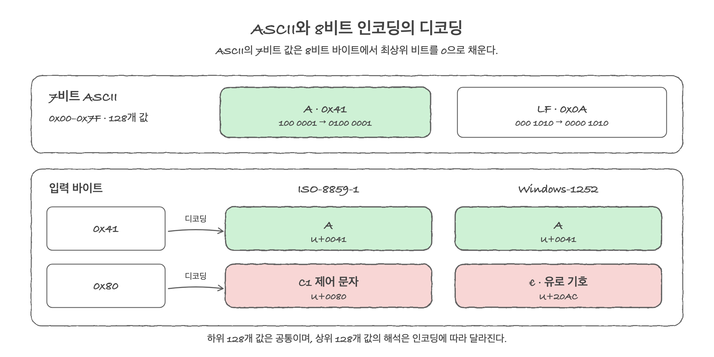
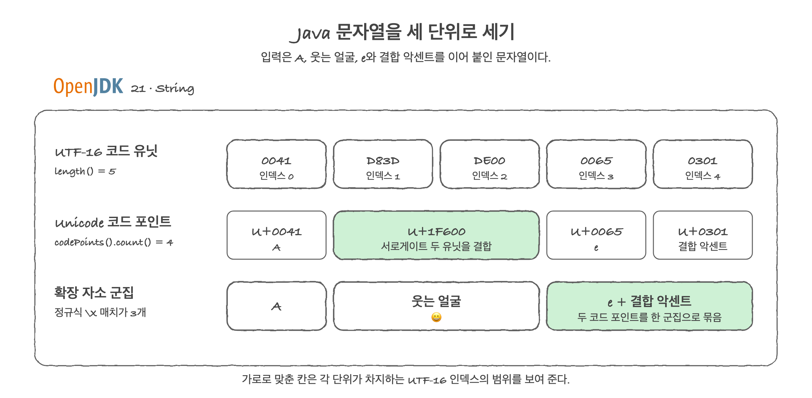
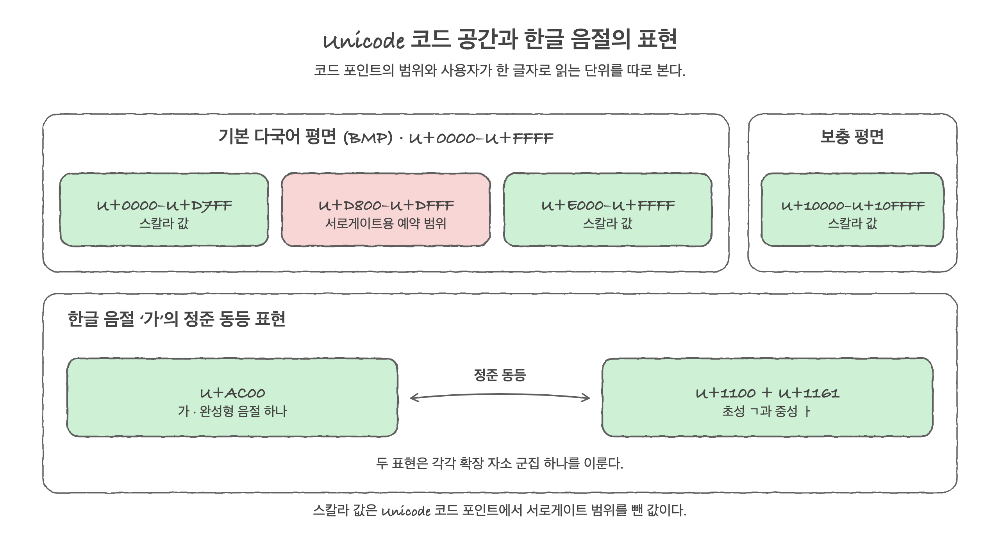

# 문자 코드체계, 문자열과 Unicode 이해하기

## 1. 문자 코드체계와 확장 ASCII

문자 데이터를 저장하거나 전달하려면 문자를 수치로 나타내는 규칙과 그 수치를 바이트로 표현하는 규칙이 필요하다. 인코딩은 문자 데이터를 바이트로 바꾸는 과정이고, 디코딩은 지정한 인코딩의 대응 규칙을 적용해 바이트에서 문자 데이터를 복원하는 과정이다. [Unicode 기술 소개](https://www.unicode.org/standard/principles.html) · [Java 21 Charset](https://docs.oracle.com/en/java/javase/21/docs/api/java.base/java/nio/charset/Charset.html)



두 8비트 매핑에서 ASCII 바이트 0x41과 상위 바이트 0x80을 각각 디코딩한 결과다. [RFC 20 ASCII 코드표](https://www.rfc-editor.org/rfc/rfc20.html) · [Unicode ISO-8859-1 매핑표](https://www.unicode.org/Public/MAPPINGS/ISO8859/8859-1.TXT) · [Microsoft Windows-1252 매핑표](https://www.unicode.org/Public/MAPPINGS/VENDORS/MICSFT/WINDOWS/CP1252.TXT)

ASCII는 7비트로 `0x00`부터 `0x7F`까지 128개 값을 사용한다. 이 범위에는 영문자와 숫자, 문장 부호, 제어 문자가 들어 있다. 예를 들어 대문자 `A`는 `0x41`, 줄 바꿈에 쓰이는 제어 문자 LF는 `0x0A`다. 8비트 바이트에 담으면 최상위 비트는 0이다. [RFC 20 ASCII 코드표](https://www.rfc-editor.org/rfc/rfc20.html)

‘확장 ASCII’는 ASCII의 하위 128개 값을 유지하면서 상위 바이트 값도 사용하는 여러 8비트 인코딩을 가리키는 통칭이다. ISO-8859-1과 Windows-1252의 매핑표에서 `0x41`은 모두 `A`(`U+0041`)지만, `0x80`은 ISO-8859-1에서 C1 제어 문자 `U+0080`, Windows-1252에서 유로 기호 `€`(`U+20AC`)다. 이 차이 때문에 ASCII 범위를 벗어난 바이트를 읽을 때는 데이터가 쓰인 인코딩 이름을 확인해야 한다. [Microsoft 코드 페이지](https://learn.microsoft.com/en-us/globalization/encoding/code-pages) · [Unicode ISO-8859-1 매핑표](https://www.unicode.org/Public/MAPPINGS/ISO8859/8859-1.TXT) · [Microsoft Windows-1252 매핑표](https://www.unicode.org/Public/MAPPINGS/VENDORS/MICSFT/WINDOWS/CP1252.TXT) · [Unicode 18.0 §23.1](https://www.unicode.org/versions/Unicode18.0.0/core-spec/chapter-23/)

## 2. 문자와 문자열

Java 21의 기본 타입 `char`는 부호 없는 16비트 UTF-16 코드 유닛 하나를 담는다. `A`(`U+0041`)는 코드 유닛 `0041` 하나로 표현하고, 보충 평면의 문자 `😀`(`U+1F600`)는 `D83D DE00` 두 코드 유닛으로 표현한다. 앞의 값은 상위 서로게이트, 뒤의 값은 하위 서로게이트다. [Java 21 JLS §4.2](https://docs.oracle.com/javase/specs/jls/se21/html/jls-4.html#jls-4.2) · [Unicode 18.0 §3.8–3.9](https://www.unicode.org/versions/Unicode18.0.0/core-spec/chapter-3/)



같은 문자열에서 서로게이트 쌍을 코드 포인트 하나로, e와 결합 악센트를 자소 군집 하나로 묶는 모습을 보여 준다. [Java 21 String.length](https://docs.oracle.com/en/java/javase/21/docs/api/java.base/java/lang/String.html#length()) · [Java 21 String.codePoints](https://docs.oracle.com/en/java/javase/21/docs/api/java.base/java/lang/String.html#codePoints()) · [Unicode UAX #29 §3](https://www.unicode.org/reports/tr29/tr29-49.html#Grapheme_Cluster_Boundaries)

`String.length()`는 UTF-16 코드 유닛 수를 반환하고 `charAt(i)`는 해당 인덱스의 코드 유닛을 반환한다. `codePoints()`는 서로게이트 쌍을 하나의 `int` 코드 포인트로 합친다. 쌍을 이루지 않은 서로게이트는 그 유닛의 수치가 그대로 스트림에 포함되므로, `codePoints()`를 호출하는 것만으로 문자열의 UTF-16 유효성이 보장되지는 않는다. [Java 21 String.length](https://docs.oracle.com/en/java/javase/21/docs/api/java.base/java/lang/String.html#length()) · [Java 21 String.charAt](https://docs.oracle.com/en/java/javase/21/docs/api/java.base/java/lang/String.html#charAt(int)) · [Java 21 String.codePoints](https://docs.oracle.com/en/java/javase/21/docs/api/java.base/java/lang/String.html#codePoints()) · [Unicode 18.0 §3.9](https://www.unicode.org/versions/Unicode18.0.0/core-spec/chapter-3/)

사용자가 한 글자로 인식하는 단위는 확장 자소 군집(extended grapheme cluster)으로 근사할 수 있다. 예를 들어 기본 문자 `e`(`U+0065`) 뒤에 결합 악센트(`U+0301`)를 붙이면 두 코드 포인트가 한 군집을 이룬다. 다음 예제를 `TextUnits.java`로 저장하고 JDK 21에서 `java TextUnits.java`로 실행한다. `Pattern`의 `\X`는 확장 자소 군집 하나에 일치한다. [Unicode UAX #29 §3](https://www.unicode.org/reports/tr29/tr29-49.html#Grapheme_Cluster_Boundaries) · [Java 21 Pattern의 Unicode 지원](https://docs.oracle.com/en/java/javase/21/docs/api/java.base/java/util/regex/Pattern.html#unicode) · [Java 21 소스 파일 실행 모드](https://docs.oracle.com/en/java/javase/21/docs/specs/man/java.html#using-source-file-mode-to-launch-single-file-source-code-programs)

```java
import java.util.regex.Pattern;

class TextUnits {
    public static void main(String[] args) {
        String text = "A\uD83D\uDE00e\u0301";

        System.out.println("UTF-16 code units: " + text.length());
        System.out.println("Unicode code points: " + text.codePoints().count());
        System.out.println("Extended grapheme clusters: "
                + Pattern.compile("\\X").matcher(text).results().count());
    }
}
```

```text
UTF-16 code units: 5
Unicode code points: 4
Extended grapheme clusters: 3
```

## 3. Unicode

Unicode는 여러 문자 체계의 문자를 공통 코드 공간에서 다룬다. 코드 포인트는 `U+0000`부터 `U+10FFFF`까지의 수치를 말한다. 이 범위에는 문자에 배정된 위치와 아직 배정되지 않은 위치, 서로게이트에 예약된 위치 등이 있다. UTF-8, UTF-16, UTF-32는 Unicode 스칼라 값을 각각의 코드 유닛 시퀀스로 변환하는 인코딩 형식이다. [Unicode 18.0 §3.4, §3.9](https://www.unicode.org/versions/Unicode18.0.0/core-spec/chapter-3/)



코드 공간에서 서로게이트 범위를 구분하고, 정준 동등한 두 가지 한글 음절 표현을 비교한다. [Unicode 18.0 §3.4, §3.8, §3.9.2](https://www.unicode.org/versions/Unicode18.0.0/core-spec/chapter-3/) · [Unicode UAX #15 §1.1–1.2](https://www.unicode.org/reports/tr15/tr15-58.html#Canon_Compat_Equivalence)

Unicode 스칼라 값은 전체 코드 포인트 중 `U+D800`부터 `U+DFFF`까지의 서로게이트 범위를 제외한 값이다. 기본 다국어 평면(BMP)은 `U+0000`부터 `U+FFFF`까지다. 이 평면의 스칼라 값은 UTF-16 코드 유닛 하나로, `U+10000`부터 `U+10FFFF`까지의 스칼라 값은 상위·하위 서로게이트 코드 유닛 한 쌍으로 표현한다. [Unicode 18.0 §3.4, §3.8, §3.9.2](https://www.unicode.org/versions/Unicode18.0.0/core-spec/chapter-3/) · [Java 21 Character](https://docs.oracle.com/en/java/javase/21/docs/api/java.base/java/lang/Character.html)

하나의 글자를 여러 코드 포인트 시퀀스로 나타낼 수도 있다. 한글 `가`는 완성형 음절 `U+AC00` 하나 또는 초성 `U+1100`과 중성 `U+1161`을 잇는 두 코드 포인트로 표현할 수 있다. 두 시퀀스는 정준 동등하고 기본 분할 규칙에서 각각 확장 자소 군집 하나를 이룬다. `String.equals()`는 시퀀스를 그대로 비교하므로, 이 두 표현을 같은 값으로 비교해야 한다면 양쪽을 같은 정규화 형식으로 변환한 뒤 비교할 수 있다. [Unicode UAX #15 §1.1–1.2](https://www.unicode.org/reports/tr15/tr15-58.html#Canon_Compat_Equivalence) · [Unicode UAX #29 §3.1.1](https://www.unicode.org/reports/tr29/tr29-49.html#Grapheme_Cluster_Boundary_Rules) · [Java 21 String.equals](https://docs.oracle.com/en/java/javase/21/docs/api/java.base/java/lang/String.html#equals(java.lang.Object)) · [Java 21 Normalizer](https://docs.oracle.com/en/java/javase/21/docs/api/java.base/java/text/Normalizer.html)
