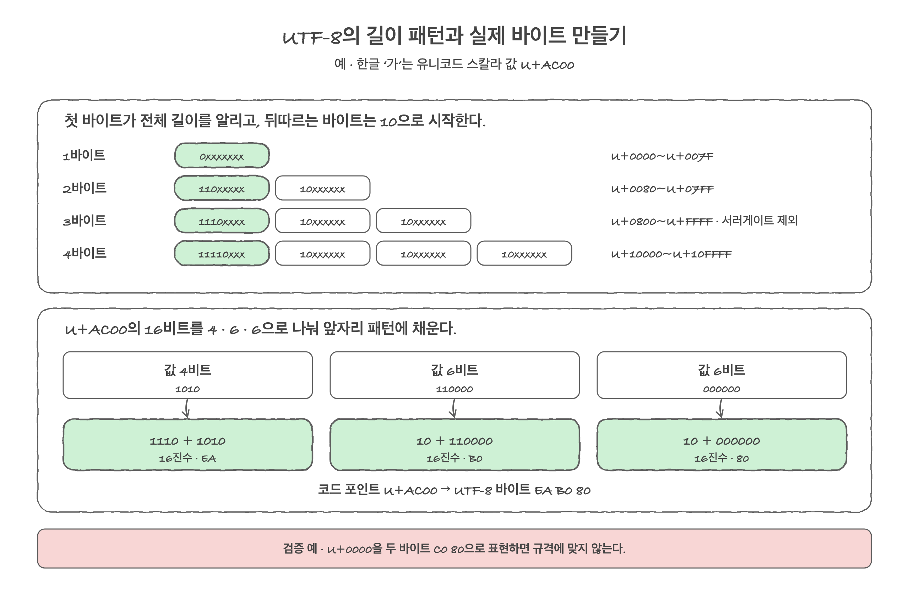
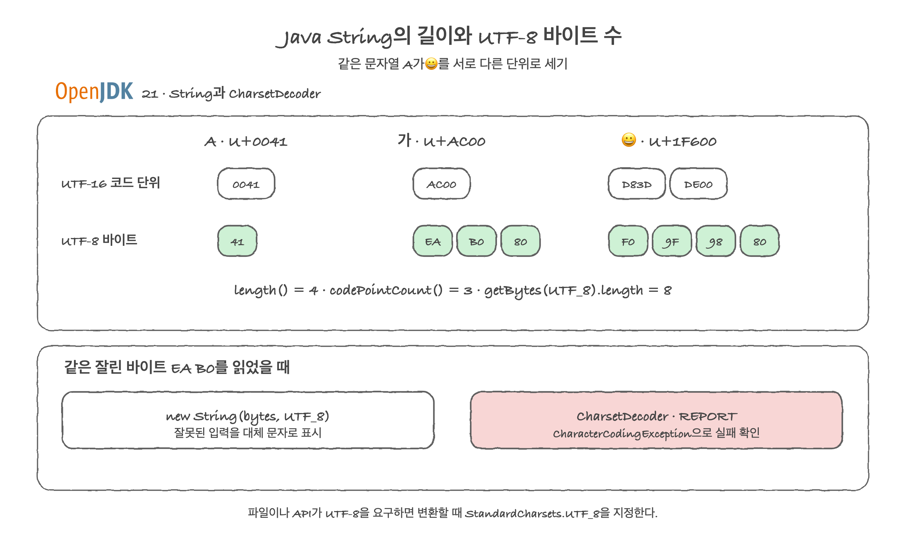
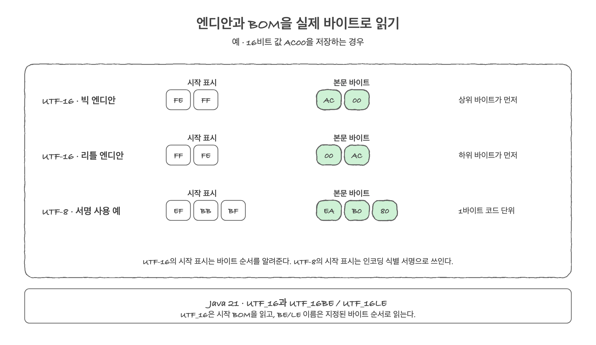
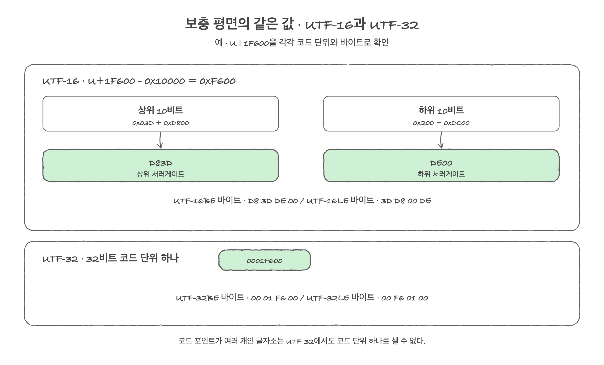

# UTF 인코딩과 Java에서 바이트 다루기

같은 유니코드 스칼라 값을 UTF-8·UTF-16·UTF-32에서 각각 어떤 코드 단위와 바이트로 표현하는지 살펴본다. Java 예제는 JDK 21을 기준으로 한다. [Unicode 18 핵심 명세 §3.9](https://www.unicode.org/versions/Unicode18.0.0/core-spec/chapter-3/) · [JDK 21 Charset](https://docs.oracle.com/en/java/javase/21/docs/api/java.base/java/nio/charset/Charset.html)

## 1. UTF-8 규칙과 바이트 분해

UTF-8은 유니코드 스칼라 값 하나를 1~4바이트로 나타낸다. ASCII 범위에서는 값이 같은 1바이트를 쓴다. 그 밖에서는 첫 바이트의 `110`·`1110`·`11110` 패턴이 각각 전체 길이 2·3·4를 나타내고, 이어지는 각 바이트는 `10`으로 시작한다. [RFC 3629 §3](https://www.rfc-editor.org/rfc/rfc3629.html#section-3) · [Unicode 18 핵심 명세 §3.9](https://www.unicode.org/versions/Unicode18.0.0/core-spec/chapter-3/)



UTF-8의 길이 패턴과 U+AC00이 바이트 세 개로 만들어지는 과정을 비교했다. [RFC 3629 §3](https://www.rfc-editor.org/rfc/rfc3629.html#section-3) · [Unicode 18 핵심 명세 §3.9](https://www.unicode.org/versions/Unicode18.0.0/core-spec/chapter-3/)

`가`는 `U+AC00`이다. 3바이트 패턴의 값 자리 4·6·6비트에 `1010 110000 000000`을 넣으면 `11101010 10110000 10000000`, 즉 `EA B0 80`이 된다. 예를 들어 `A`는 `41`, `😀`는 `F0 9F 98 80`으로 인코딩된다. [RFC 3629 §3–4](https://www.rfc-editor.org/rfc/rfc3629.html#section-3) · [Unicode 18 핵심 명세 §3.9](https://www.unicode.org/versions/Unicode18.0.0/core-spec/chapter-3/)

규격에 맞는 디코더는 필요한 바이트 수와 접두 패턴을 검사한다. 동일 값을 더 긴 형식으로 표현한 바이트열, 서러게이트 범위, `U+10FFFF`를 넘는 값, 중간에 끝난 바이트열은 정상 UTF-8로 해석할 수 없다. 예를 들어 널 문자 `U+0000`은 `00`으로만 표현하며 `C0 80`은 표준 UTF-8에서 유효하지 않다. [RFC 3629 §3–4](https://www.rfc-editor.org/rfc/rfc3629.html#section-4) · [Unicode 18 핵심 명세 §3.9](https://www.unicode.org/versions/Unicode18.0.0/core-spec/chapter-3/)

## 2. Java String과 UTF-8 변환

Java `String`의 `length()`는 UTF-16 코드 단위 수를 반환하고, UTF-8 바이트 수는 `getBytes(StandardCharsets.UTF_8).length`로 구한다. JDK 21은 기본 문자셋으로 UTF-8을 사용하며 구현별 설정에 따라 바뀔 수 있다. 파일이나 API가 UTF-8을 요구하면 변환하는 경계에서 명시한다. [JDK 21 String](https://docs.oracle.com/en/java/javase/21/docs/api/java.base/java/lang/String.html) · [JDK 21 Charset.defaultCharset](https://docs.oracle.com/en/java/javase/21/docs/api/java.base/java/nio/charset/Charset.html#defaultCharset()) · [JDK 21 StandardCharsets](https://docs.oracle.com/en/java/javase/21/docs/api/java.base/java/nio/charset/StandardCharsets.html)



같은 문자열의 길이와 바이트 수를 비교하고, 잘못된 입력을 처리하는 두 Java API를 나타냈다. [JDK 21 String](https://docs.oracle.com/en/java/javase/21/docs/api/java.base/java/lang/String.html) · [JDK 21 CharsetDecoder](https://docs.oracle.com/en/java/javase/21/docs/api/java.base/java/nio/charset/CharsetDecoder.html) · [JDK 21 StandardCharsets](https://docs.oracle.com/en/java/javase/21/docs/api/java.base/java/nio/charset/StandardCharsets.html)

입력에 잘못된 UTF-8이 있어도 `new String(bytes, UTF_8)`은 대체 문자를 사용한다. 형식 오류를 발견하면 처리 자체를 중단해야 하는 경계에는 `CharsetDecoder`의 `REPORT`를 지정한다. Java 데이터 스트림의 `readUTF()`·`writeUTF()`는 본문 앞에 길이를 두고 수정 UTF-8을 읽고 쓰므로, 상대가 요구하는 형식을 먼저 확인한다. [JDK 21 String(byte[], Charset)](https://docs.oracle.com/en/java/javase/21/docs/api/java.base/java/lang/String.html#%3Cinit%3E(byte%5B%5D,java.nio.charset.Charset)) · [JDK 21 CharsetDecoder](https://docs.oracle.com/en/java/javase/21/docs/api/java.base/java/nio/charset/CharsetDecoder.html) · [JDK 21 DataInput · Modified UTF-8](https://docs.oracle.com/en/java/javase/21/docs/api/java.base/java/io/DataInput.html#modified-utf-8)

다음 예제에서 같은 `A가😀`가 UTF-16 코드 단위 4개, 코드 포인트 3개, UTF-8 바이트 8개로 관측된다. 잘린 `EA B0`를 엄격한 디코더에 넘기면 실패를 확인할 수 있다. [JDK 21 String](https://docs.oracle.com/en/java/javase/21/docs/api/java.base/java/lang/String.html) · [JDK 21 CharsetDecoder](https://docs.oracle.com/en/java/javase/21/docs/api/java.base/java/nio/charset/CharsetDecoder.html) · [RFC 3629 §4](https://www.rfc-editor.org/rfc/rfc3629.html#section-4)

```java
import java.nio.ByteBuffer;
import java.nio.charset.CharacterCodingException;
import java.nio.charset.CodingErrorAction;
import java.util.HexFormat;

import static java.nio.charset.StandardCharsets.UTF_8;

public class Utf8Inspection {
    public static void main(String[] args) throws CharacterCodingException {
        String text = "A가😀";
        byte[] bytes = text.getBytes(UTF_8);
        var hex = HexFormat.ofDelimiter(" ").withUpperCase();
        System.out.printf("UTF-16 units=%d, code points=%d, UTF-8 bytes=%d%n",
                text.length(), text.codePointCount(0, text.length()), bytes.length);
        System.out.println(hex.formatHex(bytes));

        var decoder = UTF_8.newDecoder().onMalformedInput(CodingErrorAction.REPORT);
        System.out.println(decoder.decode(ByteBuffer.wrap(bytes)));
        try {
            UTF_8.newDecoder().onMalformedInput(CodingErrorAction.REPORT)
                    .decode(ByteBuffer.wrap(hex.parseHex("EA B0")));
            throw new AssertionError("Expected malformed UTF-8");
        } catch (CharacterCodingException expected) {
            System.out.println("Malformed UTF-8 rejected");
        }
    }
}
```

```sh
javac --release 21 -encoding UTF-8 Utf8Inspection.java
java Utf8Inspection
```

## 3. 엔디안과 BOM

16비트 값 `AC00`을 바이트로 옮길 때 빅 엔디안은 상위 바이트부터 `AC 00`으로, 리틀 엔디안은 하위 바이트부터 `00 AC`로 기록한다. UTF-8의 코드 단위는 1바이트라서 바이트 순서를 선택하는 문제가 생기지 않는다. [Unicode Consortium UTF·BOM FAQ](https://www.unicode.org/faq/utf_bom.html) · [JDK 21 Charset · Byte order marks](https://docs.oracle.com/en/java/javase/21/docs/api/java.base/java/nio/charset/Charset.html)



같은 코드 포인트를 바이트 순서별로 나란히 놓고, BOM이 붙는 위치를 표시했다. [Unicode Consortium UTF·BOM FAQ](https://www.unicode.org/faq/utf_bom.html) · [JDK 21 Charset · Byte order marks](https://docs.oracle.com/en/java/javase/21/docs/api/java.base/java/nio/charset/Charset.html)

BOM은 스트림 맨 앞에 놓인 `U+FEFF` 표현이다. UTF-16에서 `FE FF`와 `FF FE`로 바이트 순서를 알려줄 수 있다. UTF-8의 `EF BB BF`는 바이트 순서를 구분할 필요가 없어서 인코딩 식별 서명으로 쓰인다. 허용 여부는 형식마다 다르며, 예를 들어 네트워크로 전송하는 JSON에는 BOM을 덧붙이지 않는 규칙이 있다. [Unicode Consortium UTF·BOM FAQ](https://www.unicode.org/faq/utf_bom.html) · [RFC 8259 §8.1](https://www.rfc-editor.org/rfc/rfc8259.html#section-8.1)

JDK 21에서 `UTF_16`은 디코딩할 때 맨 앞 BOM이 있으면 바이트 순서를 선택하고, 없으면 빅 엔디안으로 읽는다. 인코딩할 때는 빅 엔디안 BOM을 붙인다. `UTF_16BE`와 `UTF_16LE`는 이미 바이트 순서를 정한 이름으로, 인코딩 시 BOM을 쓰지 않고 디코딩 시 맨 앞 표시를 바이트 순서 신호로 소비하지 않는다. [JDK 21 Charset · Byte order marks](https://docs.oracle.com/en/java/javase/21/docs/api/java.base/java/nio/charset/Charset.html)

## 4. UTF-16과 UTF-32의 코드 단위

UTF-16은 BMP의 스칼라 값을 16비트 코드 단위 하나로 표현하며, 보충 평면의 스칼라 값은 상위·하위 서러게이트 두 개로 표현한다. 예를 들어 `U+1F600`에서 `0x10000`을 뺀 값을 상위·하위 10비트로 나누면 `0x03D`와 `0x200`이다. 여기에 각각 `0xD800`과 `0xDC00`을 더해 `D83D DE00`을 얻는다. 단독 서러게이트는 올바른 UTF-16 코드 단위열을 이루지 않는다. [Unicode 18 핵심 명세 §3.9](https://www.unicode.org/versions/Unicode18.0.0/core-spec/chapter-3/) · [Unicode Consortium UTF·BOM FAQ](https://www.unicode.org/faq/utf_bom.html)



보충 평면 값 하나를 UTF-16 서러게이트 쌍으로 계산하고 UTF-32 코드 단위와 비교했다. [Unicode 18 핵심 명세 §3.9](https://www.unicode.org/versions/Unicode18.0.0/core-spec/chapter-3/) · [Unicode Consortium UTF·BOM FAQ](https://www.unicode.org/faq/utf_bom.html) · [Unicode UAX #29 · Grapheme Cluster Boundaries](https://www.unicode.org/reports/tr29/#Grapheme_Cluster_Boundaries)

UTF-32는 스칼라 값 하나를 32비트 코드 단위 하나로 표현한다. 같은 `😀`는 UTF-16BE에서 `D8 3D DE 00`, UTF-32BE에서 `00 01 F6 00`이다. 보이는 문자 하나가 여러 코드 포인트로 구성될 수 있으므로 화면에서 인식하는 문자 수는 고정 길이 코드 단위만으로 구할 수 없다. [Unicode 18 핵심 명세 §3.9](https://www.unicode.org/versions/Unicode18.0.0/core-spec/chapter-3/) · [Unicode UAX #29 · Grapheme Cluster Boundaries](https://www.unicode.org/reports/tr29/#Grapheme_Cluster_Boundaries)
