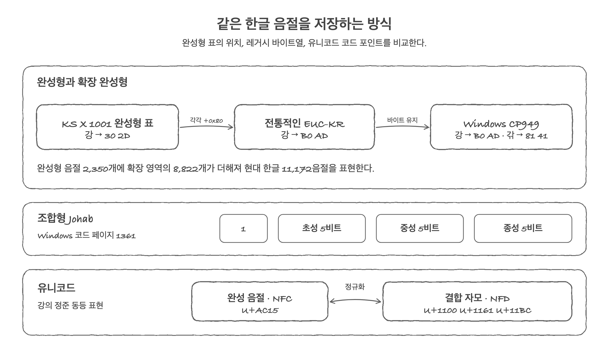
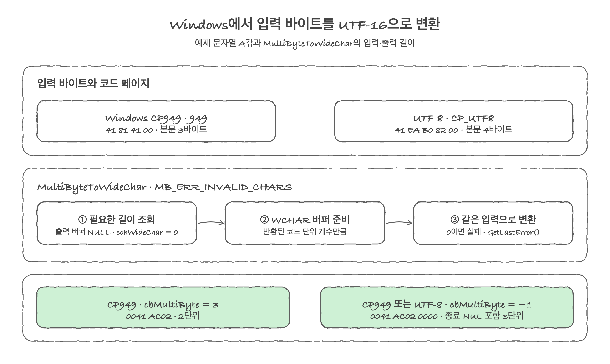

# 한글 인코딩과 Windows MBCS 이해하기

## 1. 완성형·조합형·확장의 역사

완성형은 미리 고른 음절마다 코드 위치를 배정한다. KS X 1001의 전신인 KS C 5601:1987은 한글 완성형 음절 2,350개를 배정했다. 전통적인 EUC-KR은 문자 집합의 위치를 바이트로 옮기는 방식이다. 예를 들어 KS X 1001 표의 `30 2D`에 있는 `강`을 EUC-KR로 표현하면 각 값에 `0x80`을 더한 `B0 AD`가 된다. [국립국어원 한글 코드의 역사 §7](https://www.korean.go.kr/nkview/nklife/2015_2/25_0205.pdf) · [공공 정보시스템 한글 처리 가이드라인의 EUC-KR 예제](https://m.korea.kr/expertWeb/resources/files/data/document_file/2010/%EA%B3%B5%EA%B3%B5%20%EC%A0%95%EB%B3%B4%EC%8B%9C%EC%8A%A4%ED%85%9C%20%ED%95%9C%EA%B8%80%20%EC%B2%98%EB%A6%AC%20%EA%B0%80%EC%9D%B4%EB%93%9C%EB%9D%BC%EC%9D%B8.pdf)



강과 갂으로 완성형의 확장, Johab의 비트 구성, 유니코드 정규화의 차이를 비교한다. [국립국어원 한글 코드의 역사 §7](https://www.korean.go.kr/nkview/nklife/2015_2/25_0205.pdf) · [Oracle Solaris 공통 데스크탑 환경의 조합형 형식](https://docs.oracle.com/cd/E19620-01/805-5461/6j55ipssd/index.html) · [Microsoft CP949 매핑표 2.01](https://www.unicode.org/Public/MAPPINGS/VENDORS/MICSFT/WINDOWS/CP949.TXT) · [Unicode 18.0 §3.9·§3.12](https://www.unicode.org/versions/Unicode18.0.0/core-spec/chapter-3/)

조합형(Johab)은 음절을 이루는 초성·중성·종성의 값을 2바이트 안의 비트 필드에 넣는다. 한글 음절의 최상위 비트는 `1`이고 나머지 15비트는 초성·중성·종성에 각각 5비트씩 배정한다. KS C 5601:1992의 Johab은 현대 한글 11,172음절을 표현하며 Windows에서는 별도 코드 페이지 `1361`로 식별한다. [Oracle Solaris 공통 데스크탑 환경의 조합형 형식](https://docs.oracle.com/cd/E19620-01/805-5461/6j55ipssd/index.html) · [Unicode 18.0 §18.6.5 Hangul Syllables](https://www.unicode.org/versions/Unicode18.0.0/core-spec/chapter-18/) · [Windows 코드 페이지 식별자](https://learn.microsoft.com/en-us/windows/win32/intl/code-page-identifiers)

Windows 코드 페이지 949(CP949, Unified Hangul Code)는 기존 완성형 음절의 바이트를 유지하고 나머지 8,822음절에 2바이트 코드를 배정했다. 예를 들어 `B0 AD`는 여전히 `강`(`U+AC15`)이며, `81 41`은 확장 영역의 `갂`(`U+AC02`)이다. 기본 완성형 표에는 `갂`의 단일 음절 자리가 없다. 레거시 EUC-KR에서 쓰인 채움 문자 방식은 이 음절을 `A4 D4 A4 A1 A4 BF A4 A2`로 표현한다. 이 조합을 음절 하나로 복원하는 동작은 디코더에 따라 확인해야 한다. [국립국어원 한글 코드의 역사 §8](https://www.korean.go.kr/nkview/nklife/2015_2/25_0205.pdf) · [Microsoft CP949 매핑표 2.01](https://www.unicode.org/Public/MAPPINGS/VENDORS/MICSFT/WINDOWS/CP949.TXT) · [Unicode 기술위원회 문서 L2/17-081의 첫 번째 매핑 예](https://www.unicode.org/L2/L2017/17081-hangul-filler.pdf)

IANA는 `KS_C_5601-1987`과 `EUC-KR`을 별도 항목으로 등록한다. WHATWG 웹 표준에서 `euc-kr`, `ks_c_5601-1987`, `windows-949`는 모두 확장 매핑을 포함하는 `EUC-KR` 디코더로 연결된다. 이 디코더는 `81 41`을 `갂`으로 읽는다. 파일이나 프로토콜에서 `EUC-KR`이라는 이름을 만나면 생산자가 사용한 규격과 디코더를 함께 확인한다. [IANA Character Sets](https://www.iana.org/assignments/character-sets/character-sets.xhtml) · [WHATWG 인코딩 이름과 라벨](https://encoding.spec.whatwg.org/#names-and-labels) · [WHATWG EUC-KR 디코더](https://encoding.spec.whatwg.org/#euc-kr-decoder) · [WHATWG EUC-KR 인덱스의 항목 0](https://encoding.spec.whatwg.org/index-euc-kr.txt)

Unicode 18.0은 현대 한글 11,172음절을 `U+AC00`부터 `U+D7A3`까지 배정한다. `강`은 완성 음절 `U+AC15` 하나로도, 결합 자모 `U+1100 U+1161 U+11BC`로도 표현할 수 있다. 두 표현은 정준 동등하며, 이 음절에 NFC를 적용하면 완성 음절 하나가 되고 NFD를 적용하면 세 자모가 된다. 이때 각 코드 포인트를 어떤 바이트로 저장할지는 UTF-8이나 UTF-16 같은 인코딩이 정한다. [Unicode 18.0 §3.9·§3.12](https://www.unicode.org/versions/Unicode18.0.0/core-spec/chapter-3/) · [Unicode 18.0 UAX #15 정규화 형태](https://www.unicode.org/reports/tr15/tr15-58.html#Norm_Forms)

## 2. MBCS와 Windows C

Microsoft C/C++ 문서에서 MBCS(Multibyte Character Set)는 레거시 멀티바이트 문자 처리를 가리킨다. CP949 같은 DBCS에서는 1바이트 문자와 2바이트 문자가 섞인다. CP949에서 `A갂`은 `41 81 41`이다. 첫 `41`은 단독으로 `A`이고, 끝 `41`은 선행 바이트 `81`과 함께 `갂`을 이룬다. C 문자열 `41 81 41 00`에 대한 `strlen`은 종료 NUL 앞의 3바이트를 센다. 바이트 수를 글자 수나 잘라낼 위치로 그대로 쓰면 `81`과 그 뒤의 `41`을 나눌 수 있다. [Microsoft C++ MBCS 지원](https://learn.microsoft.com/en-us/cpp/text/support-for-multibyte-character-sets-mbcss?view=msvc-170) · [Microsoft CP949 매핑표 2.01](https://www.unicode.org/Public/MAPPINGS/VENDORS/MICSFT/WINDOWS/CP949.TXT) · [Microsoft C 런타임 `strlen`](https://learn.microsoft.com/en-us/cpp/c-runtime-library/reference/strlen-wcslen-mbslen-mbslen-l-mbstrlen-mbstrlen-l?view=msvc-170)



입력 길이는 바이트로, 출력 버퍼 용량과 반환값은 UTF-16 코드 단위로 센다. [Microsoft `MultiByteToWideChar` 매개변수 및 반환값](https://learn.microsoft.com/en-us/windows/win32/api/stringapiset/nf-stringapiset-multibytetowidechar) · [Microsoft `MultiByteToWideChar`의 `cbMultiByte`와 `cchWideChar`](https://learn.microsoft.com/en-us/windows/win32/api/stringapiset/nf-stringapiset-multibytetowidechar#parameters) · [Microsoft CP949 매핑표 2.01](https://www.unicode.org/Public/MAPPINGS/VENDORS/MICSFT/WINDOWS/CP949.TXT)

`CP_ACP`는 Windows의 현재 ANSI 코드 페이지를 사용한다. 이 값은 시스템 설정에 따라 달라지며 Windows 10 버전 1903부터 앱 매니페스트의 `activeCodePage`로 프로세스가 UTF-8을 쓰도록 설정할 수도 있다. 파일이나 네트워크의 인코딩이 이미 정해져 있다면 `MultiByteToWideChar`에 CP949는 `949`, UTF-8은 `CP_UTF8`을 넘긴다. 변환 결과는 Win32의 `WCHAR` 버퍼에 담긴 UTF-16 코드 단위이며 `W` 계열 API가 이 표현을 받는다. 보충 평면의 코드 포인트 하나는 UTF-16에서 코드 단위 두 개를 쓴다. [Microsoft `GetACP`](https://learn.microsoft.com/en-us/windows/win32/api/winnls/nf-winnls-getacp) · [Microsoft Windows 앱의 UTF-8 코드 페이지와 Win32 A/W API](https://learn.microsoft.com/en-us/windows/apps/design/globalizing/use-utf8-code-page) · [Unicode 18.0 §3.9.2 UTF-16](https://www.unicode.org/versions/Unicode18.0.0/core-spec/chapter-3/)

`MultiByteToWideChar`를 처음 호출할 때 출력 버퍼를 `NULL`, `cchWideChar`를 `0`으로 두면 필요한 `WCHAR` 개수를 얻는다. 그 개수만큼 버퍼를 준비하고 같은 코드 페이지, 플래그, 입력으로 다시 호출한다. 두 호출 모두 반환값 `0`은 실패이며 즉시 `GetLastError()`로 원인을 확인한다. `MB_ERR_INVALID_CHARS`를 지정하면 잘못된 바이트열을 오류로 처리한다. `CP_UTF8`에서 허용되는 플래그 값은 `0`과 `MB_ERR_INVALID_CHARS`다. [Microsoft `MultiByteToWideChar` 매개변수 및 반환값](https://learn.microsoft.com/en-us/windows/win32/api/stringapiset/nf-stringapiset-multibytetowidechar)

`cbMultiByte`의 양수는 읽을 바이트 수다. 입력 범위에 종료 NUL이 없으면 출력에도 종료 NUL이 추가되지 않는다. `-1`은 NUL로 끝나는 입력에 사용하며 필요한 용량과 실제 기록 개수 모두 종료 NUL을 포함한다. `0`은 오류이므로 바이트 길이 `0`을 허용하는 호출자는 빈 입력을 별도로 처리한다. [Microsoft `MultiByteToWideChar`의 `cbMultiByte`와 `cchWideChar`](https://learn.microsoft.com/en-us/windows/win32/api/stringapiset/nf-stringapiset-multibytetowidechar#parameters)

다음 Win32 C 예제는 `A갂`을 CP949와 UTF-8로 각각 준비한다. 원문 매핑과 API 계약에 따르면 CP949의 3바이트 길이를 넘긴 호출은 `0041 AC02` 두 단위, `-1`을 넘긴 호출은 `0041 AC02 0000` 세 단위를 출력한다. UTF-8의 `41 EA B0 82 00`에도 `-1`을 넘기면 같은 세 단위를 얻는다. [Microsoft CP949 매핑표 2.01](https://www.unicode.org/Public/MAPPINGS/VENDORS/MICSFT/WINDOWS/CP949.TXT) · [Unicode 18.0 §3.9.3 UTF-8](https://www.unicode.org/versions/Unicode18.0.0/core-spec/chapter-3/) · [Microsoft `MultiByteToWideChar`](https://learn.microsoft.com/en-us/windows/win32/api/stringapiset/nf-stringapiset-multibytetowidechar)

```c
#include <windows.h>
#include <stdio.h>
#include <stdlib.h>

static int print_utf16(UINT code_page, const char *bytes, int input_bytes) {
    const DWORD flags = MB_ERR_INVALID_CHARS;
    int required = MultiByteToWideChar(code_page, flags, bytes, input_bytes, NULL, 0);
    if (required == 0) {
        fprintf(stderr, "Size query failed (%lu)\n", (unsigned long)GetLastError());
        return EXIT_FAILURE;
    }

    WCHAR *wide = malloc((size_t)required * sizeof *wide);
    if (wide == NULL) {
        fputs("Allocation failed\n", stderr);
        return EXIT_FAILURE;
    }

    int written = MultiByteToWideChar(code_page, flags, bytes, input_bytes, wide, required);
    if (written == 0) {
        fprintf(stderr, "Conversion failed (%lu)\n", (unsigned long)GetLastError());
        free(wide);
        return EXIT_FAILURE;
    }

    printf("%d UTF-16 code units", written);
    for (int i = 0; i < written; ++i) {
        printf(" %04X", (unsigned int)wide[i]);
    }
    putchar('\n');
    free(wide);
    return EXIT_SUCCESS;
}

int main(void) {
    const char cp949[] = "\x41\x81\x41";
    const char utf8[] = "\x41\xEA\xB0\x82";

    if (print_utf16(949, cp949, (int)(sizeof cp949 - 1)) != EXIT_SUCCESS ||
        print_utf16(949, cp949, -1) != EXIT_SUCCESS) {
        return EXIT_FAILURE;
    }
    return print_utf16(CP_UTF8, utf8, -1);
}
```
