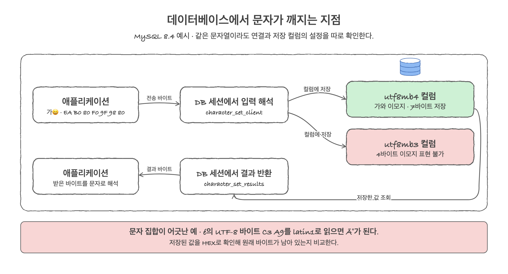
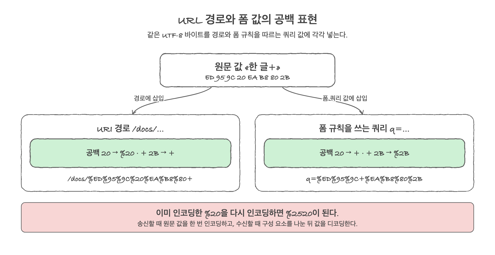
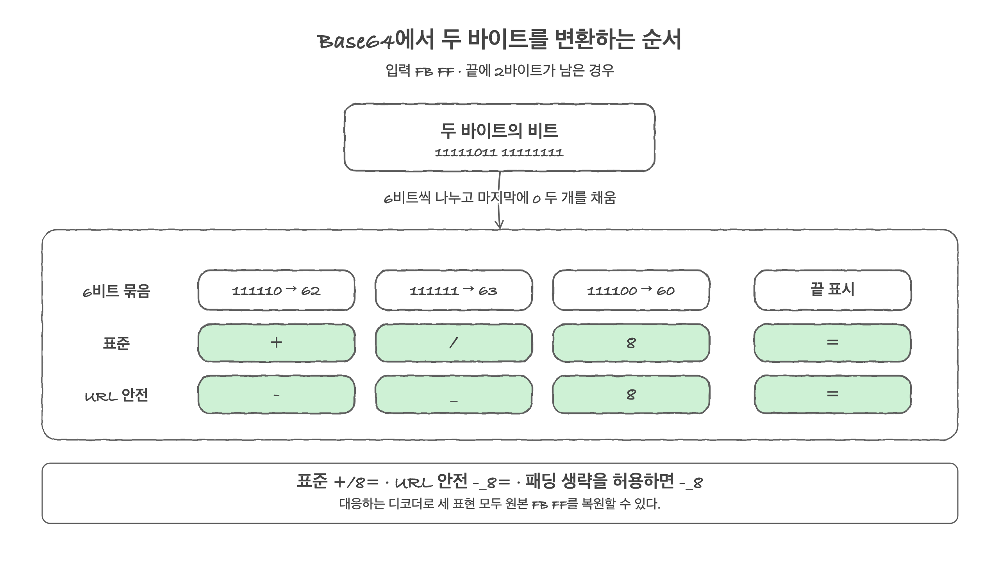

# 데이터베이스, URL, Base64에서 인코딩 사용하기

## 1. 데이터베이스 문자 인코딩 문제

MySQL 8.4에서 연결 문자 집합과 저장 컬럼의 문자 집합은 별도 설정이다. 서버는 클라이언트가 보낸 SQL을 `character_set_client`로 해석하고 일반 문자열 리터럴을 `character_set_connection`으로 변환한다. 문자 컬럼에 저장할 때는 그 컬럼의 문자 집합이 적용되며, `character_set_results`는 클라이언트로 돌려보낼 결과의 문자 집합을 정한다. 콜레이션은 저장할 수 있는 문자 범위와 별개로 대소문자·악센트 구분, 동등 비교, 정렬 순서를 정한다. [MySQL 8.4 연결 문자 집합](https://dev.mysql.com/doc/refman/8.4/en/charset-connection.html) · [컬럼 문자 집합](https://dev.mysql.com/doc/refman/8.4/en/charset-column.html) · [문자 집합과 콜레이션의 차이](https://dev.mysql.com/doc/refman/8.4/en/charset-general.html)



연결에서 바이트를 해석하는 단계와 컬럼이 문자를 표현하는 단계는 따로 점검한다. [MySQL 8.4 연결 문자 집합](https://dev.mysql.com/doc/refman/8.4/en/charset-connection.html) · [MySQL 8.4 utf8mb4](https://dev.mysql.com/doc/refman/8.4/en/charset-unicode-utf8mb4.html) · [utf8mb3](https://dev.mysql.com/doc/refman/8.4/en/charset-unicode-utf8mb3.html)

`utf8mb4`는 UTF-8 코드 포인트를 최대 4바이트로 저장하므로 `😀`(U+1F600, `F0 9F 98 80`) 같은 보충 평면 문자도 표현한다. `utf8mb3`는 기본 다국어 평면(BMP)의 문자만 최대 3바이트로 표현하므로 `가`(U+AC00, `EA B0 80`)는 저장할 수 있고 `😀`는 표현할 수 없다. MySQL 8.4에서 `utf8`은 사용 중단 예정인 `utf8mb3` 별칭이다. 스키마와 마이그레이션에서 4바이트 UTF-8이 필요하면 `utf8mb4`를 명시한다. [MySQL 8.4 utf8mb4](https://dev.mysql.com/doc/refman/8.4/en/charset-unicode-utf8mb4.html) · [utf8mb3](https://dev.mysql.com/doc/refman/8.4/en/charset-unicode-utf8mb3.html) · [utf8 별칭](https://dev.mysql.com/doc/refman/8.4/en/charset-unicode-utf8.html) · [RFC 3629 §3](https://www.rfc-editor.org/rfc/rfc3629.html#section-3)

한글이나 이모지가 깨지면 애플리케이션과 같은 연결에서 `SELECT @@character_set_client, @@character_set_connection, @@character_set_results`를 실행하고, `SHOW FULL COLUMNS FROM messages`로 대상 컬럼의 콜레이션을 확인한다. `HEX(body)`로 저장된 값의 바이트를 확인하고 `LENGTH(body)`와 `CHAR_LENGTH(body)`로 바이트 수와 문자 수를 비교한다. 예를 들어 `utf8mb4` 컬럼에 저장된 `가😀`의 값은 각각 `EAB080F09F9880`, `7`, `2`이다. Connector/J 8.0.26 이상에서 인증 후 기본값은 `utf8mb4`이며, `connectionCollation`과 `characterEncoding` 설정을 이 순서로 먼저 적용한다. 드라이버가 세션 문자 집합과 일치하도록 이 연결 속성에서 설정을 관리한다. [MySQL 8.4 연결 문자 집합](https://dev.mysql.com/doc/refman/8.4/en/charset-connection.html) · [SHOW COLUMNS](https://dev.mysql.com/doc/refman/8.4/en/show-columns.html) · [문자열 함수](https://dev.mysql.com/doc/refman/8.4/en/string-functions.html) · [Connector/J 문자 집합](https://dev.mysql.com/doc/connector-j/en/connector-j-reference-charsets.html)

예를 들어 UTF-8의 `é` 바이트 `C3 A9`를 `latin1`로 해석하면 `Ã`와 `©`로 읽힌다. `ALTER TABLE ... CONVERT TO CHARACTER SET`은 기존 컬럼 선언을 기준으로 값을 변환하므로, 데이터의 실제 인코딩과 선언이 다르면 잘못 읽은 문자가 그대로 새 문자 집합에 저장될 수 있다. 변환 전 원본 바이트, 실제 인코딩, 대상 콜레이션에서의 중복과 인덱스 길이를 확인한다. 실제 인코딩이 한 종류로 확인되고 원본 바이트가 남아 있다면 복사본에서 바이너리 타입을 거치는 재해석을 검증할 수 있다. 이미 대체 문자로 덮어쓴 값에는 원본 바이트가 필요하다. [MySQL 8.4 컬럼 문자 집합 변환](https://dev.mysql.com/doc/refman/8.4/en/charset-conversion.html) · [ALTER TABLE 문자 집합 변환](https://dev.mysql.com/doc/refman/8.4/en/alter-table.html#alter-table-character-set) · [3바이트에서 4바이트로 변환](https://dev.mysql.com/doc/refman/8.4/en/charset-unicode-conversion.html) · [콜레이션과 유일 인덱스](https://dev.mysql.com/doc/refman/8.4/en/create-index.html#unique-indexes)

## 2. URL 인코딩

RFC 3986의 퍼센트 인코딩은 바이트 하나를 `%HH`로 적는다. 예를 들어 공백은 `%20`이고, `한`의 UTF-8 바이트 `ED 95 9C`는 `%ED%95%9C`다. 경로 구분자 `/`나 쿼리 시작을 나타내는 `?`처럼 구조를 나타내는 문자는 남겨 두고, 값에 들어 있는 구분 문자는 해당 구성 요소의 규칙에 따라 이스케이프한다. 수신 측에서는 구성 요소를 먼저 분리하고 값을 디코딩한다. 같은 값을 두 번 처리하면 `%20`이 `%2520`으로 바뀌거나, 두 번 디코딩하면서 데이터로 보낸 `%` 뒤의 문자열을 이스케이프로 잘못 읽을 수 있다. [RFC 3986 §2.1–2.4](https://www.rfc-editor.org/rfc/rfc3986.html#section-2.1) · [RFC 3986 §3](https://www.rfc-editor.org/rfc/rfc3986.html#section-3)



공백과 더하기 기호의 표현은 경로와 폼 규칙을 따르는 쿼리 값에서 달라진다. [RFC 3986 §2.1–2.4](https://www.rfc-editor.org/rfc/rfc3986.html#section-2.1) · [Java 21 URLEncoder](https://docs.oracle.com/en/java/javase/21/docs/api/java.base/java/net/URLEncoder.html) · [Java 21 URI 인용 및 디코딩](https://docs.oracle.com/en/java/javase/21/docs/api/java.base/java/net/URI.html#encoding)

`application/x-www-form-urlencoded`는 공백을 `+`, 값의 실제 `+`를 `%2B`로 기록한다. Java 21의 `URLEncoder`와 `URLDecoder`는 이 폼 규칙을 따르므로 폼 본문이나 같은 규칙을 사용하는 쿼리의 키와 값에 쓴다. 경로에서 `+`는 그대로 유지될 수 있고 공백은 `%20`이다. `URI`의 여러 인자 생성자는 원문 구성 요소를 받아 `%`도 이스케이프한다. 인코딩을 마친 쿼리를 붙이면 `URI.create`로 결과를 파싱하고, 폼 쿼리를 읽을 때는 `getRawQuery()`로 원래의 `%HH`를 보존한 뒤 키와 값을 분리해 각각 디코딩한다. [Java 21 URLEncoder](https://docs.oracle.com/en/java/javase/21/docs/api/java.base/java/net/URLEncoder.html) · [Java 21 URLDecoder](https://docs.oracle.com/en/java/javase/21/docs/api/java.base/java/net/URLDecoder.html) · [Java 21 URI 인용 및 디코딩](https://docs.oracle.com/en/java/javase/21/docs/api/java.base/java/net/URI.html#encoding)

`UrlEncoding.java`를 저장하고 JDK 21에서 `java UrlEncoding.java`로 실행한다. 원문 경로의 공백은 `%20`, 폼 값의 공백은 `+`가 되며, 폼 값의 `+`와 `&`는 `%2B`와 `%26`으로 보존된다. [Java 21 소스 파일 실행 모드](https://docs.oracle.com/en/java/javase/21/docs/specs/man/java.html#using-source-file-mode-to-launch-single-file-source-code-programs) · [Java 21 URI](https://docs.oracle.com/en/java/javase/21/docs/api/java.base/java/net/URI.html) · [Java 21 URLEncoder](https://docs.oracle.com/en/java/javase/21/docs/api/java.base/java/net/URLEncoder.html)

```java
import java.net.URI;
import java.net.URLDecoder;
import java.net.URLEncoder;
import java.nio.charset.StandardCharsets;

class UrlEncoding {
    public static void main(String[] args) throws Exception {
        var utf8 = StandardCharsets.UTF_8;
        var path = new URI("https", "example.com", "/docs/한 글+", null);
        var value = "한 글+&";
        var encoded = URLEncoder.encode(value, utf8);
        var url = URI.create(path.toASCIIString() + "?q=" + encoded);

        var pair = url.getRawQuery().split("=", 2); // 이 예제의 단일 q 파라미터
        var decoded = URLDecoder.decode(pair[1], utf8);
        if (!value.equals(decoded)) {
            throw new IllegalStateException("폼 값이 바뀌었습니다");
        }

        System.out.println(url);     // https://example.com/docs/%ED%95%9C%20%EA%B8%80+?q=%ED%95%9C+%EA%B8%80%2B%26
        System.out.println(decoded); // 한 글+&
    }
}
```

## 3. Base64 인코딩

Base64는 3바이트(24비트)를 6비트씩 나눠 각 값을 64개 ASCII 문자 중 하나에 대응시킨다. 끝에 1바이트나 2바이트가 남으면 마지막 6비트 묶음의 부족한 비트를 0으로 채우고 `==` 또는 `=`를 붙인다. 패딩을 포함한 결과 길이는 `4 × ceil(바이트 수 / 3)`이다. 키 없이 원본 바이트로 되돌릴 수 있는 표현 변환이므로 기밀성을 제공하지 않는다. [RFC 4648 §3.2](https://www.rfc-editor.org/rfc/rfc4648.html#section-3.2) · [§4](https://www.rfc-editor.org/rfc/rfc4648.html#section-4) · [§12](https://www.rfc-editor.org/rfc/rfc4648.html#section-12)



같은 6비트 값도 Base64 알파벳에 따라 다른 문자로 표시한다. [RFC 4648 §3.2](https://www.rfc-editor.org/rfc/rfc4648.html#section-3.2) · [§4](https://www.rfc-editor.org/rfc/rfc4648.html#section-4) · [§5](https://www.rfc-editor.org/rfc/rfc4648.html#section-5) · [Java 21 Base64](https://docs.oracle.com/en/java/javase/21/docs/api/java.base/java/util/Base64.html)

표준 Base64의 인덱스 62, 63은 `+`, `/`이고 base64url의 같은 위치는 `-`, `_`이다. 예를 들어 `FB FF`는 표준으로 `+/8=`, URL 안전 알파벳으로 `-_8=`이 된다. `=` 패딩 여부는 교환 규격에 맞춘다. Java 21에서 `getUrlEncoder()`는 기본적으로 패딩을 붙이므로 규격이 생략을 허용하는 경우에만 `withoutPadding()`을 사용한다. 읽을 때는 해당 알파벳의 디코더를 선택한다. [RFC 4648 §3.2](https://www.rfc-editor.org/rfc/rfc4648.html#section-3.2) · [§5](https://www.rfc-editor.org/rfc/rfc4648.html#section-5) · [Java 21 Base64](https://docs.oracle.com/en/java/javase/21/docs/api/java.base/java/util/Base64.html) · [Base64.Encoder.withoutPadding](https://docs.oracle.com/en/java/javase/21/docs/api/java.base/java/util/Base64.Encoder.html#withoutPadding())

`Base64Encoding.java`를 저장하고 JDK 21에서 `java Base64Encoding.java`로 실행한다. 같은 바이트로 세 가지 출력을 만든 뒤 각 표현을 디코딩해 원래의 두 바이트와 비교한다. [Java 21 소스 파일 실행 모드](https://docs.oracle.com/en/java/javase/21/docs/specs/man/java.html#using-source-file-mode-to-launch-single-file-source-code-programs) · [Java 21 Base64.Encoder](https://docs.oracle.com/en/java/javase/21/docs/api/java.base/java/util/Base64.Encoder.html) · [Base64.Decoder 패딩 처리](https://docs.oracle.com/en/java/javase/21/docs/api/java.base/java/util/Base64.Decoder.html)

```java
import java.util.Arrays;
import java.util.Base64;

class Base64Encoding {
    public static void main(String[] args) {
        byte[] input = {(byte) 0xFB, (byte) 0xFF};
        var standard = Base64.getEncoder().encodeToString(input);
        var urlEncoder = Base64.getUrlEncoder();
        var urlDecoder = Base64.getUrlDecoder();
        var urlSafe = urlEncoder.encodeToString(input);
        var unpadded = urlEncoder.withoutPadding().encodeToString(input);

        if (!Arrays.equals(input, Base64.getDecoder().decode(standard))
                || !Arrays.equals(input, urlDecoder.decode(urlSafe))
                || !Arrays.equals(input, urlDecoder.decode(unpadded))) {
            throw new IllegalStateException("원래 바이트와 다릅니다");
        }

        System.out.println(standard); // +/8=
        System.out.println(urlSafe);  // -_8=
        System.out.println(unpadded); // -_8
    }
}
```
