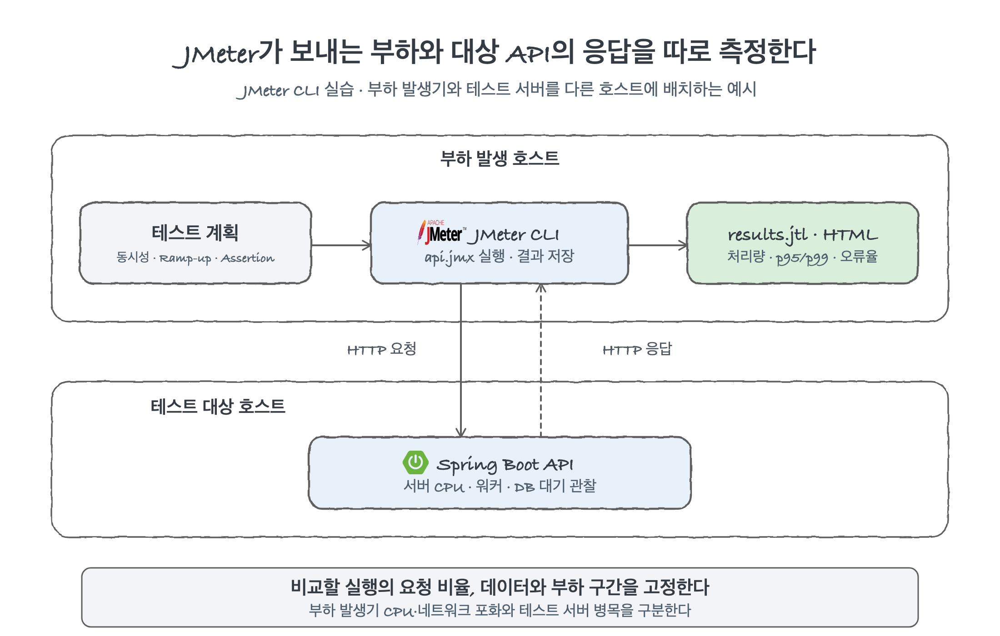
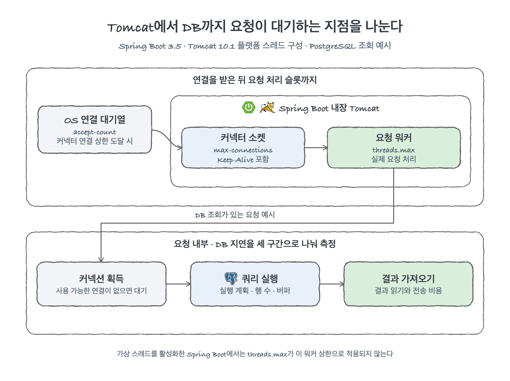
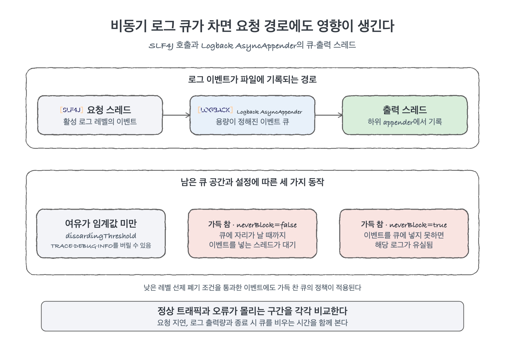

# Java Execution Performance Tuning

처리 속도를 높이려면 먼저 느린 구간을 측정하고, 개선할 때마다 같은 부하에서 결과를 비교한다. 이 문서는 JDK 21과 Spring Boot 3.5를 기준으로 설명하며, 데이터베이스 실행 계획은 PostgreSQL을 예로 든다.

## 1. 프로그램 실행 속도 측정하기

JVM 안에서 특정 구간의 경과 시간을 잴 때는 `System.nanoTime()`의 두 반환값을 뺀다. 반환값의 기준점은 JVM 내부에서 정해지며, 단위가 나노초여도 실제 타이머가 그 간격으로 갱신된다는 보장은 없다.

```java
long started = System.nanoTime();
runWorkload();
long elapsedNanos = System.nanoTime() - started;
```

- 시작 직후 지연과 워밍업 이후 성능을 따로 본다. 같은 코드라도 초기화와 JIT 컴파일 상태에 따라 측정값이 달라질 수 있다.
- 메서드나 자료구조를 비교할 때는 JMH에서 워밍업과 JVM 포크를 사용한다. API 전체를 측정할 때는 대표 요청과 동시성을 유지하고 **처리량, p95 응답 시간, 오류율**을 함께 본다. 평균만 보면 일부 요청이 길게 지연되는 현상을 놓칠 수 있다.

**공식 문서** [Java System.nanoTime](https://docs.oracle.com/en/java/javase/21/docs/api/java.base/java/lang/System.html) · [OpenJDK JMH 예제](https://github.com/openjdk/jmh/tree/master/jmh-samples)

## 2. List 반복문의 처리 속도 높이기

순회 성능은 반복문 문법보다 `List` 구현체와 접근 방식에 좌우된다. 모든 원소를 한 번씩 읽는다면 향상된 `for`나 `Iterator`를 사용하면 인덱스를 바탕으로 매번 위치를 찾는 비용을 피할 수 있다.

| 접근 방식 | 적용 기준 |
| --- | --- |
| `ArrayList`의 `get(i)` | 인덱스 조회가 상수 시간이므로 위치 정보가 필요할 때 쓸 수 있다. |
| `LinkedList`의 `get(i)`를 반복 호출 | 원소를 찾기 위해 노드를 반복해서 따라가므로 전체 순회 비용이 이차적으로 늘 수 있다. |
| 구현체가 정해지지 않은 `List` | 순차 처리가 목적이면 반복자로 순회한다. 범용 알고리즘에서 임의 접근이 필요하다면 `RandomAccess` 지원 여부에 따라 경로를 고를 수 있다. |

반복문 안에서 네트워크 호출, 정렬, 복사를 반복하는지도 확인한다. 그런 작업이 병목이라면 반복문 문법을 바꾸는 것보다 실행 횟수나 데이터 크기를 줄이는 편이 효과적이다.

**공식 문서** [Java RandomAccess](https://docs.oracle.com/en/java/javase/21/docs/api/java.base/java/util/RandomAccess.html) · [Java ArrayList](https://docs.oracle.com/en/java/javase/21/docs/api/java.base/java/util/ArrayList.html)

## 3. StringBuilder와 StringBuffer 선택하기

반복문에서 기존 문자열에 조각을 계속 붙이면 이전 결과를 포함한 문자열을 반복해서 만들 수 있다. 한 스레드가 문자열을 조립하는 경우 `StringBuilder`에 `append`하고 마지막에 한 번 `toString()`을 호출하면 중간 문자열을 줄일 수 있다.

- `StringBuilder`는 동기화를 제공하지 않는다. 요청이나 메서드 안에서 빌더를 만들면 공유에 따른 동기화 비용도 피할 수 있다.
- `StringBuffer`는 개별 연산을 동기화한다. 길이를 확인한 뒤 내용을 수정하는 것처럼 여러 호출을 묶어야 하는 로직은 별도의 조율이 필요하다.
- 짧고 고정된 표현식은 `+`를 그대로 사용할 수 있다. 수많은 조각을 붙이는 구간에서는 예상 길이를 알 때 빌더의 초기 용량을 설정하고, 할당량과 처리 시간을 비교한다.

**공식 문서** [Java StringBuilder](https://docs.oracle.com/en/java/javase/21/docs/api/java.base/java/lang/StringBuilder.html) · [Java StringBuffer](https://docs.oracle.com/en/java/javase/21/docs/api/java.base/java/lang/StringBuffer.html)

## 4. 데이터베이스 쿼리 실행 속도 높이기

요청 지연을 **DB 커넥션을 기다리는 시간, 쿼리가 실행되는 시간, 결과를 가져오는 시간**으로 나눠 본다. 커넥션 대기가 대부분이라면 인덱스를 바꾸기 전에 풀 사용량과 트랜잭션이 커넥션을 점유하는 시간을 확인한다. 같은 유형의 작은 조회가 반복된다면 한 요청이 보내는 쿼리 수부터 센다.

PostgreSQL에서는 대표 입력의 실행 계획에서 예상 행 수와 실제 행 수, 반복 횟수, 버퍼 접근을 확인할 수 있다.

```sql
EXPLAIN (ANALYZE, BUFFERS)
SELECT id, total
FROM orders
WHERE customer_id = 42
ORDER BY created_at DESC
LIMIT 20;
```

위 쿼리는 예시다. `ANALYZE`는 구문을 실제 실행하므로, 변경 쿼리는 부작용을 통제할 수 있는 환경에서 조사한다. 검색 조건과 정렬에 맞는 인덱스를 검토하되, 읽는 행이 많은 경우 순차 스캔이 더 적합할 수 있고 인덱스에는 저장 공간과 쓰기 비용이 든다. 변경 전후를 비슷한 데이터 분포와 캐시 상태로 비교한다.

**공식 문서** [PostgreSQL 실행 계획 해석](https://www.postgresql.org/docs/current/using-explain.html) · [EXPLAIN 명령](https://www.postgresql.org/docs/current/sql-explain.html) · [PostgreSQL 인덱스](https://www.postgresql.org/docs/current/indexes-intro.html)

## 5. 멀티스레딩으로 처리량 높이기

CPU 계산이 주된 작업과 I/O 대기가 주된 작업을 구분한다. CPU가 이미 포화됐다면 스레드를 더 만드는 것만으로 처리량이 늘기 어렵다. I/O 대기가 많다면 여러 작업의 대기 시간을 겹칠 수 있지만, DB 커넥션 수와 외부 시스템의 처리량이 새 한계가 될 수 있다.

- 플랫폼 스레드 풀은 워커 수와 대기열 용량, 포화된 작업의 처리 방식을 함께 정한다. `Executors.newFixedThreadPool`은 워커 수는 고정하지만 대기열은 무제한이다. 대기 시간이 중요한 요청이라면 제한된 큐와 거부 정책을 검토한다.
- JDK 21의 가상 스레드는 블로킹 I/O가 많은 작업의 동시성을 높이는 데 적합하다. CPU 계산 자체의 실행을 가속하지는 않는다. 가상 스레드는 작업별로 만들고, 공유 DB나 외부 API의 동시 접근은 커넥션 풀이나 세마포어로 제한한다.
- 스레드 수만 보지 말고 큐 대기 시간, 처리량, p95, 타임아웃을 함께 비교한다. 동시성이 늘면서 대기만 길어지는 지점이 해당 시스템의 한계에 가깝다.

**공식 문서** [ThreadPoolExecutor](https://docs.oracle.com/en/java/javase/21/docs/api/java.base/java/util/concurrent/ThreadPoolExecutor.html) · [Java Executors](https://docs.oracle.com/en/java/javase/21/docs/api/java.base/java/util/concurrent/Executors.html) · [OpenJDK JEP 444 Virtual Threads](https://openjdk.org/jeps/444)

## 6. JMeter 설치와 API 부하 테스트

1. `java -version`으로 Java가 설치돼 있는지 확인한다. Apache JMeter 다운로드 페이지에서 선택한 버전의 Java 요구사항을 확인하고, 바이너리 압축 파일과 SHA-512 체크섬을 받아 무결성을 확인한 뒤 압축을 푼다.
2. 압축을 푼 디렉터리에서 macOS·Linux는 `./bin/jmeter -v`, Windows는 `bin\jmeter.bat -v`로 실행을 확인한다.
3. GUI에서 Thread Group과 HTTP Request를 추가하고, 동시 사용자 수와 Ramp-up, 반복 횟수 또는 실행 시간을 정한다. HTTP 응답 코드와 응답 내용의 성공 조건을 Assertion으로 정의하고 `api.jmx`로 저장한다.
4. 실제 부하는 CLI에서 실행한다. 아래 예제는 결과를 저장하고 HTML 보고서를 생성한다. 보고서 경로는 비어 있는 디렉터리를 사용한다.

```sh
./bin/jmeter -n -t api.jmx -l results.jtl -e -o report
```

동시 사용자 수와 초당 요청 수는 별개다. 비교할 때는 요청 비율, 테스트 데이터, 부하 구간을 고정한 뒤 처리량, p95·p99, 오류율을 함께 본다. 부하 발생기의 CPU나 네트워크가 포화되면 서버가 처리할 수 있는 한계를 제대로 측정하기 어렵다.

**공식 문서** [Apache JMeter 다운로드](https://jmeter.apache.org/download_jmeter.cgi) · [JMeter 설치 및 CLI 실행](https://jmeter.apache.org/usermanual/get-started.html) · [JMeter 보고서](https://jmeter.apache.org/usermanual/generating-dashboard.html)



그림의 근거 · [JMeter CLI 부하 실행](https://jmeter.apache.org/usermanual/get-started.html) · [JMeter 부하 테스트 모범 사례](https://jmeter.apache.org/usermanual/best-practices.html) · [JMeter HTML 보고서](https://jmeter.apache.org/usermanual/generating-dashboard.html)

## 7. 반복 조회를 캐시로 처리하기

같은 키를 반복해서 읽고 원본 조회가 비싸다면 캐시를 검토한다. Spring의 `@Cacheable`은 키에 대한 값이 있으면 메서드 실행을 생략한다. 키에는 결과에 영향을 주는 입력을 넣고, 데이터가 변경될 때 `@CachePut`으로 갱신하거나 `@CacheEvict`로 제거할 시점을 정한다.

- TTL은 오래된 값을 허용할 수 있는 시간과 원본의 처리 용량을 고려해 정한다. Redis를 사용하면 `RedisCacheConfiguration`에서 캐시별 TTL을 설정할 수 있다.
- 히트율만으로 개선 효과를 판단하기 어렵다. 원본 호출 수와 전체 응답 지연을 보고, 캐시가 비어 있는 시작 구간과 값이 채워진 구간을 모두 측정한다. 인기 키의 만료 시점에 동시 미스가 원본으로 몰리는지도 확인한다.

**공식 문서** [Spring 캐시 애노테이션](https://docs.spring.io/spring-framework/reference/6.2/integration/cache/annotations.html) · [Spring Data Redis 캐시 설정](https://docs.spring.io/spring-data/redis/reference/3.5/redis/redis-cache.html)

## 8. Spring Boot 내장 Tomcat 튜닝하기

Spring Boot 3.5의 Tomcat 설정은 요청을 처리하는 스레드, 수락하는 소켓 연결, 운영체제의 연결 대기열을 각각 제어한다. Keep-Alive 연결을 포함한 연결 수는 현재 실행 중인 요청 수와 다를 수 있다.

| 설정 | 제어하는 범위 |
| --- | --- |
| `server.tomcat.threads.max` | 플랫폼 워커 스레드의 최대 수다. Spring Boot에서 가상 스레드가 활성화되면 이 설정의 효과가 없다. |
| `server.tomcat.max-connections` | 커넥터가 동시에 수락해 처리하는 연결 수의 상한이다. |
| `server.tomcat.accept-count` | 연결 상한에 도달했을 때 운영체제가 대기시킬 수 있는 신규 연결의 큐 길이다. 실제 크기는 운영체제에 따라 다를 수 있다. |

부하 테스트 중 `http.server.requests`의 응답 지연과 오류, Tomcat의 워커 사용량, DB 커넥션 대기를 같은 구간에서 비교한다. Actuator로 Tomcat 지표를 수집하려면 `server.tomcat.mbeanregistry.enabled=true`를 설정한다. 워커가 바쁜 이유가 DB 대기라면 워커 수 증설로 DB 쪽 대기가 더 늘 수 있다. 병목에 맞는 설정 한 가지를 바꿔 재측정한다.

**공식 문서** [Spring Boot 3.5 애플리케이션 속성](https://docs.spring.io/spring-boot/3.5/appendix/application-properties/index.html) · [Tomcat 10.1 HTTP Connector](https://tomcat.apache.org/tomcat-10.1-doc/config/http.html) · [Spring Boot Actuator 지표](https://docs.spring.io/spring-boot/3.5/reference/actuator/metrics.html)



그림의 근거 · [Spring Boot 3.5 Tomcat 속성](https://docs.spring.io/spring-boot/3.5/appendix/application-properties/index.html) · [Tomcat 10.1 HTTP Connector](https://tomcat.apache.org/tomcat-10.1-doc/config/http.html) · [Spring Boot 3.5 가상 스레드](https://docs.spring.io/spring-boot/3.5/reference/features/spring-application.html#features.spring-application.virtual-threads) · [PostgreSQL 실행 계획](https://www.postgresql.org/docs/current/using-explain.html)

## 9. 로그 출력 비용 줄이기

빈번한 요청 경로에서 로그를 남길 때는 메시지 생성 비용과 기록 장치의 처리량을 함께 본다. SLF4J의 `logger.debug("id={}", id)`는 해당 레벨이 꺼져 있을 때 메시지 포매팅을 피할 수 있다. 다만 메서드 인자는 호출 전에 계산되므로, 비싼 요약 생성은 레벨 확인으로 감싸거나 SLF4J 2의 `addArgument(() -> buildSummary())`로 지연시킨다.

- 실패 요청마다 긴 스택 트레이스를 남기거나 큰 객체를 반복해서 직렬화하면 CPU와 출력 트래픽이 늘어난다. 진단에 필요한 요청 ID와 오류 원인 위주로 남기고, 정상 부하와 오류가 몰리는 부하를 모두 측정한다.
- Logback의 `AsyncAppender`는 출력 작업을 큐로 넘긴다. 큐가 포화되면 설정에 따라 낮은 레벨의 로그를 버리거나, 호출 측이 대기하거나, 새 로그를 유실할 수 있다. 큐 크기와 `discardingThreshold`, `neverBlock`의 동작을 확인하고, 종료 시 큐가 얼마나 비워지는지도 확인한다.

**공식 문서** [SLF4J 매뉴얼](https://www.slf4j.org/manual.html) · [Logback AsyncAppender](https://logback.qos.ch/manual/appenders-async-sift.html)



그림의 근거 · [SLF4J 호출](https://www.slf4j.org/manual.html) · [Logback AsyncAppender](https://logback.qos.ch/manual/appenders-async-sift.html)
