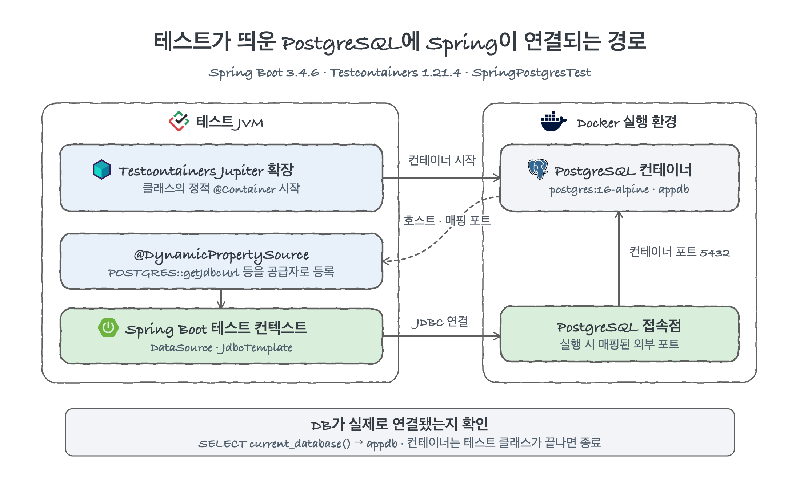

# Integration Testing with Testcontainers and Docker Compose

Testcontainers는 테스트 실행 중 실제 데이터베이스나 메시지 브로커를 Docker 컨테이너로 시작한다. PostgreSQL의 SQL 문법, JDBC 연결, 트랜잭션처럼 엔진 동작에 의존하는 코드를 통합 테스트할 수 있다. 이 문서는 **Java 17, JUnit 5.12.2, Testcontainers 1.21.4, Spring Boot 3.4.6**을 사용한다. 예제 실행에는 Docker 데몬 접근이 필요하고, Compose 예제는 로컬 Docker Compose V2를 사용한다. [Testcontainers JUnit 5 Integration](https://java.testcontainers.org/test_framework_integration/junit_5/) · [PostgreSQL Module](https://java.testcontainers.org/modules/databases/postgres/)

## 1. 테스트 의존성

[JUnit 5 문서](01_junit_5_fundamentals_and_extensions.md)의 Gradle 테스트 설정에 아래 의존성을 추가한다. Spring 예제를 실행할 때는 Spring Boot 의존성도 함께 사용한다. 이미 Spring Boot 프로젝트라면 프로젝트에서 관리하는 Boot 버전에 맞춘다.

```groovy
dependencies {
    testImplementation platform('org.springframework.boot:spring-boot-dependencies:3.4.6')
    testImplementation platform('org.testcontainers:testcontainers-bom:1.21.4')
    testImplementation 'org.testcontainers:junit-jupiter'
    testImplementation 'org.testcontainers:postgresql'
    testImplementation 'org.springframework.boot:spring-boot-starter-test'
    testImplementation 'org.springframework.boot:spring-boot-starter-jdbc'
    testRuntimeOnly 'org.postgresql:postgresql'
}
```

## 2. JUnit에서 컨테이너의 수명과 준비 상태 관리

`@Testcontainers`가 Jupiter 확장을 등록하고, 확장은 `@Container`로 선언한 컨테이너를 시작하고 종료한다. 정적 필드는 테스트 클래스에서 공유한다. 인스턴스 필드는 테스트 메서드마다 시작하고 종료한다. 정적 컨테이너를 쓰면 시작 비용을 줄일 수 있지만, 각 테스트의 데이터는 트랜잭션 롤백이나 초기화로 분리한다. [Testcontainers JUnit 5 Integration](https://java.testcontainers.org/test_framework_integration/junit_5/)

```java
import java.sql.DriverManager;
import java.sql.SQLException;

import org.junit.jupiter.api.Test;
import org.testcontainers.containers.PostgreSQLContainer;
import org.testcontainers.junit.jupiter.Container;
import org.testcontainers.junit.jupiter.Testcontainers;

import static org.junit.jupiter.api.Assertions.assertEquals;
import static org.junit.jupiter.api.Assertions.assertTrue;

@Testcontainers
class PostgresContainerTest {
    @Container
    static final PostgreSQLContainer<?> POSTGRES = new PostgreSQLContainer<>("postgres:16-alpine")
            .withDatabaseName("testdb")
            .withUsername("test")
            .withPassword("test");

    @Test
    void connectsToTheDatabase() throws SQLException {
        try (var connection = DriverManager.getConnection(
                     POSTGRES.getJdbcUrl(), POSTGRES.getUsername(), POSTGRES.getPassword());
             var statement = connection.createStatement();
             var result = statement.executeQuery("SELECT current_database()")) {
            assertTrue(result.next());
            assertEquals("testdb", result.getString(1));
        }
    }
}
```

PostgreSQL 모듈은 연결 URL과 접속 정보를 제공한다. 범용 `GenericContainer`에서는 `withExposedPorts(8080)`으로 컨테이너 포트를 노출하고, 시작 후 `getHost()`와 `getMappedPort(8080)`으로 테스트 프로세스의 연결 주소를 얻는다. 포트가 열려도 서비스 초기화가 끝나지 않을 수 있으므로 HTTP 응답, 헬스체크, 로그 등 서비스가 준비됐다는 신호에 맞춰 `WaitStrategy`를 지정한다. [Networking](https://java.testcontainers.org/features/networking/) · [Startup and Wait Strategies](https://java.testcontainers.org/features/startup_and_waits/)

## 3. Spring 테스트에 컨테이너 연결 정보 전달

`@DynamicPropertySource`를 붙인 정적 메서드에서 컨테이너의 URL과 계정 정보를 Spring 속성으로 등록한다. `DynamicPropertyRegistry`에 값을 가져오는 함수를 전달하면 속성을 조회할 때 값이 계산된다. 테스트의 `DataSource`가 실행마다 달라지는 컨테이너 포트에 연결된다. [Spring Dynamic Property Sources](https://docs.spring.io/spring-framework/reference/testing/testcontext-framework/ctx-management/dynamic-property-sources.html)

```java
import org.junit.jupiter.api.Test;
import org.springframework.beans.factory.annotation.Autowired;
import org.springframework.boot.autoconfigure.EnableAutoConfiguration;
import org.springframework.boot.test.context.SpringBootTest;
import org.springframework.context.annotation.Configuration;
import org.springframework.jdbc.core.JdbcTemplate;
import org.springframework.test.context.DynamicPropertyRegistry;
import org.springframework.test.context.DynamicPropertySource;
import org.testcontainers.containers.PostgreSQLContainer;
import org.testcontainers.junit.jupiter.Container;
import org.testcontainers.junit.jupiter.Testcontainers;

import static org.junit.jupiter.api.Assertions.assertEquals;

@Testcontainers
@SpringBootTest(classes = SpringPostgresTest.TestConfig.class,
        webEnvironment = SpringBootTest.WebEnvironment.NONE)
class SpringPostgresTest {
    @Container
    static final PostgreSQLContainer<?> POSTGRES = new PostgreSQLContainer<>("postgres:16-alpine")
            .withDatabaseName("appdb")
            .withUsername("test")
            .withPassword("test");

    @DynamicPropertySource
    static void databaseProperties(DynamicPropertyRegistry registry) {
        registry.add("spring.datasource.url", POSTGRES::getJdbcUrl);
        registry.add("spring.datasource.username", POSTGRES::getUsername);
        registry.add("spring.datasource.password", POSTGRES::getPassword);
    }

    @Autowired
    JdbcTemplate jdbc;

    @Test
    void usesTheContainerConnection() {
        assertEquals("appdb", jdbc.queryForObject("SELECT current_database()", String.class));
    }

    @Configuration(proxyBeanMethods = false)
    @EnableAutoConfiguration
    static class TestConfig {
    }
}
```

Spring Boot에서 지원하는 서비스는 `spring-boot-testcontainers` 의존성을 추가하고 `@ServiceConnection`으로 연결 정보를 등록할 수 있다. 사용자 정의 속성이나 지원 범위 밖의 서비스에는 `@DynamicPropertySource`가 유용하다. 여러 테스트 클래스가 Spring 컨텍스트를 공유한다면 컨텍스트가 참조하는 컨테이너도 그 기간에 살아 있어야 한다. 컨테이너를 Spring 빈으로 관리하는 방식은 컨텍스트와 수명을 맞출 수 있다. [Spring Boot Testcontainers Support](https://docs.spring.io/spring-boot/3.4/reference/testing/testcontainers.html)



그림의 근거 · [Testcontainers 1.21.4 Jupiter 확장](https://github.com/testcontainers/testcontainers-java/blob/1.21.4/docs/test_framework_integration/junit_5.md) · [Testcontainers 1.21.4 네트워크](https://github.com/testcontainers/testcontainers-java/blob/1.21.4/docs/features/networking.md) · [Spring Framework 6.2 동적 속성](https://docs.spring.io/spring-framework/reference/6.2/testing/testcontext-framework/ctx-management/dynamic-property-sources.html)

## 4. Docker Compose로 테스트 환경 실행

Compose 파일은 서비스 이미지, 환경 변수, 네트워크 관계와 헬스체크를 선언한다. 단일 PostgreSQL로 연결 방식을 확인한 뒤, 여러 서비스가 필요한 테스트에서는 같은 Compose 파일에 서비스와 의존 관계를 추가할 수 있다. 예제 파일은 모듈의 `src/test/resources/compose.yaml`에 둔다. [Testcontainers Docker Compose Module](https://java.testcontainers.org/modules/docker_compose/)

```yaml
services:
  db:
    image: postgres:16-alpine
    environment:
      POSTGRES_DB: composedb
      POSTGRES_USER: test
      POSTGRES_PASSWORD: test
    healthcheck:
      test: ["CMD-SHELL", "pg_isready -h 127.0.0.1 -U $$POSTGRES_USER -d $$POSTGRES_DB"]
      interval: 1s
      timeout: 3s
      retries: 30
```

`$$`는 Compose에서 리터럴 달러 기호를 전달한다. 환경 변수는 호스트의 Compose 설정 단계에서 보간하는 대신, 컨테이너 안에서 헬스체크 명령을 실행할 때 평가된다. `pg_isready`로 준비 상태를 기다린 뒤 테스트에서 실제 JDBC 조회를 실행한다. [Compose Interpolation](https://docs.docker.com/reference/compose-file/interpolation/)

```java
import java.io.File;
import java.sql.DriverManager;
import java.sql.SQLException;

import org.junit.jupiter.api.Test;
import org.testcontainers.containers.ComposeContainer;
import org.testcontainers.containers.wait.strategy.Wait;
import org.testcontainers.junit.jupiter.Container;
import org.testcontainers.junit.jupiter.Testcontainers;

import static org.junit.jupiter.api.Assertions.assertEquals;
import static org.junit.jupiter.api.Assertions.assertTrue;

@Testcontainers
class ComposePostgresTest {
    private static final String SERVICE = "db-1";
    private static final int POSTGRES_PORT = 5432;

    @Container
    static final ComposeContainer ENVIRONMENT =
            new ComposeContainer(new File("src/test/resources/compose.yaml"))
                    .withLocalCompose(true)
                    .withExposedService(SERVICE, POSTGRES_PORT, Wait.forHealthcheck());

    @Test
    void queriesTheComposeDatabase() throws SQLException {
        String host = ENVIRONMENT.getServiceHost(SERVICE, POSTGRES_PORT);
        int port = ENVIRONMENT.getServicePort(SERVICE, POSTGRES_PORT);
        String url = "jdbc:postgresql://%s:%d/composedb".formatted(host, port);

        try (var connection = DriverManager.getConnection(url, "test", "test");
             var statement = connection.createStatement();
             var result = statement.executeQuery("SELECT current_database()")) {
            assertTrue(result.next());
            assertEquals("composedb", result.getString(1));
        }
    }
}
```

`ComposeContainer`는 Compose V2를 사용한다. `db-1`은 `db` 서비스의 첫 인스턴스다. 서비스 연결 주소는 `getServiceHost`와 `getServicePort`로 얻는다. Compose의 서비스 이름은 컨테이너 네트워크 내부에서 사용하므로, 테스트 프로세스에서는 매핑된 주소를 사용한다. 시작이 늦어지면 서비스 로그와 헬스체크 결과를 확인한다. [Testcontainers Docker Compose Module](https://java.testcontainers.org/modules/docker_compose/)
