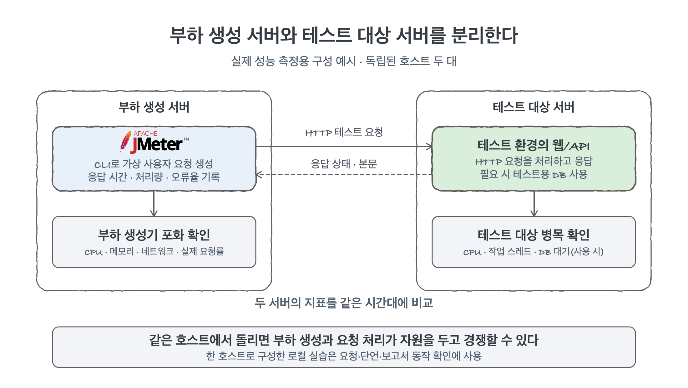

# HTTP Performance Testing with Apache JMeter

Apache JMeter는 여러 가상 사용자의 HTTP 요청을 실행하고 응답 시간, 처리량, 오류율을 기록한다. 같은 테스트 계획과 입력으로 변경 전후의 결과를 비교할 수 있다. 이 문서에서는 **Java 17, JMeter 5.6.3**으로 로컬 HTTP 서버에 요청을 보내고 검증 결과를 HTML 보고서로 확인한다. [Apache JMeter Getting Started](https://jmeter.apache.org/usermanual/get-started.html)

## 1. 테스트 계획의 구성

| 요소 | 역할 | 실습 값 |
| --- | --- | --- |
| Thread Group | 사용자 스레드 수와 시작 간격, 반복 횟수를 결정한다. | 스레드 5개, 램프업 5초, 스레드당 10회 |
| HTTP Request | 대상 서버에 HTTP 요청을 보낸다. | `GET http://127.0.0.1:18080/health.txt` |
| Response Assertion | 반환값이 기대에 맞는지 확인한다. | 응답 코드가 `200`과 일치 |
| Listener 또는 결과 파일 | 샘플 결과를 확인하거나 저장한다. | GUI에서 소량 확인, CLI에서 CSV 형식의 JTL과 HTML 보고서 생성 |

램프업은 스레드를 시작하는 기간이다. 각 스레드는 요청을 보낸 뒤 응답을 받고 다음 반복을 실행하므로, 이 설정은 계획상 50개 요청을 생성하며 초당 요청 수는 응답 시간과 실행 상황에 따라 달라진다. 사용자의 요청 간 대기 시간까지 재현하려면 Timer를 설정한다. [Building a Web Test Plan](https://jmeter.apache.org/usermanual/build-web-test-plan.html) · [Thread Group and Timer Reference](https://jmeter.apache.org/usermanual/component_reference.html#Thread_Group)

## 2. 로컬 HTTP 예제 준비

`jmeter --version`으로 쓸 버전을 확인한다. 별도 터미널에서 아래 명령을 실행해 테스트 전용 서버를 시작한다. Python 3의 HTTP 서버가 임시 디렉터리의 `health.txt`를 제공한다. [Apache JMeter 다운로드](https://jmeter.apache.org/download_jmeter.cgi)

```sh
sample_dir=$(mktemp -d)
printf 'ok\n' > "$sample_dir/health.txt"
python3 -m http.server 18080 --bind 127.0.0.1 --directory "$sample_dir"
```

다른 터미널에서 `curl --fail http://127.0.0.1:18080/health.txt`로 `ok` 응답을 확인한다. 실습을 마치면 서버를 실행한 터미널에서 `Ctrl+C`로 종료한다.

## 3. GUI에서 계획 만들기

1. Test Plan 밑에 **Thread Group**을 추가하고 사용자 수 `5`, Ramp-up `5`, Loop Count `10`을 설정한다.
2. Thread Group 밑에 **HTTP Request**를 추가하고 프로토콜 `http`, 서버 `127.0.0.1`, 포트 `18080`, 메서드 `GET`, 경로 `/health.txt`를 지정한다.
3. HTTP Request 밑에 **Response Assertion**을 추가한다. 검사 대상은 **Response Code**, 비교 방식은 **Equals**, 기대값은 `200`이다.
4. 요청과 단언을 빠르게 점검하려면 잠시 **View Results Tree**를 추가하고 스레드와 반복 횟수를 1로 설정한다. 성공 여부를 확인한 뒤 리스너를 제거하고 원래 설정으로 돌린다.
5. 계획을 `local-http.jmx`로 저장한다. 아래 JMX를 같은 파일명으로 저장해도 실습을 실행할 수 있다.

[Building a Web Test Plan](https://jmeter.apache.org/usermanual/build-web-test-plan.html) · [Response Assertion](https://jmeter.apache.org/usermanual/component_reference.html#Response_Assertion)

```xml
<?xml version="1.0" encoding="UTF-8"?>
<jmeterTestPlan version="1.2" properties="5.0" jmeter="5.6.3">
  <hashTree>
    <TestPlan guiclass="TestPlanGui" testclass="TestPlan" testname="Local HTTP Performance Test"/>
    <hashTree>
      <ThreadGroup guiclass="ThreadGroupGui" testclass="ThreadGroup" testname="Local users">
        <intProp name="ThreadGroup.num_threads">5</intProp>
        <intProp name="ThreadGroup.ramp_time">5</intProp>
        <stringProp name="ThreadGroup.on_sample_error">continue</stringProp>
        <elementProp name="ThreadGroup.main_controller" elementType="LoopController" guiclass="LoopControlPanel" testclass="LoopController">
          <boolProp name="LoopController.continue_forever">false</boolProp>
          <intProp name="LoopController.loops">10</intProp>
        </elementProp>
      </ThreadGroup>
      <hashTree>
        <HTTPSamplerProxy guiclass="HttpTestSampleGui" testclass="HTTPSamplerProxy" testname="GET /health.txt">
          <stringProp name="HTTPSampler.protocol">http</stringProp>
          <stringProp name="HTTPSampler.domain">127.0.0.1</stringProp>
          <stringProp name="HTTPSampler.port">18080</stringProp>
          <stringProp name="HTTPSampler.method">GET</stringProp>
          <stringProp name="HTTPSampler.path">/health.txt</stringProp>
          <stringProp name="HTTPSampler.connect_timeout">2000</stringProp>
          <stringProp name="HTTPSampler.response_timeout">3000</stringProp>
        </HTTPSamplerProxy>
        <hashTree>
          <ResponseAssertion guiclass="AssertionGui" testclass="ResponseAssertion" testname="HTTP status is 200">
            <collectionProp name="Asserion.test_strings">
              <stringProp name="49586">200</stringProp>
            </collectionProp>
            <stringProp name="Assertion.test_field">Assertion.response_code</stringProp>
            <boolProp name="Assertion.assume_success">false</boolProp>
            <intProp name="Assertion.test_type">8</intProp>
          </ResponseAssertion>
          <hashTree/>
        </hashTree>
      </hashTree>
    </hashTree>
  </hashTree>
</jmeterTestPlan>
```

## 4. CLI 실행과 HTML 보고서

GUI에서 요청을 확인한 뒤, 본 실행은 CLI로 수행한다. 요청별 렌더링을 하는 GUI 리스너는 부하 생성기의 자원을 사용한다. `-n`은 CLI 실행, `-t`는 테스트 계획, `-l`은 샘플 결과 파일을 지정한다. `-e -o`는 실행 후 HTML 보고서를 생성한다. 보고서 경로는 새 경로 또는 빈 디렉터리여야 한다. [JMeter CLI Mode](https://jmeter.apache.org/usermanual/get-started.html#non_gui) · [Generating a Dashboard Report](https://jmeter.apache.org/usermanual/generating-dashboard.html)

```sh
output_dir=$(mktemp -d)
jmeter -n -t local-http.jmx -l "$output_dir/results.jtl" \
  -Jjmeter.save.saveservice.output_format=csv -e -o "$output_dir/report"
printf '%s\n' "$output_dir/report/index.html"
```

보고서의 샘플 수와 오류율을 먼저 확인한다. 실습의 기대값은 샘플 50개와 오류율 0%다. 실행 명령의 종료 코드와 별도로 결과의 `success` 필드나 보고서 오류율을 확인한다. HTTP 오류나 타임아웃에 더해 응답 단언의 실패도 실패 샘플에 포함된다.



그림의 근거 · [Apache JMeter 실행 환경 분리](https://jmeter.apache.org/usermanual/remote-test.html) · [Apache JMeter 부하 테스트 권장 설정](https://jmeter.apache.org/usermanual/best-practices.html) · [AWS 부하 테스트와 모니터링](https://docs.aws.amazon.com/wellarchitected/latest/framework/perf_process_culture_load_test.html)

## 5. 결과 읽기

| 지표 | 해석 |
| --- | --- |
| Elapsed time | 요청을 보내기 직전부터 전체 응답을 수신할 때까지의 시간이다. 브라우저의 렌더링 시간과는 측정 범위가 다르다. |
| Latency | 요청을 보내기 직전부터 첫 응답 부분이 도착할 때까지의 시간이다. |
| p95 | 응답 시간 분포에서 약 95%의 표본이 이 값 이내에 있다. 평균이 비슷해도 느린 요청이 늘었는지 살필 수 있다. |
| Throughput | 단위 시간당 처리한 샘플 수다. HTTP 요청 결과를 비교할 때는 초당 처리량과 동시 사용자 수를 구분한다. |
| Error % | 실패로 기록된 샘플의 비율이다. 오류 응답이 빨리 반환되면 평균 시간이 낮아질 수 있으므로 응답 시간과 함께 읽는다. |

로컬 정적 파일 실습은 요청·단언·보고서 흐름을 검증한다. 서비스 성능을 비교할 때는 동일한 입력과 부하 조건으로 반복하고, 응답 시간 및 오류율이 달라진 구간의 서버 CPU, 스레드, DB 지표를 함께 본다. [JMeter Glossary](https://jmeter.apache.org/usermanual/glossary.html) · [JMeter Dashboard Report](https://jmeter.apache.org/usermanual/generating-dashboard.html)
