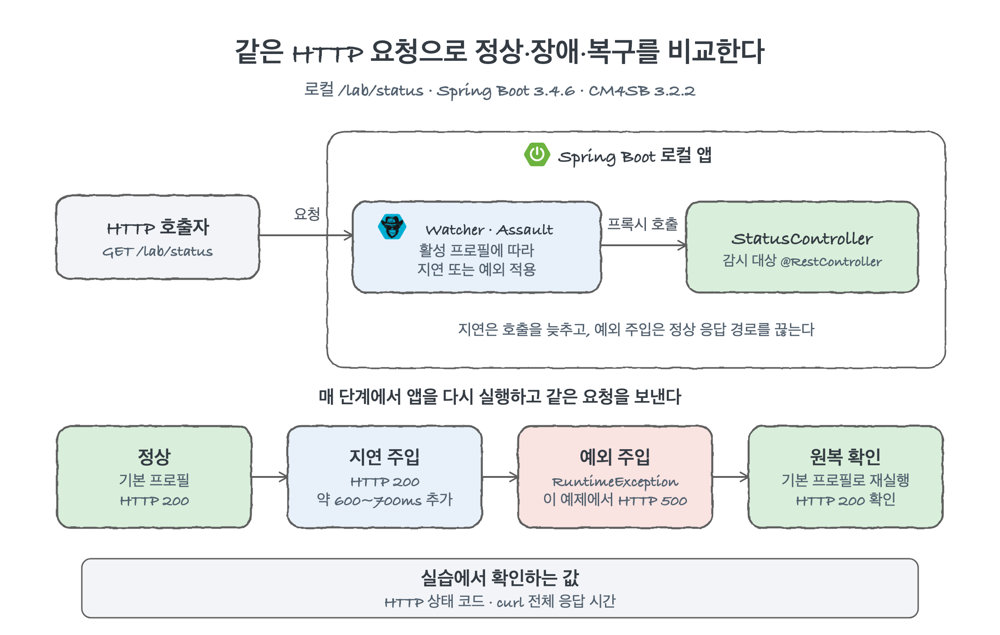

# Resilience Testing with Chaos Monkey for Spring Boot

카오스 테스트는 장애 조건을 의도적으로 만들고 서비스가 기대한 방식으로 동작하는지 확인한다. Chaos Monkey for Spring Boot(CM4SB)는 Spring 빈의 메서드 호출에 지연이나 예외를 주입할 수 있다. 이 문서에서는 로컬 REST API의 정상 응답을 먼저 확인한 뒤 지연과 예외를 각각 실험한다. 실습 기준은 **Java 17, Spring Boot 3.4.6, CM4SB 3.2.2**다. [CM4SB Reference Guide](https://codecentric.github.io/chaos-monkey-spring-boot/latest/) · [CM4SB 3.2.2 Release](https://github.com/codecentric/chaos-monkey-spring-boot/releases/tag/v3.2.2)

## 1. Watcher와 장애 주입 설정

| 설정 | 역할 |
| --- | --- |
| `chaos-monkey` Spring 프로필 | CM4SB 설정을 로드한다. |
| `chaos.monkey.enabled` | 장애 주입을 활성화한다. |
| Watcher | `@RestController`, `@Service` 등 어떤 Spring 빈의 호출을 감시할지 고른다. |
| Assault | 감시 대상 호출에 적용할 지연, 예외 등의 동작을 고른다. |
| `assaults.level` | 감시 대상에 장애를 주입할 빈도에 영향을 준다. 실습의 `1`은 모든 대상 호출에 적용한다. |

CM4SB는 Spring AOP로 프록시를 거쳐 호출되는 메서드를 관찰한다. 테스트하려는 요청이 실제로 감시 대상 메서드를 실행하는지 먼저 확인한다. 같은 빈 내부에서 직접 호출하는 메서드는 프록시를 거치지 않을 수 있다. [CM4SB Watchers and Configuration](https://codecentric.github.io/chaos-monkey-spring-boot/latest/) · [Spring AOP Proxying Mechanisms](https://docs.spring.io/spring-framework/reference/core/aop/proxying.html)

## 2. 로컬 실습 설정

Spring Boot 3.4.6의 Gradle 프로젝트에 아래 의존성을 둔다. Java 예제는 `src/main/java/example/chaos/ChaosLabApplication.java`에 둔다. 실습에서는 `127.0.0.1:18081`에서만 요청을 받는다.

```groovy
dependencies {
    implementation 'org.springframework.boot:spring-boot-starter-web'
    implementation 'de.codecentric:chaos-monkey-spring-boot:3.2.2'
}
```

```java
package example.chaos;

import java.util.Map;

import org.springframework.boot.SpringApplication;
import org.springframework.boot.autoconfigure.SpringBootApplication;
import org.springframework.web.bind.annotation.GetMapping;
import org.springframework.web.bind.annotation.RestController;

@SpringBootApplication
public class ChaosLabApplication {
    public static void main(String[] args) {
        SpringApplication.run(ChaosLabApplication.class, args);
    }
}

@RestController
class StatusController {
    @GetMapping("/lab/status")
    public Map<String, String> status() {
        return Map.of("status", "ok");
    }
}
```

다음 내용을 `src/main/resources/application.yml`에 둔다. 공통 장애 설정은 `chaos-monkey` 프로필에 두고, 지연과 예외는 실행할 때 각각 선택한다.

```yaml
server:
  address: 127.0.0.1
  port: 18081
---
spring:
  config:
    activate:
      on-profile: chaos-monkey
chaos:
  monkey:
    enabled: true
    watcher:
      controller: false
      restController: true
      service: false
      repository: false
      component: false
    assaults:
      level: 1
      latencyActive: false
      exceptionsActive: false
---
spring:
  config:
    activate:
      on-profile: chaos-latency
chaos:
  monkey:
    assaults:
      latencyActive: true
      latencyRangeStart: 600
      latencyRangeEnd: 700
---
spring:
  config:
    activate:
      on-profile: chaos-error
chaos:
  monkey:
    assaults:
      exceptionsActive: true
```



그림의 근거 · [Chaos Monkey 3.2.2 Watcher](https://raw.githubusercontent.com/codecentric/chaos-monkey-spring-boot/v3.2.2/chaos-monkey-docs/src/main/asciidoc/watcher.adoc) · [Chaos Monkey 3.2.2 Assault](https://raw.githubusercontent.com/codecentric/chaos-monkey-spring-boot/v3.2.2/chaos-monkey-docs/src/main/asciidoc/assaults.adoc) · [Spring Boot 3.4 오류 처리](https://docs.spring.io/spring-boot/3.4/reference/web/servlet.html#error-handling)

## 3. 정상 상태와 응답 지연 비교

먼저 `./gradlew bootRun`으로 평상시 동작을 실행한다. 다른 터미널에서 HTTP 상태 코드와 전체 응답 시간을 확인한다.

```sh
curl --silent --show-error --output /dev/null \
  --write-out 'HTTP %{http_code}, total %{time_total}s\n' \
  http://127.0.0.1:18081/lab/status
```

정상 상태에서 `200`을 확인한 뒤 서버를 종료한다. 이제 지연 프로필로 실행하고 같은 요청을 보낸다.

```sh
./gradlew bootRun --args='--spring.profiles.active=chaos-monkey,chaos-latency'
```

이 예제에서는 HTTP 상태가 `200`으로 유지되고, CM4SB가 메서드 호출에 약 600~700ms를 더한다. `curl`의 전체 시간에는 연결과 응답 처리 시간도 포함된다. 실제 서비스에서 이 실험을 적용할 때는 호출자 타임아웃 안에 응답하는지, 제한을 넘었을 때 호출자가 기대한 오류 처리나 대체 동작을 보이는지 확인한다. [CM4SB Latency Assault](https://codecentric.github.io/chaos-monkey-spring-boot/latest/)

## 4. 예외 주입과 원복 후 재확인

지연 실험 서버를 종료한 뒤 예외 프로필로 시작한다.

```sh
./gradlew bootRun --args='--spring.profiles.active=chaos-monkey,chaos-error'
```

같은 요청을 보내면 CM4SB가 대상 호출에 `RuntimeException`을 발생시킨다. 이 예제의 기본 Spring Boot 오류 처리에서는 HTTP `500`이 반환된다. 서비스에 예외 매핑 또는 대체 응답이 있다면 그 계약에 맞는 상태 코드와 응답 내용을 확인한다. [CM4SB Exception Assault](https://codecentric.github.io/chaos-monkey-spring-boot/latest/)

마지막으로 장애 실험을 종료하고 기본 프로필로 다시 실행해 같은 요청이 `200`으로 돌아오는지 확인한다. 결과는 정상, 지연, 예외, 원복으로 구분해 기록하면 상태 코드와 응답 시간이 어느 조건에서 달라졌는지 비교할 수 있다. 여러 요청의 응답 시간과 오류율을 비교하는 방법은 [HTTP Performance Testing with Apache JMeter](04_http_performance_testing_with_apache_jmeter.md)에 이어진다.
