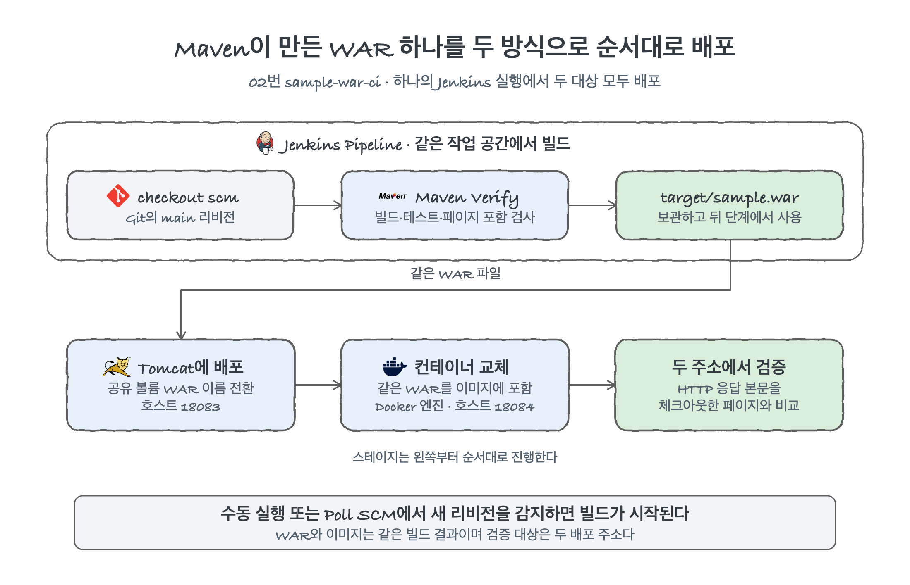

# Jenkins CI/CD with Git, Maven, Tomcat, and Docker

이 실습은 Git의 변경을 Jenkins가 가져오고, Maven이 동일한 WAR를 두 배포 단계에 전달하는 흐름이다. 먼저 실행 중인 Tomcat에 WAR를 배포하고, 이어 같은 WAR를 담은 이미지를 만들어 컨테이너를 교체한다. 두 주소에서 새 파일이 제공되는지 확인한 뒤 Pipeline을 마친다. 실습 환경은 Docker Compose다. [Jenkins Pipeline Getting Started](https://www.jenkins.io/doc/book/pipeline/getting-started/) · [Maven WAR Plugin](https://maven.apache.org/plugins/maven-war-plugin/usage.html)

## 1. Docker 실습 구성

| 서비스 | 역할 |
| --- | --- |
| `jenkins` | Git으로 체크아웃하고 Maven으로 WAR를 빌드한다. Docker CLI도 이 컨테이너에서 실행한다. |
| `git-http` | 실습용 bare 저장소를 내부 Compose 네트워크에서 HTTP로 제공한다. |
| `tomcat` | 공유 볼륨의 WAR를 자동 배포한다. 호스트에서는 `127.0.0.1:18083`으로 접속한다. |
| `docker-engine` | 실습 전용 Docker 엔진이다. 이미지를 빌드하고 두 번째 Tomcat 컨테이너를 실행한다. 호스트 접속 포트는 `18084`다. |

별도의 실습 디렉터리에서 다음 내용을 `jenkins/Dockerfile`로 저장한다. 공식 Jenkins 이미지의 Git과 JDK에 Maven과 Docker CLI·Buildx를 추가한다. Jenkins 작업은 PATH의 `mvn`을 사용한다. 플러그인 파일은 Jenkins의 아카이브 미러에서 내려받는다. [Jenkins Docker Installation](https://www.jenkins.io/doc/book/installing/docker/) · [Plugin Manager Mirror Configuration](https://github.com/jenkinsci/plugin-installation-manager-tool#mirror-setup) · [Maven Docker Image](https://hub.docker.com/_/maven)

```dockerfile
FROM maven:3.9.11-eclipse-temurin-21 AS maven
FROM docker:28-cli AS docker-cli
FROM jenkins/jenkins:lts-jdk21

USER root
COPY --from=maven /usr/share/maven /opt/maven
COPY --from=docker-cli /usr/local/bin/docker /usr/local/bin/docker
COPY --from=docker-cli /usr/local/libexec/docker/cli-plugins/docker-buildx /usr/local/libexec/docker/cli-plugins/docker-buildx
RUN install -d -o jenkins -g jenkins /git-export /war-deploy
ENV PATH="/opt/maven/bin:${PATH}"

USER jenkins
RUN jenkins-plugin-cli --jenkins-update-center-download-url https://archives.jenkins.io/plugins \
    --plugins workflow-aggregator pipeline-model-definition git
```

같은 실습 디렉터리에 `compose.yaml`을 둔다. `docker-engine`은 전용 Docker-in-Docker 서비스이며, Jenkins는 클라이언트 인증서를 읽기 전용으로 받아 TLS로 접근한다. Docker CLI는 별도 배포 호스트의 엔진에 SSH로도 연결할 수 있다. 이 예제에서는 Compose 내부 네트워크의 Docker 엔진을 사용한다. [Jenkins Docker Installation](https://www.jenkins.io/doc/book/installing/docker/) · [Protect Docker Daemon Access](https://docs.docker.com/engine/security/protect-access/)

```yaml
services:
  jenkins:
    build: ./jenkins
    depends_on:
      docker-engine:
        condition: service_healthy
    environment:
      DOCKER_HOST: tcp://docker:2376
      DOCKER_TLS_VERIFY: "1"
      DOCKER_CERT_PATH: /certs/client
    ports:
      - "127.0.0.1:18081:8080"
    volumes:
      - jenkins_home:/var/jenkins_home
      - docker_certs:/certs/client:ro
      - git_repos:/git-export
      - tomcat_apps:/war-deploy
      - ./sample-war:/seed:ro

  git-http:
    image: nginx:1.27-alpine
    depends_on:
      - jenkins
    volumes:
      - type: volume
        source: git_repos
        target: /usr/share/nginx/html
        read_only: true
        volume:
          nocopy: true

  tomcat:
    image: tomcat:10.1-jdk21-temurin
    depends_on:
      - jenkins
    ports:
      - "127.0.0.1:18083:8080"
    volumes:
      - type: volume
        source: tomcat_apps
        target: /usr/local/tomcat/webapps
        volume:
          nocopy: true

  docker-engine:
    image: docker:28-dind
    privileged: true
    environment:
      DOCKER_TLS_CERTDIR: /certs
    networks:
      default:
        aliases:
          - docker
    healthcheck:
      test: ["CMD", "docker", "-H", "unix:///var/run/docker.sock", "info"]
      interval: 2s
      timeout: 3s
      retries: 30
    ports:
      - "127.0.0.1:18084:8080"
    volumes:
      - docker_certs:/certs/client
      - docker_data:/var/lib/docker

volumes:
  jenkins_home:
  git_repos:
  tomcat_apps:
  docker_certs:
  docker_data:
```

## 2. Maven WAR 프로젝트 만들기

`compose.yaml` 옆에 `sample-war/`를 만들고 아래 파일을 저장한다. Maven의 `war` 패키징은 웹 리소스와 의존성을 WAR로 묶는다. 예제는 정적 웹 리소스 하나를 제공하고, 빌드 결과의 파일명은 `target/sample.war`로 고정한다. [Maven WAR Plugin Usage](https://maven.apache.org/plugins/maven-war-plugin/usage.html)

`sample-war/pom.xml`

```xml
<project xmlns="http://maven.apache.org/POM/4.0.0">
  <modelVersion>4.0.0</modelVersion>
  <groupId>example</groupId>
  <artifactId>sample-war</artifactId>
  <version>1.0.0</version>
  <packaging>war</packaging>
  <build>
    <finalName>sample</finalName>
    <plugins>
      <plugin>
        <groupId>org.apache.maven.plugins</groupId>
        <artifactId>maven-war-plugin</artifactId>
        <version>3.4.0</version>
        <configuration>
          <failOnMissingWebXml>false</failOnMissingWebXml>
        </configuration>
      </plugin>
    </plugins>
  </build>
</project>
```

`sample-war/src/main/webapp/index.html`

```html
<!doctype html>
<html lang="en">
  <head><meta charset="utf-8"><title>Jenkins CI/CD</title></head>
  <body><h1>Sample WAR deployed by Jenkins</h1></body>
</html>
```

`sample-war/Dockerfile`

```dockerfile
FROM tomcat:10.1-jdk21-temurin
COPY sample.war /usr/local/tomcat/webapps/sample.war
```

## 3. 체크아웃, 빌드, 배포를 Pipeline으로 연결

다음 선언을 `sample-war/Jenkinsfile`로 저장한다. `checkout scm`은 Item의 SCM 설정을 따른다. Maven의 `verify` 단계까지 실행하고 WAR 안에 예제 페이지가 있는지도 검사한다. 첫 번째 배포에서는 공유 볼륨에 임시 이름으로 복사한 뒤 최종 이름으로 바꿔 Tomcat이 쓰기 중인 WAR를 읽는 상황을 피한다. 두 번째 배포에서는 같은 WAR를 이미지에 담고 빌드 번호로 태그를 붙인다. [Jenkins Pipeline Syntax](https://www.jenkins.io/doc/book/pipeline/syntax/) · [Tomcat Host Automatic Deployment](https://tomcat.apache.org/tomcat-10.1-doc/config/host.html) · [Docker Container Run](https://docs.docker.com/reference/cli/docker/container/run/)

```groovy
pipeline {
    agent any

    options {
        skipDefaultCheckout()
        disableConcurrentBuilds()
    }

    triggers {
        pollSCM('H/2 * * * *')
    }

    stages {
        stage('Checkout') {
            steps {
                deleteDir()
                checkout scm
            }
        }
        stage('Build and Test') {
            steps {
                sh 'mvn -B -ntp clean verify'
                sh 'jar tf target/sample.war | grep -Fx index.html'
                archiveArtifacts artifacts: 'target/sample.war', fingerprint: true
            }
        }
        stage('Deploy WAR to Tomcat') {
            steps {
                sh '''
                    set -eu
                    cp target/sample.war "/war-deploy/.sample.war.$BUILD_NUMBER"
                    mv "/war-deploy/.sample.war.$BUILD_NUMBER" /war-deploy/sample.war
                '''
            }
        }
        stage('Deploy Docker Image') {
            steps {
                sh '''
                    set -eu
                    image="jenkins-lab-sample:$BUILD_NUMBER"
                    mkdir -p target/docker-context
                    cp Dockerfile target/docker-context/Dockerfile
                    cp target/sample.war target/docker-context/sample.war
                    docker build -t "$image" target/docker-context
                    if docker container inspect jenkins-lab-sample >/dev/null 2>&1; then
                        docker container rm -f jenkins-lab-sample
                    fi
                    docker run -d --name jenkins-lab-sample -p 8080:8080 "$image"
                '''
            }
        }
        stage('Verify Deployments') {
            steps {
                sh '''
                    set -eu
                    for url in http://tomcat:8080/sample/index.html http://docker-engine:8080/sample/index.html; do
                        matched=false
                        for attempt in $(seq 1 45); do
                            if curl -fsS --max-time 2 "$url" -o target/live-index.html &&
                               cmp -s src/main/webapp/index.html target/live-index.html; then
                                matched=true
                                break
                            fi
                            sleep 1
                        done
                        if [ "$matched" = false ]; then
                            echo "Expected page did not appear at $url"
                            exit 1
                        fi
                    done
                '''
            }
        }
    }
}
```



그림의 근거 · [Pipeline 실행과 Poll SCM](https://www.jenkins.io/doc/book/pipeline/syntax/#triggers) · [Maven WAR 패키징](https://maven.apache.org/plugins/maven-war-plugin/usage.html) · [Tomcat WAR 자동 배포](https://tomcat.apache.org/tomcat-10.1-doc/config/host.html#Automatic_Application_Deployment) · [Docker 컨테이너 실행](https://docs.docker.com/reference/cli/docker/container/run/)

## 4. Git 저장소와 Jenkins Item 설정

아래 명령을 실행하면 실습 파일을 컨테이너 안에서 커밋하고, 내부 HTTP 주소로 제공한다. `git update-server-info`는 정적 HTTP 서버를 통해 복제할 수 있도록 브랜치와 객체 정보를 갱신한다. [Git update-server-info](https://git-scm.com/docs/git-update-server-info)

```sh
docker compose up -d --build
docker compose exec -T jenkins git --version
docker compose exec -T jenkins mvn --version
docker compose exec -T jenkins docker version

docker compose exec -T jenkins sh -eu <<'SH'
repo=/git-export/sample-war.git
work="$JENKINS_HOME/lab-source"
git init --bare --initial-branch=main "$repo"
git init --initial-branch=main "$work"
cp -R /seed/. "$work/"
cd "$work"
git config user.name 'Jenkins Lab'
git config user.email 'jenkins-lab@example.invalid'
git add .
git commit -m 'Add sample WAR pipeline'
git remote add origin "$repo"
git push origin main
git --git-dir="$repo" update-server-info
git ls-remote http://git-http/sample-war.git refs/heads/main
SH
```

1. `http://127.0.0.1:18081`을 열어 [01번의 Jenkins 초기 설정](01_devops_ci_cd_and_jenkins_fundamentals.md#4-docker에서-jenkins-시작하기)을 진행한다. 초기 비밀번호는 이 실습 디렉터리에서 조회한다. 필요한 Pipeline과 Git 플러그인이 설치되어 있는지 확인한다.
2. **New Item**에서 `sample-war-ci`라는 **Pipeline**을 만든다. **Pipeline script from SCM → Git**에서 저장소 URL은 `http://git-http/sample-war.git`, Branch Specifier는 `*/main`, Script Path는 `Jenkinsfile`로 설정하고 **Lightweight checkout**은 해제한다.
3. **Build Now**로 첫 실행을 시작한다. 콘솔의 `Finished: SUCCESS`와 아티팩트 `target/sample.war`를 확인한다. `http://127.0.0.1:18083/sample/`과 `http://127.0.0.1:18084/sample/`에 같은 페이지가 표시된다. [Jenkins Pipeline from SCM](https://www.jenkins.io/doc/book/pipeline/getting-started/) · [Jenkins Git Plugin](https://plugins.jenkins.io/git/)

## 5. Poll SCM으로 변경 배포 확인

`pollSCM('H/2 * * * *')`는 해시로 분산된 일정에서 약 2분마다 저장소를 조회한다. 변경이 있을 때 빌드를 예약한다. 첫 수동 실행 후 아래 명령으로 예제 페이지를 바꿔 커밋한다. Polling Log에서 변경을 감지했는지 보고, 다음 빌드가 끝나면 두 배포 주소에서 새 문구를 확인한다. [Jenkins Pipeline Triggers](https://www.jenkins.io/doc/book/pipeline/syntax/#triggers) · [Git Plugin Polling](https://plugins.jenkins.io/git/)

```sh
docker compose exec -T jenkins sh -eu <<'SH'
cd "$JENKINS_HOME/lab-source"
printf '<h1>Updated by SCM polling</h1>\n' > src/main/webapp/index.html
git add src/main/webapp/index.html
git commit -m 'Update deployment smoke page'
git push origin main
git --git-dir=/git-export/sample-war.git update-server-info
SH
```

이 실습의 Docker 배포는 기존 컨테이너를 교체하는 방식이므로 전환 중 짧은 중단이 생길 수 있다. 빌드마다 WAR와 이미지 버전이 남아 어떤 커밋을 배포했는지 추적할 수 있다. 실습 환경을 중지할 때는 같은 디렉터리에서 `docker compose down`을 실행한다. [Jenkins Pipeline Artifacts](https://www.jenkins.io/doc/pipeline/steps/core/#archiveartifacts-archive-the-artifacts) · [Docker Compose Down](https://docs.docker.com/reference/cli/docker/compose/down/)
