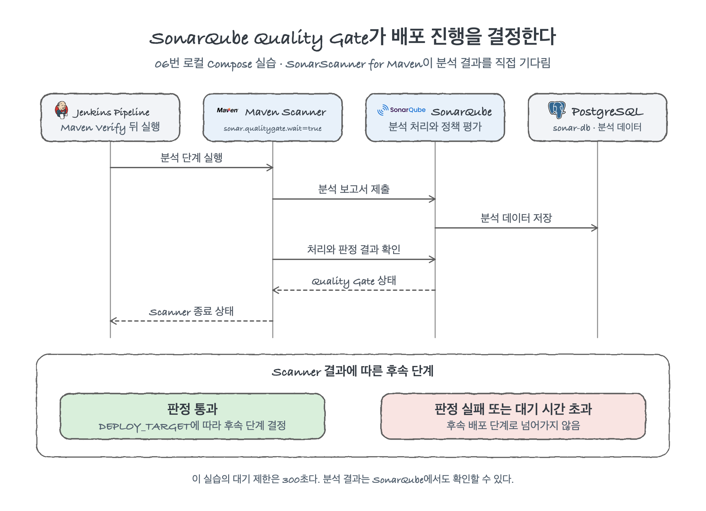
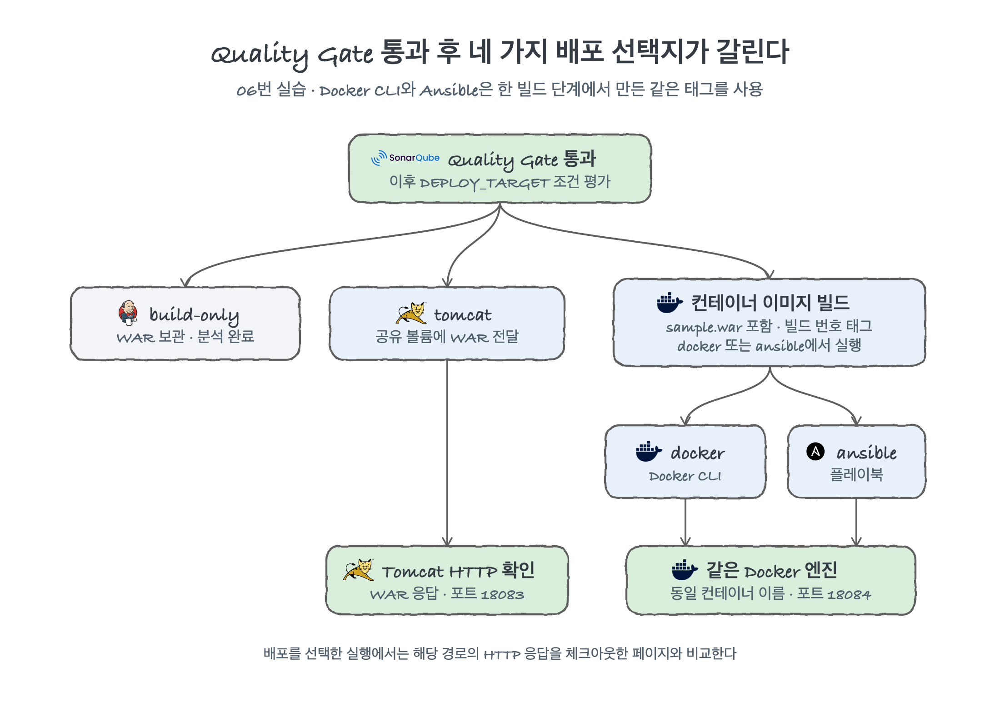

# Cloud Deployment Workflows with Jenkins and SonarQube

AWS EC2에 배포할 때 필요한 서버 역할을 살펴보고, 같은 배포 흐름을 로컬 Docker Compose에서 실습한다. Jenkins가 Git에서 코드를 가져와 Maven으로 WAR를 빌드하고, SonarQube 품질 기준을 통과하면 Tomcat, Docker CLI, Ansible 중 선택한 경로로 배포한다.

## 1. AWS 배포 구성과 Docker 실습 환경

EC2 인스턴스를 만들 때 AMI로 운영체제와 초기 소프트웨어 구성을 선택한다. VPC와 서브넷이 네트워크 위치를 정하고, 보안 그룹이 허용할 트래픽을 제어한다. 인스턴스에서 실행되는 작업이 AWS API를 호출해야 한다면 IAM 역할을 연결한다. AMI는 EC2 인스턴스의 시작 이미지이며 Docker 이미지는 실행 중인 호스트에 올릴 애플리케이션과 런타임을 패키징한다. [Amazon EC2 AMIs](https://docs.aws.amazon.com/AWSEC2/latest/UserGuide/AMIs.html) · [Launch an EC2 Instance](https://docs.aws.amazon.com/AWSEC2/latest/UserGuide/launching-instance.html)

| 역할 | AWS 배포 구성 예 | Docker Compose 실습 |
| --- | --- | --- |
| CI/CD 실행 | Jenkins 컨트롤러와 빌드 에이전트 | `jenkins`가 빌드와 배포 실행 |
| WAR 배포 | Tomcat이 실행 중인 배포 호스트 | `tomcat`의 공유 볼륨에 WAR 전달 |
| 컨테이너 배포 | 애플리케이션 컨테이너를 실행하는 Docker 호스트 | 격리된 `docker-engine`에 TLS로 연결 |
| 배포 자동화 | 배포 대상을 관리하는 Ansible 실행 환경 | Jenkins 안에서 플레이북을 실행해 `docker-engine` 관리 |
| 코드 품질 분석 | SonarQube 서비스와 영속 데이터베이스 | `sonarqube`와 `sonar-db` |

## 2. Docker Compose에 SonarQube 추가

[02번 실습](02_jenkins_ci_cd_with_git_maven_tomcat_and_docker.md)의 `compose.yaml`과 [05번 실습](05_advanced_jenkins_pipelines_with_maven_tomcat_and_docker.md)의 `sample-war/Jenkinsfile`을 이어서 사용한다. 같은 디렉터리에 `compose.sonar.yaml`을 추가한다. Jenkins는 내부 네트워크 주소로 SonarQube에 접근하고, 브라우저에서는 호스트의 `19000`번 포트를 사용한다. [Compose Merge](https://docs.docker.com/compose/how-tos/multiple-compose-files/merge/) · [SonarQube Docker Setup](https://docs.sonarsource.com/sonarqube-community-build/server-installation/from-docker-image/set-up-and-start-container)

```yaml
services:
  jenkins:
    environment:
      SONAR_HOST_URL: http://sonarqube:9000

  sonarqube:
    image: sonarqube:community
    depends_on:
      sonar-db:
        condition: service_healthy
    environment:
      SONAR_JDBC_URL: jdbc:postgresql://sonar-db:5432/sonar
      SONAR_JDBC_USERNAME: sonar
      SONAR_JDBC_PASSWORD: ${SONAR_DB_PASSWORD:?Set SONAR_DB_PASSWORD in .env}
    ports:
      - "127.0.0.1:19000:9000"
    volumes:
      - sonar_data:/opt/sonarqube/data
      - sonar_extensions:/opt/sonarqube/extensions
      - sonar_logs:/opt/sonarqube/logs

  sonar-db:
    image: postgres:16-alpine
    environment:
      POSTGRES_DB: sonar
      POSTGRES_USER: sonar
      POSTGRES_PASSWORD: ${SONAR_DB_PASSWORD:?Set SONAR_DB_PASSWORD in .env}
    healthcheck:
      test: ["CMD", "pg_isready", "-U", "sonar", "-d", "sonar"]
      interval: 3s
      timeout: 3s
      retries: 20
    volumes:
      - sonar_db_data:/var/lib/postgresql/data

volumes:
  sonar_data:
  sonar_extensions:
  sonar_logs:
  sonar_db_data:
```

기존 `jenkins/Dockerfile`에서 마지막 `USER jenkins` 줄부터 아래 내용으로 교체한다. SonarQube가 샘플 웹 소스를 분석할 때 사용하는 Node.js와 Docker 배포를 실행할 Ansible을 추가한다. [SonarQube Node.js Requirements](https://docs.sonarsource.com/sonarqube-community-build/analyzing-source-code/languages/javascript-typescript-css#nodejs) · [Installing Ansible Collections](https://docs.ansible.com/ansible/latest/collections_guide/collections_installing.html)

```dockerfile
COPY --from=node:22-bookworm-slim /usr/local/bin/node /usr/local/bin/node

RUN apt-get update \
    && apt-get install -y --no-install-recommends python3 python3-venv \
    && rm -rf /var/lib/apt/lists/*

ENV PATH="/opt/ansible/bin:${PATH}" \
    ANSIBLE_COLLECTIONS_PATH=/opt/ansible-collections
RUN python3 -m venv /opt/ansible \
    && pip install --no-cache-dir ansible-core==2.19.10 requests==2.32.5 \
    && ansible-galaxy collection install community.docker:==4.8.1 -p /opt/ansible-collections

USER jenkins
RUN jenkins-plugin-cli --jenkins-update-center-download-url https://archives.jenkins.io/plugins \
    --plugins workflow-aggregator pipeline-model-definition git credentials-binding \
    delivery-pipeline-plugin:1131.v20dd664f6ddd
```

실습 디렉터리의 `.env`에 `SONAR_DB_PASSWORD`를 원하는 로컬 DB 비밀번호로 설정하고 Git에서 제외한다. 설정을 합쳐 컨테이너를 시작하고, 상태 응답의 `status`가 `UP`이 될 때까지 기다린다. [Compose Variable Interpolation](https://docs.docker.com/compose/how-tos/environment-variables/variable-interpolation/) · [SonarQube Host Requirements](https://docs.sonarsource.com/sonarqube-community-build/server-installation/pre-installation/linux)

```sh
docker compose -f compose.yaml -f compose.sonar.yaml up -d --build
curl -fsS http://127.0.0.1:19000/api/system/status
```

1. `http://127.0.0.1:19000`에서 SonarQube에 로그인하고 초기 관리자 비밀번호를 변경한다. 로컬 프로젝트를 만들고 프로젝트 키를 `sample-war`로 지정한다.
2. SonarQube의 **My Account → Security**에서 해당 프로젝트 범위의 **Project Analysis Token**을 발급한다.
3. Jenkins의 **Manage Jenkins → Credentials**에서 토큰을 **Secret text**로 추가하고 ID를 `sonar-lab-token`으로 설정한다. 이후 Pipeline에서 이 ID를 참조한다. [SonarQube Analysis Tokens](https://docs.sonarsource.com/sonarqube-community-build/user-guide/managing-tokens) · [Jenkins Credentials](https://www.jenkins.io/doc/book/using/using-credentials/)

## 3. 배포 전에 Quality Gate 통과 확인

05번 `sample-war/Jenkinsfile`에서 `Maven Verify` 바로 뒤에 아래 단계를 추가한다. WAR 실습의 소스는 `src/main/webapp`에 있다. Scanner는 분석 결과의 판정을 기다리고, Quality Gate가 실패하거나 제한 시간 내에 결과를 받지 못하면 후속 배포 단계로 넘어가지 않는다. [SonarScanner for Maven](https://docs.sonarsource.com/sonarqube-community-build/analyzing-source-code/scanners/sonarscanner-for-maven) · [SonarQube Analysis Parameters](https://docs.sonarsource.com/sonarqube-community-build/analyzing-source-code/analysis-parameters/parameters-not-settable-in-ui) · [Jenkins Credentials Binding](https://www.jenkins.io/doc/pipeline/steps/credentials-binding/)

```groovy
        stage('SonarQube Quality Gate') {
            steps {
                withCredentials([string(credentialsId: 'sonar-lab-token', variable: 'SONAR_TOKEN')]) {
                    sh '''
                        set +x
                        mvn -B -ntp \
                          org.sonarsource.scanner.maven:sonar-maven-plugin:5.2.0.4988:sonar \
                          -Dsonar.host.url="$SONAR_HOST_URL" \
                          -Dsonar.projectKey=sample-war \
                          -Dsonar.sources=src/main/webapp \
                          -Dsonar.nodejs.executable=/usr/local/bin/node \
                          -Dsonar.scanner.skipJreProvisioning=true \
                          -Dsonar.qualitygate.wait=true \
                          -Dsonar.qualitygate.timeout=300
                    '''
                }
            }
        }
```



그림의 근거 · [SonarScanner for Maven](https://docs.sonarsource.com/sonarqube-community-build/analyzing-source-code/scanners/sonarscanner-for-maven) · [Quality Gate 대기 옵션](https://docs.sonarsource.com/sonarqube-community-build/analyzing-source-code/analysis-parameters/parameters-not-settable-in-ui) · [SonarQube Docker와 데이터베이스](https://docs.sonarsource.com/sonarqube-community-build/server-installation/from-docker-image/set-up-and-start-container)

## 4. Jenkins에서 배포 경로 선택

`sample-war/deploy.yml`을 만든다. `ansible-playbook`은 Jenkins 컨테이너 안에서 실행되고, Docker 모듈은 기존 Compose 설정의 `DOCKER_HOST`와 TLS 인증서를 사용해 실습용 엔진에 접근한다. 이미지 태그는 해당 Jenkins 빌드가 만들고 플레이북에 전달한다. [Ansible docker_container](https://docs.ansible.com/ansible/latest/collections/community/docker/docker_container_module.html)

```yaml
- name: Deploy sample WAR image
  hosts: localhost
  connection: local
  gather_facts: false
  vars:
    ansible_python_interpreter: "{{ ansible_playbook_python }}"
  tasks:
    - name: Run the built image
      community.docker.docker_container:
        name: jenkins-lab-sample
        image: "{{ image_ref }}"
        pull: never
        state: started
        published_ports:
          - "8080:8080"
```

Jenkinsfile의 `DEPLOY_TARGET` 선택지에 `ansible`을 추가해 `['build-only', 'tomcat', 'docker', 'ansible']`로 만든다. 기존 `Deploy to Docker` 단계를 아래 세 단계로 교체한다. 두 컨테이너 배포 경로가 동일한 이미지 빌드 단계를 거친다. [Jenkins Pipeline Syntax](https://www.jenkins.io/doc/book/pipeline/syntax/)

```groovy
        stage('Build Deployment Image') {
            when {
                expression { params.DEPLOY_TARGET in ['docker', 'ansible'] }
            }
            steps {
                sh '''
                    set -eu
                    mkdir -p target/docker-context
                    cp Dockerfile target/docker-context/Dockerfile
                    cp target/sample.war target/docker-context/sample.war
                    docker build -t "jenkins-lab-sample:$BUILD_NUMBER" target/docker-context
                '''
            }
        }
        stage('Deploy to Docker') {
            when {
                expression { params.DEPLOY_TARGET == 'docker' }
            }
            steps {
                sh '''
                    set -eu
                    if docker container inspect jenkins-lab-sample >/dev/null 2>&1; then
                        docker container rm -f jenkins-lab-sample
                    fi
                    docker run -d --name jenkins-lab-sample -p 8080:8080 \
                      "jenkins-lab-sample:$BUILD_NUMBER"
                '''
            }
        }
        stage('Deploy with Ansible') {
            when {
                expression { params.DEPLOY_TARGET == 'ansible' }
            }
            steps {
                sh '''
                    set -eu
                    ansible-playbook -i localhost, --syntax-check deploy.yml
                    ansible-playbook -i localhost, deploy.yml \
                      -e "image_ref=jenkins-lab-sample:$BUILD_NUMBER"
                '''
            }
        }
```

`Verify Deployment`의 실행 조건도 `params.DEPLOY_TARGET in ['tomcat', 'docker', 'ansible']`로 바꾼다. 검증 단계는 Tomcat을 선택하면 `tomcat`으로, 두 컨테이너 배포 방식에서는 `docker-engine`으로 요청을 보내 체크아웃한 페이지와 응답 내용을 비교한다.



그림의 근거 · [Jenkins 조건부 스테이지](https://www.jenkins.io/doc/book/pipeline/syntax/) · [Ansible 컨테이너 배포](https://docs.ansible.com/projects/ansible/latest/collections/community/docker/docker_container_module.html) · [Docker 컨테이너 실행](https://docs.docker.com/reference/cli/docker/container/run/)

## 5. 배포 결과 확인

이미 만든 실습 Git 저장소에 변경 사항을 올린다. 처음부터 실행하는 경우에는 수정한 `Jenkinsfile`과 `deploy.yml`을 `sample-war/`에 둔 상태에서 02번의 Git 저장소 초기화 절차를 진행한다. [Git update-server-info](https://git-scm.com/docs/git-update-server-info)

```sh
docker compose -f compose.yaml -f compose.sonar.yaml exec -T jenkins sh -eu <<'SH'
cd "$JENKINS_HOME/lab-source"
cp /seed/Jenkinsfile /seed/deploy.yml .
git add Jenkinsfile deploy.yml
git commit -m 'Add quality gate and Ansible deployment'
git push origin main
git --git-dir=/git-export/sample-war.git update-server-info
SH
```

`sample-war-ci`를 기본값으로 실행해 Jenkins 콘솔과 SonarQube 프로젝트에서 Quality Gate 상태를 확인한다. 새 파라미터가 반영되면 **Build with Parameters**로 각 경로를 실행한다.

| `DEPLOY_TARGET` | Quality Gate 통과 후 확인할 결과 |
| --- | --- |
| `build-only` | WAR를 빌드·보관하고 SonarQube 분석을 완료한다. Poll SCM 실행의 기본값이다. |
| `tomcat` | 공유 볼륨으로 WAR를 배포한다. `http://127.0.0.1:18083/sample/`에서 확인한다. |
| `docker` | Docker CLI로 컨테이너를 교체한다. `http://127.0.0.1:18084/sample/`에서 확인한다. |
| `ansible` | 플레이북이 컨테이너를 원하는 이미지 상태로 맞춘다. `http://127.0.0.1:18084/sample/`에서 확인한다. |

`docker`와 `ansible`은 같은 컨테이너 이름과 포트를 사용한다. 실행 순서에 따라 마지막 배포 결과가 `18084`번 포트에 표시된다.
