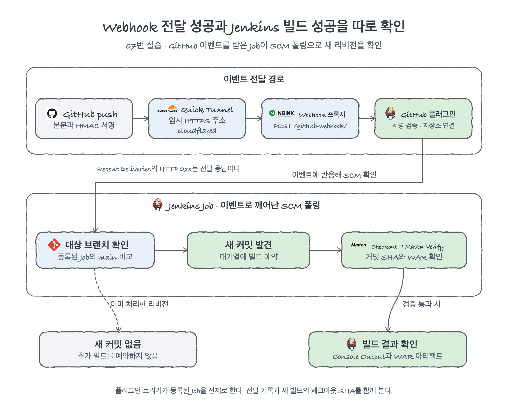

# Triggering Jenkins Builds with GitHub Webhooks

GitHub 저장소에 커밋을 푸시하면 GitHub가 Jenkins에 `push` 이벤트를 전달한다. Jenkins의 GitHub 플러그인은 이벤트의 저장소와 연결된 Job을 찾고, Git 플러그인으로 대상 브랜치의 변경을 확인해 빌드를 예약한다. 이 실습은 Jenkins, Webhook 프록시, 임시 HTTPS 터널을 Docker Compose로 실행한다. [Jenkins GitHub Plugin](https://plugins.jenkins.io/github/) · [GitHub Push Event](https://docs.github.com/en/webhooks/webhook-events-and-payloads#push)

## 1. Docker에서 Jenkins 실행

새 실습 디렉터리에 다음 내용을 `Dockerfile`로 저장한다. 공식 Jenkins 이미지에 Maven과 GitHub 플러그인을 추가한다. Maven 프로젝트는 [02번의 샘플 WAR](02_jenkins_ci_cd_with_git_maven_tomcat_and_docker.md#2-maven-war-프로젝트-만들기)를 사용한다. [Jenkins Docker Installation](https://www.jenkins.io/doc/book/installing/docker/) · [GitHub Plugin Releases](https://plugins.jenkins.io/github/#plugin-releases)

```dockerfile
FROM maven:3.9.11-eclipse-temurin-21 AS maven
FROM jenkins/jenkins:lts-jdk21

USER root
COPY --from=maven /usr/share/maven /opt/maven
ENV PATH="/opt/maven/bin:${PATH}"

USER jenkins
RUN jenkins-plugin-cli --jenkins-update-center-download-url https://archives.jenkins.io/plugins \
    --plugins workflow-aggregator pipeline-model-definition git github:1.47.0
```

같은 디렉터리에 `compose.yaml`과 `webhook.conf`를 만든다. Jenkins UI와 로컬 점검용 프록시 포트는 루프백에 바인딩한다. `tunnel`은 `github` 프로필을 사용할 때만 시작한다. [Compose Profiles](https://docs.docker.com/compose/how-tos/profiles/) · [Cloudflare Quick Tunnels](https://developers.cloudflare.com/tunnel/get-started/quick-tunnels/)

```yaml
services:
  jenkins:
    build: .
    ports:
      - "127.0.0.1:18081:8080"
    volumes:
      - jenkins_home:/var/jenkins_home

  webhook-proxy:
    image: nginx:1.27-alpine
    depends_on:
      - jenkins
    ports:
      - "127.0.0.1:18088:8080"
    volumes:
      - ./webhook.conf:/etc/nginx/conf.d/default.conf:ro

  tunnel:
    image: cloudflare/cloudflared:latest
    profiles: ["github"]
    depends_on:
      - webhook-proxy
    command: ["tunnel", "--no-autoupdate", "--url", "http://webhook-proxy:8080"]

volumes:
  jenkins_home:
```

프록시는 `POST /github-webhook/`만 Jenkins로 전달한다. 이 경로에서 GitHub 플러그인이 요청 본문과 서명 헤더를 받아 검증한다. [NGINX proxy_pass](https://nginx.org/en/docs/http/ngx_http_proxy_module.html#proxy_pass) · [GitHub Webhook Delivery Validation](https://docs.github.com/en/webhooks/using-webhooks/validating-webhook-deliveries)

```nginx
server {
    listen 8080;

    location = /github-webhook/ {
        if ($request_method != POST) {
            return 405;
        }
        client_max_body_size 25m;
        proxy_pass http://jenkins:8080;
    }

    location / {
        return 404;
    }
}
```

```sh
docker compose config --quiet
docker compose up -d --build
docker compose exec -T webhook-proxy nginx -t
docker compose exec -T jenkins cat /var/jenkins_home/secrets/initialAdminPassword
```

`http://127.0.0.1:18081`에서 [01번의 Jenkins 초기 설정](01_devops_ci_cd_and_jenkins_fundamentals.md#4-docker에서-jenkins-시작하기)을 진행한다. 앞선 실습이 `18081`을 사용 중이면 이 실습의 호스트 포트를 다른 값으로 바꾼다.

## 2. GitHub 저장소와 Pipeline 연결

GitHub 실습 저장소의 `main` 브랜치에 `pom.xml`, `src/main/webapp/index.html`, 아래 `Jenkinsfile`을 커밋한다. `githubPush()`가 Webhook 기반 폴링을 활성화한다. 이벤트로 깨어난 폴링이 새 커밋을 확인하면 Maven 검증을 실행하고 WAR를 보관한다. [Jenkins Pipeline Syntax](https://www.jenkins.io/doc/book/pipeline/syntax/#triggers) · [Jenkins GitHub Plugin](https://plugins.jenkins.io/github/)

```groovy
pipeline {
    agent any

    options {
        skipDefaultCheckout()
        disableConcurrentBuilds()
    }

    triggers {
        githubPush()
    }

    stages {
        stage('Checkout') {
            steps {
                checkout scm
            }
        }
        stage('Maven Verify') {
            steps {
                sh 'mvn -B -ntp clean verify'
                archiveArtifacts artifacts: 'target/sample.war', fingerprint: true
            }
        }
    }
}
```

1. Jenkins에서 `sample-war-webhook`이라는 **Pipeline** Item을 만든다.
2. **Pipeline script from SCM → Git**에서 저장소 URL을 `https://github.com/OWNER/REPO.git`으로, Branch Specifier를 `*/main`으로, Script Path를 `Jenkinsfile`로 설정한다. 비공개 저장소라면 체크아웃에 필요한 Jenkins 자격 증명을 선택한다.
3. **Build Now**로 한 번 실행한다. 이 실행으로 Jenkins가 `githubPush()` 트리거를 등록하고 이후 변경을 비교할 Git 리비전을 기록한다. 빌드 결과와 `target/sample.war`를 확인한다. [Jenkins Pipeline from SCM](https://www.jenkins.io/doc/book/pipeline/getting-started/) · [Jenkins Git Plugin Credentials](https://plugins.jenkins.io/git/#plugin-content-credentials)

## 3. Webhook 서명과 HTTPS 주소 설정

1. Jenkins의 **Manage Jenkins → Credentials**에 충분히 긴 임의 문자열을 **Secret text**로 등록하고 ID를 `github-webhook-secret`으로 지정한다.
2. **Manage Jenkins → System → GitHub → Advanced → Shared secrets**에서 해당 자격 증명을 선택하고 서명 알고리즘을 **SHA-256**으로 설정한다. GitHub는 요청 본문의 HMAC 서명을 `X-Hub-Signature-256` 헤더로 전달한다. [Jenkins GitHub Shared Secrets Configuration](https://github.com/jenkinsci/github-plugin/blob/v1.47.0/src/main/resources/org/jenkinsci/plugins/github/config/GitHubPluginConfig/config.groovy) · [GitHub Webhook Delivery Validation](https://docs.github.com/en/webhooks/using-webhooks/validating-webhook-deliveries)

터널 서비스를 시작하고 로그에서 `https://…trycloudflare.com` 주소를 확인한다. 이 임시 주소는 Webhook 프록시로 연결되며, 터널을 다시 시작하면 주소가 바뀐다. [Cloudflare Quick Tunnels](https://developers.cloudflare.com/tunnel/get-started/quick-tunnels/)

```sh
docker compose --profile github up -d tunnel
docker compose logs --tail=30 tunnel
```

GitHub 저장소의 **Settings → Webhooks → Add webhook**에서 다음 값을 지정한다. 저장하면 GitHub가 연결 확인용 `ping` 이벤트를 보낸다. [Creating GitHub Webhooks](https://docs.github.com/en/webhooks/using-webhooks/creating-webhooks)

| 항목 | 값 |
| --- | --- |
| Payload URL | `https://<실습-터널-주소>/github-webhook/` |
| Content type | `application/json` |
| Secret | Jenkins에 등록한 Secret text와 동일한 값 |
| SSL verification | 활성화 |
| Events | **Just the push event** |
| Active | 활성화 |



그림의 근거 · [GitHub Webhook 서명](https://docs.github.com/en/webhooks/using-webhooks/validating-webhook-deliveries) · [Cloudflare Quick Tunnel](https://developers.cloudflare.com/tunnel/get-started/quick-tunnels/) · [NGINX 요청 전달](https://nginx.org/en/docs/http/ngx_http_proxy_module.html#proxy_pass) · [Jenkins GitHub 트리거](https://www.jenkins.io/doc/pipeline/steps/params/pipelinetriggers/) · [GitHub 플러그인 서명 설정](https://github.com/jenkinsci/github-plugin/blob/v1.47.0/src/main/resources/org/jenkinsci/plugins/github/config/GitHubPluginConfig/config.groovy)

## 4. 푸시부터 빌드까지 확인

1. GitHub Webhook의 **Recent Deliveries**에서 `ping` 응답이 `2xx`인지 확인한다.
2. 샘플 페이지를 수정해 `main`에 새 커밋을 푸시한다. **Recent Deliveries**의 `push` 응답과 Jenkins의 새 빌드가 모두 확인되어야 한다.
3. 새 빌드의 콘솔에서 GitHub 푸시로 시작했는지 확인하고, 체크아웃한 커밋이 푸시한 SHA와 일치하는지 비교한다. `Maven Verify`가 성공하면 `target/sample.war`가 아티팩트에 남는다.

요청이 `2xx`인데 빌드가 시작되지 않으면 Job의 SCM URL, `*/main` 설정과 `githubPush()`가 등록된 첫 실행을 확인한다. 이미 빌드한 커밋의 전달을 다시 보내면 Git 폴링에서 새 변경을 찾지 못할 수 있다. 전달이 실패하면 먼저 터널 주소, 끝 슬래시, GitHub와 Jenkins에 입력한 서명 비밀값을 확인한다. [Troubleshooting GitHub Webhooks](https://docs.github.com/en/webhooks/testing-and-troubleshooting-webhooks/troubleshooting-webhooks) · [Jenkins GitHub Plugin](https://plugins.jenkins.io/github/)

실습을 마치면 GitHub에서 실습 Webhook을 비활성화하고 터널을 중지한다. Jenkins와 빌드 데이터는 실습 볼륨에 남는다.

```sh
docker compose --profile github stop tunnel
```
