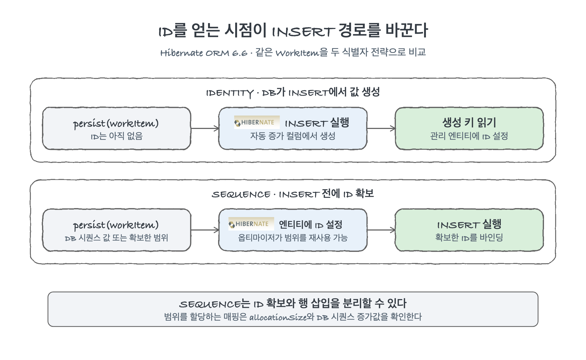

# JPA Entity Mapping and Identifier Strategies

엔티티 매핑은 테이블·컬럼 이름, 값의 저장 방식, 행의 식별자를 정의한다. 도메인 객체가 동작할 때 지켜야 할 검증과 데이터베이스가 보장할 제약도 같이 검토한다.

## 1. 엔티티와 필드 접근

엔티티에는 기본 키와 `public` 또는 `protected` 기본 생성자가 필요하다. 매핑 어노테이션을 필드에 두면 필드 접근을, getter에 두면 프로퍼티 접근을 사용한다. 상속 계층에서 접근 방식을 명시해야 하는 경우 `@Access`를 사용한다. [Jakarta Persistence 3.1 · 필드와 프로퍼티 접근](https://jakarta.ee/specifications/persistence/3.1/jakarta-persistence-spec-3.1#a113) · [Jakarta Persistence 3.1 · 기본 키와 엔티티 식별](https://jakarta.ee/specifications/persistence/3.1/jakarta-persistence-spec-3.1#a132)

```java
@Entity
@Table(name = "work_items")
public class WorkItem {
    @Id
    @GeneratedValue(strategy = GenerationType.SEQUENCE, generator = "work_item_seq")
    @SequenceGenerator(name = "work_item_seq",
                       sequenceName = "work_item_id_seq", allocationSize = 50)
    private Long id;

    @Column(nullable = false, length = 120)
    private String title;

    @Enumerated(EnumType.STRING)
    @Column(nullable = false, length = 24)
    private WorkStatus status = WorkStatus.OPEN;

    private LocalDate dueDate;

    @Transient
    private String displayHint;

    protected WorkItem() {}

    public WorkItem(String title, LocalDate dueDate) {
        this.title = title;
        this.dueDate = dueDate;
    }
}
```

`WorkStatus`는 `OPEN`, `CLOSED`, `ARCHIVED` 상수를 가진 enum으로 둔다.

`@Column`으로 컬럼 이름, 길이, null 허용 여부 등을 표현할 수 있다. 마이그레이션으로 스키마를 관리한다면 실제 DDL에도 제약을 반영한다. `@Column(nullable = false)`는 입력 메시지를 만들어 주는 애플리케이션 검증과 별개의 설정이다.

| 매핑 | 쓰임 |
| --- | --- |
| `@Enumerated(EnumType.STRING)` | enum 상수 이름을 저장한다. 상수 이름을 변경할 때 기존 데이터 이행을 검토한다. |
| `@Temporal` | `java.util.Date`나 `Calendar`의 날짜·시간 형태를 지정한다. `LocalDate` 같은 `java.time` 타입에는 적용하지 않는다. |
| `@Lob` | 긴 문자 데이터나 바이트 데이터를 DB의 LOB 타입으로 매핑한다. |
| `@Transient` | 계산 결과나 표시용 상태 등 영속화 대상에서 제외할 속성을 지정한다. |

## 2. 기본 키 생성 전략

| 전략 | ID 생성 위치 | 확인할 부분 |
| --- | --- | --- |
| 직접 할당 | 애플리케이션이 `persist()` 전에 지정 | 유일성 및 재시도 때 ID의 일관성 |
| `IDENTITY` | DB의 자동 증가 컬럼 | 삽입 후 ID를 받는 시점과 삽입 배치 제약 |
| `SEQUENCE` | DB 시퀀스 | DDL의 증가값과 `allocationSize` 정합성 |
| `TABLE` | 별도의 키 생성 테이블 | 테이블 접근 비용과 동시 갱신 병목 |
| `UUID` | 구현체가 생성한 UUID | JPA 3.1 이상과 컬럼 타입 |
| `AUTO` | 키 타입, DB, 구현체에 맞춰 결정 | 실제 사용되는 전략과 스키마 요구사항 |

시퀀스 ID를 할당 단위로 확보하면 DB에 값을 요청하는 횟수를 줄일 수 있다. ID는 객체를 안정적으로 참조하는 데 사용하고, 업무적으로 고유한 값은 별도의 제약으로 관리할 수 있다. [Jakarta Persistence 3.1 · GeneratedValue](https://jakarta.ee/specifications/persistence/3.1/jakarta-persistence-spec-3.1#a14790) · [Hibernate 6.6 · 식별자 매핑](https://docs.hibernate.org/orm/6.6/userguide/html_single/#identifiers)



그림의 근거 · [JPA 식별자 생성](https://jakarta.ee/specifications/persistence/3.1/jakarta-persistence-spec-3.1#a14790) · [Hibernate 식별자 매핑](https://docs.hibernate.org/orm/6.6/userguide/html_single/#identifiers)

## 3. 스키마 생성 범위

폐기 가능한 테스트 DB에서는 스키마 자동 생성을 사용할 수 있다. 변경 이력이 필요한 환경에서는 마이그레이션으로 스키마를 적용하고, 애플리케이션 설정은 대상 환경과 매핑의 불일치를 확인하는 데 활용한다. Hibernate의 `hibernate.hbm2ddl.auto=validate`는 기존 스키마를 검사하는 설정이다. [Hibernate 6.6 · 스키마 관리 설정](https://docs.hibernate.org/orm/6.6/javadocs/org/hibernate/cfg/SchemaToolingSettings.html#HBM2DDL_AUTO)
