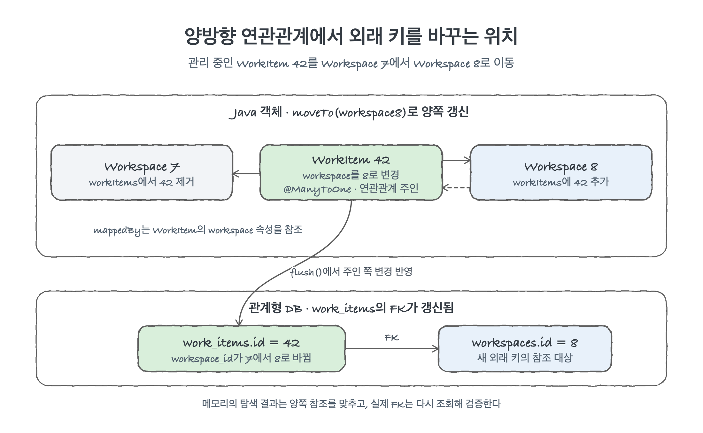

# JPA Association Mapping Fundamentals

작업은 워크스페이스 한 곳에 속할 수 있고, 워크스페이스는 여러 작업을 가질 수 있다. DB에는 `work_items.workspace_id` 외래 키 하나가 있고, 자바에서는 `WorkItem.workspace`와 `Workspace.workItems` 두 방향으로 탐색할 수 있다.

## 1. 외래 키를 관리하는 방향

먼저 [WorkItem 매핑](03_jpa_entity_mapping_and_identifier_strategies.md)에 다음 속성을 추가한다.

```java
@ManyToOne(fetch = FetchType.LAZY)
@JoinColumn(name = "workspace_id")
private Workspace workspace;
```

`WorkItem.workspace`가 연관관계의 주인이다. 관리 상태에서 이 참조를 바꾸면 플러시에서 외래 키 변경이 반영된다. 작업에서 워크스페이스로만 접근하면 이 단방향 매핑으로 충분하다.

## 2. 양방향 매핑과 mappedBy

워크스페이스에서도 작업 목록을 탐색한다면 [Workspace](01_getting_started_with_jpa.md)에 반대 방향을 추가한다.

```java
@OneToMany(mappedBy = "workspace")
private List<WorkItem> workItems = new ArrayList<>();

void link(WorkItem workItem) {
    workItems.add(workItem);
}

void unlink(WorkItem workItem) {
    workItems.remove(workItem);
}
```

`mappedBy`에는 외래 키 컬럼명이 아니라 상대 엔티티의 **자바 속성명**인 `workspace`를 넣는다. 컬렉션은 반대쪽 참조를 읽는 데 사용되며, 외래 키를 갱신하려면 작업의 참조도 바꿔야 한다. [Jakarta Persistence 3.1 · 연관관계 주인과 mappedBy](https://jakarta.ee/specifications/persistence/3.1/jakarta-persistence-spec-3.1#a516)



그림의 근거 · [연관관계 주인](https://jakarta.ee/specifications/persistence/3.1/jakarta-persistence-spec-3.1#a516) · [DB 동기화](https://jakarta.ee/specifications/persistence/3.1/jakarta-persistence-spec-3.1#a1955)

## 3. 객체의 두 참조를 함께 바꾸기

`WorkItem`에 다음 메서드를 추가하면 작업을 옮길 때 두 객체의 탐색 결과가 일치한다.

```java
public void moveTo(Workspace destination) {
    if (workspace == destination) {
        return;
    }

    if (workspace != null) {
        workspace.unlink(this);
    }
    workspace = destination;

    if (destination != null) {
        destination.link(this);
    }
}
```

관리 중인 두 객체에서 `workItem.moveTo(destination)`을 호출하면 이전 컬렉션에서 빠지고 새 컬렉션에 추가된다. 이 예제의 외래 키는 null을 허용하므로 `moveTo(null)`로 소속을 해제할 수도 있다. 소속이 필수라면 도메인 메서드에서 null을 거부하고 `optional = false`와 DB의 `NOT NULL` 제약을 맞춘다.

매핑을 확인할 때는 `flush()` 후 `clear()`하고 DB에서 작업과 워크스페이스를 다시 조회한다. 메모리의 두 참조가 일치하는지와 실제 외래 키가 변경됐는지를 각각 검증한다. [Jakarta Persistence 3.1 · 연관관계와 DB 동기화](https://jakarta.ee/specifications/persistence/3.1/jakarta-persistence-spec-3.1#a1955)
