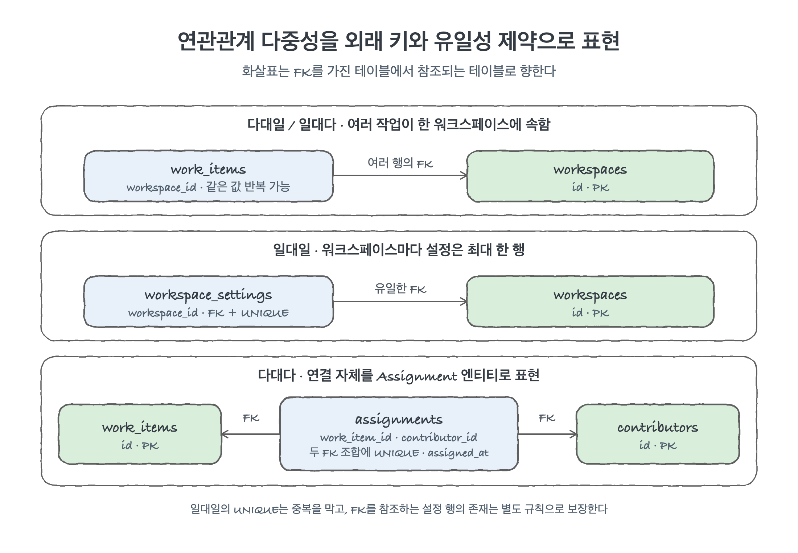

# JPA Association Cardinalities

연관관계를 선택할 때는 다중성, 탐색 방향, 외래 키를 관리할 엔티티를 확인한다. 같은 일대다 관계도 FK를 누가 보유하는지와 양방향 탐색이 필요한지에 따라 코드가 달라진다.



그림의 근거 · [연관관계 매핑 기본값](https://jakarta.ee/specifications/persistence/3.1/jakarta-persistence-spec-3.1#a538) · [외래 키 매핑과 유일성 제약](https://jakarta.ee/specifications/persistence/3.1/jakarta-persistence-spec-3.1#a16444)

## 1. 다대일과 일대다

| 매핑 | 테이블 구조 | 구현 시 확인할 점 |
| --- | --- | --- |
| `@ManyToOne` 단방향 | 다 쪽 테이블이 FK 보유 | 예를 들어 작업이 워크스페이스를 참조한다. |
| `@ManyToOne`과 `@OneToMany` 양방향 | 다 쪽 테이블이 FK 보유 | 다 쪽 속성으로 FK를 관리하고, 일 쪽은 `mappedBy`로 연결한다. |
| `@OneToMany` 단방향 | 기본적으로 조인 테이블을 사용 | `@JoinColumn`을 지정해 다 쪽 테이블의 FK를 사용할 수도 있다. |

일대다 단방향에서 FK를 지정하면 일 쪽 객체를 수정하는 코드가 다 쪽 테이블의 FK를 갱신한다. 구현체와 저장 순서에 따라 별도 `UPDATE`가 발생할 수 있다. 작업에서 워크스페이스를 탐색하는 흐름이 있다면 [다대일과 양방향 매핑](04_jpa_association_mapping_fundamentals.md)으로 FK 변경 지점을 명확히 둘 수 있다. [Jakarta Persistence 3.1 · 연관관계 매핑 기본값](https://jakarta.ee/specifications/persistence/3.1/jakarta-persistence-spec-3.1#a538)

## 2. 일대일과 유일성 제약

예를 들어 워크스페이스에 설정 행이 최대 하나라면 `workspace_settings.workspace_id`에 FK와 `UNIQUE`를 둔다. 설정을 저장할 때 워크스페이스가 반드시 존재해야 한다면 `NOT NULL`을 추가한다.

```java
// WorkspaceSettings
@OneToOne(fetch = FetchType.LAZY, optional = false)
@JoinColumn(name = "workspace_id", nullable = false, unique = true)
private Workspace workspace;
```

반대 방향이 필요하면 워크스페이스의 `settings` 속성에 `@OneToOne(mappedBy = "workspace", fetch = FetchType.LAZY)`을 둔다. FK가 있는 속성이 주인이 된다. FK와 `UNIQUE`는 한 워크스페이스에 설정 행이 두 개 생기는 것을 막는다. 모든 워크스페이스에 설정 행이 존재해야 하는지 여부는 별도의 생성 규칙으로 다룬다. 반대쪽 일대일의 지연 로딩은 구현체가 대상의 존재를 확인하는 방식에 영향을 받는다. [Jakarta Persistence 3.1 · 연관관계 소유와 다중성](https://jakarta.ee/specifications/persistence/3.1/jakarta-persistence-spec-3.1#a516)

## 3. 다대다를 연결 엔티티로 모델링

`@ManyToMany`는 두 엔티티를 조인 테이블로 연결한다. 연결에 `assignedAt`, 역할, 상태가 생긴다면 조인 테이블을 `Assignment` 같은 엔티티로 모델링한다. 연결 엔티티에서 양쪽으로 각각 다대일을 두면 관계 자체를 조회하고 변경할 수 있다.

```java
@Entity
@Table(name = "assignments", uniqueConstraints = @UniqueConstraint(
    name = "uk_assignment_item_contributor",
    columnNames = {"work_item_id", "contributor_id"}
))
public class Assignment {
    @Id
    @GeneratedValue
    private Long id;

    @ManyToOne(fetch = FetchType.LAZY, optional = false)
    @JoinColumn(name = "work_item_id", nullable = false)
    private WorkItem workItem;

    @ManyToOne(fetch = FetchType.LAZY, optional = false)
    @JoinColumn(name = "contributor_id", nullable = false)
    private Contributor contributor;

    @Column(nullable = false)
    private LocalDateTime assignedAt;

    protected Assignment() {}
}
```

위 복합 유일성 제약은 같은 작업과 기여자를 한 번만 연결한다는 규칙을 DB에서 보장한다. `@JoinColumn`의 `name`은 FK 컬럼, `referencedColumnName`은 대상 컬럼을 지정한다. 후자를 생략한 일반적인 단일 FK는 대상의 기본 키를 참조한다. [Jakarta Persistence 3.1 · 매핑 메타데이터와 스키마 생성](https://jakarta.ee/specifications/persistence/3.1/jakarta-persistence-spec-3.1#a16444)
